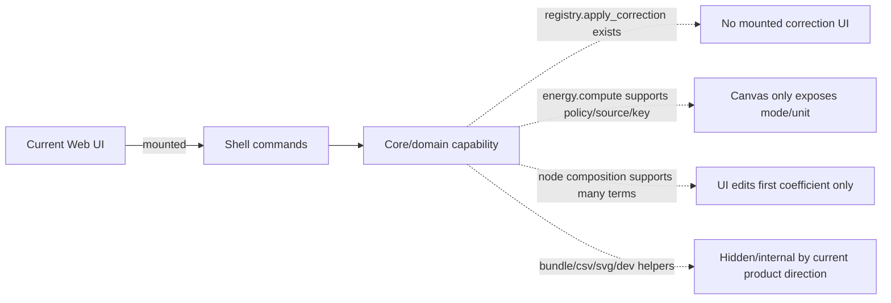

> 2026-06-12 更新：本文件是重构前的能力不匹配审计，作为历史证据保留。当前项目规则已收敛为“原 UI 没承载或用户未认可的功能，不进入 active UI/code，只放 roadmap”。旧 Shell/Core 能力存在不再构成恢复 UI 的理由；当前 active 现状以 `.codestable/architecture/ARCHITECTURE.md`、`.codestable/architecture/web-workbench.md` 和 `rxnflow-desktop-canvas-rebuild` roadmap 为准。

## 问题与范围

审查当前 UI 界面和底层能力之间有没有不匹配，重点看“底层已经实现，但当前用户界面没有入口或入口不完整”的能力。范围限定在 Web Workbench 当前主界面、Shell command boundary、fixture transport 和已记录的 CodeStable 架构现状。

## 速答

有不匹配，但分成两类：

1. 真实缺口：对象校正项、校正策略、完整能量剖面配置这条链路底层可用，但新版主 UI 没有可用入口；如果后续还保留 corrected energy / manual correction / resonance correction 这类能力，需要重新设计成当前画布式 UI 的轻量入口。
2. 局部暴露：节点 composition 底层支持多 term、role、label、metadata，但当前 UI 只暴露第一个 term 的 coefficient chip。这符合“不要大表达式面板”的最新方向，但如果要正确处理释放/加入物种、多路径和化学计量，后续需要路径级或节点级的更清晰 affordance。
3. 刻意隐藏：项目包导入导出、CSV/SVG 导出、fixture/snapshot/dev command 都是底层或测试能力，当前不在主 UI 展示基本符合近期产品决策；这类不应贸然补 UI，更适合标记为 internal helper 或后续清理。

## 关键证据

1. Shell command boundary 暴露了 `registry.apply_correction`、`workspace.set_node_composition`、`energy.compute`、`project.export_bundle`、`project.import_bundle`、`export.profile` 等能力，说明底层入口并不只有当前 UI 展示的画布操作：`web/src/shell/types.ts:10-34`。
2. `WorkbenchShell` 仍有 `energyPanelOptions`，包含 `energyKey`、`energySource`、`baselineNodeId`、`correctionPolicyMode`、`correctionKinds`、`correctionIds`，但当前 `InspectorPanel` 只在 `ReportExportPanel` 和 `SourceInspectorPanel` 间切换，没有挂载 `EnergyProfilePanel` 或 `ObjectRegistryPanel`：`web/src/app/WorkbenchShell.tsx:241-249`、`web/src/app/WorkbenchShell.tsx:5861-5930`。
3. `applyCorrection` 会调用 `registry.apply_correction` 并用返回的 object summary 替换当前对象，`ObjectRegistryPanel` 也有 manual/solvation/resonance 校正表单；但 `rg` 当前只找到类型 import，没有主 UI 渲染该面板：`web/src/app/WorkbenchShell.tsx:2470-2505`、`web/src/app/ObjectRegistryPanel.tsx:247-335`。
4. `EnergyProfilePanel` 仍实现 correction policy 控件，可选 none/all/kinds/ids；`runEnergyCompute` 也会把 `include_corrections`、`energy_key`、`energy_source`、`correction_policy` 发给 `energy.compute`。当前画布顶栏只暴露 electronic/free/solvation 和 unit，配置能力明显缩窄：`web/src/app/EnergyProfilePanel.tsx:256-301`、`web/src/app/WorkbenchShell.tsx:3230-3251`、`web/src/app/GraphCanvas.tsx:1152-1186`。
5. fixture transport 的 `workspace.set_node_composition` 接收完整 composition array；parser 会保留 `coefficient`、`role`、`label`、`metadata`。当前节点 UI 只读取 primary coefficient，应用时只改 index 0：`web/src/shell/fixtureTransport.ts:600-626`、`web/src/shell/fixtureTransport.ts:3364-3389`、`web/src/app/GraphCanvas.tsx:2833-2841`、`web/src/app/WorkbenchShell.tsx:2754-2798`。
6. Export capability table 标记 PNG/CDXML/XLSX/CSV/SVG 均 supported，但 `reportExportFormats()` 只返回 `webDefaultEnabled` 的格式，当前报告面板只展示 PNG/CDXML/XLSX。CSV/SVG 是底层支持但故意隐藏的能力：`web/src/app/exportFormatCapabilities.ts:19-79`、`web/src/app/exportFormatCapabilities.ts:135-139`、`web/src/app/ReportExportPanel.tsx:31-59`。
7. CodeStable 架构文档已经记录 `.rxnflow.zip` bundle helper 不挂到 Project Sidebar 主流程，作为内部测试和后备迁移工具；这和当前 UI 不展示项目包导入/导出一致：`.codestable/architecture/web-workbench.md:44-45`、`.codestable/architecture/ARCHITECTURE.md:273-275`。

## 细节展开

校正链路是最明显的真缺口。现在底层能把 correction 附到 object 上，能量计算也能按 policy 选择 correction 是否进入 profile；但是当前新版 UI 没有对象详情/校正入口，用户无法从界面创建这些 correction。结果是 corrected energy 能力会变成“只能被测试或旧组件使用”的半死状态。

能量剖面配置也有类似问题。新版画布把控制压缩成能量模式和单位，这是对高频操作友好的；但底层的 energy source/key、baseline、correction policy 仍存在。如果这些能力不是近期要删掉，就需要把它们转译成更贴近当前产品的入口，例如节点更多菜单、路径标签页设置或导出前高级选项，而不是恢复旧的大面板。

composition 是“当前 UI 有入口但不完整”。用户最新方向是不需要手动表达式大面板，只要节点上能改化学计量数；这解释了只暴露 `×1` chip 的设计。但底层支持的是多 term composition，后续相对能量计算要处理释放/加入物种、多路径、多 0 点时，只改第一个 term 可能不足。

项目 bundle 和 CSV/SVG 导出不是当前优先补 UI 的缺口。用户之前已经明确项目包导入/导出不应是主流程，CSV/SVG 也被质疑过必要性；现状更像“底层可测/可迁移，UI 暂不暴露”。后续选择是继续作为 internal helper 保留，或按“不考虑兼容性”的项目规则删除旧能力，避免维护负担。

## 未决问题

- corrected energy / manual correction / resonance correction 是否仍是正式产品能力，还是先从底层与 UI 都删掉，等需求明确后重做？
- 多路径相对能量的化学计量表达应该由节点 coefficient chip、路径级设置、还是自动从 graph topology 推导？
- CSV/SVG/project bundle helper 是否继续作为 internal/testing helper 保留，还是进入清理清单？

## 后续建议

下一步建议把“校正项/校正策略入口”和“多 term composition 的 UI 表达”拆成一个小 feature design；同时把确定不暴露的 bundle、CSV/SVG、旧面板能力列成清理候选。

## 相关文档

- `.codestable/architecture/web-workbench.md`
- `.codestable/architecture/ARCHITECTURE.md`
- `web/src/app/WorkbenchShell.tsx`
- `web/src/app/GraphCanvas.tsx`
- `web/src/app/ObjectRegistryPanel.tsx`
- `web/src/app/EnergyProfilePanel.tsx`
- `web/src/app/exportFormatCapabilities.ts`
- `web/src/shell/types.ts`
