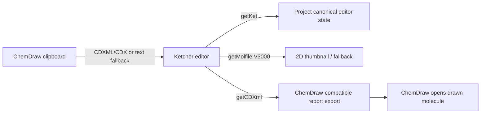

# Explore: ChemDraw structure editor interop

## 速答

当前 OpenChemLib CanvasEditor 不能满足 ChemDraw 互通闭环：它的 paste 只从 clipboard text 走 `Molecule.fromText()`，当前 RxnFlow 也只保存 manual molfile，导出的 CDXML 仍是能量图文字/线/箭头，不包含 molecule-level atom/bond CDXML。

Ketcher 3.15 的公开包比截图里的说法更新：`ketcher-core` 暴露 `getCDXml()` / `getCDX()`，格式表含 CDXML/CDX，`ketcher-standalone` 内置 Indigo WASM 转换，license 是 Apache-2.0。它是当前“不买 ChemDraw JS/MarvinJS 授权”的最佳候选。

## 关键证据

1. OpenChemLib 依赖和许可：`web/node_modules/openchemlib/dist/openchemlib.d.ts:3937` 定义 CanvasEditor options，当前 API 是本地 canvas editor；`npm view openchemlib@9.23.0` 返回 license `BSD-3-Clause`，description `Manipulate molecules`。
2. OpenChemLib paste 边界：`web/node_modules/openchemlib/dist/openchemlib.js:1` 的 clipboard handler 写入 OCL idCode/coordinantes；`web/node_modules/openchemlib/dist/openchemlib.js:3` 的 paste listener 只读 `event.clipboardData.getData("text")` 并调用 `Molecule.fromText()`，没有 CDX/CDXML 解析路径。
3. RxnFlow 当前 manual 结构状态：`web/src/domain/projectPackages.ts:49` 只有 `manualStructureMolfile?: string`，`web/src/app/Molecule2DEditorDialog.tsx:75` 保存的是 `editor.getMolecule().toMolfile()`。
4. RxnFlow 当前 CDXML writer 边界：`web/src/domain/reportExports.ts:206` 生成 `<CDXML>`，但 `web/src/domain/reportExports.ts:217-224` 只拼 title、state lines、arrows、text，不输出 molecule atom/bond CDXML；`web/src/domain/reportExports.test.ts:77-86` 也只断言文字和 arrow。
5. Ketcher 3.15 license / package：`npm view ketcher-core@3.15.0` 和 `npm view ketcher-react@3.15.0` 返回 license `Apache-2.0`，description `Web-based molecule sketcher`；Ketcher README 声明可作为 React component library 集成，并支持 copy/paste between different chemical editors。
6. Ketcher CDXML/CDX API：临时解包 `/tmp/rxnflow-editor-research/ketcher-core-3.15.0/package/dist/application/ketcher.d.ts:49-55` 暴露 `getCDXml()`、`getCDX()`、`setMolecule()`；`/tmp/rxnflow-editor-research/ketcher-core-3.15.0/package/dist/index.modern.js:8512-8514` 的 supported format 表包含 CDXML、Base64 CDX、binary CDX。
7. Ketcher standalone 转换能力：`/tmp/rxnflow-editor-research/ketcher-standalone-3.15.0/package/dist/infrastructure/services/struct/indigoWorker.types.d.ts:59-60` 列出 CDX/CDXML；`standaloneStructService.d.ts:29` 暴露 `convert()`；包内含 Indigo WASM（约 5–9MB），说明可离线转换但需 lazy-load 控制体积。

## 初步方案边界

- 编辑器：把当前 `Molecule2DEditorDialog` 从 OpenChemLib CanvasEditor 替换为 Ketcher React editor；OpenChemLib 可继续保留做轻量 2D thumbnail，直到 Ketcher SVG/preview 接管。
- 持久化：节点新增 `manualStructureKet`、`manualStructureMolfile`、`manualStructureCdxml`；KET 做 editor canonical，molfile 做 fallback/preview，CDXML 做 ChemDraw export canonical。
- 粘贴：优先用 Ketcher 内置 clipboard；如果 ChemDraw native clipboard 在 Electron renderer 不暴露为 web MIME，再加 preload/main IPC 读取 `clipboard.availableFormats()` / `readBuffer()`，转成 CDXML/CDX/text 后交给 Ketcher `setMolecule()`。
- 导出：不要手写 molecule-level CDXML；优先复用 Ketcher/Indigo 生成的 node-level CDXML，并在 `buildCdxmlReport` 做 id remap + 坐标平移嵌入当前能量图。
- 暂不做：2D/3D 原子联动、完整 ChemDraw JS 付费方案、CDX binary 作为默认导出格式。

## 风险/待验证

- ChemDraw 在 macOS/Windows 写入剪贴板的 native format 需要真机验证；Ketcher 的 Web Clipboard API 可能只能读到标准 web MIME 或 text/plain。
- Ketcher + Indigo WASM 体积明显大于 OpenChemLib，必须 lazy-load 到编辑弹窗/导出转换路径，不能进首屏主 bundle。
- 把多个 Ketcher 生成的 CDXML molecule fragment 嵌入一份 RxnFlow report 需要 id 去重、坐标平移和 ChemDraw 打开回归。
