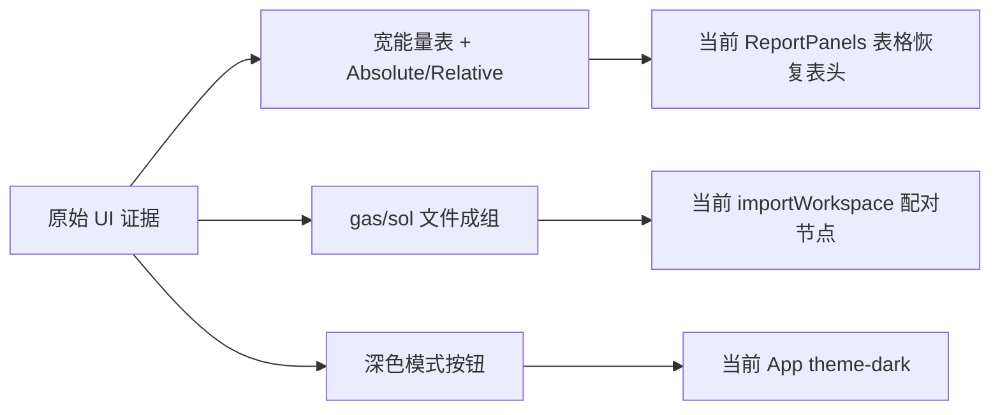

# 原始 UI parity 审查

## 速答

原始 UI 明确承载了三项当前重构版缺口：能量表是包含 Absolute/Relative 模式和 23 列的宽表；同一结构的 gas/solution log 在项目文件侧作为一个结构行拖拽；窗口顶栏有深色模式切换。当前修复已把这三项落地到重构版：导入计划会把可自动注册的 gas/solution 单候选 log 合并成一个节点，表格恢复原始表头和 Absolute/Relative 切换，顶栏增加 light/dark 切换并覆盖主要软 UI 面板。

另外发现但未直接补齐的差异：原始画布能量模式有 `Egas / Ggas / Gsol`，当前工具条仍只有 `Egas / Gsol`；原始有中英文语言切换，当前桌面重构版是英文 UI；原始表格里 Ggas、1M、shermo、entropy/basis 等列有更完整的领域数据来源，当前数据模型还没有这些字段，所以只恢复了表头和现有 Egas/Gsol 填值，缺失列显示 `-`。

## 关键证据

1. 原始 `WorkbenchEnergyTable` 持有 `tableMode: "absolute" | "relative"`，并在表头渲染 Absolute/Relative 按钮：`/tmp/rxnflow-original-ui-audit/rxnflow/web/src/app/WorkbenchShell.tsx:3659-3685`。
2. 原始能量表头包括 `Structure`、`Charge / Multiplicity`、`Egas × 627.5095`、`Ggas+1M`、`Esol`、`Gsol` 等 23 列：`/tmp/rxnflow-original-ui-audit/rxnflow/web/src/app/WorkbenchShell.tsx:4892-4930`。
3. 原始侧栏测试要求 `Bfix6-ts.log` 与 `Bfix6-ts-sol.log` 显示成一个 `Bfix6-ts` 结构行，并拖拽 payload 同时包含 gas/sol 两个文件：`/tmp/rxnflow-original-ui-audit/rxnflow/web/src/app/ProjectSidebar.test.tsx:350-383`。
4. 原始 i18n 消息里有 `theme.switchToDark`，且原始浏览器验证能看到顶栏深色模式按钮：`/tmp/rxnflow-original-ui-audit/rxnflow/web/src/app/i18n/messages.ts:475`。
5. 当前修复后 `buildImportPlan()` 先按 `sourceFileDisplayGroupKey()` 分组，再对 gas+solution 单候选组跳过桌面双注册、生成一个合并 fallback node：`web/src/app/importWorkspace.ts:87-158`。
6. 当前修复后合并节点以 gas 文件为 primary，`energyGas` 来自 gas log，`energySolution` 优先取 solution log 的 free-energy/SCF 能量：`web/src/app/importWorkspace.ts:161-207`。
7. 当前修复后 `EnergyTableView` 增加 Absolute/Relative 模式和原始长表头；当前缺字段用 `-` 占位，已有 Egas/Gsol 使用现有节点能量：`web/src/app/ReportPanels.tsx:112-280`。
8. 当前修复后 `App` 增加持久化 theme 状态、根节点 `theme-light/theme-dark` class、窗口顶栏切换按钮：`web/src/app/App.tsx:180-185`, `web/src/app/App.tsx:224-226`, `web/src/app/App.tsx:381-385`, `web/src/app/App.tsx:914-936`；主要暗色样式在 `web/src/app/workbench.css:2733-2840`。

## 已验证

- `cd web && npx tsc -b --pretty false`
- `cd web && npm run test`：28 files / 220 tests passed
- `cd web && npm run build`
- `cd web && npm run desktop:smoke`
- `cd web && npm run desktop:runtime:smoke`
- Playwright 浏览器 smoke：`http://127.0.0.1:5173/`，验证长表头、dark mode class、导入 `Bfix6-ts.log + Bfix6-ts-sol.log` 后只有一个 `Node Bfix6-ts`，截图：`output/playwright/ui-parity-smoke.png`

## 待用户确认的 parity 差异

1. 是否恢复原始画布能量模式的第三档 `Ggas`（当前只有 `Egas / Gsol`）。
2. 是否恢复原始的语言切换（zh/en）与中文文案。
3. 是否继续把原始表格中的 Ggas、Ggas+1M、shermo、熵、basis functions 等字段补成真实领域数据，而不是当前的 `-` 占位。
