## 问题与范围

用户反馈：RxnFlow 启动后内存可到 3GB，按钮 hover / 高亮 / 标题栏交互卡顿，怀疑代码里有“原生已有但自建了一套更差”的实现。本次只做证据化探索，不改代码。

## 速答

核心结论：**3GB 内存的主因不是 3Dmol 振动动画本身，而是项目持久化/IPC/React state 把结构化振动 payload 以巨大 JSON 形式完整装进 renderer，并在 autosave dirty check 中反复 `JSON.stringify`。** 你的 active Ir 项目只有 16 个 source、7 个 canvas node，但 `.rxnflow/project.json` 已经 216.9MB；去掉 `vibrationModes` 后 compact project 只剩约 1.2MB。

第二层结论：**UI hover/按钮卡顿来自三类自建/过度定制：**

1. Vite lazy chunk 被 `modulepreload` 打穿：Ketcher 24MB vendor chunk 虽然 React.lazy，但生产 `index.html` 启动就 preload。
2. Electron titlebar hit-test 被多轮 CSS/fixed layer/drag-no-drag 补丁堆复杂；Electron 官方文档明确 draggable region 会忽略 pointer events，当前代码正踩在这个机制上。
3. tooltip/hover/视觉层存在全局 MutationObserver、62 处 backdrop-filter、296 处 box-shadow、接近 1.4 万行 CSS 和大量 `!important` 叠补，导致 repaint/hit-test 成本高。

```mermaid
flowchart LR
  A["16 个 log source"] --> B["engine full-file parse"]
  B --> C["SourceFile.parse 含 atoms + vibrationModes"]
  C --> D["parse.coordinatePreview 与 candidate.coordinatePreview 重复"]
  D --> E["pretty project.json 216.9MB"]
  E --> F["Electron main 读 content"]
  F --> G["IPC 传给 renderer"]
  G --> H["React parse + state"]
  H --> I["autosave JSON.stringify dirty key + save content"]
  I --> J["RSS/GC 暴涨，交互卡顿"]
```

## 关键证据

1. `/Users/linsay/Documents/chemistry/Ir/.rxnflow/project.json` 实测 216.9MB；其中 16 个 files、7 个 nodes，compact 后 57.4MB；去掉全部 `vibrationModes` 后只剩 1.2MB；去掉整个 `file.parse` 后 0.94MB。这个量级足以解释启动 3GB RSS。
2. Node 只读实验：读取这个 project JSON 后 RSS 47MB → 738MB；JSON.parse 后 924MB；compact stringify 后 1066MB；pretty stringify 后 1283MB。Electron main + renderer + IPC + autosave 同时存在时，3GB 是合理后果。
3. `/Users/linsay/Desktop/code/rxnflow/web/src/domain/sourceParsers.ts:161-184` 把 Gaussian candidate 的 `coordinatePreview` 放进 candidate；同文件 `sourceResultFromCandidates()` 又在 `:368-370` 把 primary candidate 的 `coordinatePreview` 复制到 parse 顶层，导致同一 atoms/vibrationModes 至少双份持久化。
4. `/Users/linsay/Desktop/code/rxnflow/web/src/app/projectPackageWorkflow.ts:78-91` 用 `JSON.stringify(projectPackage, null, 2)` 保存整个项目；`/Users/linsay/Desktop/code/rxnflow/web/electron/project-store.cjs:71-78` 再 pretty write；pretty/compact 比例实测约 3.78 倍。
5. `/Users/linsay/Desktop/code/rxnflow/web/src/app/App.tsx:1854-1904` autosave dirty check 调用 `projectAutosaveKey(input)`；`/Users/linsay/Desktop/code/rxnflow/web/src/app/App.tsx:2587-2594` 的 key 是对 `{project, files, canvases, activeCanvasId}` 整包 `JSON.stringify`，会把所有 parse/vibration/image dataURL 都扫一遍。
6. `/Users/linsay/Desktop/code/rxnflow/web/electron/main.cjs:143-163` startup restore 读取 recent project 的完整 `content` 并塞进 IPC payload；`/Users/linsay/Desktop/code/rxnflow/web/electron/main.cjs:810-821` 再把 payloads 通过 `get-startup-project-content` 返回 renderer。大项目会在 main、IPC、renderer 间多份复制。
7. `/Users/linsay/Desktop/code/rxnflow/web/dist/index.html` 当前含 `<link rel="modulepreload" ... ketcher-vendor...js>` 和 Ketcher CSS；`web/dist/assets/ketcher-vendor-*.js` 实测 24MB。Vite 文档 `build.modulePreload` 提供 `resolveDependencies`，可避免不该启动预加载的 lazy chunk。
8. Electron 官方 Custom Window Interactions 文档说明 draggable areas ignore pointer events，需用 `app-region: no-drag` 排除交互区。当前 `/Users/linsay/Desktop/code/rxnflow/web/src/app/workbench.css` 中 `-webkit-app-region` 规则反复覆盖，且 issue note `/Users/linsay/Desktop/code/rxnflow/.codestable/issues/2026-06-27-titlebar-actions-dead-after-sidebar-toggle/titlebar-actions-dead-after-sidebar-toggle-fix-note.md:57-66` 已记录过“底层 drag slab 会吞掉按钮 hover/click”。
9. `/Users/linsay/Desktop/code/rxnflow/web/src/app/App.tsx:1920-1930` 在 document.body 上挂全局 `MutationObserver`，任意按钮/菜单 title/aria-label 变化都会触发 `syncNativeControlTooltips()`；`/Users/linsay/Desktop/code/rxnflow/web/src/app/App.tsx:2778-2791` 每次全局 query 所有 button/role=button/menuitem 来补 title。这是可被原生 `title` 或组件化 Button 替代的运行时 DOM 扫描。
10. `/Users/linsay/Desktop/code/rxnflow/web/src/app/workbench.css` 统计显示 `backdrop-filter` 62 处、`box-shadow` 296 处、`filter:` 63 处、`blur()` 50 处；这些 hover/floating/titlebar 层叠效果会增加 repaint/compositing 成本，尤其在 Electron 透明/hidden titlebar 场景。

## 细节展开

### 1. 最大问题是数据模型，而不是某一个动画

Ir 项目实测：source 文件总计 89MB，project metadata 目录 225MB，其中 `.rxnflow/project.json` 单文件 216.9MB。项目状态中 `preview` 总字符约 0.95MB，`parse` compact JSON 约 57MB，真正放大者是振动模式。每个 mode 都有每个 atom 的 dx/dy/dz displacement；196-219 atom 的大 Gaussian log 每个有 579-651 modes。当前 schema 把这些 modes 放在 `parse.coordinatePreview.vibrationModes` 和 primary candidate `coordinatePreview.vibrationModes` 两处。

这不是应该存在于 React 常驻 state / autosave dirty key / titlebar交互同一 renderer heap 的数据。更合理的边界是：项目主 JSON 只存 source 索引、node 摘要、坐标摘要、可用 mode metadata；完整 displacement payload 放 source sidecar 或按 source id 懒加载，打开 3D structure 或点击振动时再读。

### 2. autosave dirty check 是自建重 diff

`projectAutosaveKey()` 用整包 stringify 判断是否变更。它没有利用 React state 更新时天然知道 dirty scope，也没有 hash/版本号字段。大项目中一次 stringify 就能产生 57-217MB 临时字符串；autosave 成功后 `sourceFilesWithAutosavedMetadata()` 还会 parse saved content 再比较 `JSON.stringify(nextFile) !== JSON.stringify(file)`，继续制造临时字符串。

标准/轻量做法：维护 `projectRevision` / per-slice dirty bit；拖拽中只更新 viewport/node positions 的 dirty scope；autosave 时序列化变更切片；大 parse payload 不参与 dirty key。

### 3. Vite lazy chunk 实际被预加载

代码里 Ketcher host 已经用了 `React.lazy()`，但 build output 的 `index.html` 仍 modulepreload 了 `ketcher-vendor`。这意味着启动会拉 24MB JS 和 176KB CSS，即便用户没打开 2D editor。Vite 文档允许配置 `build.modulePreload.resolveDependencies`；可对 Ketcher lazy chunk 返回空依赖或关闭 polyfill/preload，让它真正在打开 2D editor 时加载。

### 4. Electron titlebar 应回到单一原生 hit-test 合约

当前 JSX 有 `.desktop-titlebar-shell`，CSS 中还有多段过期或相互覆盖的 `.right-titlebar-drag-bridge` / `.desktop-titlebar-drag-surface` 规则。最终段试图把 `.desktop-titlebar-shell` 作为 draggable parent，再让按钮 no-drag；这是符合 Electron 文档方向的，但文件里仍保留大量旧规则和 `!important`，任何后续 UI 改动都可能重新制造底层 drag slab。

建议把 titlebar 独立成一个组件和一小段 CSS：单一 fixed titlebar shell = drag；按钮、tabs、inputs = no-drag；禁止 project rail / inspector / placeholder / overlay 参与 app-region；删掉旧补丁段。

### 5. tooltip 与 hover 不需要全局 DOM observer

当前全局 MutationObserver 是为了自动把 aria-label 同步成 title。这个需求可以在组件层解决：`IconButton` / `MenuButton` 统一要求 `label`，渲染 `aria-label` + `title`。Ketcher 内部按钮如果确实需要 tooltip，也应在 Ketcher dialog mounted 后对 host 范围做一次有限 decorate，而不是全局 body 监听。

### 6. CSS 视觉层过重

工作台 CSS 已经接近 1.4 万行，后半段大量日期补丁和 `!important`。hover 卡顿不一定来自 React，而可能来自每次 hover 触发多层 blur / shadow / radial-gradient repaint。Chrome/Codex 风格更接近“单层 surface + state layer”，不需要多层 backdrop-filter。应把 titlebar、tabs、rail、toolbar、popover 的 token 收敛成少数变量和单层 hover background。

## 未决问题

- 是否允许做破坏性 project schema 变更：当前 AGENTS 允许未上线项目以最新需求为准；但已有 Ir 项目需要提供一次 migration/repair，把 216MB project JSON 瘦身。
- vibration displacement sidecar 放在哪里：可以放 `.rxnflow/source-cache/{fileId}.vibrations.json` 或直接按需从 `sources/*.log` 解析并缓存。
- Ketcher 是否要保留为内置 2D editor：保留没问题，但必须真正 lazy-load，不应启动 preload。
- titlebar 是否转用 Electron `titleBarOverlay`：macOS hidden titlebar + trafficLightPosition 仍可用；如果未来 Windows 也要统一，可评估 overlay/native controls API。

## 后续建议

下一步建议先做一个“performance-native-cleanup”修复包：先迁移/瘦身 project JSON 和 autosave dirty check，再处理 Vite Ketcher preload、全局 tooltip observer、titlebar CSS 收敛和高成本 blur/shadow 降级。

## 相关文档

- `/Users/linsay/Desktop/code/rxnflow/.codestable/architecture/ARCHITECTURE.md:25-30`
- `/Users/linsay/Desktop/code/rxnflow/.codestable/architecture/core-platform.md:31-38`
- `/Users/linsay/Desktop/code/rxnflow/.codestable/issues/2026-06-27-titlebar-actions-dead-after-sidebar-toggle/titlebar-actions-dead-after-sidebar-toggle-fix-note.md:57-118`
- Electron Custom Window Interactions: draggable regions ignore pointer events; interactive regions need no-drag.
- Vite `build.modulePreload`: supports `resolveDependencies` for preload dependency control.
