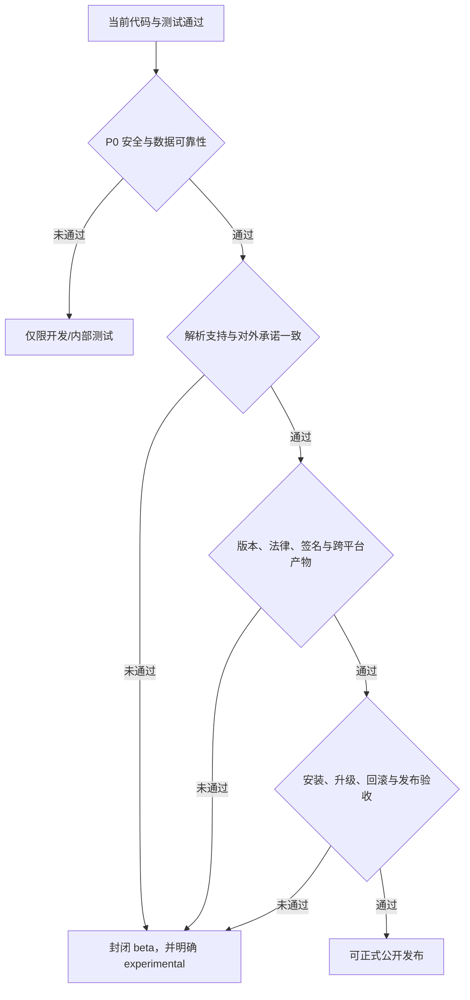

## 问题与范围

用户希望在正式发布 RxnFlow 前扫描整个项目，确认仍有哪些缺陷，以及必须完成哪些发布准备。本次是只读审计：检查当前代码、测试、构建、打包产物、CI、文档、依赖和 Git 发布状态，不修改业务代码。

本次结论适用于“正式公开发布”。审计发现的可由仓库内代码解决的问题已于 2026-07-10 按下方“修复复核”处理；外部凭据、发布渠道和真实解析样本仍是正式公开发布阻塞项。

## 2026-07-10 修复复核

已完成：

- 移除 persisted third-party SVG 与 HTML 注入路径；KET/Molfile/CDXML 作为 canonical 数据并生成受控 depiction。
- 恢复 text/image annotation 保存、导出和重开 round-trip，并限制图片大小与外部 URL。
- 桌面/Python engine 统一为 `0.1.0`，artifact lookup 从 package version 派生。
- 增加 CSP、导航/新窗口 guard、生产菜单限制和 macOS 权限/ATS 收紧。
- Python engine 使用带 hash lockfile；CI 增加 Python 与 npm dependency audit。
- renderer-only dependencies 不再进入 production ASAR；macOS app 从约 655 MB 降到约 383 MB。
- source/project/image/ZIP 增加资源上限；浏览器大文件使用 head/tail sampling；ZIP 流式导出。
- `.rxnflow.zip` 已支持受限、安全的重新导入，并完成 desktop round-trip smoke。
- 新增 README、LICENSE、PRIVACY、SECURITY、CHANGELOG、支持格式说明、第三方依赖 inventory、SHA-256 与 release manifest。
- Help 菜单改为本地 About，不再打开无效的通用 GitHub 页面。

仍需外部完成：

- 配置 Git remote、release tag、artifact 发布目的地与撤回流程。
- 提供 Apple Developer ID credentials，完成签名、公证、staple 和 Gatekeeper 开启环境验证。
- 在 Windows CI/机器生成并验证当前 `0.1.0` installer/portable；仓库中的旧 Windows artifact 不得发布。
- 配置受监控的私有安全报告渠道。
- 提供经授权、脱敏的真实 Gaussian/ORCA/MAPLE fixtures，冻结公开支持版本矩阵。
- 对 proprietary license、privacy 和 third-party notice 做最终法律审阅。

## 速答

**当前不适合正式公开发布；修复安全与数据可靠性阻断项后，可以先做封闭 beta。**

基础工程状态并不差：Python 28 个测试、Web 366 个测试、Vite build、Electron shell smoke、release configuration smoke、macOS unpacked pack 和 packaged runtime smoke 均通过；生产 npm 依赖审计也没有已知漏洞。

真正阻断正式发布的是：

1. 项目内保存的 2D SVG 可触发持久化脚本执行；
2. 画布文本/图片注释保存时会被清空，存在确定的数据丢失；
3. 产品与安装包仍是 `0.0.0`，没有可追踪的发布版本、tag、remote 和发布渠道；
4. macOS 产物未签名/未公证，Windows 产物不是当前代码对应的已验证构建；
5. 对 Gaussian / ORCA / MAPLE 的真实输出与版本支持证据不足；
6. 对外发布需要的许可证、第三方声明、变更记录、安全与隐私说明缺失；
7. `.rxnflow.zip` 被描述为分享/迁移包，但应用不能重新导入该压缩包；
8. bundled Python engine 不可复现，且大文件读取/项目归档存在明显内存放大风险。



## 已通过的基线

- `python3 -m unittest discover`：28 tests passed。
- `cd web && npm run test -- --run`：41 test files、366 tests passed。
- `cd web && npm run build`：通过；仍有 3Dmol direct `eval` 和大 chunk 警告。
- `cd web && npm run desktop:smoke`：通过。
- `cd web && npm run desktop:release:smoke`：通过，但明确警告现有 Windows unpacked app 的 bundled engine 过旧。
- `cd web && npm run desktop:pack`：成功刷新当前 macOS arm64 unpacked app。
- `cd web && npm run desktop:runtime:smoke`：packaged renderer、bundled Python engine 与 cclib 1.8.1 启动通过。
- `npm audit --omit=dev`：0 个生产依赖漏洞；完整开发依赖审计仍有 3 个 high findings。

这些结果证明当前代码能够构建和启动，但 smoke 不等于真实项目数据往返、安全输入、真实计算输出或可公开分发验证。

## P0：正式发布阻断项

### 1. 修复项目 SVG 持久化脚本注入

`Molecule2DDepiction` 把 `manualStructureSvg` 通过 `dangerouslySetInnerHTML` 注入页面；当前 `normalizeStoredSvg()` 只用正则删除 `<script>`，没有删除事件属性、`foreignObject`、外部资源、危险 URL 或其他 SVG 可执行表面。项目包解析又原样接受任意非空 `manualStructureSvg`。

Playwright 最小复现使用与当前逻辑相同的 `<svg ...>` 前缀归一化后插入：

```html
<svg xmlns="http://www.w3.org/2000/svg">
  <image href="invalid://rxnflow" onerror="window.__rxnflowSvgExecuted=true" />
</svg>
```

结果 `window.__rxnflowSvgExecuted === true`。因此打开构造过的项目文件可以在 renderer 页面执行脚本，并访问 `contextBridge` 暴露的 `window.rxnflowDesktop` API。

发布门槛：

- 优先不要把第三方 SVG 当作可信 HTML 存储；以 KET/Molfile/CDXML 为 canonical 数据并重新生成 depiction。
- 如必须存 SVG，使用成熟的 SVG allowlist sanitizer，禁止所有 `on*`、脚本、`foreignObject`、外链、`javascript:`、危险 data URL 和外部 CSS。
- 对项目导入和 Ketcher 返回值都执行同一 sanitizer，并增加恶意项目回归测试。
- Electron 增加严格 CSP、`will-navigate` 拦截、`setWindowOpenHandler` 和生产环境 DevTools 限制，作为纵深防御。

### 2. 修复画布注释保存后丢失

项目类型与 UI 支持 text/image annotations，App 也会把当前 annotations 放进 canvas snapshot；但 `normalizeProjectCanvas()` 无条件返回 `annotations: []`。该函数同时被项目构建和项目恢复调用，因此文本和图片注释在保存、自动保存、导出或重新打开时都会消失。`normalizeCanvasAnnotation()` 已存在但没有被使用。

发布门槛：

- 正确持久化并恢复文本/图片 annotations。
- 增加 schema 2 的 text/image annotation round-trip、autosave、startup restore 和 archive export 回归测试。
- 为图片设置单张/项目总大小上限；大图不要无限制内嵌 data URL。

### 3. 建立真实发布版本与发布源

当前 `web/package.json`、lockfile、macOS Info.plist 和 Windows artifact lookup 都是 `0.0.0`；engine 版本仍是 `rxnflow-smoke-engine-v1`。Windows installer smoke 还把 `RxnFlow Setup 0.0.0.exe` 写死。当前仓库没有 remote、tag，也没有 artifact publish/updater 配置。

发布门槛：

- 选择首发版本，例如 `0.1.0` public beta 或 `1.0.0` 正式版。
- 让 package、app、engine、安装包、About、日志和 smoke 从单一版本源派生。
- 配置 Git remote、受保护的 release tag、release notes、artifact upload、SHA-256 checksum 和撤回/重发流程。

### 4. 生成当前代码对应的可信 macOS/Windows 产物

当前 macOS unpacked app 是 ad-hoc/unsigned：`Identifier=Electron`、`TeamIdentifier=not set`，`codesign --verify --deep --strict` 失败。本机 `spctl` 的 accepted 结果来自 `override=security disabled`，不能作为 Gatekeeper 通过证据。

现有 Windows installer/portable 是 2026-06-14、win-unpacked 是 2026-06-15；release smoke 已警告其 bundled engine 早于当前配置。

发布门槛：

- macOS 使用 Developer ID Application 签名 DMG/ZIP，notarize、staple，并在正常启用 Gatekeeper 的干净机器验证。
- Windows 在 `windows-latest` 或真实 Windows 构建当前 tag，再完成 install / launch / project round-trip / uninstall。
- 只发布由 release tag CI 产生、带 checksum、可追溯到 commit 的 artifact。

### 5. 收口 parser 的真实支持边界

active 仓库没有真实 Gaussian/ORCA/MAPLE fixture corpus；当前测试主要使用 inline synthetic strings 和 mocks。parser roadmap 也明确写明 synthetic Gaussian 不代表真实输出支持矩阵，真实版本边界仍待补。

发布门槛二选一：

- 增加经过授权和脱敏的真实输出 fixture，覆盖明确声明支持的程序版本、任务类型、正常/异常终止、多 step、频率/虚频和大分子案例；或
- 把公开文案收窄为“有限/实验性导入”，发布精确支持矩阵，不承诺未验证版本。

对计算化学产品而言，错误能量、结构或虚频解析比普通 UI 缺陷风险更高，必须有 golden snapshot 和真实样例证据。

### 6. 补齐法律与用户信任材料

仓库根目录没有 README、LICENSE、NOTICE/third-party notices、CHANGELOG/release notes、SECURITY 或 privacy statement。应用会分发 3Dmol、Ketcher、Lucide、React、Electron 和 Python/cclib 等第三方组件。

发布门槛：定义 RxnFlow 自身许可证；生成并随应用分发第三方许可证/NOTICE；提供安装、支持范围、隐私、数据存储位置、安全报告渠道和已知限制说明。

### 7. 修正 `.rxnflow.zip` 的产品承诺

应用和用户文档把 `.rxnflow.zip` 描述为 sharing/migration archive，但 active code 只有导出，没有 zip 解包和重新打开路径。用户收到分享包后无法在 RxnFlow 中恢复，属于明显的产品预期缺陷。

发布门槛：实现安全的 zip import（含 zip-slip、压缩炸弹和总大小防护），或在 UI/文档中明确改名为“只读备份导出”，不再承诺分享/迁移。

## P1：公开 beta 前应完成

### 可复现 engine 与供应链

- `build-engine.cjs` 每次安装未锁定版本的 `pyinstaller`、`cclib`、`setuptools`；应使用 lockfile/固定版本和 checksum。
- CI 增加 Python vulnerability audit、npm full audit policy、SBOM 和第三方许可证清单。
- 清理当前 Vite 开发依赖 high findings，并记录暂不修复项的风险接受理由。

### 大文件与内存边界

- browser import 先执行完整 `file.text()` 再截断 preview；Python parser 用 `read_text()` 读完整计算输出；project JSON 也无大小上限。
- archive export 先把工作区所有文件读入内存，再同步压缩每个 Buffer，最后 `Buffer.concat` 整包。大型 log/轨迹项目可能出现数倍内存放大或 renderer/main 卡死。
- 应增加文件/项目/图片上限、流式读取/压缩、取消/进度、超时和清晰错误提示。
- 结合已有 performance-native audit，继续避免把大 parse/vibration payload 放进 React 常驻 state 和 autosave 整包 stringify。

### 安装包体积与启动成本

当前 macOS app 约 655MB，`app.asar` 约 321MB，engine 约 60MB；ASAR 17,145 个条目中 17,096 个位于 `node_modules`。renderer 已经被 Vite bundle，仍把 Ketcher、3Dmol、MUI/Babel/Lexical 等依赖树再次打包进 ASAR。

发布前应收窄 production runtime dependencies/files，验证 Electron main 真正需要的模块，并减少 PyInstaller `--collect-all cclib` 带入的 scipy/matplotlib/Tk 等无关体积。

### Electron 防护与权限声明

- 保留 `contextIsolation: true`、`nodeIntegration: false`、`sandbox: true` 的当前安全默认值。
- 增加 CSP、导航/新窗口拦截、生产菜单移除 reload/forceReload/DevTools。
- 当前 Info.plist 声明 camera、microphone、audio capture、Bluetooth，并允许任意网络加载；对本地离线化学工作台来说这些声明具有误导性，也扩大攻击面，应按真实需要删除或收紧。

### 产品级端到端验收

当前 packaged smoke 主要验证“能启动和能调用少量 engine command”，尚未覆盖用户关键数据链路。至少新增：

- 创建工作区 → 导入真实样例 → 选择候选 → 编辑节点/edge/barrier/annotation → 关闭重开 → 数据一致；
- 2D 编辑、3D 振动、PNG/CDXML/XLSX 导出；
- 项目损坏、缺 source、checksum mismatch、超大文件、解析超时和无权限目录；
- macOS/Windows 干净用户账户与窄屏/低分辨率验收。

### 文档与支持入口

- 更新过期的 release scope 和 desktop rebuild 文档；当前文档仍有 Settings inactive、embedded engine fallback 和 `0.0.0` 等陈旧描述。
- Help → RxnFlow Roadmap 当前只打开通用 `https://github.com/`，应换成真实文档/issue/support 地址。
- 增加 About 中的版本、commit/build、许可证、数据目录和反馈入口。

## P2：可以在首发后迭代

- 自动更新；如果首发不做，必须提供明确的手动升级和项目备份说明。
- crash reporting/诊断日志导出；隐私政策需与是否收集 telemetry 保持一致。
- macOS 应用分类从 Developer Tools 调整为更贴近 Science/Productivity 的类别。
- Linux 正式打包、更多导出格式、云同步和高级计算化学工作流，继续保留在 roadmap，不应阻塞当前桌面核心首发。

## 关键证据

1. 安全：`web/src/app/Molecule2DDepiction.tsx:37-55,236-239` 直接注入 SVG且只删除 `<script>`；`web/src/domain/projectPackages.ts:435-438` 接受任意 stored SVG；Playwright 实测 `<image onerror>` 可执行。
2. 数据丢失：`web/src/domain/projectPackages.ts:463-488` 已有 annotation normalizer，但 `:491-510` 强制 `annotations: []`；`web/src/app/projectPackageWorkflow.ts:79-92` 的正式序列化路径调用该 normalizer。
3. 版本与渠道：`web/package.json:4`、`web/package-lock.json:3,9` 为 `0.0.0`；`web/electron/windows-installer-smoke.cjs:16` 与 `web/electron/release-smoke.cjs:147,299-301` 写死旧 artifact；Git 无 remote/tag。
4. 分发：当前 app `Signature=adhoc`、`TeamIdentifier=not set` 且 strict verify 失败；Windows installer/portable 与 unpacked artifact 分别停留在 2026-06-14/15。
5. 解析可信度：`.codestable/roadmap/rxnflow-parser-fixture-corpus/rxnflow-parser-fixture-corpus-roadmap.md:363-365` 明确真实 Gaussian/ORCA/MAPLE fixture 和版本边界仍待补。
6. 产品契约：`.codestable/architecture/ARCHITECTURE.md:63-65` 明确 `.rxnflow.zip` import 不在 active code，但 `web/electron/README.md:34` 和 `docs/user/desktop-canvas-workbench.md:25` 将其描述为分享/迁移能力。
7. 可复现性与资源：`web/scripts/build-engine.cjs:22-47` 安装未锁版本依赖；`web/electron/project-store.cjs:461-563` 将整个工作区读入内存并同步构造 ZIP；`rxnflow/engine.py:325-343` 读取完整 source text。
8. 体积与硬化：`web/package.json:50-91` 的 desktop build 产出当前 655MB app；ASAR 321MB 且几乎全部条目为 node_modules；`web/index.html:1-14` 无 CSP，`web/electron/main.cjs:695-706` 在生产菜单暴露 DevTools/reload。

## 建议的发布顺序

1. 先修 SVG 注入和 annotations 数据丢失，并补恶意输入/完整 round-trip 测试。
2. 决定首发定位：`0.1.0 public beta` 还是 `1.0.0`；同时冻结 parser 支持矩阵和 `.rxnflow.zip` 语义。
3. 补 legal/security/privacy/release docs，锁定 engine 依赖并建立 artifact/SBOM/checksum。
4. 收紧 Electron CSP/权限/导航，增加大文件限制与流式 archive。
5. 用当前 release tag 在 macOS/Windows CI 重建；完成 macOS 签名公证和 Windows 安装/卸载/数据往返验收。
6. 只发布可追溯到 tag 的产物，并保留一份发布验收报告和回滚方案。

## 相关文档

- `.codestable/compound/2026-06-27-explore-performance-native-audit.md`
- `.codestable/architecture/ARCHITECTURE.md`
- `.codestable/roadmap/rxnflow-parser-fixture-corpus/rxnflow-parser-fixture-corpus-roadmap.md`
- `docs/dev/release-scope-boundary.md`
- `docs/dev/desktop-rebuild-verification.md`
- `docs/user/desktop-canvas-workbench.md`
