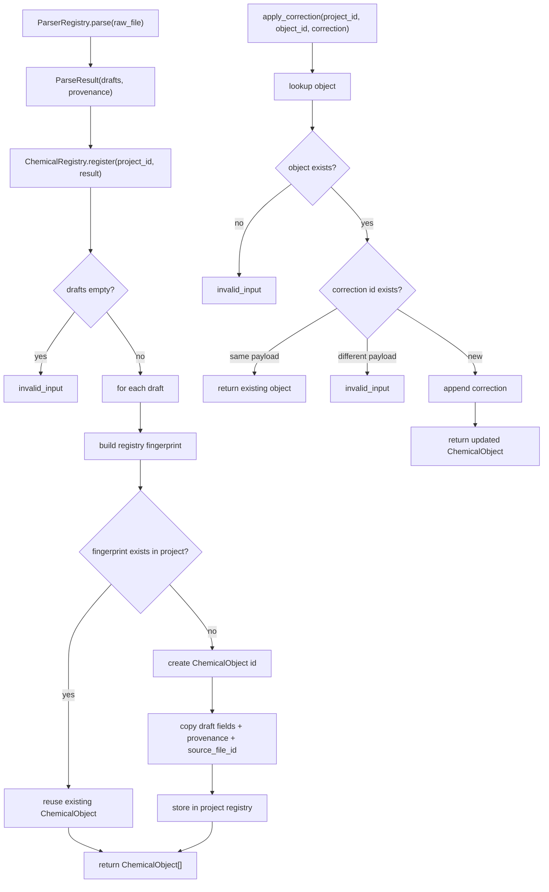

# chemical-registry-corrections design

## 0. 术语约定

| 术语 | 定义 | 防冲突结论 |
|---|---|---|
| Chemical Registry | 项目内 ChemicalObject 的登记服务，负责从 ParseResult 固化对象、追踪来源、追加校正项和基础去重 | 现有 `rxnflow.registry` 只是 fixture 登记 helper，本 feature 将其扩展为核心服务 |
| Registered ChemicalObject | 已分配项目内 id 的化学对象 | 不等同于 parser 输出的 `ChemicalObjectDraft` |
| Source Provenance | parse 结果携带的 `source_file_id`、`parser_id`、`parser_version`、`parsed_at` | 不记录用户源文件绝对路径；文件资源位置仍由 Project Store 管 |
| Correction | 用户追加在 ChemicalObject 上的能量校正记录 | 不改写原始 `energies` / `thermochemistry`，后续 Energy Engine 决定是否计入 |
| Registry Fingerprint | 用于基础去重的项目内对象指纹 | 只做同来源/同 draft 内容的幂等去重，不基于分子式自动合并 |

术语 grep 结果：当前代码存在 `ChemicalObjectDraft`、`ChemicalObject`、`Correction`、`Provenance` 和 `register_fixture_objects`；没有通用 `ChemicalRegistry` 服务、project-scoped registry state、correction 追加入口或 registry fingerprint。

## 1. 决策与约束

### 需求摘要

本 feature 的目标是把 parser 输出的 `ParseResult` 登记为项目内可复用的 `ChemicalObject`，并支持用户为对象追加显式校正项。完成后，核心层应能：

1. 接收 `ParseResult(ChemicalObjectDraft[], provenance)` 并返回带稳定 id 的 `ChemicalObject[]`。
2. 按 project id 管理已登记对象，并能通过 object id 读取对象。
3. 为对象追加 `Correction(kind, energy, note, created_at)`，保留 correction 历史。
4. 对同一项目内同来源、同内容的重复登记做幂等去重。

面向对象是后续 import workflow、reaction graph、energy engine 和 agent。成功标准是：不依赖 UI、不写 Project Store manifest、不解析原始文件，也能用 parser 结果完成登记、读取、校正项追加和基础去重。

明确不做：

- 不持久化 ChemicalObject 到项目目录；对象内容持久化格式留给后续 feature。
- 不把 `ChemicalObject` 写进 Project Manifest resource。
- 不实现 UI 导入确认、批量导入侧边栏、对象列表界面或手动合并弹窗。
- 不基于分子式、标签、能量接近或几何相似度自动合并对象。
- 不计算校正项后的总能量；后续 Energy Engine 通过 `include_corrections` 控制是否计入。
- 不改 parser plugin 输出格式，不让 parser 直接生成 ChemicalObject id。

### 复杂度档位

按“项目内部核心服务”推进。偏离默认项：

- 领域严谨性 = L3：能量单位、校正项来源和 provenance 必须显式保留。
- 幂等性 = required：同一个 ParseResult 重复 register 应返回既有对象，不产生重复 id。
- 可测试性 = tested：登记、去重、校正项、错误路径和 parser/Project Store 边界都要有单元测试。
- 持久化 = none for this feature：本 feature 只建立核心服务和内存状态，不提前决定对象落盘格式。

### 关键决策

1. **Registry 独立于 Parser Plugins 和 Project Store**：registry 接收 `ParseResult`，但不读取 raw file、不调用 parser、不保存 manifest。
2. **ChemicalObject id 由 registry 生成**：parser 继续只输出 draft；registry 负责项目内 id、source_file_id、provenance 和 corrections。
3. **基础去重只做幂等去重**：同一 project 内，如果 `source_file_id + parser_id + parser_version + draft_index + draft_fingerprint` 完全一致，则返回既有对象。不同来源即使 formula 相同也不自动合并。
4. **Correction 是 append-only 记录**：追加 correction 不修改原始能量通道；同一 correction id 重复提交且内容一致时幂等返回，id 相同但内容不同返回 `invalid_input`。
5. **校正项能量采用现有 `EnergyValue`**：单位仍限定为 `hartree`、`kcal_mol`、`kj_mol`。不在此处引入 eV，因为 parser 已把 cclib/ASE energy 转为 hartree。

### 需要用户确认的领域假设

- 假设 A：`resonance`、`solvation`、`manual` 三类 correction 都是对能量的 additive correction；正负号由用户输入的数值表达。
- 假设 B：registry 不尝试判断 resonance/solvation correction 是否“适用于”某个对象；只记录用户追加的校正项和 note。
- 假设 C：基础去重先只保证重复导入同一 parse result 不重复建对象；化学意义上的“同一分子/同一构象/同一计算水平”合并必须由后续用户确认 workflow 处理。

### 前置依赖

roadmap item `chemical-registry-corrections` 依赖 `parser-plugin-baseline`，当前已 `done`。现有实现已提供 `ParseResult`、`ChemicalObjectDraft`、`ChemicalObject`、`Correction`、`Provenance`、`Result<T>` 和 parser scope guard，可直接扩展。

## 2. 名词与编排

### 2.1 名词层：值对象 / 实体 / 接口契约

**现状**：

- `rxnflow.models.ChemicalObjectDraft` 已包含 label、formula、charge、spin_multiplicity、method、geometry、energies、thermochemistry。
- `rxnflow.models.ChemicalObject` 已扩展 draft，并包含 id、source_file_id、corrections、provenance。
- `rxnflow.models.Correction` 已包含 id、kind、energy、created_at、note。
- `rxnflow.registry.register_fixture_objects` 只处理 fixture drafts，使用固定 provenance 和 `object-a` / `object-b` id。
- `rxnflow.parsers.registry.ParserRegistry.parse` 输出 `ParseResult`，不登记对象。

**变化**：

- 新增通用 Chemical Registry 服务，按 project id 持有已登记对象。
- 新增 `register(project_id, result)`，把 `ParseResult.objects` 逐个固化为 `ChemicalObject`。
- 新增 `get_object(project_id, object_id)`，为 Reaction Graph / Energy Engine 提供对象读取边界。
- 新增 `apply_correction(project_id, object_id, correction)`，追加 correction 并返回更新后的对象。
- 保留 `register_fixture_objects` 作为 fixture 兼容入口；它可以继续独立存在，或在实现中薄封装通用 registry。

**接口示例：登记 ParseResult**

```python
result = registry.register(project_id="project-a", parse_result=parse_result)

assert result.ok
assert result.value[0].source_file_id == parse_result.provenance.source_file_id
assert result.value[0].provenance == parse_result.provenance
assert result.value[0].corrections == ()
```

同一个 `parse_result` 再次登记：

```python
first = registry.register("project-a", parse_result).value
second = registry.register("project-a", parse_result).value

assert second == first
```

**接口示例：追加 correction**

```python
correction = Correction(
    id="corr-solvation-1",
    kind="solvation",
    energy=EnergyValue(-2.3, "kcal_mol", reference="SMD correction"),
    created_at="2026-05-02T00:00:00Z",
    note="Manual solvent correction from separate calculation.",
)

result = registry.apply_correction("project-a", object_id, correction)

assert result.ok
assert result.value.corrections[-1] == correction
assert "electronic" in result.value.energies
```

### 2.2 编排层：主流程与控制流



**现状**：

当前 fixture workflow 是 `default_core_fixture_scenario -> register_fixture_objects -> build_fixture_graph -> compute_fixture_profile`。parser workflow 停在 `ParserRegistry.parse -> ParseResult`，没有登记服务承接。

**变化**：

- 新增 parser result 到 registered objects 的 registry workflow。
- 新增 project-scoped object lookup workflow。
- 新增 correction append workflow。
- Energy Engine 仍不消费 corrections；本 feature 只让 `ChemicalObject.corrections` 成为可信输入。

**跨层纪律**：

- 错误语义：空 parse result、未知 project/object、重复 correction id 但内容不同返回 `invalid_input`。
- 幂等性：重复 register 同一 parse result 返回既有对象；重复 apply 同一 correction payload 返回既有对象。
- 来源追踪：registry 必须复制 parse result 的 provenance，不重写 parser id/version/parsed_at。
- 边界约束：registry 源码不应导入 parser plugin 实现、ProjectStore、ReactionGraph 或 EnergyEngine。
- 可观测点：每个对象可查看 source_file_id、provenance、corrections 和原始 energy channels。

### 2.3 挂载点清单

- Chemical Registry 公开入口：新增 `ChemicalRegistry` 或等价服务 API。
- Registry state：新增按 project id 组织的对象存储和 fingerprint 索引。
- Correction append 入口：新增 `apply_correction(project_id, object_id, correction)`。
- Fixture 登记兼容入口：保留并验证 `register_fixture_objects` 行为。

### 2.4 推进策略

1. **Registry 服务骨架**：定义 project-scoped registry 入口和对象存储边界。
   - 退出信号：可以创建 registry，登记一个 ParseResult 后通过 object id 取回对象。
2. **ParseResult 登记节点**：把 drafts 固化为 ChemicalObject，复制 provenance/source_file_id 并生成稳定 id。
   - 退出信号：parser result 中多个 draft 可按顺序登记为多个对象。
3. **基础去重节点**：实现 draft fingerprint 和重复 register 幂等返回。
   - 退出信号：同一 project 重复 register 不增加对象；不同 project 互不影响。
4. **Correction 节点**：实现 correction 追加、同 id 幂等和冲突检测。
   - 退出信号：新增 correction 被 append；同 id 不同 payload 返回 `invalid_input`。
5. **边界守护与测试覆盖**：覆盖错误路径、fixture 兼容和跨模块边界。
   - 退出信号：registry tests、parser tests、core fixture tests 全部通过；registry 不调用 parser/project/graph/energy。

## 3. 验收契约

### 关键场景清单

1. 输入含一个 draft 的 ParseResult → `register` 返回一个 ChemicalObject，保留 draft 字段、source_file_id 和 provenance。
2. 输入含多个 draft 的 ParseResult → `register` 返回多个 ChemicalObject，id 不冲突且顺序稳定。
3. 同一 project 重复登记同一 ParseResult → 返回既有对象，registry 中对象数量不增加。
4. 不同 project 登记同一 ParseResult → 生成各自 project-scoped 对象，互不共享 state。
5. 基于 formula 相同但 source/provenance 或 draft fingerprint 不同的对象 → 不自动合并。
6. `get_object` 查询已登记对象 → 返回对应 ChemicalObject；查询不存在对象 → `invalid_input`。
7. `apply_correction` 给已登记对象追加 solvation/resonance/manual correction → 返回带新 correction 的 ChemicalObject，原始 energies 不被改写。
8. 重复提交同 id 且 payload 相同的 correction → 幂等返回，不追加重复 correction。
9. 重复提交同 id 但 payload 不同的 correction → 返回 `invalid_input`。
10. 输入空 ParseResult.objects → 返回 `invalid_input`，不得创建 project state。
11. 现有 `run_core_fixture_vertical_slice()` 行为不变，仍能通过原有测试。

### 明确不做的反向核对项

- registry 源码不应导入 Gaussian/ORCA/XYZ/MAPLE plugin 实现。
- registry 源码不应调用 ProjectStore、save_project 或写 `.rxnflow/manifest.json`。
- registry 不应生成 ReactionGraph、EnergyProfile 或 export artifact。
- registry 不应基于 formula、label、energy 接近或 geometry 相似度自动合并对象。
- `apply_correction` 不应直接改写 `ChemicalObject.energies` 或计算 corrected total energy。

## 4. 与项目级架构文档的关系

Acceptance 阶段需要把下列内容归并回 architecture：

- 名词：Chemical Registry、Registered ChemicalObject、Registry Fingerprint、append-only Correction。
- 动词骨架：ParseResult → ChemicalObject[] register workflow；Correction append workflow。
- 跨层纪律：registry 不解析文件、不写 Project Store、不碰 graph/profile/export；基础去重只覆盖同来源同内容幂等。

关联架构文档：

- `.codestable/architecture/core-platform.md`：更新 Chemical Registry 当前能力、数据状态和错误语义。
- `.codestable/architecture/ARCHITECTURE.md`：更新关键架构决定中关于 correction、去重和对象登记的待补项。
