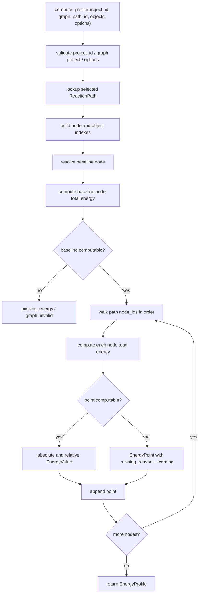

# energy-profile-engine design

## 0. 术语约定

| 术语 | 定义 | 防冲突结论 |
|---|---|---|
| Energy Engine | 核心层能量 profile 计算服务 | 新增通用服务；区别于现有 fixture-only `compute_fixture_profile` |
| Energy Profile | 一条 ReactionPath 对应的曲线/表格数据 | 复用现有 `EnergyProfile` dataclass，不引入绘图库对象 |
| Energy Point | path 上一个 node 的绝对能量、相对能量和缺失诊断 | 复用现有 `EnergyPoint`，允许部分点缺失 |
| Baseline Node | 相对能量零点节点 | 复用 `EnergyOptions.baseline_node_id`；缺省为选中 path 第一个 node |
| Node Total Energy | 一个 ReactionNode 引用对象的合计能量 | 新增计算语义；当前每个对象隐含系数为 1 |
| Correction Inclusion | 是否把 `ChemicalObject.corrections` 加入能量 | 由 `EnergyOptions.include_corrections` 显式控制 |
| Missing Energy Diagnostic | 缺失能量时给用户和 agent 的可定位原因 | 不把缺失值填 0；使用 `missing_energy` 或 point-level `missing_reason` |

术语 grep 结果：当前代码已有 `EnergyOptions`、`EnergyPoint`、`EnergyProfile` 和 `compute_fixture_profile`。没有通用 `EnergyEngine` / `EnergyProfileEngine` 服务，也没有 corrections、kj/mol、多对象节点或指定 path 的 profile 计算。

## 1. 决策与约束

### 需求摘要

本 feature 的目标是把内置 fixture 的单一路径能量计算升级为核心 Energy Engine。完成后，核心层应能：

1. 从指定 `ReactionGraph` 的指定 `ReactionPath` 读取节点顺序。
2. 根据 node 引用的 `ChemicalObject` 和 `EnergyOptions.energy_key` 计算每个点的总能量。
3. 按 `baseline_node_id` 或 path 第一个节点计算相对能量。
4. 支持 `kcal_mol` 和 `kj_mol` 两种输出单位。
5. 通过 `include_corrections` 显式决定是否叠加用户校正项。
6. 对缺失对象、缺失能量、缺失 baseline 和非能量节点给出可诊断结果。

面向对象是后续 Graph Editor 的实时曲线、Report Export 的能量表格和 agent 自动生成报告。成功标准是：不依赖 UI、不解析文件、不写 Project Store，也能用 Python API 对已加载 graph + objects 计算 curve-ready `EnergyProfile`。

明确不做：

- 不实现曲线绘图、交互图表、PNG、CDXML 或 Excel 导出。
- 不持久化 EnergyProfile，也不写 `.rxnflow/manifest.json`。
- 不调用 Parser Plugins，不解析 Gaussian/ORCA/XYZ/MAPLE 原始文件。
- 不调用 ReactionGraphService 修改图谱；只读取传入的 ReactionGraph。
- 不调用 ChemicalRegistry 修改对象或追加 correction；只读取传入的 ChemicalObject。
- 不做微观动力学、反应速率、自动路径搜索、构象搜索或化学合理性判断。
- 不引入热化学公式表达式，例如 `G = E + thermal_correction` 的组合规则。
- 不引入 stoichiometric coefficient 字段；多对象节点当前只做隐含系数为 1 的求和。

### 复杂度档位

按“可测试核心计算服务”推进。偏离默认项：

- 领域严谨度 = high：每个数值必须有单位，baseline 和 corrections 语义必须可追溯。
- 错误语义 = mixed diagnostic：图谱/对象引用错误直接失败；非 baseline 点缺失能量可保留为缺失点。
- 可测试性 = tested：单位换算、baseline、corrections、缺失数据和 fixture 回归都要有单元测试。
- Agent ergonomics = required：返回值要足够结构化，agent 能直接解释哪一个 node/object/energy key 出问题。

### 关键决策

1. **Energy Engine 是 core service，不是 UI 图表层**：它只输出 `EnergyProfile` 数据，不创建图表对象，也不关心 viewport、颜色、坐标轴样式。
2. **计算输入使用已加载领域对象**：Python 当前阶段采用 `compute_profile(project_id, graph, path_id, objects, options)` 形态，对齐 roadmap 的 `projectId/graphId/pathId/options` 语义，但不要求 Project Store 已能持久化 graph/object/profile。
3. **绝对能量输出为目标单位下的节点总能量**：通用 engine 的 `EnergyPoint.absolute_energy` 使用 `options.output_unit`；原始解析能量仍保留在 `ChemicalObject.energies`。
4. **相对能量 = 当前节点总能量 - baseline 节点总能量**：相对值和绝对值使用相同输出单位，保存在 `EnergyValue.reference` 或 profile options 中体现 baseline。
5. **校正项是加性项**：`include_corrections=True` 时，对每个对象追加所有 `Correction.energy`；不按 correction kind 做额外公式判断。
6. **多对象节点先做简单求和**：node 引用多个 ChemicalObject 时，对这些对象的选定 energy key 求和；当前不表达计量系数、配平或反应式左右侧。
7. **非 baseline 缺失点保留 profile**：某个非 baseline 节点缺少能量时返回 ok profile，该点 `missing_reason` 有值，`absolute_energy` / `relative_energy` 为空，并附带 warning。

### 已确认的领域假设

- 假设 A：一个 ReactionNode 里多个 ChemicalObject 的能量合计目前按系数 1 求和；例如底物 + 催化剂同在一个状态节点时，能量就是两者相加。
- 假设 B：`include_corrections=True` 时，resonance、solvation、manual correction 都作为加性项直接计入，正负号完全由 correction value 决定。
- 假设 C：通用 Energy Engine 的 `absolute_energy` 使用输出单位下的节点总能量，而不是保留原始 hartree；原始值仍可从 ChemicalObject 查。
- 假设 D：baseline 缺失能量时整个计算返回 `missing_energy`；非 baseline 缺失能量时保留 profile 和缺失点，便于 UI 显示断点。
- 假设 E：annotation/group 节点如果出现在 energy path 中，不当作 0 能量点；按缺失诊断处理。若它被指定为 baseline，则返回 `missing_energy`。

### 前置依赖

roadmap item `energy-profile-engine` 依赖 `reaction-graph-protocol`，当前已 `done`。现有实现已提供 `ReactionGraph`、`ReactionPath`、`ReactionNode.chemical_object_ids`、`ChemicalObject.energies`、`ChemicalObject.corrections`、`EnergyOptions`、`EnergyPoint`、`EnergyProfile`、`RxnFlowWarning` 和 `missing_energy` 错误语义，可直接扩展。

## 2. 名词与编排

### 2.1 名词层：值对象 / 实体 / 接口契约

**现状**：

- `rxnflow.models.EnergyOptions` 已包含 `output_unit`、`include_corrections`、`energy_key`、`baseline_node_id`。
- `rxnflow.models.EnergyPoint` 已包含 node id、label、absolute energy、relative energy、missing reason。
- `rxnflow.models.EnergyProfile` 已包含 profile id、graph id、path id、options、points、warnings。
- `rxnflow.energy.compute_fixture_profile` 只支持 graph 第一条 path、单对象节点、hartree/kcal_mol 输入、kcal_mol 输出，并拒绝 corrections。

**变化**：

- 新增通用 Energy Engine 入口，建议命名为 `EnergyProfileEngine` 或 `EnergyEngine`。
- 新增 `compute_profile(project_id, graph, path_id, objects, options)`，返回 `Result[EnergyProfile]`。
- 新增通用单位换算，至少支持 `hartree`、`kcal_mol`、`kj_mol` 输入到 `kcal_mol` / `kj_mol` 输出。
- 新增节点总能量语义：一个 node 的 `chemical_object_ids` 对应对象总能量 + 可选 corrections。
- 保留 `compute_fixture_profile` 作为 fixture 兼容入口；它可内部委托通用 engine，也可保持旧行为，只要当前 fixture 测试不变。

**接口示例：指定 path 计算 kcal/mol profile**

```python
engine = EnergyProfileEngine()
result = engine.compute_profile(
    "project-a",
    graph,
    "path-main",
    (reactant, transition_state, product),
    EnergyOptions(output_unit="kcal_mol", include_corrections=False, energy_key="electronic"),
)

assert result.ok
assert result.value.points[0].relative_energy.value == 0
```

**接口示例：计入校正项并输出 kj/mol**

```python
result = engine.compute_profile(
    "project-a",
    graph,
    "path-main",
    objects,
    EnergyOptions(output_unit="kj_mol", include_corrections=True, energy_key="gibbs"),
)

assert result.ok
assert result.value.options.output_unit == "kj_mol"
```

**接口示例：非 baseline 缺失能量**

```python
result = engine.compute_profile("project-a", graph, "path-main", objects, options)

assert result.ok
assert result.value.points[2].missing_reason == "missing_energy"
assert result.value.points[2].relative_energy is None
```

### 2.2 编排层：主流程与控制流



**现状**：

当前 `compute_fixture_profile` 会固定读取 graph 的第一条 path。每个 node 必须且只能引用一个 ChemicalObject，请求的 energy key 必须存在；任何节点缺失能量都会直接返回 `missing_energy`。输出只支持 `kcal_mol`。

**变化**：

- 新增指定 `path_id` 的 profile 计算 workflow。
- 新增 baseline 解析 workflow：`options.baseline_node_id` 为空时使用 path 第一个 node；非空时必须属于该 path。
- 新增 node total 计算 workflow：校验 node、object、energy key、corrections 和单位转换。
- 新增 point-level missing workflow：baseline 缺失直接失败；非 baseline 缺失则生成缺失点和 warning。
- 新增输出单位 workflow：所有 absolute/relative point energy 按 `options.output_unit` 统一输出。

**跨层纪律**：

- 错误语义：未知 path、path 引用缺失 node、node 引用缺失 object 返回 `graph_invalid`；空 project id、unsupported unit、invalid options 返回 `invalid_input`；baseline 或全局无法建立时返回 `missing_energy`。
- 单位纪律：任何能量参与加减前必须先转换到输出单位；不得在 hartree/kcal_mol/kj_mol 间直接相减。
- 顺序性：points 顺序严格等于 selected path 的 node_ids 顺序。
- 可卸载性：删除本 feature 时应只移除通用 engine、单位换算 helper 和新增测试；Parser、Registry、Graph、Project Store 行为不变。
- 可观测点：返回的 `EnergyProfile.options` 保留 energy key、output unit、include corrections 和 baseline node id；缺失点保留 node id、label、missing reason。

### 2.3 挂载点清单

- Energy Engine 入口：新增通用 `compute_profile` 服务。
- Node total energy 语义：新增多对象求和、corrections 计入和 missing diagnostics。
- Unit conversion helper：扩展 hartree/kcal_mol/kj_mol 到目标输出单位的转换边界。
- Fixture 兼容入口：保留当前 `run_core_fixture_vertical_slice()` 的可观察结果。

### 2.4 推进策略

1. **Engine 编排骨架**：新增通用 compute profile 入口，完成 project/graph/path/baseline 的结构校验。
   - 退出信号：指定 path 可返回含正确 graph id/path id/options 的空或初步 profile。
2. **单位换算与节点总能量**：实现 hartree/kcal_mol/kj_mol 转换，以及单对象/多对象节点求和。
   - 退出信号：两节点 hartree 输入能得到和 fixture 一致的 kcal/mol relative energy，并支持 kj/mol 输出。
3. **校正项计入**：按 `include_corrections` 控制 Correction.energy 是否加入节点总能量。
   - 退出信号：同一对象在开关 corrections 时得到不同且可预期的 relative energy。
4. **缺失诊断与错误边界**：实现 baseline 缺失失败、非 baseline 缺失点、annotation/group 节点诊断、缺失 object/path/node 错误。
   - 退出信号：错误 code 和 point missing_reason 可被测试精确断言。
5. **fixture 回归与范围守护**：保留现有 fixture 可观察结果，并覆盖 core service 不触碰 parser/store/export/UI。
   - 退出信号：energy tests、fixture tests、graph tests、registry tests、parser tests 全部通过。

## 3. 验收契约

### 关键场景清单

1. 输入两节点 path，两个对象 `electronic` 为 hartree → 输出 kcal/mol，相对能量和现有 fixture 的 `12.55018948 kcal_mol` 一致。
2. 同一输入请求 `output_unit="kj_mol"` → absolute 和 relative 都以 kj/mol 输出。
3. `baseline_node_id` 为空 → path 第一个 node 的 relative energy 为 0。
4. `baseline_node_id` 指向 path 中间节点 → 该节点 relative energy 为 0，前后节点按该节点偏移。
5. `baseline_node_id` 不属于 selected path → 返回 `graph_invalid`。
6. selected path id 不存在 → 返回 `graph_invalid`。
7. path 引用缺失 node 或 node 引用缺失 ChemicalObject → 返回 `graph_invalid`。
8. baseline node 缺少 `options.energy_key` → 返回 `missing_energy`。
9. 非 baseline node 缺少 `options.energy_key` → profile ok，该点 `missing_reason="missing_energy"`，并带 warning。
10. species / transition_state node 引用多个 ChemicalObject → 节点总能量按对象能量求和。
11. `include_corrections=False` → 忽略所有 Correction，原始 energy channel 不被改写。
12. `include_corrections=True` → 所有 Correction.energy 加入节点总能量，并按目标输出单位换算。
13. annotation/group node 出现在 path 中 → 非 baseline 时生成缺失点；作为 baseline 时返回 `missing_energy`。
14. unsupported energy unit 或 output unit → 返回 `invalid_input`。
15. 现有 `run_core_fixture_vertical_slice()` profile id、points 和 relative energy 行为不变。

### 明确不做的反向核对项

- 不新增 UI、CLI、Web route、画布交互、图表绘制或报告预览代码。
- 不写 Project Store，不新增 manifest resource，不持久化 EnergyProfile。
- 不调用 ParserRegistry、GaussianLogPlugin、OrcaOutputPlugin、XyzPlugin 或 Maple parser。
- 不调用 ChemicalRegistry.apply_correction，不修改 ChemicalObject。
- 不调用 ReactionGraphService.apply_patch，不修改 ReactionGraph。
- 不生成 ExportArtifact、PNG、CDXML 或 Excel。
- 不新增热化学表达式、计量系数字段、反应配平、速率模型或自动路径搜索。

## 4. 与项目级架构文档的关系

Acceptance 阶段需要把下列内容归并回 architecture：

- 名词：Energy Engine、Node Total Energy、baseline node、point-level missing diagnostic、correction inclusion。
- 动词骨架：selected path → baseline → node total energies → relative profile workflow。
- 跨层纪律：Energy Engine 只读取 ReactionGraph 和 ChemicalObject，不解析、不登记、不持久化、不导出；缺失能量不得默认为 0。

关联架构文档：

- `.codestable/architecture/core-platform.md`：更新 Energy Engine 当前能力、数据状态、错误语义、单位与 correction 约束。
- `.codestable/architecture/ARCHITECTURE.md`：更新关键架构决定中关于相对能量、baseline、输出单位和缺失能量诊断的说明。
