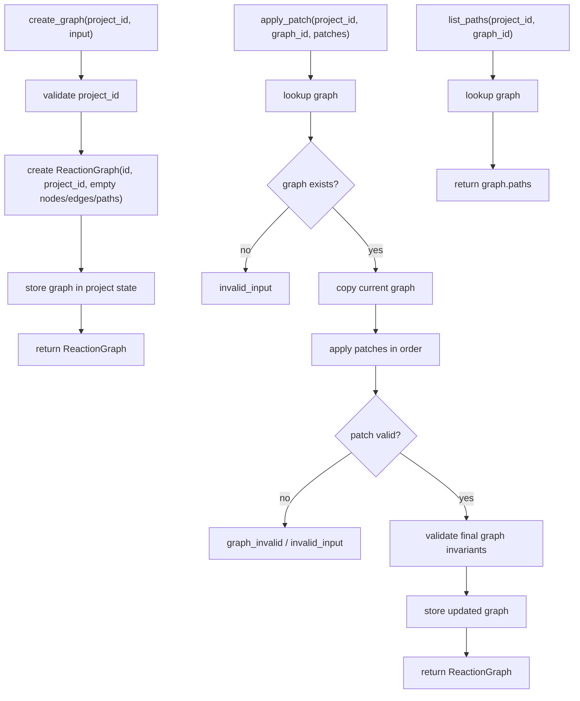

# reaction-graph-protocol design

## 0. 术语约定

| 术语 | 定义 | 防冲突结论 |
|---|---|---|
| Reaction Graph | 项目内反应网络结构，包含 nodes、edges、paths | 现有 `ReactionGraph` dataclass 已存在，但只有 fixture 构造入口 |
| Reaction Node | 图谱中的节点，可表示 species、transition_state、group 或 annotation | 复用 roadmap 和 `ReactionNodeKind`，不新增 UI 专用 node 类型 |
| Reaction Edge | 有向连线，表达节点之间的反应路径方向或关系 | 复用现有 `ReactionEdge.from_node` / `to_node` 命名 |
| Reaction Path | 一条有序 node id 序列，可用于后续 Energy Engine 计算 | path 是路径视图，不复制完整节点或能量数据 |
| GraphPatch | UI 和 agent 共同使用的图谱修改操作协议 | 本 feature 新增，不等同于文件 diff 或 Project Store patch |
| ReactionGraphService | 项目内 graph 创建、patch 应用和 path 列表服务 | 新增核心服务，不负责 UI 布局渲染或能量计算 |

术语 grep 结果：当前代码已有 `ReactionNode`、`ReactionEdge`、`ReactionPath`、`ReactionGraph`、`build_fixture_graph`，没有 `GraphPatch`、`ReactionGraphService`、通用 patch workflow 或分叉路径服务。

## 1. 决策与约束

### 需求摘要

本 feature 的目标是把 fixture-only 的图谱构造升级为核心 Reaction Graph 服务。完成后，核心层应能：

1. 为 project 创建空 `ReactionGraph`。
2. 通过 `GraphPatch[]` 添加/更新/删除节点和边。
3. 通过 `set_path` 建立多条 ReactionPath，支持分叉路径用不同 path 表达。
4. 校验 node/object/edge/path 引用，错误统一返回 `graph_invalid` 或 `invalid_input`。
5. 让 UI 和 agent 可以用同一组 patch 修改图谱。

面向对象是后续 Graph Editor、Energy Engine、Report Export 和 agent 操作入口。成功标准是：不依赖 UI、不计算能量、不写 Project Store，也能通过 Python API 创建图、应用 patch、列出路径并阻止无效引用。

明确不做：

- 不实现画布 UI、拖拽交互、自动布局、缩放或实时预览。
- 不持久化 ReactionGraph 到项目目录，也不写 Project Manifest resource。
- 不计算相对能量、reaction energy 或校正项；Energy Engine 后续读取 graph/path。
- 不解析 Gaussian/ORCA/XYZ/MAPLE 文件，不登记 ChemicalObject。
- 不自动发现反应路径、自动搜索分叉或判断化学合理性。
- 不引入 stoichiometric coefficient 字段；多对象节点当前只表达“同一状态引用多个对象”。

### 复杂度档位

按“agent 可操作核心服务”推进。偏离默认项：

- 结构 = modules：应把通用 graph service 与 fixture graph helper 区分，避免继续膨胀 fixture-only 函数。
- 幂等性 = patch-level explicit：新增操作遇到重复 id 返回 `graph_invalid`；重复 set 同一 path 可幂等覆盖同 id path。
- 可测试性 = tested：patch 正常路径、错误路径、删除级联和 fixture 回归都要有单元测试。
- Agent ergonomics = required：GraphPatch 必须是结构化、可序列化、单步可诊断的操作集合。

### 关键决策

1. **GraphPatch 是核心协议，不是 UI 状态**：patch 只描述 graph 领域对象变化，不包含 selection、hover、viewport、折叠面板等 UI 状态。
2. **Reaction Graph 只引用 ChemicalObject id**：graph 不复制 ChemicalObject、能量或 correction；object id 有效性由调用方传入可用 object id 集合校验。
3. **分叉用多条 ReactionPath 表达**：同一个 graph 可保存多条 path；一条 path 是有序 node id 序列，分叉不是 path 内特殊节点。
4. **删除节点会级联删除相关 edge/path 引用**：remove node 后移除关联 edges，并移除包含该 node 的 paths，避免留下半断路径。
5. **annotation/group 节点允许空 chemical_object_ids**：species / transition_state 至少需要一个 object id；annotation/group 可作为图谱组织与说明节点。

### 需要用户确认的领域假设

- 假设 A：`transition_state` 节点和 `species` 节点一样引用 ChemicalObject；是否真为 TS 由对象来源/用户语义决定，GraphService 不判断虚频或结构特征。
- 假设 B：一个 ReactionNode 引用多个 ChemicalObject 时，当前只表示同一状态包含多个已登记对象，各对象隐含计量系数为 1；更复杂的化学计量表达留到后续 feature。
- 假设 C：分叉反应路径先用多条 `ReactionPath` 表达，不新增 branch node / branch edge 类型。

### 前置依赖

roadmap item `reaction-graph-protocol` 依赖 `chemical-registry-corrections`，当前已 `done`。现有实现已提供 `ReactionNode`、`ReactionEdge`、`ReactionPath`、`ReactionGraph`、`ChemicalRegistry.get_object` 能力和 `graph_invalid` 错误码，可直接扩展。

## 2. 名词与编排

### 2.1 名词层：值对象 / 实体 / 接口契约

**现状**：

- `rxnflow.models.ReactionNode` 已包含 id、kind、label、chemical_object_ids、position、metadata。
- `rxnflow.models.ReactionEdge` 已包含 id、from_node、to_node、label、metadata。
- `rxnflow.models.ReactionPath` 已包含 id、label、node_ids。
- `rxnflow.models.ReactionGraph` 已包含 id、project_id、nodes、edges、paths。
- `rxnflow.graph.build_fixture_graph` 只接收 `FixtureGraph`，并返回固定 id `graph-a-b` 的 fixture graph。

**变化**：

- 新增 GraphPatch 操作类型，对齐 roadmap：`add_node`、`update_node`、`add_edge`、`update_edge`、`remove`、`set_path`。
- 新增 `ReactionGraphService`，按 project id 管理内存 graph state。
- 新增 `create_graph(project_id, input=None)`，返回空 ReactionGraph。
- 新增 `apply_patch(project_id, graph_id, patches, object_ids=None)`，按顺序应用 patch 并返回更新 graph。
- 新增 `list_paths(project_id, graph_id)`，只返回 path，不计算能量。
- 保留 `build_fixture_graph` 作为 fixture 兼容入口。

**接口示例：创建图并添加节点/边/path**

```python
service = ReactionGraphService()
created = service.create_graph("project-a", label="demo path")

patched = service.apply_patch(
    "project-a",
    created.value.id,
    (
        GraphPatch("add_node", node=ReactionNode(id="node-r", kind="species", label="R", chemical_object_ids=("object-r",))),
        GraphPatch("add_node", node=ReactionNode(id="node-ts", kind="transition_state", label="TS", chemical_object_ids=("object-ts",))),
        GraphPatch("add_edge", edge=ReactionEdge(id="edge-r-ts", from_node="node-r", to_node="node-ts")),
        GraphPatch("set_path", path=ReactionPath(id="path-main", label="main", node_ids=("node-r", "node-ts"))),
    ),
    object_ids={"object-r", "object-ts"},
)

assert patched.ok
assert service.list_paths("project-a", created.value.id).value[0].id == "path-main"
```

**接口示例：无效引用**

```python
result = service.apply_patch(
    "project-a",
    graph_id,
    (GraphPatch("add_edge", edge=ReactionEdge(id="edge-bad", from_node="missing", to_node="node-r")),),
)

assert not result.ok
assert result.error.code == "graph_invalid"
```

### 2.2 编排层：主流程与控制流



**现状**：

当前 `build_fixture_graph` 只在 fixture vertical slice 中使用。它验证 node/object/edge/path 引用，然后返回一个固定 id 的 ReactionGraph。没有通用 graph state，没有 patch 协议，也不能保存多条 path。

**变化**：

- 新增通用 graph 创建 workflow。
- 新增 patch 顺序应用 workflow，支持单 patch 和批量 patch。
- 新增 graph invariant 校验，覆盖 node id 重复、edge 引用缺失、path 引用缺失、object id 缺失等。
- 新增 list paths workflow，为后续 Energy Engine 提供路径入口。

**跨层纪律**：

- 错误语义：未知 graph/project、patch 缺少 payload 返回 `invalid_input`；图谱引用错误、重复 id、路径非法返回 `graph_invalid`。
- 顺序性：同一批 patches 按输入顺序应用；中途失败不写回 graph state。
- 可卸载性：删除本 feature 时应只移除 GraphPatch、ReactionGraphService 和新测试，不影响 fixture vertical slice。
- 边界约束：ReactionGraphService 不调用 ChemicalRegistry、ParserPlugin、ProjectStore、EnergyEngine 或 ExportService；只接收 object id 集合作校验输入。
- 可观测点：每次 `apply_patch` 返回完整 ReactionGraph，agent 可直接检查 nodes/edges/paths。

### 2.3 挂载点清单

- GraphPatch 类型：新增结构化 patch 操作载体。
- ReactionGraphService 入口：新增 create/apply/list paths 的核心服务。
- Graph service state：新增按 project id / graph id 管理的内存 graph state。
- Fixture 兼容入口：保留并验证 `build_fixture_graph` 行为。

### 2.4 推进策略

1. **GraphPatch 名词骨架**：定义 patch 操作载体和 graph service 入口。
   - 退出信号：可以构造 `GraphPatch("add_node", node=...)` 并由 service 接收。
2. **Graph 创建与状态骨架**：实现 project-scoped `create_graph`、graph lookup 和 `list_paths`。
   - 退出信号：创建空 graph 后可列出空 paths，不影响 fixture graph。
3. **Patch 应用节点**：实现 add/update node、add/update edge、set_path。
   - 退出信号：一批 patches 可生成包含 nodes、edges、paths 的 graph。
4. **删除与 invariant 校验**：实现 remove、重复 id、缺失引用、object id 校验、失败不写回。
   - 退出信号：无效 patch 返回 Result 错误，原 graph state 保持不变。
5. **测试与范围守护**：覆盖正常、分叉、错误、回归和跨模块边界。
   - 退出信号：graph tests、registry tests、parser tests、fixture tests 全部通过。

## 3. 验收契约

### 关键场景清单

1. 输入 project id → `create_graph` 返回空 ReactionGraph，project_id 正确，id 稳定非空。
2. 创建 graph 后 `list_paths` → 返回空 tuple。
3. 应用 add_node patch → graph 增加节点；节点 kind、label、object ids、position、metadata 保留。
4. 应用 add_edge patch → edge 引用已存在 nodes 时成功。
5. 应用 set_path patch → path 引用已存在 nodes 时成功，`list_paths` 可返回该 path。
6. 多条 set_path patch → graph 保存多条 path，用于表达分叉路径。
7. update_node / update_edge patch → 只更新指定字段，未指定字段保留。
8. remove node → 删除该 node，并级联删除相关 edge 和包含该 node 的 path。
9. add_node 重复 id、add_edge 缺失 node、set_path 缺失 node → 返回 `graph_invalid`。
10. species / transition_state node 的 object id 不在传入 object_ids 集合中 → 返回 `graph_invalid`。
11. annotation / group node 可不引用 ChemicalObject。
12. patch 批次中途失败 → 原 graph state 不被写回。
13. 未知 graph id 或空 project id → 返回 `invalid_input`。
14. 现有 `run_core_fixture_vertical_slice()` 行为不变。

### 明确不做的反向核对项

- 不新增 UI、CLI、Web route、画布交互或自动布局代码。
- 不调用 ProjectStore 或写 `.rxnflow/manifest.json`。
- 不调用 ChemicalRegistry，只接收 object id 集合校验引用。
- 不调用 Parser Plugins，不解析原始输出文件。
- 不调用 Energy Engine，不计算能量或校正项。
- 不生成 ExportArtifact、PNG、CDXML 或 Excel。
- 不新增 stoichiometric coefficient 字段或自动反应路径搜索。

## 4. 与项目级架构文档的关系

Acceptance 阶段需要把下列内容归并回 architecture：

- 名词：GraphPatch、ReactionGraphService、ReactionPath 多路径/分叉表达、annotation/group 空对象节点规则。
- 动词骨架：create graph → apply patches → list paths workflow；patch 失败不写回。
- 跨层纪律：Reaction Graph 只引用 object id，不复制 ChemicalObject；不计算能量；不持久化；不触碰 UI。

关联架构文档：

- `.codestable/architecture/core-platform.md`：更新 Reaction Graph 当前能力、数据状态、错误语义和约束边界。
- `.codestable/architecture/ARCHITECTURE.md`：更新关键架构决定中关于 GraphPatch 和 agent/UI 共用操作协议的说明。
