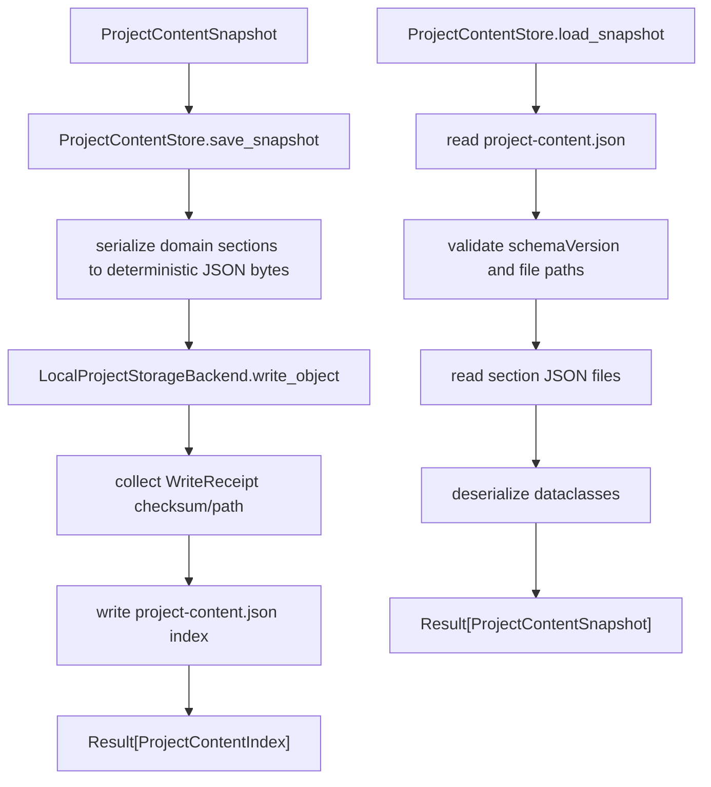

# project-content-store-v1 design

## 0. 术语约定

| 术语 | 定义 | 防冲突结论 |
|---|---|---|
| Project Content | `.rxnflow/state/` 下保存的项目领域内容，包括对象、图谱、workspace、profile 等 | 区分于 Project Manifest；manifest 仍只保存项目元数据和资源索引 |
| Project Content Index | `.rxnflow/state/project-content.json`，记录 state 文件清单、checksum 和更新时间 | 新增内容索引；不是 `.rxnflow/manifest.json` 的替代品 |
| Project Content Snapshot | 一次保存/加载的领域内容快照，首版覆盖 fixture 的 ChemicalObject、ReactionGraph、WorkspaceSnapshot 和 EnergyProfile | 新增传输结构；不是长期缓存或数据库 |
| Project Storage Backend | 按项目相对路径读写 bytes 的后端协议 | 新增抽象；首版只实现本地文件系统 backend，不做 IndexedDB/云端 |
| Local Project Storage Backend | 把 logical path 映射到项目目录文件系统的 backend | 复用现有 ProjectStore 的安全路径原则；不替代 ProjectStore |
| Project Content Store | 编排 index、snapshot JSON 和 backend 读写的核心服务 | 新增服务；不解析 raw file、不登记对象、不计算 profile |
| project-content-v1 | 本 roadmap 的第一版项目内容 schema version | 区分于现有 `project-v1` manifest schema |

术语 grep 结果：当前已有 `ProjectStore`、`ProjectManifest`、`ProjectResource`、`RAW_INPUT_DIR`、`project_manifest_to_dict/from_dict`、`run_core_fixture_vertical_slice` 和 Platform Shell session。当前没有 `ProjectContentStore`、`ProjectContentSnapshot`、`ProjectStorageBackend`、`.rxnflow/state/` 或 `project-content-v1`。

## 1. 决策与约束

### 需求摘要

本 feature 是 `rxnflow-project-persistence` roadmap 的最小闭环。完成后，调用方应能：

1. 构造包含 fixture project id、ChemicalObject、ReactionGraph、WorkspaceSnapshot 和 EnergyProfile 的 ProjectContentSnapshot。
2. 通过本地文件系统 backend 把 snapshot 写入 `.rxnflow/state/`。
3. 生成 deterministic 的 `project-content.json` index，记录每个 state 文件的 kind、path、checksum 和 updated_at。
4. 在新进程/新 service 实例中从项目目录加载 snapshot，恢复同样的对象、图谱、workspace 和 profile 摘要。
5. 对空 project ref、不安全 logical path、不存在 index、不兼容 schema version 和坏 JSON 返回结构化 Result error。

明确不做：

- 不持久化真实 ImportBatch / ParsePreview / ExportArtifact index；这些由后续子 feature 扩展。
- 不实现浏览器 IndexedDB / OPFS、project bundle、云存储、数据库、账号或同步。
- 不修改 `.rxnflow/manifest.json` 的 schema，不把完整领域内容塞进 manifest。
- 不读取、复制、删除或解析 `inputs/raw/` 文件。
- 不调用 ParserRegistry、ImportRegistryWorkflow、ChemicalRegistry.register、ReactionGraphService.apply_patch、EnergyProfileEngine 或 ReportExportService。
- 不实现增量保存、并发锁、冲突合并、migration 或引用完整性深校验。
- 不新增 CLI/Web/desktop 命令；Platform Shell 恢复入口由后续 `platform-shell-state-restore` 实现。

### 复杂度档位

按“核心服务 + 本地文件 backend + deterministic JSON”推进。偏离默认项：

- Storage Backend 抽象先落地：虽然首版只实现本地文件系统，但接口必须能映射到后续浏览器本地存储和 project bundle。
- Snapshot 粒度为全量保存：首版不做增量写入，降低一致性复杂度。
- Schema 先覆盖 fixture 闭环：对象、图谱、workspace、profile 的字段覆盖当前 dataclass；import ledger/export index 先保留空集合。
- 写盘要求原子性：本地 JSON state 文件先写临时文件再替换，避免半文件。

### 关键决策

1. **Project Content 不进 manifest**：manifest 是项目级元数据和 resource index；内容状态放在 `.rxnflow/state/`，避免 manifest 变成巨型状态文件。
2. **backend 只认 bytes**：Storage Backend 不理解 ChemicalObject、Graph 或 Profile；序列化由 Project Content Store 和后续 domain repositories 负责。
3. **首版恢复 fixture 级别完整内容**：`project-content-store-v1` 要能恢复对象、图谱、workspace 和 profile，证明“关闭后再打开”这条路径成立。
4. **时间戳先 deterministic**：沿用现有 fixture 风格使用固定时间，保证测试稳定；真实 updated_at 策略留到后续实现细化或系统时钟 adapter。
5. **错误不 silent fallback**：index 缺失、schema 不兼容、JSON 坏掉或 path 不安全都要返回 Result error，不自动重新生成空项目。

### 前置依赖

roadmap item `project-content-store-v1` 无前置依赖。现有 `ProjectStore` 已能创建项目目录、保存 manifest 和 raw file；现有领域 dataclass 已能表达 fixture 的对象、图谱和 profile。目标模块属于新增 project content persistence 层。

## 2. 名词与编排

### 2.1 名词层：值对象 / 实体 / 接口契约

**现状**：

- `rxnflow.project.ProjectStore` 只处理 `.rxnflow/manifest.json` 和 `inputs/raw/`；不保存 ChemicalObject、ReactionGraph、WorkspaceSnapshot 或 EnergyProfile。
- `rxnflow.project_manifest` 只序列化 `ProjectManifest` 和 `ProjectResource`，并校验 manifest resource path。
- `rxnflow.models` 已有 ChemicalObject、ReactionGraph、EnergyProfile 等 dataclass，但没有通用 JSON serializer。
- `rxnflow.fixture.run_core_fixture_vertical_slice` 可生成稳定的 project、objects、graph 和 profile；没有 workspace snapshot。

**变化**：

- 新增 `ProjectContentIndex(schema_version, project_id, updated_at, files)`。
- 新增 `ProjectContentFile(kind, path, checksum, updated_at)`。
- 新增 `StorageObject(path, bytes, checksum=None, metadata={})`、`StorageObjectInfo` 和 `WriteReceipt`。
- 新增 `ProjectStorageBackend` 协议，定义 read/write/exists/list/delete。
- 新增 `LocalProjectStorageBackend`，把 project_ref 映射到本地项目目录。
- 新增 `ProjectContentSnapshot(project_id, chemical_objects=(), reaction_graphs=(), workspaces=(), energy_profiles=(), import_batches=(), export_artifacts=())`。
- 新增 `ProjectContentStore.save_snapshot/load_snapshot/load_index`。
- 新增 fixture snapshot helper，把现有 CoreFixtureResult 转成首版 ProjectContentSnapshot，并构造一个最小 WorkspaceSnapshot。

**接口示例：保存 fixture snapshot**

```python
fixture = run_core_fixture_vertical_slice().value
snapshot = project_content_snapshot_from_fixture(fixture)
store = ProjectContentStore(LocalProjectStorageBackend())

result = store.save_snapshot("/tmp/rxnflow-demo", snapshot)

assert result.ok
assert result.value.schema_version == "project-content-v1"
assert Path("/tmp/rxnflow-demo/.rxnflow/state/project-content.json").exists()
```

**接口示例：跨实例加载 snapshot**

```python
loaded = ProjectContentStore(LocalProjectStorageBackend()).load_snapshot("/tmp/rxnflow-demo")

assert loaded.ok
assert loaded.value.project_id == snapshot.project_id
assert loaded.value.chemical_objects[0].id == "object-a"
assert loaded.value.reaction_graphs[0].id == "graph-a-b"
assert loaded.value.energy_profiles[0].id == "profile-a-b-electronic"
```

**接口示例：错误路径**

```python
bad = LocalProjectStorageBackend().write_object("/tmp/project", StorageObject("../bad.json", b"{}"))

assert not bad.ok
assert bad.error.code == "invalid_input"
assert bad.error.target == "path"
```

### 2.2 编排层：主流程与控制流



**现状**：

当前跨进程能恢复的只有 ProjectManifest 和 raw file resource。Platform Shell 的 PlatformSession 只在进程内保存 object_ids、graph_id、profile_id 等摘要，不能从磁盘恢复完整对象。

**变化**：

- 新增 save workflow：校验 snapshot → 序列化各 section → 写 `.rxnflow/state/*.json` → 汇总 checksum → 写 `project-content.json`。
- 新增 load workflow：读 index → 校验 schema/path → 读各 section → 反序列化 dataclass → 返回 ProjectContentSnapshot。
- 新增 backend workflow：所有 logical path 统一走安全 path 解析，写入时自动创建父目录，返回 checksum/byte_size/backend_id。
- 新增 fixture workflow：从 CoreFixtureResult 派生 snapshot，作为第一条端到端保存/加载证据。

**跨层纪律**：

- 错误语义：空 project_ref、unsafe path、index 缺失、坏 JSON、schema 不兼容返回 `invalid_input`；文件系统 I/O 失败返回 `internal_error`。
- 幂等性：同一 snapshot 重复保存应得到相同 section checksums 和相同 index file paths。
- 顺序性：先写 section files，再写 index；load 时先读 index，再按 index 读取 sections。
- 文件边界：所有 path 使用项目相对 POSIX 路径；禁止绝对路径、`..`、反斜杠和空路径。
- 原子性：本地 JSON 写入使用临时文件替换；若 section 写入失败，不更新 index。
- 可观测点：index files 记录 kind、path、checksum、updated_at；WriteReceipt 记录 backend_id、byte_size 和 checksum。
- 扩展点：后续 browser backend、bundle backend、domain repository 都接同一 ProjectStorageBackend / ProjectContentStore 协议。

### 2.3 挂载点清单

- Project content schema：`.rxnflow/state/project-content.json` 与首批 section 文件路径 — 新增。
- Storage backend registry：`LocalProjectStorageBackend.backend_id = "local-filesystem-v1"` — 新增。
- Project Content Store public API：`ProjectContentStore.save_snapshot/load_snapshot/load_index` — 新增。
- Fixture snapshot helper：`project_content_snapshot_from_fixture` — 新增，用于最小闭环和测试。

### 2.4 推进策略

1. 名词骨架：落地 ProjectContentIndex、ProjectContentFile、StorageObject、WriteReceipt、ProjectContentSnapshot 和 backend/store 协议。
   - 退出信号：可构造对象；空 project_ref / unsafe path 返回 structured error。
2. 本地 backend：实现 read/write/exists/list/delete 和安全 path 解析。
   - 退出信号：能写入 `.rxnflow/state/*.json`，checksum 和 byte_size 可验证。
3. Snapshot JSON 序列化：实现 fixture 所需 ChemicalObject、ReactionGraph、WorkspaceSnapshot、EnergyProfile 的 deterministic JSON 往返。
   - 退出信号：对象、图谱和 profile 的关键 id/能量/path 字段往返一致。
4. Content store 编排：实现 save_snapshot/load_snapshot/load_index，section 先写、index 后写。
   - 退出信号：新 store 实例可从项目目录恢复 fixture snapshot。
5. 错误和边界：补 index 缺失、坏 JSON、schema 不兼容、unsafe path、缺失 section 的错误路径。
   - 退出信号：关键错误均返回 Result error，不静默 fallback。
6. 测试与范围守护：覆盖最小闭环、幂等 checksum、路径安全和不触碰现有核心服务语义。
   - 退出信号：新增 persistence tests 和现有全量 unittest 均通过。

## 3. 验收契约

### 关键场景清单

1. 构造 ProjectContentIndex / ProjectContentFile / ProjectContentSnapshot → dataclass 字段符合 roadmap 契约。
2. LocalProjectStorageBackend 写入安全 path → 文件落在项目目录内，WriteReceipt 含 checksum、byte_size、backend_id。
3. LocalProjectStorageBackend 读取已写文件 → bytes 和 checksum 与写入一致。
4. unsafe path（绝对路径、`..`、反斜杠、空路径）→ 返回 `invalid_input`，target 指向 `path`。
5. ProjectContentStore.save_snapshot 保存 fixture snapshot → `.rxnflow/state/project-content.json`、`chemical-objects.json`、`reaction-graphs.json`、`workspaces.json`、`energy-profiles.json` 存在。
6. 保存结果 ProjectContentIndex → schema_version 为 `project-content-v1`，project_id 正确，files 含各 section kind/path/checksum。
7. 新 ProjectContentStore 实例 load_snapshot → 恢复 project_id、object ids、graph id/path id、workspace graph id/active path、profile id/points。
8. 同一 snapshot 重复 save → section checksum 稳定，index paths 稳定。
9. load_index 遇到不存在的 `project-content.json` → 返回 `invalid_input`，不自动生成空 index。
10. load_snapshot 遇到不兼容 schema version → 返回 `invalid_input`。
11. load_snapshot 遇到坏 JSON 或缺失 section file → 返回结构化 error。
12. save_snapshot 不修改 `.rxnflow/manifest.json`，不新增 ProjectResource。
13. save/load 不调用 ParserRegistry、ImportRegistryWorkflow、ChemicalRegistry.register、ReactionGraphService.apply_patch、EnergyProfileEngine 或 ReportExportService。
14. 现有 ProjectStore、fixture、parser、registry、graph、workspace、energy、export、platform shell 测试继续通过。

### 明确不做的反向核对项

- 不出现 IndexedDB、OPFS、Supabase、S3、Vercel Blob、R2 或数据库 adapter 实现。
- 不新增 CLI/Web/desktop command。
- 不修改 `.rxnflow/manifest.json` schema。
- 不写入 ImportBatch、ParsePreview 或 ExportArtifact index 真实内容。
- 不实现 migration、增量保存、并发锁、云同步、账号权限或 project bundle。

## 4. 与项目级架构文档的关系

验收时需要回写：

- `.codestable/architecture/ARCHITECTURE.md`：补 Project Content、Project Content Store、Project Storage Backend、Project Content Snapshot、project-content-v1 等术语。
- `.codestable/architecture/core-platform.md`：补当前已落地的 `.rxnflow/state/` 内容存储最小闭环、LocalProjectStorageBackend、ProjectContentStore 能力和边界。
- 不更新 AGENTS.md：本 feature 不新增通用命令或环境约束。

roadmap 回写：

- 验收时把 `rxnflow-project-persistence-items.yaml` 中 `project-content-store-v1` 从 `in-progress` 改为 `done`，并同步 roadmap 主文档子 feature 清单。
