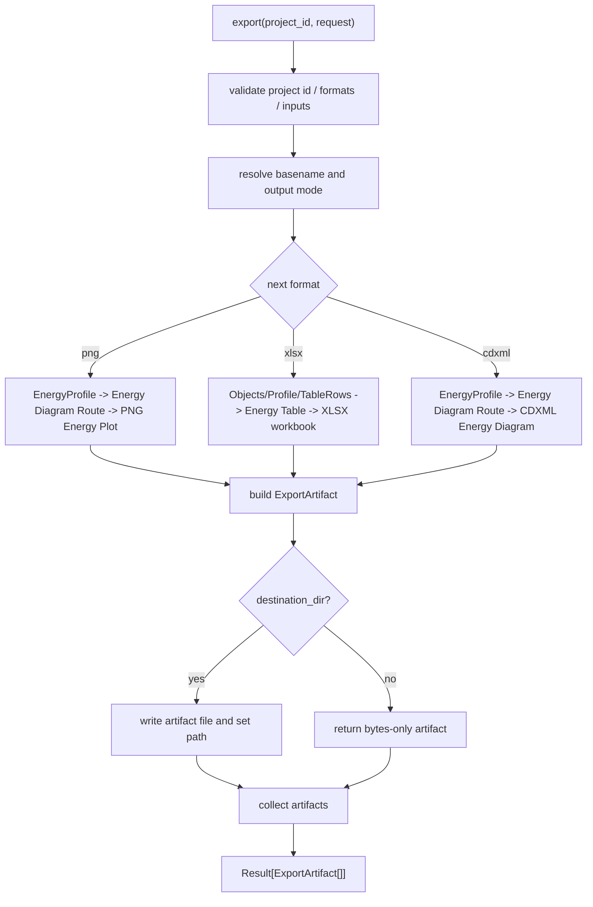

# report-export-baseline design

## 0. 术语约定

| 术语 | 定义 | 防冲突结论 |
|---|---|---|
| Report Export Service | 核心层导出编排服务，把已加载 graph/profile 转成外部 artifact | 新增 export 层；不替代 EnergyProfileEngine 或 GraphEditorWorkspaceService |
| Export Request | 一次导出的输入，包含 project id、目标格式、已加载 graph/profile、文件名和可选输出目录 | 新增请求结构；不是 ProjectManifest resource |
| Export Artifact | 单个导出结果，包含 format、bytes、path、created_at 和元数据 | 新增领域对象；manifest 可引用 export_artifact kind 但本 feature 不写 manifest |
| Energy Table | 以结构名称为第一列的行式能量数据，供 XLSX 和后续 CSV 扩展复用 | 新增派生结构；不重新计算能量 |
| Energy Diagram Route | 从 EnergyProfile 派生的一条能量路径，包含按 path 顺序排列的 state labels 和相对能量 | 新增导出中间结构；不重新计算能量 |
| PNG Energy Plot | 从 Energy Diagram Route 绘制的静态相对能量图 | PNG 来源明确为能量曲线，不是 graph canvas screenshot |
| CDXML Energy Diagram | 从 Energy Diagram Route 生成的 ChemDraw 可编辑能量图对象 | 首版生成 state lines、connectors、labels 和 y-axis，不是分子结构级 ChemDraw 重建 |
| XLSX Energy Workbook | Excel 2007+ `.xlsx` 结构能量表工作簿 | 首版写结构能量表、profile view 和 warning，不写宏或图片嵌入 |
| CSV Energy Table | Energy Table 的纯文本交换格式 | 当前 roadmap 未包含 csv；只保持行式 schema 可兼容，暂不作为本 feature 输出格式 |
| CDX Export | ChemDraw binary `.cdx` 输出 | 暂不进 baseline；需要独立二进制 writer 或 ChemDraw/Revvity 依赖 |

术语 grep 结果：当前代码已有 `EnergyProfile`、`ReactionGraph`、`NetworkPreview`、`ProjectResource.kind="export_artifact"` 和 roadmap 中的 `ExportService` 伪接口。没有 `ReportExportService`、`ExportRequest`、`ExportArtifact` dataclass、`EnergyTable` 或任何真实 PNG/CDXML/XLSX 导出代码。

外部能力调研结论：

- 用户提供的 `20240115-Pd-Ni_LZD.xlsx` 使用“结构名称在第一列”的结构能量表。核心列组包括 `Egas`、gas basis function、`Ggas`、`Ggas+1M`、`Ggas(shermo)`、`Ggas(shermo+1M)`、`Esol`、sol basis function、`Gsol`，并有 `Sgau,tran`、`Swhit,tran`、`Sgau,tran - Swhit,tran`、`T*(S差)/1000`、`RT*0.239006/1000` 等熵/标准态校正列。很多列是 Hartree 与 kcal/mol 成对出现。
- `Energy_Diagram_Plotter_CDXML` 的核心价值是把能量图生成为 ChemDraw 对象。它从 Excel route rows 读取能量和标签，输出 CDXML 中的 state line、connector、text、axis、color table 和 font table，用户打开 ChemDraw 后可以继续编辑。该项目可作为 CDXML energy diagram 的结构参考，但许可证为 CC BY-NC-SA 4.0，本项目不直接复制代码或模板。
- Pillow 官方 `ImageDraw` 支持在 image 上绘制 2D 图形并保存 PNG，适合第一版静态能量曲线。
- XlsxWriter 官方定位是写 Excel 2007+ `.xlsx` 文件，只写不读，和本 feature 的“只生成能量表”边界匹配。
- CSV 可以表达 Energy Table 的行式数值数据，但不能保留多 sheet、公式、格式、warning sheet 或 Excel 模板语义；因此当前 baseline 仍以 XLSX 作为报告用表格格式，CSV 只作为后续轻量交换格式候选。
- Open Babel 文档列出 `cdxml` 和 `cdx` 两种 ChemDraw 2D drawing formats，其中 CDX 在 Open Babel 中是 read-only；RDKit 文档提示 CDXML/CDX 支持依赖可选 ChemDraw parser，并且 CDXML 格式很大，RDKit 只覆盖 molecule/reaction parsing 的基础能力。因此第一版只生成文本 XML 形态的 CDXML energy diagram，不同时承诺 CDX 输出。

## 1. 决策与约束

### 需求摘要

本 feature 的目标是在核心层建立第一版报告导出服务。完成后，调用方应能：

1. 把已计算好的 EnergyProfile 导出为 PNG energy plot。
2. 把 EnergyProfile 导出为 ChemDraw 可编辑的 CDXML energy diagram。
3. 把 ChemicalObject / EnergyProfile 导出为 Excel `.xlsx` 结构能量表。
4. 选择返回内存 bytes，或写入指定输出目录并返回 artifact path。
5. 获得统一的 ExportArtifact 和 `Result` 错误/警告语义。

面向对象是后续 Web/CLI/桌面壳层、报告预览和 agent 生成报告入口。成功标准是：不依赖真实 UI、不读取 Project Store 中尚不存在的 graph/profile 持久化，也能用 Python API 对已加载 graph/profile 生成三个基础导出 artifact。

明确不做：

- 不新增 Web route、CLI 命令、桌面保存面板或真实报告预览 UI。
- 不写 `.rxnflow/manifest.json`，不新增 ProjectResource，也不持久化 graph/profile/export index。
- 不调用 ParserRegistry、ProjectStore.add_raw_file、ImportRegistryWorkflow、ChemicalRegistry 或 GraphPatch。
- 不调用 EnergyProfileEngine 重新计算能量；导出只消费调用方传入的 EnergyProfile。
- PNG 不导出 graph canvas screenshot，不导出组合报告整页，不做交互图表。
- CDXML 不复刻 ChemDraw 完整编辑能力，不从 3D geometry 自动推断 bonds，不生成 molecule-level 可编辑结构，不导出 generic reaction scheme。
- CDX 不进入本 feature；如果后续需要 ChemDraw binary、Office 嵌入或高保真 ChemDraw roundtrip，另起 CDX adapter / ChemDraw integration feature。
- XLSX 不读/改已有 Excel 模板，不生成宏、Excel chart 或图片嵌入。
- CSV 不进入当前 roadmap contract；Energy Table schema 保持 CSV-safe，后续可通过 roadmap update 加入。
- 不实现 PDF、PPTX、SVG、JSON、SDF、MOL 或批量目录导出。

### 复杂度档位

按“核心层 writer adapters + 编排服务”推进。偏离默认项：

- 文件输出 = bytes-first：服务必须支持内存 bytes，方便 agent 测试和未来 Web 下载；可选 destination_dir 只做薄写盘。
- 能量表 = structure-first：表格第一列固定为结构名称，后续列按 gas/solution/standard-state/entropy/profile 分组。
- 第三方依赖 = adapter 边界：PNG/XLSX 依赖放在具体 writer adapter 内延迟 import，缺失时返回 `export_failed`，不让包 import 失败。
- CDXML 兼容目标 = energy diagram：第一版只保证 XML well-formed 和 ChemDraw 可编辑能量图语义，分子结构级 CDXML 或 generic reaction scheme 留后续独立 feature。
- 可测试性 = binary signatures + structured parse：PNG 用文件头/尺寸验证，XLSX 用 zip 内容验证，CDXML 用 XML 结构验证。

### 关键决策

1. **导出消费已加载对象，不查项目持久化**：当前 ChemicalObject、ReactionGraph、WorkspaceSnapshot、EnergyProfile 内容都尚未落盘；因此 Python API 使用已加载 graph/profile 对象，对齐 roadmap 的 id 语义但不假装已有 repository。
2. **PNG/CDXML 共用 Energy Diagram Route**：第一版 PNG 是相对能量曲线静态图；第一版 CDXML 是同一条能量路径的 ChemDraw 可编辑对象。真实 graph canvas screenshot 要等 UI renderer 或 platform shell。
3. **XLSX 以结构能量表为主**：第一版 workbook 的第一列是结构名称；优先输出 ChemicalObject 中已有的 gas/solution/thermochemistry energy channels，同时可附加 EnergyProfile 的相对能量视图。
4. **CDXML 来源固定为 EnergyProfile**：points 转成 state lines 和 connectors；labels 来自 EnergyPoint.label，relative_energy 用作 y 轴坐标；missing point 形成断点或 warning，不编造位置。
5. **CSV 暂不替代 XLSX**：CSV 足够表达行式数据，但不能表达当前样表的多 sheet、公式和格式；当前 feature 保持 XLSX，后续如需要再将 `csv` 加入 roadmap ExportFormat。
6. **CDX 暂不和 CDXML 同时做**：CDX 是 ChemDraw binary，高保真生成难度和依赖边界不同；当前先输出可检查、可测试、可被 ChemDraw 打开的 CDXML。
7. **Export Service 不反向修改核心状态**：不写 manifest、不登记 resource、不修改 graph/profile，也不自动调用 EnergyProfileEngine。
8. **依赖先隔离再拍板**：建议 PNG adapter 用 Pillow，XLSX adapter 用 XlsxWriter；CDXML 首版用标准 XML writer。若用户不接受新依赖，PNG/XLSX 可降级为标准库最小 writer，但视觉/兼容性会下降。

### 待用户确认的假设

- 假设 A：第一版 CDXML 接受“ChemDraw 可编辑的能量图对象”，不要求节点内分子结构可 ChemDraw 化学编辑，也不要求 generic reaction scheme。
- 假设 B：第一版 PNG 只导出 energy profile plot，不导出 graph canvas 或组合报告页。
- 假设 C：接受 Pillow 作为 PNG writer、XlsxWriter 作为 XLSX writer；两者放在 adapter 内延迟 import。
- 假设 D：导出服务只消费调用方传入的 graph/profile；等项目状态持久化后再支持按 graph id / profile id 从 Project Store 读取。
- 假设 E：第一版 XLSX 表格按用户样表走 structure-first schema；当前数据模型没有的 basis function、Shermo/Whitesides 熵校正等字段先留空或来自调用方传入的额外 table rows，不在 export service 中自行解析或推导。
- 假设 F：第一版不生成 CDX；若后续 ChemDraw 工作流确实需要 `.cdx`，单独评估 ChemDraw/Revvity、ChemScript、Open Babel/RDKit 或二进制 writer 方案。
- 假设 G：`Energy_Diagram_Plotter_CDXML` 只作为结构和产品行为参考；RxnFlow 重新实现 CDXML writer，并使用确定性 id / XML builder，避免复制其随机 id、GUI 耦合和许可证约束代码。

### 前置依赖

roadmap item `report-export-baseline` 依赖 `energy-profile-engine` 和 `graph-editor-workspace`，当前均已 `done`。现有实现已提供 `ReactionGraph`、`ReactionNode.position`、`ChemicalObject.energies`、`ChemicalObject.thermochemistry`、`EnergyProfile`、`EnergyPoint`、`EnergyOptions`、`RxnFlowWarning` 和 `ProjectResource.kind="export_artifact"`，但没有 export service、artifact dataclass、basis function 字段、Shermo/Whitesides entropy 字段或输出 writer。

## 2. 名词与编排

### 2.1 名词层：值对象 / 实体 / 接口契约

**现状**：

- `rxnflow.models.EnergyProfile` 已包含 graph id、path id、options、points 和 warnings。
- `rxnflow.models.ChemicalObject` 已包含 label、method、source_file_id、energies 和 thermochemistry；当前没有 basis function、Shermo entropy 或 Whitesides entropy 的专用字段。
- `rxnflow.models.ReactionGraph` 已包含 nodes、edges、paths，ReactionNode 已有可选 position；CDXML energy diagram 第一版不依赖 ReactionNode.position。
- `rxnflow.workspace.NetworkPreview` 可表达网络预览，但属于 workspace 层；export service 不应依赖具体 workspace state。
- roadmap 已定义 `ExportFormat = "png" | "cdxml" | "xlsx"` 和 `ExportArtifact` 伪类型，但代码中尚未落地。
- 项目没有正式依赖清单；当前环境有 Pillow，但没有 XlsxWriter、openpyxl、RDKit 或 Open Babel Python 包。

**变化**：

- 新增 `ExportFormat = Literal["png", "cdxml", "xlsx"]`。
- 新增 `ExportArtifact(id, format, path=None, bytes=None, created_at, metadata={})`。
- 新增 `ExportRequest(formats, graph=None, profile=None, objects=(), table_rows=(), destination_dir=None, basename=None, title=None, options={})`。
- 新增 `EnergyTableColumn(key, label, unit=None, group=None, source=None)`。
- 新增 `EnergyTableRow(structure_name, values, node_id=None, object_id=None, missing_reason=None, warnings=())`。
- 新增 `EnergyDiagramState(node_id, label, relative_value, unit, missing_reason=None)`。
- 新增 `EnergyDiagramRoute(profile_id, path_id, states, color=None, y_axis_label=None)`。
- 新增 `CdxmlDiagramOptions(state_line_span, show_values, show_labels, decimals, y_axis_label, line_style)`。
- 新增 `ReportExportService.export(project_id, request) -> Result[tuple[ExportArtifact, ...]]`。

默认 Energy Table columns：

1. `Structure`：结构名称，来自 ChemicalObject.label、EnergyPoint.label 或调用方 table row。
2. `Egas (Hartree)` / `Egas (kcal/mol)`：优先读取 `energies["egas"]`，没有时可用 `energies["electronic"]` 作为 fallback 并在 metadata 标记。
3. `Gas basis functions`：当前模型无字段，调用方 table row 提供时写入，否则留空。
4. `Ggas (Hartree)` / `Ggas (kcal/mol)`：读取 `thermochemistry["ggas"]` 或 `energies["ggas"]`。
5. `Ggas+1M (Hartree)` / `Ggas+1M (kcal/mol)`：读取 `thermochemistry["ggas_1m"]` 或调用方 table row；export service 不自行套用固定 `+0.003019`。
6. `Ggas(shermo)` / `Ggas(shermo+1M)`：读取对应 table row 或 future thermochemistry keys；当前缺失时留空。
7. `Esol (Hartree)` / `Esol (kcal/mol)`：读取 `energies["esol"]`。
8. `Solution basis functions`：当前模型无字段，调用方 table row 提供时写入，否则留空。
9. `Gsol (Hartree)` / `Gsol (kcal/mol)`：读取 `thermochemistry["gsol"]` 或 `energies["gsol"]`。
10. `Relative energy` / `Missing reason`：profile 传入时附加 path-relative view。

**接口示例：导出 profile PNG + structure-first XLSX bytes**

```python
result = ReportExportService().export(
    "project-a",
    ExportRequest(
        formats=("png", "xlsx"),
        profile=profile,
        objects=objects,
        basename="main-route",
        title="Main route energy",
    ),
)

assert result.ok
assert {artifact.format for artifact in result.value} == {"png", "xlsx"}
assert result.value[0].bytes is not None
```

**接口示例：导出 energy diagram CDXML 到目录**

```python
result = ReportExportService().export(
    "project-a",
    ExportRequest(
        formats=("cdxml",),
        profile=profile,
        destination_dir="/tmp/rxnflow-report",
        basename="main-route",
    ),
)

assert result.ok
assert result.value[0].path.endswith(".cdxml")
```

### 2.2 编排层：主流程与控制流



**现状**：

当前 graph、workspace 和 energy 模块都故意不生成导出 artifact。调用方如果想导出，只能自己读取 EnergyProfile.points 或 ReactionGraph.nodes 拼文件，没有统一 artifact、错误语义、文件命名或范围守护。

**变化**：

- 新增 export workflow：校验请求 → 按格式分派 writer → 生成 bytes → 可选写盘 → 返回 ExportArtifact。
- 新增 ChemicalObject / EnergyProfile / table_rows → EnergyTable workflow：以结构名称为第一列，合并原始能量通道、热化学通道、profile 相对能量、缺失原因和 warnings。
- 新增 EnergyProfile → Energy Diagram Route workflow：按 profile points 生成 state labels、relative energy、missing point 和 y-axis metadata。
- 新增 PNG writer workflow：用 Energy Diagram Route 生成确定尺寸、确定样式的静态曲线图；缺失点显示断点和 warning 标记。
- 新增 XLSX writer workflow：生成一个 workbook，至少包含 `Energy Table` sheet、可选 `Energy Profile` sheet 和可选 `Warnings` sheet。
- 新增 CDXML writer workflow：用 Energy Diagram Route 生成 CDXML document、page、color table、font table、editable state lines、connectors、labels、axis 和 grouped objects。

**跨层纪律**：

- 错误语义：project id 缺失、formats 为空、格式缺少必需输入返回 `invalid_input`；writer dependency 缺失、文件写入失败或生成失败返回 `export_failed`。
- 顺序性：一个 request 内格式按传入顺序处理；任一格式失败则整个 request 返回 error，不产生半成功 Result。
- 幂等性：相同 project id、graph/profile、formats 和 basename 生成稳定 artifact id；写盘时同名文件覆盖策略由本 feature 明确为覆盖或返回错误，不能静默混用。
- 文件边界：destination_dir 只接收目录；basename 必须净化，不能包含路径分隔符或 `..`。
- 可观测点：每个 artifact metadata 记录 source graph id / profile id、path id、object count、format、bytes length、writer id 和 title。
- 依赖边界：writer adapter 内部延迟 import Pillow / XlsxWriter；service module import 不应要求这些依赖存在。

### 2.3 挂载点清单

- Export domain contracts：新增 ExportFormat、ExportArtifact、ExportRequest、EnergyTableColumn、EnergyTableRow。
- ReportExportService：新增统一 export 编排入口。
- Writer adapters：新增 PNG energy plot、XLSX energy workbook、CDXML energy diagram 三个 writer 边界。
- Artifact file sink：新增 bytes-only / destination_dir 写盘边界。
- Export tests：新增格式签名、结构解析、错误语义和范围守护测试。

### 2.4 推进策略

1. **导出名词骨架**：落地 ExportFormat、ExportArtifact、ExportRequest、EnergyTableRow 和 service 空壳。
   - 退出信号：可构造 request，空 formats / 缺 project id 返回 `invalid_input`。
2. **Service 编排与 artifact sink**：实现格式分派、artifact id、bytes-only 返回和 destination_dir 写盘。
   - 退出信号：伪 writer 可返回 bytes artifact，写盘路径安全校验生效。
3. **Energy table 派生**：从 ChemicalObject、EnergyProfile 和可选 table_rows 生成 structure-first 行式数据和 warnings 数据。
   - 退出信号：第一列为结构名称；Egas/Ggas/Esol/Gsol 等缺失字段留空而不是编造；missing point 保留 missing_reason。
4. **XLSX workbook writer**：输出 `Energy Table` sheet、optional `Energy Profile` sheet 和 optional `Warnings` sheet。
   - 退出信号：生成 `.xlsx` zip，可读到 `Energy Table` worksheet、结构名称、能量列和 warnings 内容。
5. **Energy diagram route 派生**：从 EnergyProfile 生成 PNG/CDXML 共享的 state path。
   - 退出信号：有效 points 保留 label/relative energy；missing points 保留断点和 warning。
6. **PNG energy plot writer**：输出 EnergyProfile 静态曲线 PNG。
   - 退出信号：PNG header、尺寸、非空像素和 missing point 标记可验证。
7. **CDXML energy diagram writer**：输出 state-line / connector / label / axis 级 CDXML。
   - 退出信号：XML well-formed，包含 CDXML/page/colortable/fonttable、state labels、relative energy text、connectors 和 y-axis metadata。
8. **范围守护与回归测试**：覆盖不触碰 parser/import/registry/graph patch/energy compute/UI，并保留现有 92 个测试。
   - 退出信号：export tests、fixture/graph/workspace/energy/import/parser 回归全部通过。

## 3. 验收契约

### 关键场景清单

1. 输入空 project id → `export` 返回 `invalid_input`。
2. 输入空 formats → `export` 返回 `invalid_input`。
3. 请求 `png` 但不提供 EnergyProfile → `invalid_input`。
4. 请求 `xlsx` 但不提供 EnergyProfile、ChemicalObject 或 table_rows → `invalid_input`。
5. 请求 `cdxml` 但不提供 EnergyProfile → `invalid_input`。
6. EnergyProfile 含两个有效 points → PNG artifact bytes 以 PNG signature 开头，metadata 记录 profile id。
7. EnergyProfile 含 missing point → PNG 仍成功，metadata/warnings 保留 missing point 语义。
8. ChemicalObject 或 table_rows 含两个结构 → XLSX artifact 为 zip，含 `Energy Table` sheet，第一列为结构名称。
9. EnergyProfile 含两个有效 points → XLSX 可附加 `Energy Profile` sheet 或 profile columns，保留 node label / relative energy 数据。
10. EnergyProfile 含 warnings → XLSX 含 `Warnings` sheet 或等价结构化 warning 输出。
11. EnergyProfile 含两个有效 points → CDXML artifact 为 XML，包含 `CDXML` root、`page`、`colortable`、`fonttable`、state labels、relative energy text 和 connectors。
12. EnergyProfile 含 missing point → CDXML 仍成功，missing point 不生成伪 state line，并在 warnings/metadata 中保留。
13. 请求 `("png", "xlsx", "cdxml")` → 返回三个 ExportArtifact，顺序与 request.formats 一致。
14. 提供 destination_dir + basename → 文件写入指定目录，artifact.path 非空，artifact.bytes 可保留或置空但行为稳定。
15. basename 包含路径分隔符或 `..` → `invalid_input`，不写文件。
16. destination_dir 不存在或不可写 → `export_failed`，错误 target 指向 destination。
17. 缺少 Pillow / XlsxWriter 依赖时 → 对应 writer 返回 `export_failed`，service import 本身不失败。
18. 请求 `cdx` 或 `csv` → 当前返回 unsupported/invalid format，除非先更新 roadmap contract。
19. 现有 `run_core_fixture_vertical_slice()`、EnergyProfileEngine、GraphEditorWorkspaceService、ReactionGraphService、ImportRegistryWorkflow 行为不变。

### 明确不做的反向核对项

- 不新增 Web route、CLI 命令、桌面保存面板或真实报告预览 UI。
- 不写 `.rxnflow/manifest.json`，不新增 ProjectResource，不持久化 graph/profile/export index。
- 不调用 ParserRegistry、ProjectStore.add_raw_file、ImportRegistryWorkflow、ChemicalRegistry 或 GraphPatch。
- 不调用 EnergyProfileEngine 重新计算能量。
- 不导出 graph canvas screenshot、组合报告整页、交互图表、Excel chart、公式、宏或模板。
- 不从 3D geometry 自动推断 bonds，不生成 molecule-level CDXML，不生成 generic reaction scheme CDXML。
- 不生成 CDX；不实现 PDF、PPTX、SVG、CSV、JSON、SDF、MOL 或批量目录导出。

## 4. 后续归并提示

- architecture 归并：验收时在 `.codestable/architecture/ARCHITECTURE.md` 和 `.codestable/architecture/core-platform.md` 补 Report Export Service、ExportRequest、ExportArtifact、Energy Table、Energy Diagram Route、PNG Energy Plot、CDXML Energy Diagram、XLSX Energy Workbook 术语与边界。
- requirement 回写：本 feature 仍是核心 API 能力，若后续 platform shell 暴露用户可点击导出入口，再 backfill 用户需求文档。
- roadmap 回写：design 启动时把 `report-export-baseline` 标为 `in-progress`；acceptance 通过后标为 `done`。
- 依赖决策：若用户确认 Pillow / XlsxWriter，应在后续 `cs-decide` 或包管理 feature 中沉淀第三方依赖边界；CDXML molecule-level 或 CDX export 需要单独评估 RDKit / Open Babel / ChemScript / Revvity 生态。
