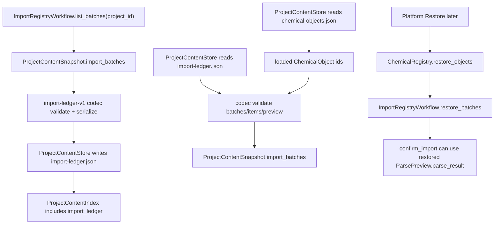

# import-ledger-persistence design

## 0. 术语约定

| 术语 | 定义 | 防冲突结论 |
|---|---|---|
| Import Ledger Persistence | `import-ledger-v1` section 对 ImportBatch / ImportItem / ParsePreview 的长期保存与加载协议 | 区分于 Project Manifest 的 raw file resource index |
| Stored ImportBatch | 写入 `.rxnflow/state/import-ledger.json` 的批量导入记录 | 不是运行中的 parser job，也不是计算任务调度记录 |
| Stored ImportItem | 写入 import ledger 的单文件导入记录，包含状态、raw resource 引用、preview、registered ids、warnings/error | 不保存用户源文件绝对路径 |
| Stored ParsePreview | 可在重启后展示并继续确认导入的解析预览 | 需要保存 object drafts 和 provenance，不能依赖重新 parse |
| Source Path Display | 用于 UI/agent 提示的来源文件名或展示路径 | 不作为恢复依据，不要求仍存在于用户机器 |
| Raw Resource Reference | 指向 Project Manifest 中 raw file resource 的 id | raw 文件恢复依赖 manifest resource path/checksum，不由 import ledger 直接决定 |
| Import Workflow Restore | 从已持久化 ImportBatch 恢复 ImportRegistryWorkflow 的 project-scoped batch state | 不调用 ParserRegistry，不重新复制 raw file，不重新登记 ChemicalObject |
| import-ledger-v1 | Project Content 中 import ledger section 的 schema version | 与 `project-content-v1` index schema 区分 |

术语 grep 结果：当前已有 `ImportRegistryWorkflow`、`ImportBatch`、`ImportItem`、`ParsePreview`、`ImportSelection`、`ImportFileRequest`、`ImportItemStatus` 和 `ProjectResource`。当前没有 `import-ledger-v1`、import ledger codec、`ProjectContentSnapshot.import_batches` 的真实类型约束，也没有 `ImportRegistryWorkflow.restore_batches`。

## 1. 决策与约束

### 需求摘要

本 feature 是 `rxnflow-project-persistence` roadmap 的第四步。完成后，核心层应能：

1. 把 `ImportRegistryWorkflow.list_batches(project_id)` 返回的 ImportBatch 保存为 `import-ledger-v1` section。
2. 保存 ImportItem 的 id、source path display、status、raw resource id、preview、registered_object_ids、warnings 和 error。
3. 保存 ParsePreview 的 raw_resource_id、parser_id、parser_version、object_count、warnings、object_drafts 和 provenance，使 `needs_confirmation` item 在加载后仍可继续 `confirm_import`。
4. 从 `ProjectContentStore.load_snapshot` 恢复 `ProjectContentSnapshot.import_batches`，并能通过 `ImportRegistryWorkflow.restore_batches` 灌回运行态。
5. 对坏 section schema、project id mismatch、重复 batch/item id、非法 status、preview object_count 不一致、preview/provenance parser 信息不一致、registered_object_ids 引用缺失 ChemicalObject、warnings/error shape 错误返回结构化 Result error。
6. 继续保持 ProjectContentStore 不改 manifest、不复制/删除/解析 raw file、不调用 ParserRegistry、ChemicalRegistry.register、ReactionGraphService、EnergyProfileEngine 或 ReportExportService。

明确不做：

- 不重新 parse raw files，不根据 parser version 自动刷新 ParsePreview。
- 不保存用户源文件绝对路径；`source_path_display` 只用于提示。
- 不把 raw file bytes、raw file path/checksum 的权威副本塞进 import ledger；raw resource 仍由 Project Manifest 管理。
- 不实现 stale preview 自动修复、parser version migration 或 “重新解析” 命令。
- 不新增 CLI/Web/desktop command、真实 sidebar UI、文件选择器、拖拽、browser storage adapter、cloud adapter、project bundle 或 migration。
- 不登记新的 ChemicalObject；registered ids 只引用已经由 ChemicalObject persistence 保存的对象。
- 不改变 ImportRegistryWorkflow 的 import/confirm 业务语义、ParserRegistry 选择逻辑或 ChemicalRegistry 去重规则。
- 不持久化 ReactionGraph、WorkspaceSnapshot、EnergyProfile 或 ExportArtifact index 的新内容。

### 复杂度档位

按“导入状态仓储 + confirm-after-reload 基础”推进。偏离默认项：

- 导入恢复性 = required：`needs_confirmation` preview 必须能在恢复后继续 confirm，不靠重新 parse。
- 来源边界 = strict：import ledger 只保存 source display 和 raw resource id，不能把用户绝对路径当恢复依据。
- 引用完整性 = required：registered_object_ids 应能对照已加载 ChemicalObject ids 校验。
- 可测试性 = tested：pending preview 往返、failed item error/warnings、registered ids、restore 后 confirm、错误路径和范围守护都要有单元测试。

### 关键决策

1. **Import ledger 保存状态，不执行导入**：保存/加载只处理 ImportBatch dataclass，不调用 ProjectStore.add_raw_file、ParserRegistry.parse 或 ChemicalRegistry.register。
2. **ParsePreview 保存 object_drafts 和 provenance**：这是恢复后继续 confirm 的必要条件；只保存 parser_id/parser_version/object_count 不足以重建 ParseResult。
3. **source_path 变为 source_path_display**：当前 ImportItem.source_path 可能是用户机器绝对路径；持久化时只作为展示字符串保存，加载后不作为文件读取依据。
4. **raw_resource_id 是恢复锚点**：Stored ImportItem / Stored ParsePreview 都保存 raw_resource_id；raw file path/checksum 的权威来源仍是 Project Manifest，跨文件深校验留给 `project-content-validation-migration`。
5. **ImportRegistryWorkflow 暴露 restore_batches**：新增 `restore_batches(project_id, batches, object_ids=None, replace=False)`，直接恢复 `_batches`，不调用 `import_files` 或 `confirm_import`。
6. **registered ids 只校验存在性，不登记对象**：加载 import ledger 时可用 loaded ChemicalObject ids 校验 registered_object_ids；缺失返回 error 或留给后续 validation/migration 的更细报告。

### 需要确认的技术假设

- 假设 A：`needs_confirmation` 的 ParsePreview 必须保存完整 ChemicalObjectDraft tuple 和 Provenance，保证重启后还能确认登记；如果只保存 object_count，则只能展示不可确认 preview。
- 假设 B：source_path_display 可以保存文件名或原始字符串，但产品上不得承诺该路径仍可访问；恢复依据是项目内 raw file resource。
- 假设 C：`registered_object_ids` 在 load 时应按已加载 ChemicalObject ids 做 hard validation；如果对象缺失，说明 project content 不一致，应返回 error。
- 假设 D：failed item 可以没有 preview / registered ids，但应该保存 error；warnings 可保留。

### 前置依赖

roadmap item `import-ledger-persistence` 依赖 `project-content-store-v1` 和 `chemical-object-persistence`，当前均已 `done`。现有实现已提供：

- `ProjectContentStore.save_snapshot/load_snapshot` 和 `.rxnflow/state/` section 文件协议。
- `chemical-objects-v1` codec 和 `ChemicalRegistry.list_objects/restore_objects`。
- `ImportRegistryWorkflow.import_files/confirm_import/get_batch/list_batches` 和内存 `_batches` 状态。
- `ParsePreview` 仍包含 `parse_result: ParseResult`；`ParseResult` 由 ChemicalObjectDraft tuple + Provenance 组成。
- `ProjectContentSnapshot.import_batches` 当前只是 `tuple[Any, ...]`，且 `project-content-v1` 保存时仍拒绝 import_batches。

## 2. 名词与编排

### 2.1 名词层：值对象 / 实体 / 接口契约

**现状**：

- `ImportBatch` 包含 `id`、`project_id`、`items`。
- `ImportItem` 包含 `id`、`source_path`、`status`、`raw_resource`、`preview`、`registered_object_ids`、`error` 和 `warnings`。
- `ParsePreview` 包含 `raw_resource_id`、`parser_id`、`parser_version`、`object_count`、`warnings` 和 `parse_result`。
- `ProjectContentSnapshot.import_batches` 目前是未落地的 `tuple[Any, ...]`，`save_snapshot` 遇到 import_batches 会返回 `invalid_input`。
- `ImportRegistryWorkflow` 可 list_batches，但没有 restore_batches。

**变化**：

- `ProjectContentSnapshot.import_batches` 收紧为 `tuple[ImportBatch, ...]`。
- `SECTION_PATHS` 增加 `import_ledger -> .rxnflow/state/import-ledger.json`，ProjectContentIndex 可以登记该 section。
- 新增 Import Ledger section codec，负责 `import-ledger-v1` 的 serialize/deserialize/validate。
- `ProjectContentStore` 保存/加载 import ledger section；保存 import_batches 不再被 `project-content-v1` 拒绝。
- `ImportRegistryWorkflow` 新增 `restore_batches(project_id, batches, object_ids=None, replace=False)`。

**接口示例：保存 import ledger**

```python
batches = import_workflow.list_batches("project-a").value
snapshot = ProjectContentSnapshot(
    project_id="project-a",
    chemical_objects=objects,
    import_batches=batches,
)

saved = ProjectContentStore().save_snapshot(project_path, snapshot)
assert saved.ok
```

**接口示例：恢复后继续确认导入**

```python
loaded = ProjectContentStore().load_snapshot(project_path).value
registry.restore_objects(loaded.project_id, loaded.chemical_objects)
import_workflow.restore_batches(
    loaded.project_id,
    loaded.import_batches,
    object_ids={obj.id for obj in loaded.chemical_objects},
)

confirmed = import_workflow.confirm_import(
    loaded.project_id,
    loaded.import_batches[0].id,
    (ImportSelection(loaded.import_batches[0].items[0].id),),
)

assert confirmed.ok
```

**接口示例：failed item 往返**

```python
loaded_item = loaded.import_batches[0].items[1]

assert loaded_item.status == "failed"
assert loaded_item.error.code == "unsupported_format"
assert loaded_item.preview is None
```

### 2.2 编排层：主流程与控制流



**现状**：

当前 ImportBatch / ImportItem 只存在于 ImportRegistryWorkflow 的进程内 `_batches`。ProjectContentStore 不保存 import_batches，关闭进程后 pending preview、failed error、registered ids 和 warnings 都丢失。

**变化**：

- save workflow：从 ImportRegistryWorkflow.list_batches 或调用方 snapshot 获取 ImportBatch tuple → import ledger codec 校验并序列化 → ProjectContentStore 写 `import-ledger.json`。
- load workflow：先加载 ChemicalObject ids → 加载 import ledger → 校验 registered ids 和 preview fields → 返回 ProjectContentSnapshot.import_batches。
- restore workflow：ImportRegistryWorkflow 直接恢复 `_batches`，恢复后 `get_batch/list_batches/confirm_import` 可继续使用。

**跨层纪律**：

- 错误语义：schema 错误、project id 不一致、重复 batch/item id、非法 status、preview shape 错误、object_count 不一致、provenance/parser 信息不一致、registered ids 缺失对象返回 `invalid_input`。
- 幂等性：同一 import ledger snapshot 重复保存得到稳定 JSON/checksum；同一 batch 集合重复 restore 不追加重复 batch。
- 顺序性：batches/items/object_drafts/warnings 按输入顺序保存和加载。
- 来源边界：source_path_display 不参与恢复；raw_resource_id 才是项目内 raw file 引用。
- Parser 边界：load/restore 不调用 ParserRegistry，不因 parser version 变化自动 reparse。
- Registry 边界：restore_batches 不调用 ChemicalRegistry.register；confirm_import 仍保持原有登记语义。
- 扩展点：后续 validation/migration 可把 raw_resource_id 与 manifest resource path/checksum 做深校验，并标记 stale preview。

### 2.3 挂载点清单

- Import Ledger section codec：`import-ledger-v1` 的 serialize/deserialize/validate 边界。
- ProjectContentStore import_ledger section：`.rxnflow/state/import-ledger.json` 写入和加载。
- ProjectContentSnapshot.import_batches：从 Any tuple 收紧为 ImportBatch tuple。
- ImportRegistryWorkflow public API：`restore_batches(project_id, batches, object_ids=None, replace=False)`。
- ParsePreview draft/provenance codec：ChemicalObjectDraft、Provenance、warnings/error 的持久化表达。

### 2.4 推进策略

1. **Import ledger codec 骨架**：实现 ImportBatch / ImportItem / warnings / errors 的 `import-ledger-v1` 往返。
   - 退出信号：batch id/project_id、item id/status/raw_resource_id/source display/warnings/error 往返一致。
2. **ParsePreview draft/provenance 往返**：实现 ChemicalObjectDraft、Provenance 和 ParseResult 的 preview 持久化。
   - 退出信号：needs_confirmation item 加载后仍有 ParsePreview.parse_result，可用于 confirm_import。
3. **ProjectContentStore 接入**：增加 import-ledger section path，允许保存/加载 import_batches，并保持 index/checksum 行为稳定。
   - 退出信号：ProjectContentStore.save_snapshot/load_snapshot 能恢复 import_batches，且 chemical object / graph / workspace sections 不回退。
4. **Import workflow restore API**：新增 restore_batches，恢复 `_batches` 并校验 project/batch/item/registered ids。
   - 退出信号：新 ImportRegistryWorkflow restore 后 list_batches/get_batch 成功，pending preview 可继续 confirm_import。
5. **错误与范围守护**：覆盖坏 schema、project id mismatch、重复 id、非法 status、坏 preview、registered ids 缺失对象、warnings/error shape，以及不碰 parser/graph/energy/export 的边界。
   - 退出信号：新增 import ledger persistence tests 和现有全量 unittest 均通过。

## 3. 验收契约

### 关键场景清单

1. ImportRegistryWorkflow.import_files 产生 `needs_confirmation` item → ProjectContentStore.save_snapshot 写入 `import-ledger.json`，保留 batch id、item id、status、raw_resource_id、source_path_display、warnings 和 preview summary。
2. 上述 snapshot load 后 → `ProjectContentSnapshot.import_batches` 字段恢复 ImportBatch / ImportItem / ParsePreview。
3. 加载后的 ParsePreview.parse_result 保留 ChemicalObjectDraft tuple 和 Provenance，object_count 与 draft 数量一致。
4. 新 ImportRegistryWorkflow.restore_batches 恢复 pending batch 后 → `list_batches` 和 `get_batch` 可读取该 batch。
5. restore 后调用 `confirm_import` 选择 pending item → 成功登记 ChemicalObject，且 registered_object_ids 写回 batch。
6. failed ImportItem 保存/加载后保留 status、error code/message/target/details 和 warnings，不要求 preview。
7. registered ImportItem 保存/加载后保留 registered_object_ids，并校验这些 ids 存在于 loaded ChemicalObject ids。
8. 同一 import ledger snapshot 重复保存 → import-ledger section checksum 稳定，index path/kind 不变。
9. `import-ledger.json` schema_version 不是 `import-ledger-v1` → load_snapshot 返回 `invalid_input`。
10. section project_id 与 ProjectContentIndex.project_id 不一致 → 返回 `invalid_input`。
11. 同一 section 内重复 batch id 或同一 batch 内重复 item id → 返回 `invalid_input`。
12. item status 不属于 ImportItemStatus → 返回 `invalid_input`。
13. preview object_count 与 object_drafts 数量不一致 → 返回 `invalid_input`。
14. preview parser_id/parser_version 与 parse_result.provenance 不一致 → 返回 `invalid_input`。
15. registered_object_ids 引用缺失 ChemicalObject id → 返回 `invalid_input`。
16. warning/error entry 字段缺失或 shape 错误 → 返回 `invalid_input`。
17. save/load 不修改 `.rxnflow/manifest.json`，不新增 ProjectResource，不读取或解析 `inputs/raw/`。
18. 本 feature 不调用 ParserRegistry.parse、ProjectStore.add_raw_file、ChemicalRegistry.register、ReactionGraphService、EnergyProfileEngine 或 ReportExportService。
19. 现有 ProjectContentStore、ChemicalRegistry、Import Workflow、Graph Workspace、Energy Engine、Report Export 和 Platform Shell 测试继续通过。

### 明确不做的反向核对项

- 不保存用户源文件绝对路径作为恢复依据。
- 不保存 raw file bytes 或把 raw resource path/checksum 的权威副本塞进 import ledger。
- 不重新 parse raw files，不根据 parser version 自动刷新 preview。
- 不新增 stale preview migration、reparse command、CLI/Web/desktop command 或 UI。
- 不调用 ChemicalRegistry.register 进行 restore。
- 不持久化 graph/workspace/profile/export 的新 schema。
- 不新增 browser storage、cloud adapter、project bundle、migration、增量保存、并发锁或冲突合并。

## 4. 与项目级架构文档的关系

验收时需要回写：

- `.codestable/architecture/ARCHITECTURE.md`：补 Import Ledger Persistence、import-ledger-v1、restore_batches、ParsePreview draft/provenance 持久化和 source_path_display / raw_resource_id 边界。
- `.codestable/architecture/core-platform.md`：补 Project Content Store 已支持 import-ledger-v1、ImportRegistryWorkflow restore API、import ledger 字段、错误语义和范围边界。
- 不更新 AGENTS.md：本 feature 不新增通用命令或环境约束。

roadmap 回写：

- design 确认后把 `rxnflow-project-persistence-items.yaml` 中 `import-ledger-persistence` 从 `planned` 改为 `in-progress`，feature 填 `2026-05-06-import-ledger-persistence`。
- 验收时再改为 `done` 并同步 roadmap 主文档子 feature 清单。
