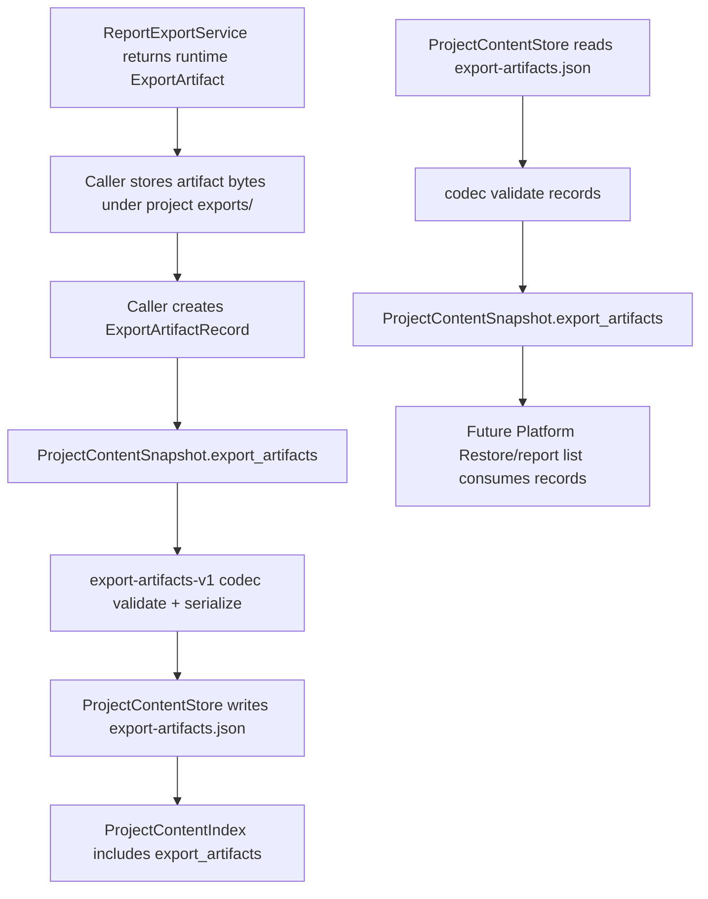

# export-artifact-index-persistence design

## 0. 术语约定

| 术语 | 定义 | 防冲突结论 |
|---|---|---|
| Export Artifact | `ReportExportService` 运行时返回的导出结果，包含 format、可选 path、bytes、created_at 和 metadata | 已存在于 `rxnflow.export.ExportArtifact`；可能携带 bytes 或绝对输出路径 |
| Export Artifact Record | 写入 Project Content 的长期索引记录，包含 id、format、项目相对 path、checksum、metadata、created_at | 新增；不保存 artifact bytes |
| Export Artifact Index | `.rxnflow/state/export-artifacts.json` 中的 `export-artifacts-v1` section | 新增；不是 Project Manifest resource 列表 |
| Artifact Logical Path | 项目相对 POSIX path，第一版要求位于 `exports/` 下 | 区分于 ReportExportService 当前返回的绝对文件系统 path |
| Artifact Checksum | 导出文件 bytes 的 `sha256:<hex>` 校验值 | 保存索引事实；不在本 feature 中重读 artifact bytes 做深校验 |
| Runtime Artifact Bytes | `ExportArtifact.bytes` 中的内存 bytes | 不进入 index JSON；artifact bytes 由 project storage object 管理 |
| export-artifacts-v1 | Project Content 中 export artifact index section 的 schema version | 与 `project-content-v1` index schema 区分 |

术语 grep 结果：当前已有 `ExportArtifact`、`ExportRequest`、`ReportExportService`、`ProjectContentSnapshot.export_artifacts` 和 roadmap 中的 `ExportArtifactRecord` 伪类型。当前 `ProjectContentStore` 对非空 `snapshot.export_artifacts` 直接返回 `invalid_input`，没有 `export-artifacts.json`、独立 codec、record dataclass 或 path/checksum validation。

## 1. 决策与约束

### 需求摘要

本 feature 是 `rxnflow-project-persistence` roadmap 的第六步。完成后，核心层应能：

1. 在 Project Content 中写入 `.rxnflow/state/export-artifacts.json`。
2. 以 `export-artifacts-v1` 保存 ExportArtifactRecord 的 id、format、project-relative path、checksum、metadata 和 created_at。
3. 允许 `ProjectContentSnapshot.export_artifacts` 保存和加载 tuple 化的 artifact index。
4. 校验 format 只属于 `png` / `cdxml` / `xlsx`。
5. 校验 artifact path 是项目相对 POSIX path，且第一版位于 `exports/` 下。
6. 校验 checksum 是 `sha256:<64 hex>`，metadata 是 JSON-safe object。
7. 对坏 section schema、project id mismatch、records shape 错误、重复 artifact id、重复 artifact path、非法 path、unsupported format、坏 checksum 和 metadata shape 返回结构化 Result error。
8. 继续保持 ProjectContentStore 不修改 manifest、不登记 ProjectResource、不保存 artifact bytes、不调用 ReportExportService、不调用 ParserRegistry / ImportRegistryWorkflow / ChemicalRegistry / ReactionGraphService / EnergyProfileEngine。

明确不做：

- 不复制、移动、删除或生成 artifact 文件本身。
- 不把 ExportArtifact bytes 写进 `export-artifacts.json`。
- 不把 export artifact 写入 `.rxnflow/manifest.json` 或登记为 ProjectResource。
- 不调用 ReportExportService，不新增导出格式，不改 PNG/CDXML/XLSX writer。
- 不把 ReportExportService 当前的绝对 `artifact.path` 直接当作长期路径保存。
- 不实现 project bundle、browser storage、cloud adapter、artifact garbage collection、清理孤儿文件、文件存在性深校验或 checksum 重算。
- 不实现 artifact preview UI、下载链接、报告列表面板、CLI/Web/desktop command。
- 不支持 CDX/PDF/PPTX/SVG/CSV 等新格式。

### 复杂度档位

按“已存在导出文件的长期索引 section”推进。偏离默认项：

- 路径安全 = required：index 只接受项目相对 POSIX path，禁止绝对路径、反斜杠、空路径、`.`、`..`；第一版约束在 `exports/` 下。
- checksum = required：record 必须带 sha256 checksum；本 feature 校验 checksum shape，不重读 artifact bytes 复算。
- bytes 边界 = strict：ExportArtifactRecord 不含 bytes；Runtime ExportArtifact.bytes 不进入 Project Content JSON。
- 可测试性 = tested：正常往返、重复 id/path、非法 path、unsupported format、坏 checksum、metadata shape、重复 save checksum、scope guard 都要覆盖。

### 关键决策

1. **新增 ExportArtifactRecord，而不是复用 ExportArtifact**：ExportArtifact 是运行时返回对象，可带 bytes 和绝对 path；长期 index 需要稳定、可备份、可跨端的项目相对记录。
2. **index 只记录文件，不保存 bytes**：artifact bytes 由 storage backend 的 object path 管理；index 只登记 path、checksum 和 metadata。
3. **路径第一版收紧到 `exports/`**：这让 project bundle 和未来清理逻辑有明确边界，避免 index 指向 `.rxnflow/state/`、`inputs/raw/` 或用户机器任意路径。
4. **checksum 必填但不深校验 bytes**：当前 ProjectContentStore 不管理 artifact bytes；读取文件复算 checksum 交给后续 `project-content-validation-migration`。
5. **ReportExportService 不改写为项目仓储服务**：导出 writer 仍只返回 runtime ExportArtifact；调用方或后续 platform save flow 负责把 artifact 转成 ExportArtifactRecord。
6. **metadata 必须 JSON-safe**：保存时禁止 bytes、Path、dataclass、tuple 等不可稳定 JSON 的对象；tuple/list 可在调用方显式转为 list。

### 需要确认的技术假设

- 假设 A：ExportArtifactIndex 第一版只接受 `exports/...` 项目相对路径，不接受 ReportExportService 当前返回的绝对 path。
- 假设 B：checksum 作为 record 必填字段；本 feature 只校验 `sha256:<hex>` 形状，不读取 artifact 文件复算。
- 假设 C：`ExportArtifactRecord` 放在 `rxnflow.export` 模块，与 `ExportArtifact` 并列；ProjectContentStore 通过独立 codec 保存 record tuple。
- 假设 D：metadata 只保存 JSON-safe object；如果 ReportExportService.metadata 中有 tuple，转换 record 前需要转成 list。
- 假设 E：本 feature 不提供“从 ExportArtifact 自动写入 exports/ 并登记”的高级 helper；后续 Platform Restore / save_content 再接这条链路。

### 前置依赖

roadmap item `export-artifact-index-persistence` 依赖 `project-content-store-v1` 和 `energy-profile-persistence`，当前均已 `done`。现有实现已提供：

- `ReportExportService.export` 和 runtime `ExportArtifact`。
- `ProjectContentStore.save_snapshot/load_snapshot`、`ProjectContentSnapshot.export_artifacts` 占位字段。
- `ProjectStorageBackend` 的项目相对 path 读写协议。
- `EnergyProfile` 长期持久化，后续导出记录可引用 profile id。

## 2. 名词与编排

### 2.1 名词层：值对象 / 实体 / 接口契约

**现状**：

- `rxnflow.export.ExportArtifact` 包含 `id`、`format`、`path`、`bytes`、`created_at` 和 `metadata`。
- `ReportExportService` 可返回 bytes-only artifact，也可写入 `destination_dir` 并返回 `artifact.path`；该 path 当前是文件系统 path，不保证项目相对。
- `ProjectContentSnapshot.export_artifacts` 是 `tuple[Any, ...]`，非空时被 `ProjectContentStore` 拒绝。
- Project Content Index 当前不包含 `export_artifacts` section。

**变化**：

- 新增 `ExportArtifactRecord(id, format, path, checksum, metadata, created_at)`。
- 将 `ProjectContentSnapshot.export_artifacts` 收紧为 `tuple[ExportArtifactRecord, ...]`。
- 新增 `export-artifacts-v1` section codec，负责 records 的 serialize/deserialize/validate。
- ProjectContentStore 增加 `export_artifacts` section path：`.rxnflow/state/export-artifacts.json`。
- ProjectContentStore 保存/加载 `ProjectContentSnapshot.export_artifacts`，不再拒绝非空 export artifact index。

**接口示例：登记已写入项目 exports 目录的 artifact**

```python
record = ExportArtifactRecord(
    id="artifact-png-main",
    format="png",
    path="exports/main-route.png",
    checksum="sha256:...",
    metadata={"profile_id": "profile-main", "writer_id": "pillow-energy-plot-v1"},
    created_at="2026-05-07T00:00:00Z",
)

snapshot = ProjectContentSnapshot(project_id="project-a", export_artifacts=(record,))
saved = ProjectContentStore().save_snapshot(project_path, snapshot)

assert saved.ok
```

**接口示例：恢复 artifact index**

```python
loaded = ProjectContentStore().load_snapshot(project_path).value
record = loaded.export_artifacts[0]

assert record.path == "exports/main-route.png"
assert record.format == "png"
```

**接口示例：拒绝 runtime bytes**

```python
record = ExportArtifactRecord(
    id="artifact-bad",
    format="png",
    path="/tmp/main-route.png",
    checksum="sha256:...",
)

assert not ProjectContentStore().save_snapshot(project_path, ProjectContentSnapshot("project-a", export_artifacts=(record,))).ok
```

### 2.2 编排层：主流程与控制流



**现状**：

当前 `ReportExportService` 负责生成 runtime ExportArtifact，但 ProjectContentStore 不接受 export_artifacts，Project Content 不会记录已导出的文件。用户或 agent 如果保存了 PNG/CDXML/XLSX 文件，项目状态里没有可恢复的 artifact list。

**变化**：

- save workflow：调用方提供 ExportArtifactRecord tuple → export artifact codec 校验 id/format/path/checksum/metadata → ProjectContentStore 写 `export-artifacts.json`。
- load workflow：读取 export artifacts section → 校验 shape 和 project id → 返回 ProjectContentSnapshot.export_artifacts。
- restore/list workflow：本 feature 不新增 Platform Shell 命令；后续 Platform Restore 可消费 loaded records 展示 artifact_count 或报告列表。

**跨层纪律**：

- 错误语义：schema 错误、project id 不一致、records 不是 list、record 不是 object、重复 id/path、unsupported format、unsafe path、bad checksum、metadata 非 object 返回 `invalid_input`。
- 幂等性：同一 artifact index snapshot 重复保存得到稳定 JSON/checksum。
- 顺序性：records 按调用方输入顺序保存和加载。
- 文件边界：record.path 必须是 `exports/...` 项目相对 POSIX path；index 不读取、不写入、不删除 artifact bytes。
- 兼容边界：ExportArtifactRecord.metadata 只要求 JSON-safe，不理解每个 writer 的 metadata schema。
- Export 边界：ReportExportService 可产生 runtime artifact，但本 feature 不调用 writer，不新增格式，不改 artifact bytes。

### 2.3 挂载点清单

- Export Artifact Record contract：长期 index record 的 dataclass 边界。
- Export Artifact Index section codec：`export-artifacts-v1` 的 serialize/deserialize/validate 边界。
- ProjectContentStore export_artifacts section：`.rxnflow/state/export-artifacts.json` 写入和加载。
- ProjectContentSnapshot.export_artifacts：项目内容快照中的 artifact index 入口。
- Artifact logical path/checksum validation：项目相对 path、format、checksum 和 metadata 的一致性校验。

### 2.4 推进策略

1. **ExportArtifactRecord 名词骨架**：落地 record dataclass，收紧 ProjectContentSnapshot.export_artifacts。
   - 退出信号：可构造 record；ProjectContentSnapshot.export_artifacts 类型语义明确。
2. **Export artifact index codec 骨架**：实现 `export-artifacts-v1` section 的 schema/project/records 往返。
   - 退出信号：空 index 和单条 record 往返一致；坏 schema/project id 返回 Result error。
3. **Path/checksum/metadata 严格校验**：校验 format、exports/ path、checksum、metadata JSON-safe、重复 id/path。
   - 退出信号：非法 path、absolute path、unsupported format、bad checksum、metadata shape 和重复 id/path 返回 `invalid_input`。
4. **ProjectContentStore 接入**：增加 export_artifacts section path，保存/加载 snapshot.export_artifacts，保持 index/checksum 行为稳定。
   - 退出信号：ProjectContentStore.save_snapshot/load_snapshot 可恢复 export artifact records，且其他 sections 不回退。
5. **错误与范围守护**：覆盖不保存 bytes、不碰 manifest/resource、不调用 export writer/parser/import/registry/graph/energy/platform 的边界。
   - 退出信号：新增 export artifact index tests 和现有全量 unittest 均通过。

## 3. 验收契约

### 关键场景清单

1. 构造 ExportArtifactRecord → 字段包含 id、format、path、checksum、metadata、created_at。
2. ProjectContentStore.save_snapshot 保存含 export_artifacts 的 snapshot → 写入 `.rxnflow/state/export-artifacts.json`。
3. 保存结果 ProjectContentIndex → files 包含 kind `export_artifacts`，path 为 `.rxnflow/state/export-artifacts.json`。
4. ProjectContentStore.load_snapshot → 恢复 `ProjectContentSnapshot.export_artifacts` 为 ExportArtifactRecord tuple。
5. 同一 artifact index snapshot 重复保存 → export-artifacts section checksum 稳定，index path/kind 不变。
6. `export-artifacts.json` schema_version 不是 `export-artifacts-v1` → load_snapshot 返回 `invalid_input`。
7. section project_id 与 ProjectContentIndex.project_id 不一致 → 返回 `invalid_input`。
8. `artifacts` 不是 list 或 record 不是 object → 返回 `invalid_input`。
9. 同一 section 内重复 artifact id → 返回 `invalid_input`。
10. 同一 section 内重复 artifact path → 返回 `invalid_input`。
11. format 不是 `png` / `cdxml` / `xlsx` → 返回 `invalid_input`。
12. path 是绝对路径、包含 `..`、包含反斜杠、为空或不在 `exports/` 下 → 返回 `invalid_input`。
13. checksum 缺失、非字符串或不是 `sha256:<64 hex>` → 返回 `invalid_input`。
14. metadata 不是 object，或包含 bytes / Path / dataclass 等非 JSON-safe value → 返回 `invalid_input`。
15. ExportArtifactRecord 不保存 bytes；`export-artifacts.json` 中没有 `bytes` 字段。
16. save/load 不修改 `.rxnflow/manifest.json`，不新增 ProjectResource，不读取或写入 artifact file bytes。
17. 本 feature 不调用 ReportExportService、ParserRegistry、ImportRegistryWorkflow、ChemicalRegistry.register、ReactionGraphService.apply_patch、EnergyProfileEngine 或 PlatformShellService。
18. 现有 ProjectContentStore、Report Export、Energy Profile Persistence、Import Ledger、Graph Workspace 和 Platform Shell 测试继续通过。

### 明确不做的反向核对项

- 不生成、复制、移动、删除或校验 artifact bytes。
- 不把 ExportArtifact.bytes 写入 Project Content JSON。
- 不把 ExportArtifactRecord 写入 Project Manifest 或 ProjectResource。
- 不新增导出格式，不改 PNG/CDXML/XLSX writer，不支持 CDX/PDF/PPTX/SVG/CSV。
- 不新增 UI、CLI/Web/desktop command、browser storage、cloud adapter、project bundle、migration、artifact cleanup 或 garbage collection。
- 不根据 artifact metadata 自动校验 graph/profile/object 引用存在；跨 section 引用深校验留给 `project-content-validation-migration`。

## 4. 与项目级架构文档的关系

验收时需要回写：

- `.codestable/architecture/ARCHITECTURE.md`：补 Export Artifact Index、`export-artifacts-v1`、ExportArtifactRecord 与 runtime ExportArtifact 的边界、bytes 不进入 index 的约束。
- `.codestable/architecture/core-platform.md`：补 Project Content Store 已支持 export-artifacts-v1，ExportArtifactRecord fields、path/checksum/metadata 错误语义和范围边界。
- `.codestable/requirements/project-content-persistence.md`：更新用户故事/边界，把导出 artifact index 纳入可恢复项目内容。
- 不更新 AGENTS.md：本 feature 不新增通用命令或环境约束。

roadmap 回写：

- design 确认后把 `rxnflow-project-persistence-items.yaml` 中 `export-artifact-index-persistence` 从 `planned` 改为 `in-progress`，feature 填 `2026-05-07-export-artifact-index-persistence`。
- 验收时再改为 `done` 并同步 roadmap 主文档子 feature 清单。
