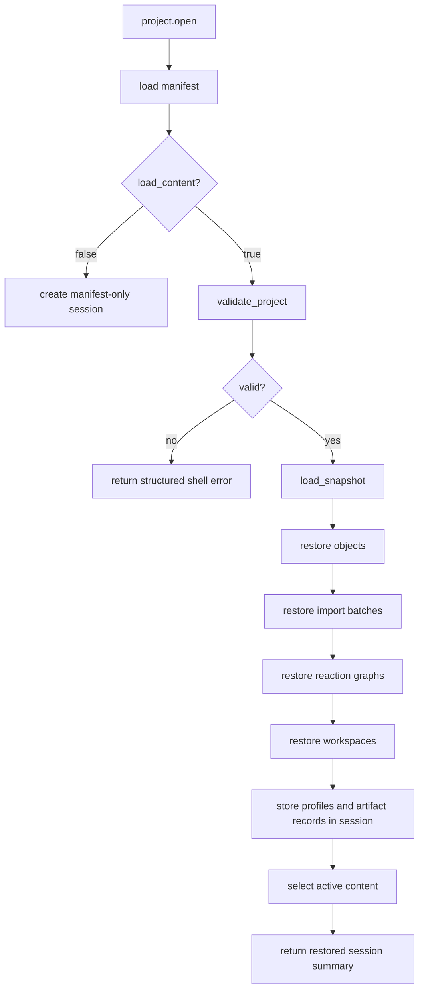
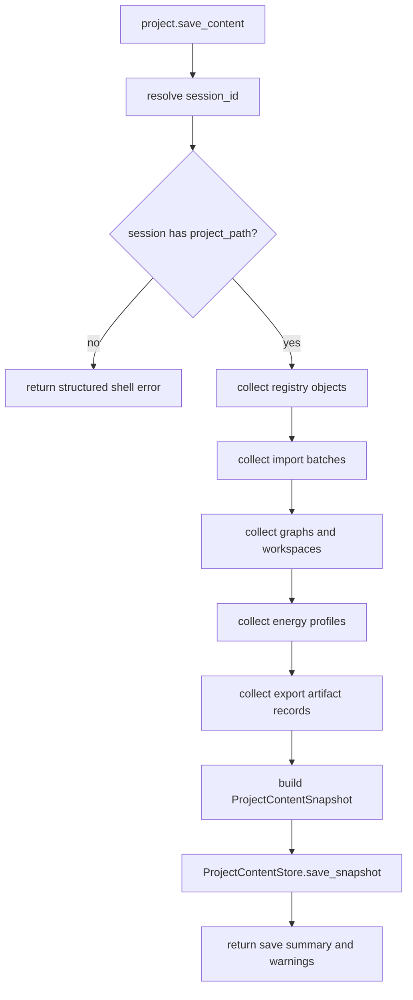

# Platform Shell State Restore Design

## 0. Terminology

- Project Open: `project.open` 命令。加载项目 manifest，并在 `load_content=true` 时读取、校验、恢复项目内容快照。
- Save Content: `project.save_content` 命令。把当前 shell session 中的领域服务状态和会话缓存写回项目内容快照。
- Restored Session Summary: `ShellResponse.data` 中面向 shell / agent / CLI 的恢复摘要，至少包含 object / graph / workspace / profile / artifact 数量。
- Session Content Snapshot: 从当前 `PlatformShellService` 内存会话收集出的 `ProjectContentSnapshot`。
- Active Content Selection: 恢复后供既有命令继续操作的活动 graph / workspace / profile。默认选择第一个已恢复 workspace，并用它关联的 graph 作为活动 graph；没有 workspace 时再选择第一个 graph / profile。
- Project Artifact Record Candidate: runtime `ShellArtifact` 中可转换为持久 `ExportArtifactRecord` 的导出物。只有路径位于 `<project>/exports/...` 下且可计算 checksum 时才持久化。

## 1. Decisions And Constraints

### Scope

本 feature 实现 roadmap item `platform-shell-state-restore`，让平台壳层能恢复和保存已持久化的项目内容。范围是 shell 编排和 CLI 可观测入口，不改变领域 codec / schema，不引入 UI、云存储或桌面运行时。

### Decisions

- 新增 `project.open`，保留既有 `project.load` 的 manifest-only 语义，避免破坏现有测试和脚本。
- `project.open` 默认 `load_content=true`；当 `load_content=false` 时只创建 manifest-only session。
- `project.open(load_content=true)` 在 restore 前调用 `ProjectContentStore.validate_project`；校验失败返回结构化错误，不做半恢复。
- 缺失或损坏的内容快照不静默忽略。需要只看 manifest 的场景继续使用 `project.load` 或显式 `project.open(load_content=false)`。
- Restore 只恢复已持久化内容，不重新解析 raw 文件、不重新登记 import、不重新计算 energy profile、不重新导出报告。
- Save content 基于当前进程内 shell session。`project.save_content` 必须带可用 `session_id`，并要求该 session 有 `project_path`。
- CLI 先只暴露 `project open`。由于当前 CLI 是一次性进程，暂不暴露容易误导的 `project save-content`；否则用户会以为可以保存另一个命令进程里的内存 session。
- 为避免 open -> save 丢失多内容，session state 从单一 graph / workspace / profile 扩展为可保存 collections：objects、import batches、reaction graphs、workspaces、energy profiles、export artifact records，并继续保留 active graph / workspace / profile 供既有命令使用。
- Runtime `ShellArtifact` 只有在文件路径位于当前项目 `exports/` 目录下时转换为 `ExportArtifactRecord`；外部路径、bytes-only artifact 或 checksum 失败返回 warning，不作为 fatal error。

### Non-goals

- 不实现 `project.export_bundle` / `project.import_bundle`，这属于后续 `project-bundle-import-export`。
- 不实现浏览器、云端、桌面 app、后台同步或多进程会话存储。
- 不改变 `ProjectContentSnapshot` schema、codec 或迁移策略。
- 不做 raw 文件重解析、batch 重新确认、energy 重新计算或报告重新导出。
- 不自动修复损坏内容，不删除孤儿 raw/export 文件。
- 不把导出文件 bytes 写入 JSON 快照。

### Confirmation Needed

- 是否接受 `project.open` 与 `project.load` 分离：open 恢复内容，load 只读 manifest。
- 是否接受 CLI 当前只提供 `project open`，不提供 `project save-content`。
- 是否接受 validation 失败时 `project.open(load_content=true)` 直接失败，而不是带 warning 继续打开部分内容。
- 是否接受 runtime artifact 只有位于 `<project>/exports/...` 的文件会被保存为 artifact record。

## 2. Shape

### Existing State

- `AppKernel` 当前持有 `ProjectStore`、parser registry、chemical registry、import workflow、reaction graph service、workspace service、energy engine 和 export service，但没有 `ProjectContentStore`。
- `PlatformShellService` 当前只有 `project.create` / `project.load`，其中 `project.load` 只加载 manifest 并创建 session。
- `_PlatformSessionState` 当前以单个 graph / workspace / profile 为主；多 graph、多 workspace、多 profile 无法完整 roundtrip。
- `export.profile` 返回 runtime `ShellArtifact`，路径是绝对输出路径；尚未转换为 `ProjectContentSnapshot.export_artifacts` 所需的项目相对 `exports/...` 记录。
- CLI 当前支持 `fixture`、`project create`、`project load`、`import preview`，没有 project open。

### New Interfaces

Python shell API:

```python
response = service.run(
    ShellCommand(
        "project.open",
        {"project_path": "/path/to/project", "load_content": True},
    )
)

save_response = service.run(
    ShellCommand(
        "project.save_content",
        {"session_id": response.session_id},
    )
)
```

CLI:

```bash
python3 -m rxnflow.cli project open --json --project-path /path/to/project
python3 -m rxnflow.cli project open --json --project-path /path/to/project --manifest-only
```

Expected summary fields:

```json
{
  "project_id": "example",
  "project_path": "/path/to/project",
  "object_count": 2,
  "graph_count": 1,
  "workspace_count": 1,
  "profile_count": 1,
  "artifact_count": 1,
  "active_graph_id": "graph-1",
  "active_workspace_id": "workspace-1",
  "active_profile_id": "profile-1",
  "warnings": []
}
```

### Project Open Flow



### Save Content Flow



### Implementation Mount Points

- `rxnflow.platform.AppKernel`: 增加 `ProjectContentStore`。
- `rxnflow.platform._PlatformSessionState`: 增加 content collections 和 active content 字段，保留既有字段兼容当前命令。
- `rxnflow.platform.PlatformShellService.run`: 增加 `project.open` / `project.save_content` 分支。
- `rxnflow.platform`: 增加内部 helper，用于 validate/load/restore、session snapshot 构建、artifact record 转换和 restored summary 生成。
- `rxnflow.cli`: 增加 `project open` 子命令和 JSON 输出。
- Tests: 增加平台 shell restore/save、CLI open、validation failure、artifact record warning、scope guard 回归测试。

## 3. Acceptance Scenarios

- `project.open(load_content=true)` 能从已保存的 project content 恢复 objects、import batches、reaction graphs、workspaces、energy profiles 和 export artifact records，并返回准确 counts。
- 恢复后，`ChemicalRegistry`、`ImportRegistryWorkflow`、`ReactionGraphService`、`GraphEditorWorkspaceService` 的 list 接口能读到对应项目内容。
- 恢复后 active workspace / graph / profile 可被既有 `workspace.add_node`、`workspace.connect`、`workspace.set_path`、`energy.compute`、`export.profile` 继续使用。
- `project.open(load_content=false)` 只创建 manifest-only session，counts 为 0，且不访问 content snapshot。
- `project.open(load_content=true)` 遇到校验失败返回结构化错误，包含 validation report 摘要，不做部分恢复。
- `project.save_content` 能把当前 session 保存为 `ProjectContentSnapshot`，随后 `ProjectContentStore.load_snapshot` 可以读取。
- open -> save roundtrip 不丢失多个 graph、workspace、profile、import batch 和 export artifact record。
- `project.save_content` 缺少 session 或 session 没有 `project_path` 时返回结构化错误。
- runtime artifact 只有位于项目 `exports/` 下才持久化；外部路径或 bytes-only artifact 产生 warning。
- `project.export_bundle` / `project.import_bundle` 不在本 feature 中出现。
- CLI `project open --json --project-path <path>` 输出 restored session summary；`--manifest-only` 输出 manifest-only summary。
- 既有 shell、CLI、scope guard 和 content persistence 单元测试继续通过。
- Restore 路径测试确认没有调用 parser/import register/energy compute/export 这类会重新生成内容的流程。

## 4. Architecture And Docs Updates

- 更新 `.codestable/architecture/` 中 platform shell 现状，记录 `project.open` / `project.save_content` 和 restore/save 边界。
- 更新 `.codestable/requirements/` 中 project content persistence 的现状，补充 shell 级打开和保存能力。
- acceptance 阶段回写 roadmap item 状态为 done，并产出 acceptance 文档。
- 不新增用户指南；CLI open 目前作为平台验证入口保留在 feature/architecture 文档中。
