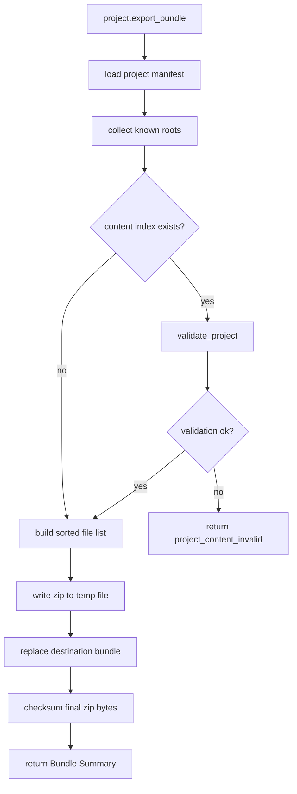
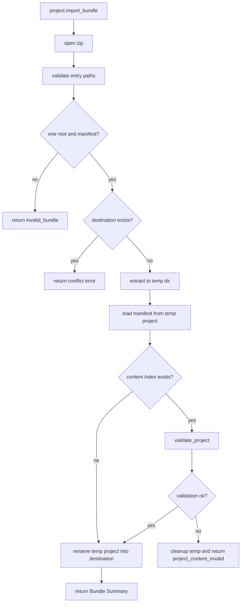

# Project Bundle Import Export Design

## 0. Terminology

- Project Bundle: 以 `.rxnflow.zip` 结尾的 RxnFlow 项目包，内部只包含一个项目根目录。
- Bundle Root: zip 内唯一的 top-level directory，例如 `demo-project/`。
- Bundle Export: 从本地 Project Directory 复制 `.rxnflow/`、`inputs/raw/` 和 `exports/` 到 zip package。
- Bundle Import: 从 `.rxnflow.zip` 解包到目标父目录，生成新的 Project Directory。
- Conflict Policy: import 遇到同名目标目录时的处理策略。第一版只支持 `fail_if_exists`，不支持覆盖。
- Bundle Summary: shell / CLI 返回的 JSON-safe 摘要，包含 bundle path、project path、project id、file count、byte size、checksum 和 validation summary。

术语检索结果：当前 architecture/roadmap 中已有 `Project Bundle` 协议；代码中没有 `project.export_bundle`、`project.import_bundle` 或 bundle module。`tests/test_platform_shell_baseline.py` 目前用 scope guard 明确禁止 bundle shell command，说明这条 feature 的实现会移除该 guard。

## 1. Decisions And Constraints

### Scope

本 feature 实现 roadmap item `project-bundle-import-export`：让本地 CLI / agent / future desktop bridge 能把一个 RxnFlow Project Directory 打成 `.rxnflow.zip`，并能把该 zip 安全导入为新的 Project Directory。它服务本地备份和早期网页“用户自己导入/导出项目包”的同步路径，不引入云存储。

### Decisions

1. **Bundle 是传输格式，不是 live storage**：导出和导入只复制项目文件；打开项目仍走 `project.open`，保存当前 session 仍走 `project.save_content`。
2. **只打包已知项目根**：第一版只包含 `.rxnflow/`、`inputs/raw/`、`exports/`。项目根下的散落文件、notes、临时脚本和系统文件不进入 bundle。
3. **Manifest 是权威入口**：bundle 不新增 `bundle.json`；导入时要求 `<root>/.rxnflow/manifest.json` 存在并可由 `ProjectStore.load_project` 读取。
4. **Project Content 有则必须有效**：导出或导入时，如果 `.rxnflow/state/project-content.json` 存在，就运行 `ProjectContentStore.validate_project`；validation error 阻止打包或落地，warning 随响应返回。
5. **Manifest-only 项目允许打包**：只有 manifest、raw files 或空 state 的早期项目可以导出；缺失 content index 不作为 fatal error。
6. **Import 先验路径安全再写磁盘**：读取 zip central directory 时先拒绝绝对路径、空路径、`.`、`..`、反斜杠、多 top-level root、`__MACOSX` 和 root 外文件，再进入临时目录解包。
7. **Import 不自动覆盖**：第一版只支持 `conflict_policy="fail_if_exists"`；目标 `<destination_dir>/<bundle-root>` 已存在时返回结构化错误，不 rename、不 merge、不 overwrite。
8. **Zip 输出尽量稳定**：导出按项目相对 POSIX path 排序写入，并跳过 `.DS_Store` 等系统元数据；checksum 基于最终 zip bytes 返回。
9. **CLI 暴露传输命令**：新增 `project export-bundle` 和 `project import-bundle`，仍只输出 JSON；不新增 CLI `save-content`。
10. **Platform Shell 不恢复 bundle 内容**：`project.import_bundle` 成功后返回 imported project summary；调用方要继续编辑时显式调用 `project.open`。

### Non-goals

- 不实现浏览器 IndexedDB / OPFS adapter、Web UI 文件选择器、拖拽导入、云端上传或账号同步。
- 不实现 overwrite、rename、merge、diff、冲突合并、CRDT 或多人协作。
- 不把当前内存 session 自动保存进 bundle；需要调用方先 `project.save_content`。
- 不重新 parse raw files、不重新 confirm import、不重新计算 energy profile、不重新导出报告。
- 不新增 Project Content schema，也不迁移旧 schema。
- 不把项目根下任意附加文件视为 RxnFlow 项目内容。

### Confirmation Needed

- 是否接受第一版 bundle 只包含 `.rxnflow/`、`inputs/raw/`、`exports/`，不带用户放在项目根的杂项文件。
- 是否接受 content index 存在时强制 validation 通过；不存在时允许导出 manifest-only 项目。
- 是否接受第一版 import 只支持 `fail_if_exists`，完全不覆盖、不自动改名。
- 是否接受 import 成功后不自动 open session，而是让调用方再执行 `project.open`。

## 2. Shape

### Existing State

- `ProjectStore` 已负责创建和加载 Project Directory，并把 raw file resource 复制到 `inputs/raw/`。
- `ProjectContentStore` 已负责 `.rxnflow/state/` 下的 snapshot save/load/validate，并通过本地 storage backend 读取项目相对 POSIX path。
- `PlatformShellService` 已支持 `project.open` 和 `project.save_content`，但还没有 bundle 命令。
- `rxnflow.cli` 当前支持 fixture、project create/load/open 和 import preview；还没有 bundle 子命令。
- Roadmap 4.8 已规定 bundle layout：`<project-name>.rxnflow.zip` 内有 `<project-root>/.rxnflow/`、`inputs/raw/`、`exports/`，且 import 不自动覆盖。

### New Interfaces

Core service level:

```python
@dataclass(frozen=True)
class ProjectBundleSummary:
    bundle_path: str
    project_path: str | None
    project_id: str | None
    root_name: str
    file_count: int
    byte_size: int
    checksum: str
    validation_summary: dict[str, object]

class ProjectBundleService:
    def export_bundle(self, project_path: str, destination_path: str) -> Result[ProjectBundleSummary]: ...
    def import_bundle(
        self,
        bundle_path: str,
        destination_dir: str,
        conflict_policy: str = "fail_if_exists",
    ) -> Result[ProjectBundleSummary]: ...
```

Platform shell commands:

```python
ShellCommand(
    "project.export_bundle",
    {"project_path": "/path/to/project", "destination_path": "/tmp/demo.rxnflow.zip"},
)

ShellCommand(
    "project.import_bundle",
    {
        "bundle_path": "/tmp/demo.rxnflow.zip",
        "destination_dir": "/path/to/projects",
        "conflict_policy": "fail_if_exists",
    },
)
```

CLI:

```bash
python3 -m rxnflow.cli project export-bundle --json \
  --project-path /path/to/project \
  --destination-path /tmp/demo.rxnflow.zip

python3 -m rxnflow.cli project import-bundle --json \
  --bundle-path /tmp/demo.rxnflow.zip \
  --destination-dir /path/to/projects \
  --conflict-policy fail-if-exists
```

Expected shell response shape:

```json
{
  "command": "project.export_bundle",
  "bundle": {
    "bundle_path": "/tmp/demo.rxnflow.zip",
    "project_path": "/path/to/project",
    "project_id": "project-demo",
    "root_name": "demo",
    "file_count": 9,
    "byte_size": 12345,
    "checksum": "sha256:...",
    "validation_summary": {"error_count": 0, "warning_count": 0}
  }
}
```

### Bundle Export Flow



### Bundle Import Flow



### Implementation Mount Points

- `rxnflow.project_bundle`: 新增 bundle import/export 服务和 bundle path validation。删除该模块后 bundle feature 应整体消失。
- `rxnflow.platform.AppKernel`: 装配 `ProjectBundleService`。
- `rxnflow.platform.PlatformShellService.run`: 增加 `project.export_bundle` / `project.import_bundle` 分支，并把 `ProjectBundleSummary` 投影为 JSON-safe response。
- `rxnflow.cli`: 增加 `project export-bundle` / `project import-bundle` 子命令。
- Tests: 增加 bundle service、platform shell、CLI 和 scope guard 测试；移除上一 feature 中禁止 bundle 命令的 guard。

### Cross-layer Discipline

- 错误语义：unsafe zip path、缺 manifest、多 root、非 zip、坏 suffix 返回 `invalid_bundle` 或 `invalid_input`；content validation error 返回 `project_content_invalid`；I/O 异常返回 `internal_error`。
- 幂等性：同一项目内容重复导出应产生相同 file list；zip checksum 在固定 metadata 策略下稳定。重复 import 到同一 destination 在 `fail_if_exists` 下必须失败，不覆盖旧项目。
- 顺序与原子性：export 先写临时 zip 再替换 destination；import 先解到临时目录并通过 manifest/content validation，再 rename 为最终目录。
- 路径纪律：zip 内所有路径先转为 POSIX logical path 校验；解包前不得把 entry name 直接拼到本地文件系统路径。
- 可观测性：所有成功响应返回 file count、byte size、bundle checksum、project id 和 validation summary；validation warning 以 shell warnings 暴露。

### Rollout Strategy

1. **Bundle service noun layer**：定义 `ProjectBundleSummary`、conflict policy、zip entry path validation 和 checksum summary。
   - 退出信号：可独立 inspect 一个 zip，并对多 root、traversal、missing manifest 给出结构化错误。
2. **Export orchestration**：从 Project Directory 收集已知 roots，执行可选 content validation，写出 `.rxnflow.zip`。
   - 退出信号：包含 manifest/state/raw/export 的项目能导出；无 content index 的 manifest-only 项目也能导出。
3. **Import orchestration**：验证 zip、临时解包、manifest/content validation、无覆盖落地。
   - 退出信号：导出的 bundle 能导入到新目录，并能被 `ProjectStore.load_project` 和 `ProjectContentStore.load_snapshot` 读取。
4. **Platform shell wiring**：接入 AppKernel 和 shell commands。
   - 退出信号：`project.export_bundle` / `project.import_bundle` 返回 JSON-safe summary 和 warnings。
5. **CLI wiring and guards**：增加 CLI 子命令，并补齐 scope guard。
   - 退出信号：CLI 命令成功/失败 exit code 正确，且不引入 Web/cloud/desktop framework。

## 3. Acceptance Scenarios

1. 给定包含 `.rxnflow/manifest.json`、`.rxnflow/state/`、`inputs/raw/` 和 `exports/` 的项目，执行 bundle export 后生成 `.rxnflow.zip`，内部只有一个 root，root 下只包含 `.rxnflow/`、`inputs/raw/`、`exports/` 的安全 POSIX paths。
2. 导出的 bundle 再 import 到空 destination 后，`ProjectStore.load_project` 可读取 manifest；若原项目有 content index，`ProjectContentStore.load_snapshot` 可恢复对象、图谱、workspace、profile 和 export artifact records。
3. manifest-only 项目可以导出和导入；响应中 content validation summary 标出没有执行深 content validation。
4. 当 content index 存在但 validation 有 error，export 返回 `project_content_invalid`，不写出最终 bundle。
5. 当 bundle 内路径包含 `../`、绝对路径、反斜杠、空路径、多 top-level root、`__MACOSX` 或 root 外文件，import 返回结构化错误，且目标目录无残留项目。
6. 当 bundle 缺少 `<root>/.rxnflow/manifest.json`，import 返回 `invalid_bundle`。
7. 当目标 `<destination_dir>/<bundle-root>` 已存在，import 在 `fail_if_exists` 下失败，不覆盖、不改名、不 merge。
8. 当 `conflict_policy` 不是 `fail_if_exists`，import 返回 `invalid_input`。
9. `project.export_bundle` / `project.import_bundle` shell responses 可 JSON 序列化，并包含 bundle summary、validation warnings 和错误详情。
10. CLI `project export-bundle` / `project import-bundle` 输出 JSON；成功 exit code 为 0，失败为非 0。
11. Bundle export/import 不调用 parser、import confirm、energy compute 或 report export；只读/写项目文件。
12. 既有 Project Content、Platform Shell、CLI 和 Report Export 测试继续通过。
13. 本 feature 不新增 browser storage adapter、cloud adapter、auth、database、Web framework、desktop framework、overwrite/merge 策略或 CLI save-content。

## 4. Architecture And Docs Updates

- 更新 `.codestable/architecture/ARCHITECTURE.md` 和 `.codestable/architecture/core-platform.md`，记录 Project Bundle、ProjectBundleService、shell/CLI 命令和 non-overwrite import 边界。
- 更新 `.codestable/requirements/project-content-persistence.md`，把 project bundle 从“当前不提供”移动到已实现能力，并明确它是用户自备份路径而非云同步。
- 新增开发者指南，说明 bundle format、shell/CLI 调用、validation 行为和 conflict policy。
- 新增用户指南，说明如何导出项目备份、导入到新目录，以及导入后需要显式 open。
- acceptance 阶段回写 roadmap item 状态为 done，并产出 acceptance 文档。
