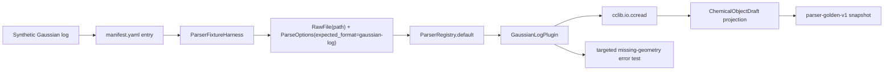

# Gaussian cclib Fixture Coverage Design

## 0. Terminology

- Gaussian cclib Fixture：通过 `GaussianLogPlugin` 和真实 cclib parser 解析的 `.log` 文件级样例。
- Synthetic Gaussian Log：由 RxnFlow 项目自有编写、只包含 cclib 解析所需最小 Gaussian 风格片段的测试日志，不来自 Gaussian 程序真实输出。
- cclib-data Reference：cclib 官方 regression logfile 仓库；本 feature 只把它作为来源调研依据，不 vendor 其中 log 文件。
- Gaussian Field Boundary：本 feature 对 Gaussian 样例固定的首批字段集合，包括 charge、spin_multiplicity、method、geometry、electronic energy、thermochemistry_keys。
- Gaussian Missing Geometry Fixture：能被 `GaussianLogPlugin.can_parse` 识别但 cclib data 缺少几何字段时的 targeted expected-error 样例。

术语检索结果：现有代码已有 `GaussianLogPlugin`、`_map_cclib_data`、`ParserFixtureManifest`、`assert_parser_fixture_snapshot`、`gaussian-log`、`gaussian-log-cclib`。本 feature 只补 Gaussian fixture coverage，不新增 parser runtime API。

## 1. Decisions And Constraints

### Scope

本 feature 实现 roadmap item `gaussian-cclib-fixture-coverage`：在已落地的 parser fixture harness 上补 Gaussian/cclib 样例，确认首批字段边界，并把 fake cclib data 单测无法覆盖的文件级 ParserRegistry 路径纳入 golden snapshot。

首轮使用 `Synthetic Gaussian Log`，不是从 cclib-data、Gaussian 软件输出或用户日志复制。原因是 cclib 文档说明 test logfiles 不随默认发布包分发，且 cclib-data / Gaussian 真实输出可能包含许可证和隐私边界；本项目在未确认再分发条件前不提交真实第三方 Gaussian log。

调研依据：

- cclib development docs：test logfiles 在单独 data 目录 / cclib-data 中维护，属性支持由测试覆盖决定。参考：<https://cclib.github.io/development.html>
- cclib install docs：默认安装不包含 unittest logfiles；Debian 的 `cclib-data` 位于 non-free repositories。参考：<https://cclib.github.io/how_to_install.html>
- 本地 spike：项目自有 minimal Gaussian log 可被 cclib 1.8.1 解析出 `atomcoords`、`atomnos`、`charge`、`mult`、`scfenergies` 和 `metadata.functional=B3LYP`。

### Decisions

1. **首轮用 synthetic log，不 vendor cclib-data**：新增 file 的 `source.kind=synthetic`，license 使用 `project-test-fixture`。
2. **ParserRegistry 路径必须真实运行 cclib**：success fixture 通过 `ParserRegistry.default()` + `GaussianLogPlugin` 读取本地 `.log` 文件，不使用 fake backend。
3. **固定最小字段边界**：snapshot 固定 `charge=0`、`spin_multiplicity=1`、first geometry sample、elements、`method=B3LYP`、`electronic` energy 和 `thermochemistry_keys=[]`。
4. **能量单位保持既有策略**：cclib `scfenergies` 按 eV 进入 adapter，再乘 `EV_TO_HARTREE` 写入 hartree；snapshot 只保存 hartree value 和 reference。
5. **thermochemistry 不强行造字段**：当前 adapter 没有映射 Gaussian thermochemistry，本 feature 只固定 `thermochemistry_keys=[]`，支持矩阵阶段再决定是否引入 thermochemistry mapping。
6. **错误边界用 fake backend targeted test**：缺几何字段这类 cclib data shape 错误很难用最小文本稳定触发；用 `GaussianLogPlugin(backend=...)` 的 targeted expected-error 测试固定 `parse_failed`，不进入默认 manifest executable loop。
7. **不改 Project / Import / Registry**：本 feature 只通过 parser registry 做文件级解析回归，不接 ImportRegistryWorkflow。

### Non-goals

- 不提交真实 Gaussian 软件输出、cclib-data log 或用户日志。
- 不覆盖 Gaussian 03/09/16 的真实版本矩阵、Link1、compound job、scan、IRC、freq、ONIOM 或 failed job 组合。
- 不解析 Gaussian thermochemistry、frequencies、basis set、solvent、imaginary frequency、MO、charge population 或 route section 语义。
- 不改变 cclib adapter 的 public contract、parser id、energy key 或 unit conversion 策略。
- 不新增 CLI、Web route、桌面入口、外部 Gaussian/cclib-data 下载流程或自动 snapshot 更新命令。
- 不调用 ProjectStore、ImportRegistryWorkflow、ChemicalRegistry、ReactionGraphService、EnergyProfileEngine、ReportExportService、PlatformShellService 或 ProjectBundleService。

### Complexity

- 健壮性 = L2：success path 使用真实 cclib parser，但输入是项目自有 synthetic 文件。
- 结构 = focused coverage：复用现有 fixture harness，不新增 parser corpus helper。
- 可测试性 = tested：success fixture 走 golden snapshot，missing geometry 走 targeted expected-error。
- Security / license = cautious：不引入真实第三方日志、不保存用户路径或 Gaussian 运行环境信息。
- Extensibility = corpus-first：后续真实 Gaussian fixtures 只追加 manifest + file + snapshot，并在 source policy 里记录脱敏和再分发状态。

## 2. Shape

### 2.1 Noun Layer

#### Existing State

- `rxnflow.parsers.cclib_adapter.GaussianLogPlugin` 已通过 cclib 读取 Gaussian log，并把 `atomcoords` / `atomnos`、`charge`、`mult`、`metadata`、`scfenergies` 映射为 `ChemicalObjectDraft`。
- `tests/test_parser_plugin_baseline.py` 当前用 `_fake_cclib_data` 覆盖 Gaussian adapter 字段映射，没有文件级 Gaussian log corpus。
- `tests/fixtures/parsers/manifest.yaml` 已有 MAPLE、XYZ、extxyz fixtures，但没有 `program=gaussian` 的条目。
- `tests/parser_fixture_harness.py` 已能对 success 和 failure result 投影 `parser-golden-v1` snapshot。

#### Changes

新增一个 manifest success 条目：

```yaml
- id: gaussian-sp-water-synthetic-minimal
  program: gaussian
  format: gaussian-log
  task: sp
  parser_id: gaussian-log-cclib
  file: files/gaussian/gaussian-sp-water-synthetic-minimal.log
  source:
    kind: synthetic
    url: null
    commit: null
    license: project-test-fixture
    redistributable: true
    redaction: none
  parse_options:
    expected_format: gaussian-log
    strict: true
    frame_policy: all
  expected_snapshot: snapshots/gaussian-sp-water-synthetic-minimal.json
  tolerances:
    energy_abs: 1.0e-10
    coordinate_abs: 1.0e-8
  support_status: supported
  tags: [gaussian, cclib, sp, energy, geometry, synthetic]
  notes: synthetic minimal log authored for cclib fixture coverage; not a real Gaussian output
```

对应 snapshot 期望：

```json
{
  "fixture_id": "gaussian-sp-water-synthetic-minimal",
  "parser_id": "gaussian-log-cclib",
  "parse_ok": true,
  "object_count": 1,
  "objects": [
    {
      "label": "gaussian-sp-water-synthetic-minimal.log",
      "charge": 0,
      "spin_multiplicity": 1,
      "method": "B3LYP",
      "atom_count": 2,
      "elements": ["O", "H"],
      "energy_keys": ["electronic"],
      "thermochemistry_keys": []
    }
  ]
}
```

错误边界不新增 manifest 条目，使用 targeted test：

```python
GaussianLogPlugin(backend=missing_geometry_backend).parse(
    RawFile(id="gaussian-missing-geometry", name="missing-geometry.log", content="Gaussian")
)
```

期望 `ok=False`、`error.code="parse_failed"`、message 指向 cclib data 必须包含 geometry 字段。

### 2.2 Orchestration Layer



#### Existing State

当前 Gaussian adapter 的文件读取路径已经存在，但回归只验证 fake backend 返回的 data object。ParserRegistry 对真实 `.log` 文件的 can_parse、plugin selection、cclib parse、snapshot projection 尚未被 corpus 固定。

#### Changes

1. 在 corpus 中新增 `files/gaussian/` synthetic `.log` 样例。
2. 在 manifest 中登记 Gaussian fixture、source policy、parse_options 和 tolerances。
3. 生成 golden snapshot，固定 object_count、parser_id、charge/spin、method、elements、geometry sample、electronic energy 和 thermochemistry absence。
4. 扩展 fixture harness tests，让 Gaussian success fixture 进入 default executable loop，并单独断言 Gaussian 字段覆盖。
5. 增加 missing geometry targeted test，用 fake backend 固定 cclib data shape 错误为 `parse_failed`。
6. 保留现有 `test_gaussian_cclib_adapter_maps_basic_fields`，不要求删除 fake-data unit coverage。

### 2.3 Mount Points

删除以下挂载点后，本 feature 应从系统视角消失：

1. `tests/fixtures/parsers/files/gaussian/gaussian-sp-water-synthetic-minimal.log`。
2. `tests/fixtures/parsers/snapshots/gaussian-sp-water-synthetic-minimal.json`。
3. `tests/fixtures/parsers/manifest.yaml` 中新增的 Gaussian fixture entry。
4. `tests/test_parser_fixture_harness.py` 中新增的 Gaussian snapshot / expected-error coverage。

不属于挂载点：`rxnflow.parsers.cclib_adapter` runtime API、Project Store、Import Workflow、Chemical Registry、ReactionGraph、EnergyProfile、ReportExport、Platform Shell。

### 2.4 Progression Strategy

1. **Corpus entry**：新增 `files/gaussian/` synthetic Gaussian log 和 manifest entry；退出信号是 manifest loader 能读到 6 个 fixture，且 Gaussian fixture 是 supported / executable。
2. **Golden snapshot**：用当前 ParserRegistry 生成 Gaussian success snapshot；退出信号是 cclib 真实解析 `.log` 文件并固定字段边界。
3. **Regression wiring**：扩展 fixture harness tests，默认跑 Gaussian snapshot，并用 targeted test 固定 missing geometry `parse_failed`；退出信号是 focused tests 通过。
4. **Scope guards**：确认未 vendor cclib-data/真实 Gaussian 输出、未改 runtime parser API、未调用外部计算或 import/project/registry/graph/energy/export；退出信号是全量 unittest 和 YAML 校验通过。

## 3. Acceptance Contract

正常路径：

1. manifest 中新增 `gaussian-sp-water-synthetic-minimal`，source 为 synthetic，`support_status=supported`。
2. Gaussian fixture 的 `program=gaussian`、`format=gaussian-log`、`parser_id=gaussian-log-cclib`、`parse_options.expected_format=gaussian-log`。
3. `gaussian-sp-water-synthetic-minimal` 进入 `manifest.executable_fixtures()`，并由 `ParserRegistry.default()` 解析成功。
4. snapshot `parse_ok=true`、`object_count=1`、`provenance.parser_id=gaussian-log-cclib`。
5. snapshot 对象固定 `label`、`charge=0`、`spin_multiplicity=1`、`method=B3LYP`、`elements=["O", "H"]`、`atom_count=2` 和第一个 geometry sample。
6. snapshot `energy_keys=["electronic"]`，energy unit 为 `hartree`，reference 为 `cclib scfenergies converted from eV`，value 等于 synthetic SCF energy 经 cclib / adapter 转换后的 hartree。
7. snapshot `thermochemistry_keys=[]`，明确当前 Gaussian thermochemistry 未映射。

边界与错误：

8. missing geometry targeted test 返回 `parse_failed`，不泄漏 backend exception，也不生成 partial object。
9. 新增 fixture file / snapshot 均为 corpus 内相对路径，loader 安全校验通过。
10. snapshot 不保存完整 log、完整坐标轨迹或 Gaussian 运行环境路径，只保存对象摘要和必要 geometry sample。

范围守护：

11. 本 feature 不提交真实 Gaussian 输出、cclib-data log 或用户日志。
12. 本 feature 不新增 Gaussian 版本/任务支持矩阵，不宣称 Gaussian 03/09/16 全支持。
13. 本 feature 不修改 `GaussianLogPlugin` parser id、public contract、energy key 或 unit conversion 策略，除非 snapshot 暴露实现 bug 且修复限制在 parser 行为内。
14. 本 feature 不调用 ProjectStore、ImportRegistryWorkflow、ChemicalRegistry、ReactionGraphService、EnergyProfileEngine、ReportExportService、PlatformShellService 或 ProjectBundleService。
15. 不新增 CLI command、Web route、桌面入口、外部 Gaussian 调用、cclib-data 下载流程或 snapshot 自动更新命令。

## 4. Integration Notes

### Architecture / Requirement / Roadmap

Acceptance 阶段需要同步：

- `.codestable/roadmap/rxnflow-parser-fixture-corpus/rxnflow-parser-fixture-corpus-items.yaml`：把 `gaussian-cclib-fixture-coverage` 从 `in-progress` 回写为 `done`。
- `.codestable/roadmap/rxnflow-parser-fixture-corpus/rxnflow-parser-fixture-corpus-roadmap.md`：同步第 5 节子 feature 状态。
- `.codestable/architecture/core-platform.md`：补充 parser fixture corpus 已覆盖 synthetic Gaussian cclib fixture；仍未完成真实 Gaussian 版本矩阵。
- `.codestable/architecture/ARCHITECTURE.md`：把 parser fixture corpus 术语和待补项同步为 “Gaussian synthetic coverage 已有，真实 Gaussian 版本/字段矩阵仍待补”。
- Requirement：当前无 parser format support requirement；本 feature 仍是测试覆盖增强，不改变用户可见导入行为。format support requirement 可在支持矩阵或 import preview 回归完成后 backfill。

### Requirement Fit

无对应 requirement。该 feature 固定 parser 行为和样例覆盖，不改变导入 UI、Import Registry Workflow 或已登记 ChemicalObject 的用户可见语义。

### Open Decisions

- 如果用户后续提供可提交的真实 Gaussian log，本 feature 不直接纳入；应另起真实 fixture 或 support matrix 更新，记录脱敏和 source policy。
- 如果 synthetic Gaussian log 在未来 cclib 版本无法解析，优先调整 synthetic fixture 以保持 project-owned / redistributable；不要自动转向 vendoring cclib-data。
