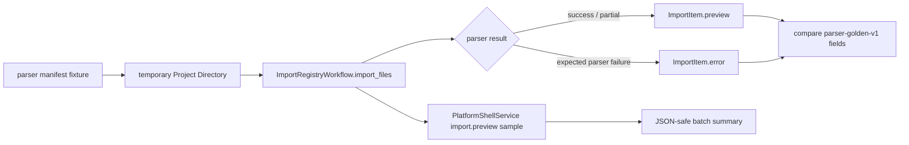

# Import Preview Parser Regression Design

## 0. Terminology

- Import Preview Parser Regression：用 parser fixture corpus 驱动 `ImportRegistryWorkflow.import_files` 和 `PlatformShellService(import.preview)` 的测试侧回归，确认 parser 输出进入 import preview 后不丢失关键字段。
- Preview Fidelity：`ImportItem.preview` 与 parser golden snapshot 之间需要保持一致的字段集合，包括 `parser_id`、`parser_version`、`object_count`、warning codes、error code 和 provenance/raw resource 关系。
- Fixture-backed Import Project：测试中临时创建的 Project Directory，只用于导入 fixture file，不写入真实用户项目。
- Preview-only Import：只执行 `import_files` / `import.preview`，不执行 `confirm_import` / `import.register_all`，因此不登记 ChemicalObject。
- Shell Preview Projection：`PlatformShellService` 对 ImportBatch/ImportItem/ParsePreview 的 JSON-safe 摘要。

术语检索结果：现有代码已有 `ImportRegistryWorkflow`、`ImportFileRequest`、`ParsePreview`、`PlatformShellService`、`import.preview`、`tests/parser_fixture_harness.py` 和 `parser-golden-v1` snapshots。本 feature 复用这些现有名词，不新增 runtime parser API。

## 1. Decisions And Constraints

### Scope

本 feature 实现 roadmap item `import-preview-parser-regression`：用已经落地的 parser fixture corpus 回归导入预览层，确认支持/partial fixture 通过 Import Workflow 后仍保留 parser provenance、warnings、object_count 和 raw resource linkage；同时确认 parser failure fixture 在 ImportItem 中保留 error code 和 raw resource。

### Decisions

1. **回归从 fixture corpus 读取输入**：测试加载 `tests/fixtures/parsers/manifest.yaml` 和对应 golden snapshots，不复制新计算输出样例。
2. **Import Workflow 是主验证面**：每个 supported / partial fixture 都通过 `ImportRegistryWorkflow.import_files` 进入临时 Project Directory，并和 snapshot 对比 preview 字段。
3. **Unsupported parser failure 也纳入**：`xyz-bad-atom-count` 应产生 `ImportItem.status=failed`、`error.code=parse_failed`、`raw_resource` 仍存在、`preview=None`。
4. **Platform Shell 只做 JSON 投影回归**：选取一个 success/partial fixture 和一个 failure fixture，通过 `PlatformShellService("import.preview")` 验证 batch summary 可 JSON 序列化且不丢 preview/error/warnings。
5. **不确认登记**：本 feature 不调用 `confirm_import` 或 `import.register_all` 作为主流程；ChemicalRegistry 应保持空对象集合。
6. **不改 parser runtime 行为**：如果发现 preview 字段缺失，优先在 import preview projection 或测试 helper 层定位；不借本 feature 增加格式解析能力。

### Non-goals

- 不新增 parser fixture、真实第三方日志、下载流程或 snapshot 自动更新命令。
- 不改变 ParserRegistry、ParseResult、ChemicalObjectDraft、warning/error code shape。
- 不改变 ImportRegistryWorkflow 的确认登记语义、ChemicalRegistry fingerprint 或 Project Content schema。
- 不新增用户可见 CLI command、Web route、桌面入口、UI import panel 或 import hint API。
- 不调用 ReactionGraphService、GraphEditorWorkspaceService、EnergyProfileEngine、ReportExportService 或 ProjectBundleService。
- 不把 unsupported fixture 注册成 ChemicalObject，也不把 parse failure 当成 partial success。

### Complexity

- 健壮性 = L1：测试侧回归，主流程使用现有 Import Workflow 和 Platform Shell。
- 结构 = adapter regression：不新增长期 runtime 数据结构。
- 可测试性 = tested：fixture loop、failure fixture、shell JSON projection 和 scope guard 都有单测。
- 持久化 = none：只用临时 Project Directory 和 ProjectStore raw resource 副本，不保存 Project Content。

## 2. Shape

### 2.1 Noun Layer

#### Existing State

- `tests/fixtures/parsers/manifest.yaml` 记录 9 个 fixture，其中 supported/partial fixture 可成功进入 ParserRegistry，`xyz-bad-atom-count` 是 expected parser failure。
- `tests/fixtures/parsers/snapshots/*.json` 记录 parser-golden-v1 的 `parse_ok`、`object_count`、`parser_id`、warning/error code 和对象摘要。
- `ImportRegistryWorkflow.import_files` 已把 source file 复制为 raw resource，再生成 `ImportItem.preview` 或 `ImportItem.error`。
- `PlatformShellService._run_import_preview` 已把 `ImportBatch` 投影为 JSON-safe batch summary。

#### Changes

新增测试侧 preview projection 对比规则，不新增 runtime 类型：

```python
expected = load_snapshot(fixture.expected_snapshot)
batch = workflow.import_files(project_path, (ImportFileRequest(fixture.file, fixture.parse_options),))
item = batch.value.items[0]

if expected["parse_ok"]:
    assert item.status == "needs_confirmation"
    assert item.preview.parser_id == expected["provenance"]["parser_id"]
    assert item.preview.object_count == expected["object_count"]
    assert warning_codes(item.preview.warnings) == set(expected["warning_codes"])
    assert item.preview.raw_resource_id == item.raw_resource.id
    assert item.preview.parse_result.provenance.source_file_id == item.raw_resource.id
else:
    assert item.status == "failed"
    assert item.error.code == expected["error"]["code"]
    assert item.raw_resource is not None
    assert item.preview is None
```

Shell Preview Projection 只验证 summary 层字段：

```json
{
  "batch": {
    "items": [
      {
        "status": "needs_confirmation",
        "raw_resource": {"kind": "raw_file", "path": "inputs/raw/..."},
        "preview": {"parser_id": "xyz-ase", "object_count": 1},
        "warnings": [{"code": "missing_section"}]
      }
    ]
  }
}
```

### 2.2 Orchestration Layer



#### Existing State

Import Workflow 已有针对手写 XYZ 字符串的单测，Platform Shell 也有一条完整 session import/register/workspace/energy/export 流程。但这些测试没有覆盖 parser fixture corpus，也没有系统性核对 fixture snapshots 中的 parser_id、warning/error codes、object_count 和 provenance/raw_resource 关系。

#### Changes

1. 新增一个 test module，专门加载 parser fixture corpus 并构造临时 project。
2. 对 supported / partial fixture 循环执行 `ImportRegistryWorkflow.import_files`，逐个对比 snapshot 的 parser_id、object_count、warning codes 和 provenance/source linkage。
3. 对 expected failure fixture 执行同一路径，确认 raw file 已进入 project、item failed、error code 等于 snapshot。
4. 对 Shell Preview Projection 运行代表性 batch：包含一个 warning success fixture 和一个 parser failure fixture，确认响应可 JSON 序列化且 summary 字段完整。
5. 增加 scope guard，确认本 feature 没有调用 confirm/register、graph、energy、export 或 bundle 服务。

### 2.3 Mount Points

删除以下挂载点后，本 feature 应从系统视角消失：

1. 新增的 import preview parser regression 测试文件。
2. 测试文件内的 preview projection / snapshot comparison helper。
3. 本 feature 的 CodeStable design/checklist/acceptance 与 roadmap/architecture 回写。

不属于挂载点：parser fixture manifest/snapshots/support matrix 本身、runtime parser modules、ImportRegistryWorkflow public API、PlatformShellService command set、Project Content codecs。

### 2.4 Progression Strategy

1. **Workflow fixture loop**：用 manifest/snapshot 驱动 `ImportRegistryWorkflow.import_files` 成功/partial fixtures；退出信号是 preview fidelity 字段全部对齐。
2. **Failure fixture path**：把 `xyz-bad-atom-count` 作为 expected parser failure 走 import preview；退出信号是 raw_resource 保留、preview 为空、error code 对齐 snapshot。
3. **Shell projection sample**：用 `PlatformShellService("import.preview")` 跑 batch summary；退出信号是 JSON-safe payload 中 success/failure items 保留 preview/error/warnings。
4. **Scope guards**：确认测试不调用 confirm/register/graph/energy/export/bundle，不新增 runtime API 或 fixture；退出信号是 focused tests 与全量 unittest 通过。

## 3. Acceptance Contract

正常路径：

1. supported / partial parser fixture 都能通过 `ImportRegistryWorkflow.import_files` 进入 `ImportItem.status=needs_confirmation`。
2. 每个成功 preview 的 `parser_id`、`parser_version` 与 `parse_result.provenance` 一致。
3. 每个成功 preview 的 `object_count` 等于 parser golden snapshot 的 `object_count`。
4. 每个成功 preview 的 warning codes 等于 snapshot 顶层 `warning_codes`。
5. 每个成功 preview 的 `raw_resource_id` 等于 `ImportItem.raw_resource.id`，也等于 `parse_result.provenance.source_file_id`。
6. Preview-only import 后 ChemicalRegistry 仍为空，未登记 ChemicalObject。

边界与错误：

7. `xyz-bad-atom-count` import item 为 `failed`，`error.code=parse_failed`，`preview=None`，且 `raw_resource` 已复制进项目。
8. Platform shell `import.preview` 对 success + failure batch 返回 `ok=True`，payload 可 JSON 序列化。
9. Shell batch summary 保留 success item 的 preview parser_id/object_count/warnings 和 failure item 的 error code/raw_resource。
10. 缺少 source_path 或无效 session 的既有 shell error 行为不被改变。

范围守护：

11. 本 feature 不新增 parser fixture file、support matrix entry 或 golden snapshot。
12. 本 feature 不修改 runtime parser modules、ParserRegistry、ImportRegistryWorkflow public API 或 PlatformShellService command set。
13. 本 feature 不调用 `confirm_import`、`import.register_all`、ChemicalRegistry.register、ReactionGraphService、GraphEditorWorkspaceService、EnergyProfileEngine、ReportExportService 或 ProjectBundleService。
14. 本 feature 不新增 UI、CLI command、Web route、桌面入口、Project Content schema 或云/本地持久化能力。

## 4. Integration Notes

Acceptance 阶段需要同步：

- `.codestable/roadmap/rxnflow-parser-fixture-corpus/rxnflow-parser-fixture-corpus-items.yaml`：把 `import-preview-parser-regression` 从 `in-progress` 回写为 `done`。
- `.codestable/roadmap/rxnflow-parser-fixture-corpus/rxnflow-parser-fixture-corpus-roadmap.md`：同步第 5/6/7 节状态。
- `.codestable/architecture/core-platform.md`：补充 parser fixture corpus 已接入 Import Workflow / Platform Shell import preview regression。
- `.codestable/architecture/ARCHITECTURE.md`：更新 Parser Fixture Corpus 或 Import Registry Workflow 关键决定，说明 fixture-backed preview fidelity 回归已存在。
- Requirement：本 feature 仍是测试覆盖增强，不新增用户可见导入能力；如验收时认为“支持格式边界可被 agent 查询”已成为用户/agent 可感能力，再 backfill parser/import format support requirement。
