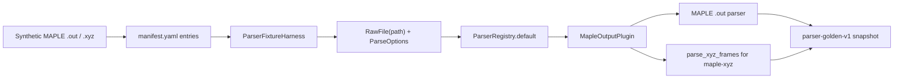

# MAPLE Fixture Coverage Design

## 0. Terminology

- MAPLE Output Fixture：通过 `MapleOutputPlugin` 解析的 MAPLE `.out` 文件级样例。
- MAPLE Trajectory XYZ Fixture：通过 `MapleOutputPlugin` 识别的 MAPLE-style multi-frame `.xyz` 样例，comment 行携带 `Image`、`Frame`、`Iter ... Image` 或 `Iteration` 与 energy。
- ClickFF/MAPLE Example Reference：用户指定的 <https://github.com/ClickFF/MAPLE> 仓库 `example/` 目录；本 feature 只把它作为格式观察依据，不 vendor 真实输出。
- MAPLE Artifact Boundary：`.sum`、AutoNEB tree JSON、MD thermo `.dat` 和 IRC/NEB path `.xyz` 等 MAPLE example 产物在 RxnFlow 首轮 parser corpus 中的支持状态标注。
- MAPLE Path Semantics：IRC/NEB/AutoNEB 的路径方向、iteration、image topology 和 TS candidate 语义；本 feature 不建模，只保留 frame-level objects。

术语检索结果：现有代码已有 `MapleOutputPlugin`、`maple-output`、`maple-xyz`、`MAPLE_XYZ_COMMENT_RE`、`parse_xyz_frames`、`ParserFixtureManifest` 和 `parser-golden-v1`。本 feature 不新增 runtime parser API，只补 fixture coverage 和 MAPLE trajectory comment 识别边界。

## 1. Decisions And Constraints

### Scope

本 feature 实现 roadmap item `maple-fixture-coverage`：基于 ClickFF/MAPLE examples 的任务结构和可再分发策略，补 MAPLE `.out` 与 MAPLE-style multi-frame `.xyz` 样例，并标注 `.sum`、AutoNEB tree、MD thermo、IRC path 的首轮支持状态。

调研依据：

- ClickFF/MAPLE README 当前说明 MAPLE 是 MLFF-native computational chemistry toolkit，覆盖 single point、optimization、transition-state search、IRC、MD、frequency、scan 等任务。
- ClickFF/MAPLE `example/` 当前包含 `sp`、`opt`、`ts`、`irc`、`md/nve`、`scan`、`freq/mw` 等目录。
- 本地 clone 观察到 examples commit `001636482646bca0d1e867fb257322d2a172cc86`，`.out` 文件可很小也可能超过 80k 行，`.xyz` path/traj comment 常见 `Image N Energy = ...`、`Iter N Image M Energy = ...`、`Iteration N Energy = ...`。
- MAPLE license 文件同时包含 BSD 3-Clause 文本和 academic/commercial restriction notice；本 feature 不直接 vendor ClickFF/MAPLE example outputs。

### Decisions

1. **首轮仍用 project-owned synthetic fixtures**：新增样例 source.kind 使用 `synthetic`，license 使用 `project-test-fixture`。
2. **保留已有 MAPLE SP fixture**：`maple-sp-synthetic-minimal` 继续作为最小 `.out` success path。
3. **新增 MAPLE opt output fixture**：用 synthetic opt `.out` 覆盖多 coordinate block、多 energy line 时 parser 选择最后结构和最后 energy。
4. **新增 MAPLE trajectory XYZ fixture**：用 synthetic `.xyz` 覆盖 `Image`、`Iter ... Image`、`Iteration` 三类 MAPLE trajectory comments；支持状态为 `partial`，因为只解析 frame objects，不建路径语义。
5. **扩展 MAPLE XYZ comment 识别**：`MapleOutputPlugin.can_parse` 应识别 examples 中的 `Iter N Image M` 和 `Iteration N` comments；label projection 保留可追溯 comment label。
6. **artifact boundary 只在 feature doc/acceptance 标注**：`.sum`、AutoNEB tree JSON 和 MD thermo `.dat` 不进入 manifest，也不冒充 ParserFormat；后续由 support matrix feature 正式结构化。
7. **不改 Import / Registry / Graph / Energy**：本 feature 只通过 parser registry 做文件级解析回归，不把 MAPLE path 转成 ReactionGraph 或 EnergyProfile。

### MAPLE Artifact Boundary

- MAPLE `.out`：supported for current fixture fields，覆盖 task、model、coordinates、Hartree energy。
- MAPLE trajectory/path `.xyz`：partial，解析 frame geometry 和 electronic energy；不表达 IRC/NEB 方向、iteration grouping、path topology 或 TS candidate。
- MAPLE `.sum` frequency summary：reference-only，不解析。
- AutoNEB tree JSON：reference-only，不解析。
- MD thermo `.dat` / summary text：reference-only，不解析。

### Non-goals

- 不提交真实 ClickFF/MAPLE examples、真实用户 MAPLE 输出或大型轨迹。
- 不支持完整 MAPLE task/version matrix，不宣称 sp/opt/ts/irc/md/scan/freq 全支持。
- 不解析 `.sum`、AutoNEB tree JSON、MD thermo `.dat`、restart、DCD、PBC cell、frequency mode、scan coordinate 或 solvation details。
- 不把 MAPLE path `.xyz` 直接转换成 ReactionPath、ReactionGraph、EnergyProfile 或 TS record。
- 不新增 CLI、Web route、桌面入口、外部 MAPLE 调用、自动下载 examples 或 snapshot 自动更新命令。

### Complexity

- 健壮性 = L2：success/partial path 使用当前 parser 解析 project-owned synthetic files。
- 结构 = focused coverage：复用现有 fixture harness，不新增 support matrix schema。
- 可测试性 = tested：`.out` success 与 `.xyz` partial 都走 golden snapshot，comment 识别边界有 targeted assertions。
- Security / license = cautious：不 vendor ClickFF/MAPLE examples，只记录 URL、commit 和观察结论。

## 2. Shape

### 2.1 Noun Layer

#### Existing State

- `rxnflow.parsers.maple.MapleOutputPlugin` 已能识别 MAPLE banner 和 `Image|Frame N Energy =` 风格 `.xyz`。
- `rxnflow.parsers.xyz.parse_xyz_frames` 会把每个 XYZ frame 投影为 `ChemicalObjectDraft`，并从 comment 中读取 energy。
- `tests/fixtures/parsers/manifest.yaml` 当前已有一个 `maple-sp-synthetic-minimal` success fixture。
- `tests/test_parser_plugin_baseline.py` 当前用 inline data 覆盖 MAPLE `.out` 和 `Image/Frame` multi-frame `.xyz`。

#### Changes

新增两个 corpus entries：

```yaml
- id: maple-opt-synthetic-minimal
  program: maple
  format: maple-output
  task: opt
  parser_id: maple-output
  file: files/maple/maple-opt-synthetic-minimal.out
  support_status: supported

- id: maple-irc-path-synthetic-minimal
  program: maple
  format: maple-xyz
  task: irc-path
  parser_id: maple-output
  file: files/maple/maple-irc-path-synthetic-minimal.xyz
  support_status: partial
```

`maple-opt-synthetic-minimal` 固定：

- label `MAPLE opt`
- method `opt ani2x`
- last coordinate block
- last `Energy: ... Hartree`

`maple-irc-path-synthetic-minimal` 固定：

- 3 个 frame objects
- labels `Image 0`、`Iter 1 Image 1`、`Iteration 7`
- energy unit `hartree`
- `warning_codes=[]`

### 2.2 Orchestration Layer



#### Existing State

MAPLE parser 已经能解析单个 `.out` 和简单 multi-frame `.xyz`，但 fixture corpus 只有一个 sp `.out`。ClickFF/MAPLE examples 暴露出的 opt output 末帧/末能量策略、IRC/NEB trajectory comment 变体和非 XYZ artifact 边界尚未被 corpus 固定。

#### Changes

1. 新增 opt `.out` synthetic fixture 和 golden snapshot。
2. 新增 IRC/path `.xyz` synthetic fixture 和 golden snapshot，support_status 标为 `partial`。
3. 扩展 MAPLE `.xyz` comment detection 和 label projection，覆盖 `Iter N Image M` / `Iteration N`。
4. 扩展 fixture harness tests，断言 MAPLE entries、snapshots、source/redaction 和 reference boundary。
5. 保留 `.sum`、AutoNEB tree、MD thermo 为 reference-only 文档边界，不进入 executable manifest。

### 2.3 Mount Points

删除以下挂载点后，本 feature 应从系统视角消失：

1. `tests/fixtures/parsers/files/maple/maple-opt-synthetic-minimal.out`。
2. `tests/fixtures/parsers/files/maple/maple-irc-path-synthetic-minimal.xyz`。
3. 对应 `tests/fixtures/parsers/snapshots/maple-*.json`。
4. `tests/fixtures/parsers/manifest.yaml` 中新增 MAPLE entries。
5. `tests/test_parser_fixture_harness.py` 和 MAPLE parser baseline 中新增的 MAPLE coverage。
6. `rxnflow.parsers.maple` / `rxnflow.parsers.xyz` 中 MAPLE trajectory comment 识别和 label 投影的限定修正。

不属于挂载点：Project Store、Import Workflow、Chemical Registry、ReactionGraph、Energy Engine、Report Export、Platform Shell。

### 2.4 Progression Strategy

1. **Corpus entries**：新增 MAPLE opt `.out` 和 IRC/path `.xyz` synthetic files 与 manifest entries；退出信号是 loader 能读到 9 个 fixtures，MAPLE opt supported，MAPLE path partial 且进入 executable fixtures。
2. **Trajectory comment boundary**：扩展 MAPLE `.xyz` detection 和 labels；退出信号是 `Image`、`Iter ... Image`、`Iteration` 均由 `MapleOutputPlugin` 识别并保持 label。
3. **Golden snapshots**：生成并固定 opt/path snapshots；退出信号是 ParserRegistry.default 解析成功，数值和 labels 稳定。
4. **Regression wiring**：扩展 fixture harness tests 和 MAPLE parser baseline；退出信号是 focused tests 通过。
5. **Scope guards**：确认未 vendor ClickFF/MAPLE examples、未解析 `.sum`/AutoNEB/MD thermo、未调用外部 MAPLE 或 import/project/registry/graph/energy/export；退出信号是全量 unittest 和 YAML 校验通过。

## 3. Acceptance Contract

正常路径：

1. manifest 中新增 `maple-opt-synthetic-minimal`，source 为 synthetic，`support_status=supported`。
2. manifest 中新增 `maple-irc-path-synthetic-minimal`，source 为 synthetic，`support_status=partial`。
3. 两个新增 MAPLE fixtures 进入 `manifest.executable_fixtures()`，并由 `ParserRegistry.default()` 解析成功。
4. opt snapshot `parse_ok=true`、`object_count=1`、`parser_id=maple-output`。
5. opt snapshot 对象固定 `label=MAPLE opt`、`method=opt ani2x`、last geometry sample、`energy_keys=["electronic"]`、Hartree energy 和 `thermochemistry_keys=[]`。
6. IRC/path snapshot `parse_ok=true`、`object_count=3`、labels 固定为 `Image 0`、`Iter 1 Image 1`、`Iteration 7`。
7. IRC/path snapshot 每个 object 都有 geometry 和 electronic Hartree energy；warning_codes 为空。

边界与错误：

8. `MapleOutputPlugin.can_parse` 支持 `Iter N Image M Energy =` 和 `Iteration N Energy =` MAPLE trajectory comments。
9. `.sum`、AutoNEB tree JSON、MD thermo `.dat` 只在本 feature 文档标为 reference-only，不进入 manifest executable fixtures。
10. 新增 fixture file / snapshot 均为 corpus 内相对路径，loader 安全校验通过。

范围守护：

11. 本 feature 不提交真实 ClickFF/MAPLE examples 或用户输出。
12. 本 feature 不新增 MAPLE 完整版本/任务支持矩阵，不宣称 sp/opt/ts/irc/md/scan/freq 全支持。
13. 本 feature 不把 MAPLE path `.xyz` 转为 ReactionPath、ReactionGraph、EnergyProfile 或 TS object。
14. 本 feature 不调用 ProjectStore、ImportRegistryWorkflow、ChemicalRegistry、ReactionGraphService、EnergyProfileEngine、ReportExportService、PlatformShellService 或 ProjectBundleService。
15. 不新增 CLI command、Web route、桌面入口、外部 MAPLE 调用、examples 下载流程或 snapshot 自动更新命令。

## 4. Integration Notes

Acceptance 阶段需要同步：

- `.codestable/roadmap/rxnflow-parser-fixture-corpus/rxnflow-parser-fixture-corpus-items.yaml`：把 `maple-fixture-coverage` 从 `in-progress` 回写为 `done`。
- `.codestable/roadmap/rxnflow-parser-fixture-corpus/rxnflow-parser-fixture-corpus-roadmap.md`：同步第 5/6 节状态。
- `.codestable/architecture/core-platform.md`：补充 parser fixture corpus 已覆盖 MAPLE sp/opt `.out` 和 MAPLE path `.xyz` partial coverage。
- `.codestable/architecture/ARCHITECTURE.md`：更新 Parser Fixture Corpus 和待补项。
- Requirement：当前无 parser format support requirement；本 feature 固定 parser 行为和样例覆盖，不改变导入 UI 或 Import Registry Workflow。

### Open Decisions

- 如果后续决定 vendor ClickFF/MAPLE examples，需要先确认 license/commercial restriction 与脱敏策略，再另起 support matrix 或 real fixture feature。
- MAPLE path `.xyz` 的 ReactionPath/TS 语义应等 graph/energy/import preview 能消费 path-level parser output 后再设计，不在本 feature 中提前编码。
