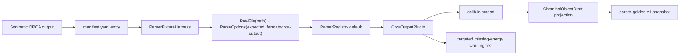

# ORCA cclib Fixture Coverage Design

## 0. Terminology

- ORCA cclib Fixture：通过 `OrcaOutputPlugin` 和真实 cclib parser 解析的 `.out` 文件级样例。
- Synthetic ORCA Output：由 RxnFlow 项目自有编写、只包含 cclib 解析所需最小 ORCA 风格片段的测试输出，不来自 ORCA 程序真实输出。
- ORCA Keyword Functional：cclib ORCA parser 把泛化方法记为 `DFT` 时，`metadata.keywords` 中可用于恢复的 functional token，例如 `B3LYP`。
- ORCA Field Boundary：本 feature 固定的首批 ORCA 字段集合，包括 ORCA banner、charge、spin_multiplicity、method、geometry 和 final electronic energy。
- ORCA Missing Energy Boundary：cclib data 有几何/电荷/自旋但缺少 `scfenergies` 时，adapter 应返回 parse success 加 `missing_section` warning，而不是把能量写成 0。

术语检索结果：现有代码已有 `OrcaOutputPlugin`、`_map_cclib_data`、`ParserFixtureManifest`、`assert_parser_fixture_snapshot`、`orca-output`、`orca-output-cclib`。本 feature 只补 ORCA fixture coverage，并在 snapshot 暴露 `DFT` 泛化丢失时限定修正 method 映射。

## 1. Decisions And Constraints

### Scope

本 feature 实现 roadmap item `orca-cclib-fixture-coverage`：在已落地的 parser fixture harness 上补 ORCA/cclib 样例，确认 ORCA banner、final energy、charge/spin/method/geometry 的首批字段边界，并把文件级 `ParserRegistry.default()` 路径纳入 golden snapshot。

首轮使用 `Synthetic ORCA Output`，不是从 cclib-data、ORCA 软件输出或用户日志复制。原因是 cclib-data / ORCA 真实输出可能带有再分发和隐私边界；本项目在未确认许可证和脱敏策略前不提交真实第三方 ORCA output。

本地 spike 确认：最小 ORCA output 必须包含 `INPUT FILE`、`CARTESIAN COORDINATES (ANGSTROEM)`、`SCF ITERATIONS`、`SCF CONVERGED`、`SCF CONVERGENCE` 和 `TOTAL RUN TIME` 段，cclib 1.8.1 才能解析出 `atomcoords`、`atomnos`、`charge`、`mult`、`scfenergies` 并标记 `metadata.success=True`。

### Decisions

1. **首轮用 synthetic output，不 vendor cclib-data**：新增 file 的 `source.kind=synthetic`，license 使用 `project-test-fixture`。
2. **ParserRegistry 路径必须真实运行 cclib**：success fixture 通过 `ParserRegistry.default()` + `OrcaOutputPlugin` 读取本地 `.out` 文件，不使用 fake backend。
3. **固定最小字段边界**：snapshot 固定 `charge=0`、`spin_multiplicity=1`、first geometry sample、elements、`method=B3LYP`、`electronic` energy 和 `thermochemistry_keys=[]`。
4. **ORCA DFT method 使用 keyword functional 限定修正**：当 cclib 返回 `metadata.methods[-1]=="DFT"` 且没有 `functional` 字段时，adapter 可从 `metadata.keywords` 的已知 functional token 恢复 `B3LYP`；无法识别时仍保留 `DFT`。
5. **能量单位保持既有策略**：cclib `scfenergies` 按 eV 进入 adapter，再乘 `EV_TO_HARTREE` 写入 hartree；snapshot 只保存 hartree value 和 reference。
6. **缺能量边界用 fake backend targeted test**：缺 `scfenergies` 这类 cclib data shape 不需要造失败 output；用 `OrcaOutputPlugin(backend=...)` 固定 `missing_section` warning。
7. **不改 Project / Import / Registry**：本 feature 只通过 parser registry 做文件级解析回归，不接 ImportRegistryWorkflow。

### Non-goals

- 不提交真实 ORCA 软件输出、cclib-data output 或用户日志。
- 不覆盖 ORCA 2/3/4/5/6 的真实版本矩阵、opt、freq、IRC、scan、CASSCF、TDDFT、failed job 或多 job 输出。
- 不解析 ORCA basis set、solvent、frequencies、orbital、population、timing、GBW/HESS 或 SCF convergence 细节。
- 不改变 `OrcaOutputPlugin` parser id、public contract、energy key 或 unit conversion 策略。
- 不新增 CLI、Web route、桌面入口、外部 ORCA/cclib-data 下载流程或自动 snapshot 更新命令。
- 不调用 ProjectStore、ImportRegistryWorkflow、ChemicalRegistry、ReactionGraphService、EnergyProfileEngine、ReportExportService、PlatformShellService 或 ProjectBundleService。

### Complexity

- 健壮性 = L2：success path 使用真实 cclib parser，但输入是项目自有 synthetic 文件。
- 结构 = focused coverage：复用现有 fixture harness，不新增 parser corpus helper。
- 可测试性 = tested：success fixture 走 golden snapshot，missing energy 走 targeted warning test。
- Security / license = cautious：不引入真实第三方输出、不保存用户路径或 ORCA 运行环境信息。
- Extensibility = corpus-first：后续真实 ORCA fixtures 只追加 manifest + file + snapshot，并在 source policy 里记录脱敏和再分发状态。

## 2. Shape

### 2.1 Noun Layer

#### Existing State

- `rxnflow.parsers.cclib_adapter.OrcaOutputPlugin` 已通过 cclib 读取 ORCA output，并把 `atomcoords` / `atomnos`、`charge`、`mult`、`metadata`、`scfenergies` 映射为 `ChemicalObjectDraft`。
- `tests/test_parser_plugin_baseline.py` 当前用 `_fake_cclib_data` 覆盖 ORCA adapter 基础路径，没有文件级 ORCA output corpus。
- `tests/fixtures/parsers/manifest.yaml` 已有 MAPLE、XYZ、extxyz、Gaussian fixtures，但没有 `program=orca` 的条目。
- `tests/parser_fixture_harness.py` 已能对 success 和 failure result 投影 `parser-golden-v1` snapshot。

#### Changes

新增一个 manifest success 条目：

```yaml
- id: orca-sp-water-synthetic-minimal
  program: orca
  format: orca-output
  task: sp
  parser_id: orca-output-cclib
  file: files/orca/orca-sp-water-synthetic-minimal.out
  source:
    kind: synthetic
    url: null
    commit: null
    license: project-test-fixture
    redistributable: true
    redaction: none
  parse_options:
    expected_format: orca-output
    strict: true
    frame_policy: all
  expected_snapshot: snapshots/orca-sp-water-synthetic-minimal.json
  tolerances:
    energy_abs: 1.0e-10
    coordinate_abs: 1.0e-8
  support_status: supported
  tags: [orca, cclib, sp, energy, geometry, synthetic]
  notes: synthetic minimal output authored for cclib fixture coverage; not a real ORCA output
```

对应 snapshot 期望：

```json
{
  "fixture_id": "orca-sp-water-synthetic-minimal",
  "parser_id": "orca-output-cclib",
  "parse_ok": true,
  "object_count": 1,
  "objects": [
    {
      "label": "orca-sp-water-synthetic-minimal.out",
      "charge": 0,
      "spin_multiplicity": 1,
      "method": "B3LYP",
      "atom_count": 3,
      "elements": ["O", "H", "H"],
      "energy_keys": ["electronic"],
      "thermochemistry_keys": []
    }
  ]
}
```

缺能量边界不新增 manifest 条目，使用 targeted test：

```python
OrcaOutputPlugin(backend=missing_energy_backend).parse(
    RawFile(id="orca-missing-energy", name="missing-energy.out", content="O   R   C   A")
)
```

期望 `ok=True`、`warnings=["missing_section"]`、对象 `energies={}`、`method=B3LYP`。

### 2.2 Orchestration Layer



#### Existing State

当前 ORCA adapter 的文件读取路径已经存在，但回归只验证 fake backend 返回的 data object。ParserRegistry 对真实 `.out` 文件的 can_parse、plugin selection、cclib parse、snapshot projection 尚未被 corpus 固定。

#### Changes

1. 在 corpus 中新增 `files/orca/` synthetic `.out` 样例。
2. 在 manifest 中登记 ORCA fixture、source policy、parse_options 和 tolerances。
3. 生成 golden snapshot，固定 object_count、parser_id、charge/spin、method、elements、geometry sample、electronic energy 和 thermochemistry absence。
4. 扩展 fixture harness tests，让 ORCA success fixture 进入 default executable loop，并单独断言 ORCA 字段覆盖。
5. 增加 missing energy targeted test，用 fake backend 固定缺 `scfenergies` 时的 `missing_section` warning。
6. 限定增强 `_method_from_metadata()`：只在 cclib method 为泛化 `DFT` 时，从 `metadata.functional` 或已知 ORCA keyword functional 中恢复更具体方法。

### 2.3 Mount Points

删除以下挂载点后，本 feature 应从系统视角消失：

1. `tests/fixtures/parsers/files/orca/orca-sp-water-synthetic-minimal.out`。
2. `tests/fixtures/parsers/snapshots/orca-sp-water-synthetic-minimal.json`。
3. `tests/fixtures/parsers/manifest.yaml` 中新增的 ORCA fixture entry。
4. `tests/test_parser_fixture_harness.py` 中新增的 ORCA snapshot / missing-energy coverage。
5. `rxnflow.parsers.cclib_adapter._method_from_metadata` 中针对泛化 `DFT` 的 keyword functional 恢复逻辑。

不属于挂载点：`OrcaOutputPlugin` parser id、Project Store、Import Workflow、Chemical Registry、ReactionGraph、EnergyProfile、ReportExport、Platform Shell。

### 2.4 Progression Strategy

1. **Corpus entry**：新增 `files/orca/` synthetic ORCA output 和 manifest entry；退出信号是 manifest loader 能读到 7 个 fixture，且 ORCA fixture 是 supported / executable。
2. **Method boundary**：限定修正泛化 `DFT` 的 method 映射；退出信号是 ORCA cclib metadata keywords 可恢复 `B3LYP`，其他未知 DFT 仍回退 `DFT`。
3. **Golden snapshot**：用当前 ParserRegistry 生成 ORCA success snapshot；退出信号是 cclib 真实解析 `.out` 文件并固定字段边界。
4. **Regression wiring**：扩展 fixture harness tests，默认跑 ORCA snapshot，并用 targeted test 固定 missing energy warning；退出信号是 focused tests 通过。
5. **Scope guards**：确认未 vendor cclib-data/真实 ORCA 输出、未改 parser id / energy conversion、未调用外部计算或 import/project/registry/graph/energy/export；退出信号是全量 unittest 和 YAML 校验通过。

## 3. Acceptance Contract

正常路径：

1. manifest 中新增 `orca-sp-water-synthetic-minimal`，source 为 synthetic，`support_status=supported`。
2. ORCA fixture 的 `program=orca`、`format=orca-output`、`parser_id=orca-output-cclib`、`parse_options.expected_format=orca-output`。
3. `orca-sp-water-synthetic-minimal` 进入 `manifest.executable_fixtures()`，并由 `ParserRegistry.default()` 解析成功。
4. snapshot `parse_ok=true`、`object_count=1`、`provenance.parser_id=orca-output-cclib`。
5. snapshot 对象固定 `label`、`charge=0`、`spin_multiplicity=1`、`method=B3LYP`、`elements=["O","H","H"]`、`atom_count=3` 和第一个 geometry sample。
6. snapshot `energy_keys=["electronic"]`，energy unit 为 `hartree`，reference 为 `cclib scfenergies converted from eV`，value 等于 synthetic SCF energy 经 cclib / adapter 转换后的 hartree。
7. snapshot `thermochemistry_keys=[]`，明确当前 ORCA thermochemistry 未映射。

边界与错误：

8. missing energy targeted test 返回 parse success + `missing_section` warning，不生成 0 energy。
9. 新增 fixture file / snapshot 均为 corpus 内相对路径，loader 安全校验通过。
10. snapshot 不保存完整 output、完整坐标轨迹、ORCA 运行环境路径、`.gbw`、`.hess` 或临时文件内容。

范围守护：

11. 本 feature 不提交真实 ORCA 输出、cclib-data output 或用户日志。
12. 本 feature 不新增 ORCA 版本/任务支持矩阵，不宣称 ORCA 2/3/4/5/6 全支持。
13. 本 feature 不修改 `OrcaOutputPlugin` parser id、public contract、energy key 或 unit conversion 策略，除非 snapshot 暴露实现 bug 且修复限制在 parser 行为内。
14. 本 feature 不调用 ProjectStore、ImportRegistryWorkflow、ChemicalRegistry、ReactionGraphService、EnergyProfileEngine、ReportExportService、PlatformShellService 或 ProjectBundleService。
15. 不新增 CLI command、Web route、桌面入口、外部 ORCA 调用、cclib-data 下载流程或 snapshot 自动更新命令。

## 4. Integration Notes

### Architecture / Requirement / Roadmap

Acceptance 阶段需要同步：

- `.codestable/roadmap/rxnflow-parser-fixture-corpus/rxnflow-parser-fixture-corpus-items.yaml`：把 `orca-cclib-fixture-coverage` 从 `in-progress` 回写为 `done`。
- `.codestable/roadmap/rxnflow-parser-fixture-corpus/rxnflow-parser-fixture-corpus-roadmap.md`：同步第 5 节子 feature 状态。
- `.codestable/architecture/core-platform.md`：补充 parser fixture corpus 已覆盖 synthetic ORCA cclib fixture；仍未完成真实 ORCA 版本矩阵。
- `.codestable/architecture/ARCHITECTURE.md`：把 parser fixture corpus 术语和待补项同步为 “Gaussian / ORCA synthetic cclib coverage 已有，真实版本/字段矩阵仍待补”。
- Requirement：当前无 parser format support requirement；本 feature 仍是测试覆盖增强，不改变用户可见导入行为。format support requirement 可在支持矩阵或 import preview 回归完成后 backfill。

### Requirement Fit

无对应 requirement。该 feature 固定 parser 行为和样例覆盖，不改变导入 UI、Import Registry Workflow 或已登记 ChemicalObject 的用户可见语义。

### Open Decisions

- 如果用户后续提供可提交的真实 ORCA output，本 feature 不直接纳入；应另起真实 fixture 或 support matrix 更新，记录脱敏和 source policy。
- 如果 synthetic ORCA output 在未来 cclib 版本无法解析，优先调整 synthetic fixture 以保持 project-owned / redistributable；不要自动转向 vendoring cclib-data。
