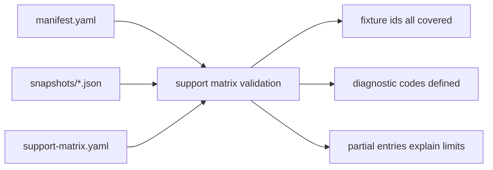

# Parser Support Matrix Diagnostics Design

## 0. Terminology

- Parser Support Matrix：`tests/fixtures/parsers/support-matrix.yaml`，机器可读地描述当前 fixture 覆盖过的 program / format / task / fields / known limits。
- Diagnostic Code Catalog：Support Matrix 内的 warning/error code 目录，记录 parser 可能返回的 warning/error code 语义。
- Observed Diagnostics：从 golden snapshots 和 targeted tests 里已经观察到的 warning/error codes，例如 `missing_section`、`unit_assumed`、`parse_failed`。
- Field Status：support matrix 中字段级状态，取 `supported`、`partial`、`unsupported`、`not-applicable` 或 `reference-only`。
- Reference-only Artifact：已知存在但首轮不解析的输出类型，例如 MAPLE `.sum`、AutoNEB tree JSON、MD thermo `.dat`。

术语检索结果：roadmap 已定义 `parser-support-matrix-v1` 和 diagnostic code 草案；现有代码只有 manifest/snapshot loader，没有 support matrix loader。本 feature 新增测试侧结构化文件和校验 helper，不新增 runtime API。

## 1. Decisions And Constraints

### Scope

本 feature 实现 roadmap item `parser-support-matrix-diagnostics`：把已经完成的 XYZ/extxyz、Gaussian、ORCA、MAPLE fixture 覆盖整理为支持矩阵，并用矩阵固定 warning/error code 语义。矩阵只描述当前 corpus 覆盖过的输入，不声明完整程序支持。

### Decisions

1. **Support Matrix 落在 fixture corpus 下**：新增 `tests/fixtures/parsers/support-matrix.yaml`，schema version 为 `parser-support-matrix-v1`。
2. **测试侧 loader 校验矩阵**：扩展 `tests/parser_fixture_harness.py`，读取 support matrix，校验 schema、fixture ids、status、field status、diagnostic code 目录和 observed code 引用。
3. **entries 覆盖全部 fixture ids**：每个当前 manifest fixture id 必须至少被一个 support matrix entry 引用，包括 unsupported `xyz-bad-atom-count`。
4. **partial entries 必须写 known limits**：避免“partial”没有解释；observed warnings/errors 必须在 diagnostic catalog 中定义。
5. **不改 parser runtime 行为**：本 feature 不新增 warning code、parser 分支或 Import Workflow 行为，只把现状结构化。
6. **reference-only artifact 只在矩阵声明**：MAPLE `.sum`、AutoNEB tree JSON、MD thermo `.dat` 以 reference-only entry 表达，不进入 manifest executable fixtures。

### Non-goals

- 不新增真实第三方 fixture 或下载流程。
- 不改变 ParserRegistry selection、ParseResult、ChemicalObjectDraft 或 warning/error code 的 runtime shape。
- 不把 support matrix 做成产品 UI 或 import hint API。
- 不实现 MAPLE `.sum`、AutoNEB tree、MD thermo、Gaussian/ORCA freq/opt/irc 等新 parser 能力。
- 不调用 ProjectStore、ImportRegistryWorkflow、ChemicalRegistry、ReactionGraphService、EnergyProfileEngine、ReportExportService、PlatformShellService 或 ProjectBundleService。

### Complexity

- 健壮性 = L1：结构化 YAML + tests，不改核心解析语义。
- 结构 = corpus metadata：与 manifest/snapshot 同目录，但独立 schema。
- 可测试性 = tested：loader validation、fixture coverage、diagnostic catalog 与 snapshot codes 全部单测覆盖。

## 2. Shape

### 2.1 Noun Layer

#### Existing State

- `tests/fixtures/parsers/manifest.yaml` 记录 fixture source、format、task、parser id 和 expected snapshot。
- `tests/fixtures/parsers/snapshots/*.json` 记录 parse result 投影与 warning/error codes。
- `tests/parser_fixture_harness.py` 只提供 manifest loader 和 snapshot assertion。
- `.codestable/roadmap/...` 只有 support matrix schema 草案，没有落地文件。

#### Changes

新增 `support-matrix.yaml`：

```yaml
schema_version: parser-support-matrix-v1
diagnostics:
  warning_codes:
    missing_section:
      severity: warning
      meaning: Parser succeeded but an expected optional section was absent.
    unit_assumed:
      severity: warning
      meaning: Parser continued by applying an explicit unit assumption.
  error_codes:
    parse_failed:
      severity: error
      meaning: Parser recognized the format but could not map required fields.
entries:
  - id: gaussian-log-sp-synthetic
    program: gaussian
    formats: [gaussian-log]
    tasks: [sp]
    versions: [synthetic]
    parser_id: gaussian-log-cclib
    status: partial
    fields:
      geometry: supported
      electronic_energy: supported
      charge_spin: supported
      method: supported
      thermochemistry: unsupported
    fixture_ids: [gaussian-sp-water-synthetic-minimal]
    observed_warning_codes: []
    observed_error_codes: []
    known_limits:
      - Synthetic fixture only; real Gaussian version matrix is not declared.
```

新增 loader dataclasses：

- `ParserSupportMatrix`
- `ParserSupportMatrixEntry`
- `ParserDiagnosticCatalog`

### 2.2 Orchestration Layer



#### Existing State

Golden snapshots 能告诉我们某个 fixture 当前是否解析成功、warning/error codes 是什么，但没有一个独立文件回答“这个 format/task 到底支持哪些字段、哪里是 partial、哪些 artifact 只是 reference-only”。

#### Changes

1. 新增 support matrix YAML，按 program/format/task 分组声明字段边界和 known limits。
2. 扩展 fixture harness loader，校验 support matrix 与 manifest/snapshot 一致。
3. 增加测试，确保全部 fixture ids 被 support matrix 覆盖，snapshot warning/error codes 都出现在 diagnostic catalog 中。
4. 保持 reference-only artifact entries 不要求 manifest fixture ids。

### 2.3 Mount Points

删除以下挂载点后，本 feature 应从系统视角消失：

1. `tests/fixtures/parsers/support-matrix.yaml`。
2. `tests/parser_fixture_harness.py` 中 support matrix dataclasses / loader / validation helpers。
3. `tests/test_parser_fixture_harness.py` 中 support matrix validation tests。
4. 本 feature 的 CodeStable design/checklist/acceptance 与 roadmap/architecture 回写。

不属于挂载点：runtime parser modules、Project Store、Import Workflow、Chemical Registry、ReactionGraph、EnergyProfile、Report Export、Platform Shell。

### 2.4 Progression Strategy

1. **Matrix file**：新增 `support-matrix.yaml`，覆盖当前 9 个 manifest fixture ids 和 MAPLE reference-only artifacts；退出信号是 YAML 可读且字段边界完整。
2. **Loader validation**：新增 support matrix loader 和结构校验；退出信号是 bad schema、unknown fixture id、undefined diagnostic code 可被测试捕获。
3. **Corpus consistency tests**：新增 tests 覆盖 fixture ids、snapshot codes 和 partial known limits；退出信号是 focused tests 通过。
4. **Scope guards**：确认未改 runtime parser 行为、未新增真实 fixture 或产品入口；退出信号是全量 unittest 和 YAML 校验通过。

## 3. Acceptance Contract

正常路径：

1. `tests/fixtures/parsers/support-matrix.yaml` 存在，schema_version 为 `parser-support-matrix-v1`。
2. Support matrix entries 覆盖当前 manifest 里的全部 9 个 fixture ids。
3. 每个 `supported` / `partial` entry 至少引用一个 fixture id，`reference-only` entry 不要求 fixture id。
4. 每个 `partial` entry 有非空 known_limits。
5. Diagnostic catalog 定义 roadmap 中列出的 warning codes 和 error codes。
6. 每个 snapshot 里的 warning/error code 都能在 diagnostic catalog 中找到。
7. MAPLE `.sum`、AutoNEB tree JSON、MD thermo `.dat` 以 reference-only entry 记录，不进入 manifest executable fixtures。

边界与错误：

8. support matrix loader 拒绝未知 schema_version。
9. support matrix loader 拒绝 unknown fixture id。
10. support matrix loader 拒绝 observed code 未定义。

范围守护：

11. 本 feature 不修改 runtime parser modules。
12. 本 feature 不新增真实 third-party fixture 或下载流程。
13. 本 feature 不新增产品 UI、CLI、Web route 或 import hint API。
14. 本 feature 不调用 ProjectStore、ImportRegistryWorkflow、ChemicalRegistry、ReactionGraphService、EnergyProfileEngine、ReportExportService、PlatformShellService 或 ProjectBundleService。

## 4. Integration Notes

Acceptance 阶段需要同步：

- `.codestable/roadmap/rxnflow-parser-fixture-corpus/rxnflow-parser-fixture-corpus-items.yaml`：把 `parser-support-matrix-diagnostics` 从 `in-progress` 回写为 `done`。
- `.codestable/roadmap/rxnflow-parser-fixture-corpus/rxnflow-parser-fixture-corpus-roadmap.md`：同步第 5/6 节状态。
- `.codestable/architecture/core-platform.md`：补充 support matrix 和 diagnostic catalog 已落地。
- `.codestable/architecture/ARCHITECTURE.md`：更新 Parser Fixture Corpus / 关键架构决定。
- Requirement：当前仍是测试/文档侧 parser support metadata，不改变用户可见导入行为；可在 import preview regression 后 backfill。
