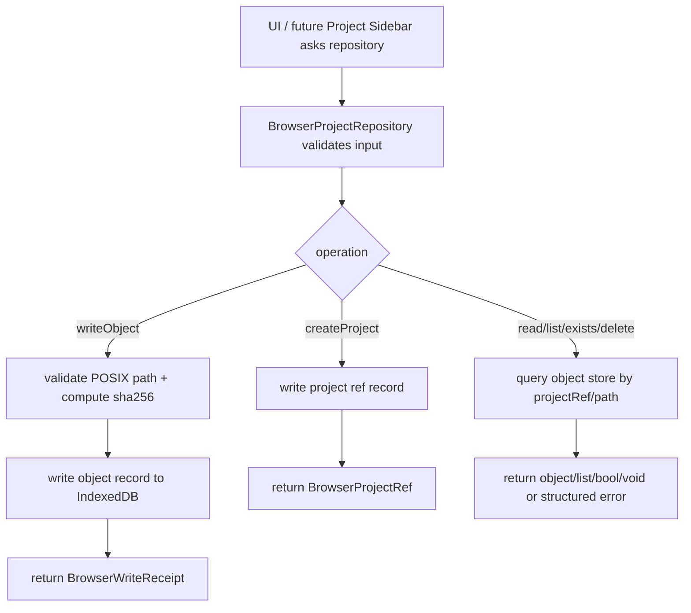

# web-local-project-repository design

## 0. 术语约定

| 术语 | 定义 | 防冲突结论 |
|---|---|---|
| Browser Project Repository | Web 前端真实浏览器本地项目仓储，保存项目 refs 和项目相对 path 下的 bytes 对象 | 不等同于 Python `BrowserLocalProjectStorageBackend` 测试替身 |
| Browser Project Ref | 浏览器 origin-local 的项目引用，供 UI 列表、打开项目和后续 bundle import/export 使用 | 复用 roadmap `BrowserProjectRef` shape，不是本地文件系统 path |
| Browser Storage Object | 存在浏览器本地仓储中的一个项目对象，包含 project-relative POSIX path、bytes、checksum 和 metadata | 对齐 `ProjectStorageBackend` 的 `StorageObject` 语义 |
| IndexedDB Project Store | 第一版真实浏览器实现使用的 IndexedDB metadata + bytes object stores | OPFS payload store 暂不实现，避免提前引入大文件权限和 worker 复杂度 |
| Repository Error | 浏览器仓储结构化错误，包含 code、message、target、details | 对齐 ShellError 风格，但不包装成 ShellResponse |

术语 grep 结果：architecture / roadmap 已有 Browser Project Repository、BrowserLocalProjectStorageBackend、IndexedDB / OPFS、ProjectStorageBackend 和 Project Content 术语。当前 `web/src` 尚无 repository 模块，`rxnflow.browser_storage` 是 Python 内存测试替身，不可直接复用到浏览器 runtime。

## 1. 决策与约束

### 需求摘要

本 feature 的目标是把 Web Workbench 从“只有 shell fixture 状态”推进到具备真实浏览器本地项目仓储基础：

1. 在 `web/src` 新增 Browser Project Repository 模块，提供 project refs 和 project object CRUD。
2. 按 roadmap 4.3 契约实现 `listProjects`、`createProject`、`readObject`、`writeObject`、`exists`、`listObjects`、`deleteObject`。
3. 第一版真实浏览器实现使用 IndexedDB 保存 refs、metadata 和 bytes，保持 local-only，不承诺云同步。
4. 复用 Python `BrowserLocalProjectStorageBackend` 的 path 校验、project_ref 隔离、checksum、list prefix 和 quota error 语义。
5. 提供可在 Vitest 中验证的 repository factory / test double，并在真实浏览器里 smoke 验证 IndexedDB 读写。

### 明确不做

- 不实现 Project Sidebar UI、新建/打开/保存按钮、项目列表面板或 validation 状态视图。
- 不实现 `project.create` / `project.open` / `project.save_content` 与浏览器仓储的真实 bridge。
- 不实现 `.rxnflow.zip` bundle import/export UI 或 zip 读写。
- 不实现 File picker、drag/drop、parser preview 或 raw file 到 Python core 的桥接。
- 不实现 OPFS payload store、Web Worker、Service Worker、持久存储权限请求 UI 或大文件 chunking。
- 不引入云存储、账号、权限、跨设备同步、冲突合并或多人协作。
- 不修改 Python parser、registry、graph、energy、export、ProjectContentStore 或 BrowserLocalProjectStorageBackend。

### 复杂度档位

- Browser storage adapter：L3。涉及浏览器异步存储、bytes、checksum、path 校验和错误语义，但不接 UI 或 Python bridge。
- Frontend architecture：L2。新增独立 repository 模块和 tests，不重构 WorkbenchShell。
- Security / privacy：L2。local-only，需明确浏览器清数据会删除项目，不引入网络传输。
- UX risk：L1。本 feature 不新增用户可见项目操作 UI，只做 repository smoke / diagnostics。

### 关键决策

1. **IndexedDB-first，不在本 feature 实现 OPFS**：IndexedDB 原生支持结构化克隆 `ArrayBuffer` / `Uint8Array`，足够支撑 MVP 的 raw files、Project Content sections 和 exports。OPFS 更适合大文件 payload，但需要额外权限、worker/handle 管理和浏览器兼容处理，放到后续性能/大文件 feature。
2. **repository 是 Web 前端服务，不是 ShellTransport**：它保存项目内容 bytes；ShellTransport 仍只负责 command 调用。后续 Project Sidebar / bridge 会把两者编排起来。
3. **沿用 project-relative POSIX path 规则**：禁止绝对路径、反斜杠、`.`、`..` 和空 path，确保与 Project Content / Project Bundle logical path 一致。
4. **checksum 在浏览器端计算**：`writeObject` 使用 Web Crypto 计算 `sha256:`，返回 `BrowserWriteReceipt`，后续 validation / export index 可复用。
5. **错误结构化但不返回 ShellResponse**：repository promise 失败时抛出 `BrowserProjectRepositoryError`；UI 层后续可转成 panel error，不混入 Shell command response。

### 已确认 / 待确认假设

- 假设 A：接受第一版真实浏览器仓储使用 IndexedDB 保存 metadata 和 bytes，OPFS 暂不实现。
- 假设 B：本 feature 只落 repository 模块、测试和浏览器 smoke，不把 Project Sidebar UI 一并做掉。
- 假设 C：`backendId` 继续使用 roadmap 契约中的 `"browser-local-indexeddb-opfs-v1"` 作为 storage family 标识；实际 implementation notes 明确当前 payload store 是 IndexedDB-only。

## 2. 名词与编排

### 2.1 名词层：值对象 / 实体 / 接口契约

**现状**：

- Roadmap 4.3 已定义 `BrowserProjectRef`、`BrowserStorageObject`、`BrowserWriteReceipt` 和 `BrowserProjectRepository`。
- Python `rxnflow.browser_storage.BrowserLocalProjectStorageBackend` 已验证 project_ref 隔离、POSIX path 校验、checksum、prefix list、delete 幂等和 quota error 语义。
- Web `web/src/shell/types.ts` 已有 `JsonValue` / `JsonObject`，可复用为 repository metadata 类型。
- Web 当前没有 `web/src/repository/`，也没有 IndexedDB adapter。

**变化**：

新增前端 repository DTO / interface：

```ts
type BrowserProjectRef = {
  id: string
  name: string
  backendId: "browser-local-indexeddb-opfs-v1"
  projectRef: string
  createdAt: string
  updatedAt: string
  localOnly: true
}

type BrowserStorageObject = {
  path: string
  bytes: Uint8Array
  checksum?: string
  metadata: JsonObject
}

type BrowserWriteReceipt = {
  path: string
  checksum: string
  byteSize: number
  updatedAt: string
  backendId: string
}

type BrowserProjectRepositoryError = {
  code: "invalid_input" | "object_not_found" | "storage_unavailable" | "storage_quota_exceeded" | "storage_failed"
  message: string
  target?: string | null
  details?: JsonValue
}

interface BrowserProjectRepository {
  listProjects(): Promise<BrowserProjectRef[]>
  createProject(input: { name: string }): Promise<BrowserProjectRef>
  readObject(projectRef: string, path: string): Promise<BrowserStorageObject>
  writeObject(projectRef: string, object: BrowserStorageObject): Promise<BrowserWriteReceipt>
  exists(projectRef: string, path: string): Promise<boolean>
  listObjects(projectRef: string, prefix: string): Promise<BrowserStorageObject[]>
  deleteObject(projectRef: string, path: string): Promise<void>
}
```

IndexedDB 存储 shape：

```ts
type ProjectRefRecord = BrowserProjectRef

type ProjectObjectRecord = {
  key: string
  projectRef: string
  path: string
  bytes: ArrayBuffer
  checksum: string
  metadata: JsonObject
  byteSize: number
  updatedAt: string
}
```

`key` 是 repository 内部索引键，不进入公开 API；公开边界只暴露 `projectRef + path`。

### 2.2 编排层：主流程与控制流



**现状**：

- Web app shell 只通过 `fixtureTransport` 展示 local-only 状态，没有真实 project refs。
- Project Content 的 logical path 已在 Python core 固定为 `.rxnflow/state/...`、`inputs/raw/...`、`exports/...`。
- `.rxnflow.zip` 是手动迁移路径，但 Web 端尚无 bundle IO。

**变化**：

- 新增 `IndexedDbBrowserProjectRepository` 作为真实浏览器实现。
- 新增 `MemoryBrowserProjectRepository` 或可注入 driver 作为 Vitest 稳定测试替身，语义必须与 IndexedDB implementation 对齐。
- 新增 `createBrowserProjectRepository()` factory：浏览器有 IndexedDB 时返回 IndexedDB implementation；不可用时返回结构化 `storage_unavailable` 错误或显式 unavailable repository。
- Repository 模块不自动写 Project Content scaffold；创建 project ref 只创建项目引用。`.rxnflow/state/project-content.json`、raw files、exports 由后续 Project Sidebar / Import / Export feature 调用 `writeObject` 写入。
- Browser smoke 验证通过 Vite dev server 动态 import repository module，在真实 Chromium IndexedDB 中创建测试项目、写入 `.rxnflow/state/project-content.json`、读取、list、delete。

**跨层纪律**：

- Local-only：所有 project refs 带 `localOnly: true`，不出现网络请求或 cloud SDK。
- Path safety：所有 object path 都走统一校验，不允许绝对路径、反斜杠、`.`、`..`、空 path。
- Bytes authority：repository 保存 bytes，不解析 ChemicalObject、ReactionGraph、EnergyProfile 或 ExportArtifact 语义。
- Project isolation：相同 path 在不同 `projectRef` 下互相隔离。
- Idempotency：`writeObject` 覆盖同一 projectRef/path；`deleteObject` 对缺失对象返回成功。
- Ordering：`listProjects` 按 `updatedAt` 或 `name` 稳定排序；`listObjects` 按 path 稳定排序。
- Error semantics：缺 object 返回 `object_not_found`；quota DOMException 映射为 `storage_quota_exceeded`；IndexedDB 不可用映射为 `storage_unavailable`。

### 2.3 挂载点清单

- `web/src/repository/`：新增 Browser Project Repository DTO、factory、path/checksum helpers、IndexedDB implementation 和 test double。
- `web/src/repository/*.test.ts`：覆盖 contract、path safety、checksum、project isolation、prefix list、delete idempotency 和 error semantics。
- `web/src/app` 或 browser validation script：只做 smoke 验证 repository 在真实浏览器可用，不新增 Project Sidebar UI。
- `.codestable/architecture/web-workbench.md` / `ARCHITECTURE.md`：acceptance 阶段记录真实 Web Browser Project Repository 现状和 IndexedDB-first 边界。
- `.codestable/requirements/project-content-persistence.md`：acceptance 阶段补充“真实 Web repository 已落地，仍 local-only / 手动 bundle 备份”的现状。

本 feature 不挂入 Python core、PlatformShellService、ProjectContentStore、parser/import/graph/energy/export 算法，也不挂入云 provider 或账号系统。

### 2.4 推进策略

1. **Repository Contract Types**：新增 Browser Project Repository 类型、结构化错误、path validation 和 checksum helper。
   - 退出信号：前端单测能验证 path safety、checksum 格式和 JSON-safe metadata。
2. **IndexedDB Repository Implementation**：实现 project refs 和 object records 的 IndexedDB CRUD。
   - 退出信号：测试替身或 fake IndexedDB 可跑通 create/list/write/read/exists/list/delete。
3. **Local-only Error / Edge Semantics**：补 project isolation、overwrite、missing object、delete idempotency、quota/unavailable 映射。
   - 退出信号：单测覆盖 roadmap 4.3 contract 的正常、边界和错误路径。
4. **Browser Smoke Validation**：在 Vite dev server 的真实浏览器环境动态 import repository，执行一次 create/write/read/list/delete smoke。
   - 退出信号：桌面浏览器 smoke 通过；不需要新增用户可见 UI。
5. **Scope Guard / Docs Prep**：跑 Web test/build、scope grep、确认未引入云/bridge/UI/Python core 改动，准备 acceptance 回写 architecture/requirement/roadmap。
   - 退出信号：验证证据足以进入 acceptance。

## 3. 验收契约

### 关键场景清单

1. `createBrowserProjectRepository()` 在真实浏览器 IndexedDB 可用时返回 repository。
2. `createProject({name})` 返回 `BrowserProjectRef`，包含 id、name、backendId、projectRef、createdAt、updatedAt、localOnly=true。
3. `listProjects()` 可看到已创建 project refs，并有稳定排序。
4. `writeObject(projectRef, {path, bytes, metadata})` 返回 `BrowserWriteReceipt`，checksum 为 `sha256:<64 hex>`，byteSize 正确。
5. `readObject(projectRef, path)` 返回原 bytes、checksum 和 metadata。
6. `exists(projectRef, path)` 对存在/不存在对象分别返回 true/false。
7. `listObjects(projectRef, prefix)` 支持 exact file 和 prefix subtree，并按 path 稳定排序。
8. `deleteObject(projectRef, path)` 对存在和不存在对象都成功，删除后 `exists=false`。
9. 不同 `projectRef` 下相同 path 互相隔离。
10. 非法 path（空、绝对路径、反斜杠、`.`、`..`）返回 / 抛出结构化 `invalid_input`，target 为 `path`。
11. 缺失 object 的 `readObject` 返回 / 抛出 `object_not_found`，target 为 `path`。
12. IndexedDB 不可用时错误为 `storage_unavailable`，不静默退化成内存持久化。
13. quota failure 可映射为 `storage_quota_exceeded` 或在测试替身中模拟该错误。
14. `npm run test` 通过。
15. `npm run build` 通过。
16. 真实浏览器 smoke 通过：create/write/read/list/delete 均成功。

### 反向检查

- 不新增 Project Sidebar UI、新建/打开/保存按钮或项目列表面板。
- 不实现 `.rxnflow.zip` bundle import/export UI 或 zip 读写。
- 不实现 File picker、drag/drop、parser preview 或 raw file 到 Python core 的桥接。
- 不实现 OPFS payload store、Web Worker、Service Worker、StorageManager.persist 权限 UI 或大文件 chunking。
- 不新增 HTTP API、local-python bridge、Vercel route、FastAPI、Flask、Django、Express server。
- 不新增 Supabase、S3、R2、Vercel Blob、Firebase、Auth0、Clerk 或其他账号/云存储 SDK。
- 不修改 Python parser、registry、graph、energy、export、ProjectContentStore 或 BrowserLocalProjectStorageBackend。
- 不把 repository bytes 当成 ChemicalObject / ReactionGraph / EnergyProfile 的前端领域真相。

## 4. 与项目级架构文档的关系

- 用户确认后生成 checklist，并把 roadmap item `web-local-project-repository` 更新为 `in-progress`。
- 实现完成并验收后，`.codestable/architecture/web-workbench.md` 应记录真实 Browser Project Repository、IndexedDB-first implementation、local-only 和清浏览器数据风险。
- `.codestable/architecture/ARCHITECTURE.md` 应把 Browser Project Repository 从“未来 Web 端”更新为“已落地 Web IndexedDB-first adapter”。
- `.codestable/requirements/project-content-persistence.md` 应补充真实 Web repository 的现状边界：它提供浏览器 local project refs / objects，但不是云备份；早期仍需要 `.rxnflow.zip` 手动迁移。
- 本 feature 若 implementation 阶段确认 `backendId` 不应继续叫 `browser-local-indexeddb-opfs-v1`，应先回 roadmap 4.3 update，不在代码里私自改契约。
