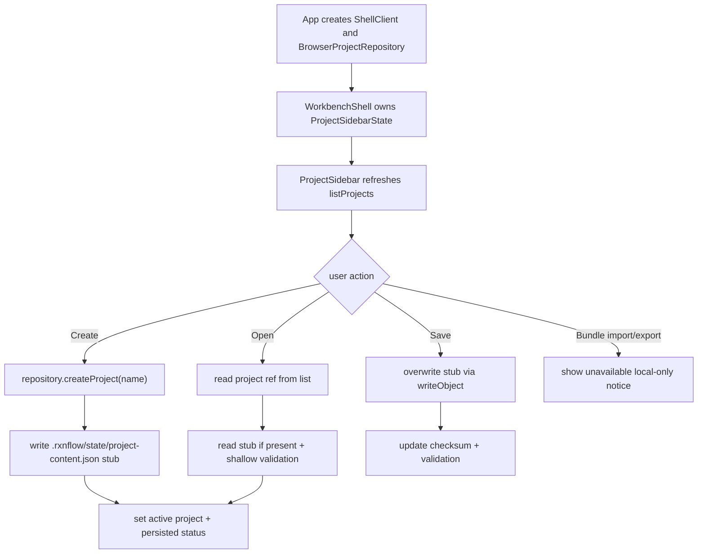

# web-project-sidebar design

## 0. 术语约定

| 术语 | 定义 | 防冲突结论 |
|---|---|---|
| Project Sidebar | Web Workbench 左侧的项目入口区，展示 browser-local projects、当前 active project、local-only / validation 状态和项目级 commands | 不等同于 `ProjectRail` 的旧 summary 占位 |
| Active Browser Project | 当前在 Web UI 中选中的 `BrowserProjectRef`，后续保存、导入、导出都以它的 `projectRef` 为目标 | 不等同于 Python `PlatformSession` 或本地文件系统 project path |
| Project Repository State | 前端从 Browser Project Repository 派生的 UI state，包含 projects、activeProjectRef、loading/error、dirty/persisted/validation 状态 | 不写入 Project Content，不替代 WorkbenchDomainState |
| Web Project Content Stub | 第一版 Web sidebar 创建项目时写入的最小 `.rxnflow/state/project-content.json` 占位对象，用于证明保存入口落到 repository | 不等同于 Python ProjectContentSnapshot 完整保存 |
| Sidebar Validation Status | 前端基于 repository object 是否存在、checksum 和本地错误得出的状态投影 | 不等同于 Python `ProjectContentValidator` 深校验报告 |

术语 grep 结果：roadmap 已定义 Project Sidebar、Browser Project Repository、Workbench State、Shell Client 和 Project Bundle 边界；architecture 已记录 `web/src/repository` 的 IndexedDB-first adapter。当前 `web/src/app/ProjectRail` 只是 project/object summary，占位 UI 不是项目侧边栏；`project.create/open/save_content` 是 shell command 名称，但 Web fixture transport 还没有真实 bridge。

## 1. 决策与约束

### 需求摘要

本 feature 的目标是把左侧占位 project rail 推进成真实 Web Project Sidebar 第一版：

1. 在 Web app 中创建 Browser Project Repository 实例，并把 repository 注入或传入 WorkbenchShell。
2. 侧边栏可列出 browser-local projects，并显示 active project、local-only、IndexedDB backend、object count / validation status。
3. 用户可在 UI 中新建 browser-local project；新建后写入最小 `.rxnflow/state/project-content.json` stub，作为本地保存入口的可观察证据。
4. 用户可打开已有 browser-local project；UI active project 切换到该 `BrowserProjectRef`，但不伪造 Python `PlatformSession`。
5. 提供保存当前 Web project stub 的动作：写入 / 覆盖 `.rxnflow/state/project-content.json`，展示 checksum、updatedAt 和 dirty/persisted 状态。
6. 提供 bundle import/export 的入口状态和按钮占位，但第一版不实现 zip 读写，避免绕开后续 bundle adapter / browser file feature。

### 明确不做

- 不实现真实 `.rxnflow.zip` import/export 读写、JSZip 依赖、下载文件或 file picker。
- 不实现 `project.create` / `project.open` / `project.save_content` 到 Python core 的真实 bridge。
- 不实现 parser preview、文件导入、drag/drop 或 raw file 到 Python core 的传输。
- 不把 IndexedDB project 伪装成 Python `PlatformSession`；打开 browser project 不自动运行 `workbench.snapshot`。
- 不实现 ProjectContentSnapshot 完整序列化、Python ProjectContentValidator 深校验或 schema migration。
- 不实现云存储、账号、权限、跨设备同步、冲突合并或多人协作。
- 不修改 Python parser、registry、graph、energy、export、ProjectContentStore、ProjectBundleService 或 PlatformShellService。

### 复杂度档位

- Frontend orchestration：L3。需要把 repository async state、WorkbenchShell UI 和 error/loading/dirty 状态编排起来。
- Browser storage：L2。复用已落地 repository，不新增 IndexedDB schema；只写最小 project content stub。
- UX：L3。左侧项目入口是用户可见工作流，必须浏览器验证桌面和窄屏布局。
- Core integration：L1。本 feature 不接 Python bridge，不修改 core。

### 关键决策

1. **先接 Browser Project Repository，不接 Python Shell bridge**：Project Sidebar 的第一版目标是让用户看见并操作浏览器本地项目仓储。Python session/open/save bridge 需要独立 feature 明确 logical path、session lifecycle 和 adapter。
2. **新建项目写最小 project content stub**：仅创建 `BrowserProjectRef` 会让“保存”不可观察；写入 `.rxnflow/state/project-content.json` 可证明项目内容对象落到 repository。stub 只包含 Web sidebar metadata，不声明为完整 ProjectContentSnapshot。
3. **validation status 先做 shallow repository validation**：第一版只判断 `.rxnflow/state/project-content.json` 是否存在、可读、checksum 是否可显示，以及 repository error。Python 深校验留到 bridge / ProjectContentStore 接入后。
4. **bundle import/export 第一版只显示 disabled / unavailable 状态**：roadmap 要求侧边栏管理 bundle 入口，但真实 zip IO 需要 file picker、download、bundle adapter 和后续 bridge，不能在本 feature 偷做半套。
5. **Project Sidebar state 独立于 WorkbenchDomainState**：WorkbenchDomainState 仍来自 ShellResponse；Project Repository State 来自 Browser Project Repository。两者可同时显示，但不能互相伪造。

### 已确认 / 待确认假设

- 假设 A：接受第一版 Project Sidebar 先完成 browser-local project list/create/open/save stub，不接 Python core session。
- 假设 B：bundle import/export 在本 feature 中显示为不可用入口或 disabled button，真实 zip IO 单独 feature 推进。
- 假设 C：最小 `.rxnflow/state/project-content.json` stub 采用 JSON bytes，metadata 标注 `kind: "web-project-content-stub"`，后续完整 ProjectContentSnapshot 接入时可以覆盖。

## 2. 名词与编排

### 2.1 名词层：值对象 / 实体 / 接口契约

**现状**：

- `web/src/repository/types.ts` 已提供 `BrowserProjectRepository`、`BrowserProjectRef`、`BrowserStorageObject` 和 `BrowserWriteReceipt`。
- `web/src/app/workbenchState.ts` 已提供 `WorkbenchDomainState` 和 `WorkbenchUiState`；其中 domain state 来自 shell snapshot，不包含 browser project list。
- `WorkbenchShell.tsx` 当前内部只维护 `WorkbenchDomainState`，左侧 `ProjectRail` 只显示 project/session/object summary。
- `web/src/app/App.tsx` 当前创建 `ShellClient`，未创建 Browser Project Repository。

**变化**：

新增前端 Project Sidebar state：

```ts
type ProjectPersistenceState = "empty" | "dirty" | "saving" | "persisted" | "error"

type SidebarValidationStatus = {
  state: "unknown" | "missing" | "valid" | "error"
  message: string
  checksum?: string
  checkedAt?: string
}

type ProjectSidebarState = {
  status: "idle" | "loading" | "ready" | "error"
  projects: BrowserProjectRef[]
  activeProjectRef?: string
  activeProject?: BrowserProjectRef
  persistence: ProjectPersistenceState
  validation: SidebarValidationStatus
  lastWrite?: BrowserWriteReceipt
  error?: BrowserProjectRepositoryErrorPayload
}
```

新增 sidebar command handlers：

```ts
type ProjectSidebarActions = {
  refreshProjects(): Promise<void>
  createProject(name: string): Promise<void>
  openProject(projectRef: string): Promise<void>
  saveProjectStub(): Promise<void>
}
```

Web Project Content Stub 示例：

```json
{
  "schema_version": "web-project-content-stub-v1",
  "project_ref": "browser-project:...",
  "project_name": "Demo",
  "created_by": "rxnflow-web-project-sidebar",
  "updated_at": "2026-05-19T00:00:00.000Z"
}
```

### 2.2 编排层：主流程与控制流



**现状**：

- App 只创建 ShellClient；WorkbenchShell 的左栏没有 repository state。
- Browser Project Repository 已能在 IndexedDB 中 list/create/read/write/exists/list/delete。
- Workbench Snapshot 仍是 fixture shell projection；project sidebar 不应伪造它。

**变化**：

- `App` 创建 `createBrowserProjectRepository()`，将 repository 传入 `WorkbenchShell`；测试可注入 `MemoryBrowserProjectRepository`。
- `WorkbenchShell` 或新 hook `useProjectSidebarState` 负责加载项目列表、维护 active project、persistence 和 validation 状态。
- `ProjectRail` 升级为 `ProjectSidebar`，展示 project list、active project details、local-only status、validation/persistence status 和 project-level actions。
- `createProject(name)`：创建 project ref，写入 stub，refresh list，设为 active。
- `openProject(projectRef)`：设为 active，尝试读取 stub，missing 显示 `missing` validation，不创建 Python session。
- `saveProjectStub()`：要求 active project，覆盖 stub，显示 checksum / updatedAt。
- bundle import/export buttons 保留入口但 disabled，并显示“后续 bundle UI 接入”的状态；不触发 file picker 或 download。

**跨层纪律**：

- UI state 来源清晰：Project Sidebar state 来自 Browser Project Repository；WorkbenchDomainState 来自 ShellResponse。
- Local-only 必须可见：active project 和 sidebar 顶部显示 local-only / IndexedDB backend / browser data risk。
- Error visibility：repository error 显示 code、message、target；不得只显示通用失败。
- Idempotency：重复保存 active project stub 覆盖同一路径；不会创建多个 `.rxnflow/state/project-content.json`。
- Scope guard：新增 UI 不调用 parser/import/register/energy/export core，不新增 HTTP API 或 cloud SDK。
- Responsive layout：桌面左栏可扫描，窄屏项目 actions 不得挤压 graph workspace 文本或产生水平滚动。

### 2.3 挂载点清单

- `web/src/app/`：新增 Project Sidebar state / hook、ProjectSidebar component，并把 App / WorkbenchShell 接入 Browser Project Repository。
- `web/src/repository/`：复用现有 Browser Project Repository；若需要，只新增 project content stub helper，不改 IndexedDB schema。
- `web/src/app/*.test.tsx` / `web/src/repository/*.test.ts`：覆盖 sidebar list/create/open/save/error/disabled bundle entry。
- `.codestable/architecture/web-workbench.md` / `ARCHITECTURE.md`：acceptance 阶段记录 Project Sidebar 当前能力和仍未接 bridge/bundle IO 的边界。
- `.codestable/requirements/project-content-persistence.md` / `web-workbench-shell.md`：acceptance 阶段补充 Web 项目侧边栏作为 browser-local project entry 的现状。

本 feature 不挂入 Python core、PlatformShellService、ProjectBundleService、parser/import/graph/energy/export 算法，也不新增 cloud provider、HTTP route 或账号系统。

### 2.4 推进策略

1. **Sidebar State Contract**：新增 ProjectSidebarState、validation/persistence 状态和 stub helper。
   - 退出信号：单测覆盖 initial state、error shape、stub bytes shape。
2. **Repository-backed Project Actions**：实现 refresh/create/open/save stub 的前端编排，支持 Memory repository 测试。
   - 退出信号：单测跑通 list/create/open/save，重复保存覆盖同一 logical path。
3. **Project Sidebar UI Integration**：把旧 ProjectRail 升级为可见 Project Sidebar，加入 project list、active project、local-only、validation 和 actions。
   - 退出信号：component tests 覆盖按钮、列表、状态文案和错误展示。
4. **Bundle Entry Scope Guard**：加入 import/export bundle 的 disabled / unavailable 入口状态，不实现 zip IO。
   - 退出信号：测试和 grep 确认没有 file picker、download、JSZip 或 bundle read/write 实现。
5. **Browser Responsive Validation**：跑 Web test/build，并在真实浏览器桌面/窄屏验证 sidebar 可用、无重叠/水平溢出。
   - 退出信号：桌面和窄屏浏览器验证通过，scope grep 确认未越界。

## 3. 验收契约

### 关键场景清单

1. App 创建并向 WorkbenchShell 提供 Browser Project Repository；测试可注入 Memory repository。
2. 首屏 Project Sidebar 显示 local-only、IndexedDB/browser-local 状态和已有 project list。
3. 用户输入项目名并点击新建后，repository 产生 `BrowserProjectRef`，项目出现在列表中并成为 active project。
4. 新建项目后写入 `.rxnflow/state/project-content.json` stub，receipt checksum 为 `sha256:<64 hex>`，persistence 显示 persisted。
5. 打开已有项目后，active project 切换；如果 stub 存在，validation 显示 valid 和 checksum。
6. 打开已有项目但 stub 缺失时，不报崩溃，validation 显示 missing，用户仍可点击保存 stub。
7. 点击保存 active project 时覆盖同一路径 stub，更新 checksum / updatedAt，不创建重复 object。
8. repository error 显示 code、message 和 target，UI 不吞错。
9. Bundle import/export 入口可见但 disabled / unavailable，并明确不触发 file picker、download 或 zip IO。
10. Project Sidebar 不调用 `project.create` / `project.open` / `project.save_content` shell commands，不创建 Python session。
11. WorkbenchDomainState 仍只来自 fixture / shell snapshot；Project Sidebar 不手写 ChemicalObject、ReactionGraph 或 EnergyProfile。
12. `npm run test` 通过。
13. `npm run build` 通过。
14. 真实浏览器桌面 viewport 验证 sidebar create/open/save 状态可见，无明显重叠。
15. 真实浏览器窄屏 viewport 验证 actions/list/status 可用，无水平溢出。

### 反向检查

- 不实现真实 `.rxnflow.zip` import/export 读写、JSZip、download 或 file picker。
- 不实现 browser file import、drag/drop、parser preview 或 raw file bridge。
- 不调用 Python core shell project create/open/save_content；不新增 local-python bridge 或 HTTP API。
- 不实现 ProjectContentSnapshot 完整 serializer、Python validator、migration 或 session restore。
- 不新增 Supabase、S3、R2、Vercel Blob、Firebase、Auth0、Clerk 或其他账号/云存储 SDK。
- 不修改 Python parser、registry、graph、energy、export、ProjectContentStore、ProjectBundleService 或 PlatformShellService。

## 4. 与项目级架构文档的关系

- 用户确认后生成 checklist，并把 roadmap item `web-project-sidebar` 更新为 `in-progress`。
- 实现完成并验收后，`.codestable/architecture/web-workbench.md` 应记录 Project Sidebar 真实 UI、repository-backed project list/create/open/save stub、local-only / validation 状态和 bundle entry disabled 边界。
- `.codestable/architecture/ARCHITECTURE.md` 应把 Project Sidebar 从 roadmap 模块更新为 Web Workbench 已落地能力。
- `.codestable/requirements/project-content-persistence.md` 应补充 Web 用户可以在浏览器本地创建/打开/保存 project stub，但仍不是云备份或完整 ProjectContentStore bridge。
- `.codestable/requirements/web-workbench-shell.md` 应补充左侧 project rail 已升级为项目侧边栏入口。
