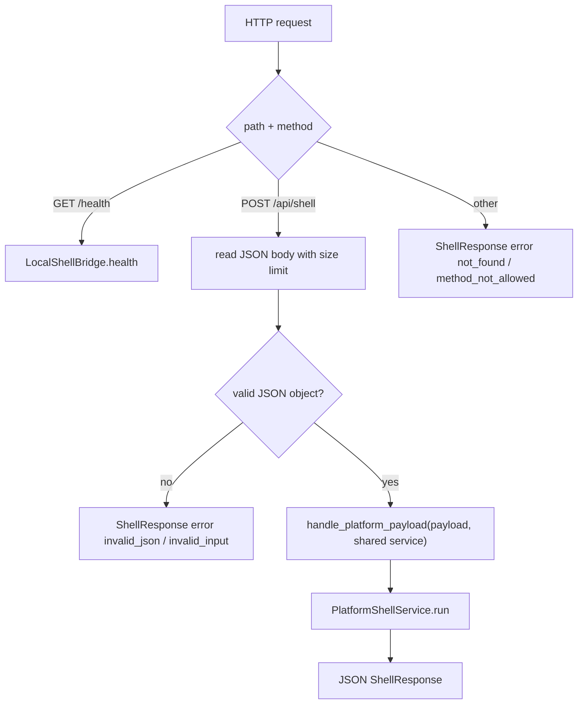

# local-http-shell-bridge design

## 0. 术语约定

| 术语 | 定义 | 防冲突结论 |
|---|---|---|
| Local HTTP Shell Bridge | 本机开发用 HTTP server，接收 Shell payload 并转给 Python `PlatformShellService` | 新增运行时入口，不替代 `PlatformShellService` |
| Bridge Session | Bridge server 进程内 `AppKernel` 保存的 `PlatformSession` | 重启后丢失；不等于项目持久化 |
| Shell HTTP API | `GET /health` 与 `POST /api/shell` 两个本地 endpoint | 只承载 JSON-safe shell command，不承载前端静态资源 |
| Bridge Error Response | Bridge 层错误包装成 ShellResponse shape | 不把 traceback 或 HTML error page 返回给前端 |

术语 grep 结果：当前已有 `rxnflow.platform.PlatformShellService`、`AppKernel`、`ShellCommand`、`ShellResponse`、`handle_platform_payload` 和 `python3 -m rxnflow.cli`。仓库没有本地 HTTP bridge server、`/health`、`/api/shell` 或长期运行的 shell service 入口。

## 1. 决策与约束

### 需求摘要

Web Workbench MVP 当前只接 fixture transport。下一阶段需要一个最小真实 runtime bridge，让本机浏览器或脚本可以通过 HTTP 调用现有 Python Platform Shell，并在同一个 server 进程内保留 session，从而支持 `fixture.run -> workbench.snapshot` 这种跨请求工作台投影。

本 feature 只实现本地 Python bridge server，不实现前端 `http-api` transport。完成后，后续 `web-http-shell-transport` feature 可以直接按本 feature 的 HTTP API 调用。

### 明确不做

- 不新增 FastAPI、Flask、Django、Uvicorn、Vercel route 或第三方 Web server 依赖。
- 不实现认证、公网部署、TLS、远程文件访问权限模型或生产安全边界。
- 不修改 parser、registry、graph、energy、export 的领域行为。
- 不扩展 `import.preview` 的 bytes payload；真实浏览器文件桥接留给 `web-import-file-payload-bridge`。
- 不接入 Web 前端 env、runtime indicator 或 Playwright bridge mode；留给后续 `web-http-shell-transport` 和 QA feature。
- 不把 bridge session 持久化到磁盘、浏览器仓储或 serverless filesystem。

### 复杂度档位

- Robustness：L2。本地开发工具，需要结构化错误和 session 保留，不做公网级安全。
- Structure：L2。新增小模块 + CLI 模块入口，复用现有 Platform Shell。
- Testability：L2。用标准库 HTTP server 在线程中启动，覆盖 health、shell success、session continuation、invalid JSON、unknown path/method。
- Security：L1。默认只监听 `127.0.0.1`；CORS 只服务本机开发 origin，不默认放开公网。

## 2. 名词与编排

### 2.1 名词层：值对象 / 接口契约

**现状**：

- `handle_platform_payload(payload, service=None)` 可把 dict payload 转成 `ShellCommand`，并返回 JSON-safe dict。
- 如果调用方每次都不传 service，会创建新的 `PlatformShellService()`，跨请求无法保留 session。
- `rxnflow.cli` 是一次性进程入口，不适合 Web 页面连续发命令。

**变化**：

- 新增 `rxnflow.local_bridge` 模块，提供：

```python
class LocalShellBridge:
    def __init__(
        self,
        service: PlatformShellService | None = None,
        max_body_bytes: int = 10 * 1024 * 1024,
    ) -> None: ...

    def health(self) -> dict[str, object]: ...
    def handle_shell_payload(self, payload: object) -> dict[str, object]: ...

def create_local_bridge_server(
    host: str = "127.0.0.1",
    port: int = 8765,
    bridge: LocalShellBridge | None = None,
) -> ThreadingHTTPServer: ...

def serve_local_bridge(host: str = "127.0.0.1", port: int = 8765) -> None: ...
```

- 新增 `python3 -m rxnflow.local_bridge --host 127.0.0.1 --port 8765` 入口。
- HTTP 契约按 roadmap 第 4.1 节实现：

```http
GET /health
POST /api/shell
```

### 2.2 编排层：主流程与控制流



**跨层纪律**：

- 同一个 `LocalShellBridge` 持有同一个 `PlatformShellService(AppKernel())`，因此 `fixture.run` 返回的 session 可被下一次 `workbench.snapshot` 使用。
- Bridge 只处理 HTTP/JSON 包装，不解释 ChemicalObject、ReactionGraph、EnergyProfile 等领域 payload。
- Bridge 任何错误都返回 JSON object；不返回 HTML error page。
- HTTP 入口默认本机监听；如果用户显式传别的 host，是用户操作，不作为生产安全承诺。

### 2.3 挂载点清单

- `rxnflow/local_bridge.py`：本地 HTTP bridge 模块和 `python -m` 入口。
- `tests/test_local_http_shell_bridge.py`：HTTP bridge contract 和 session continuation 测试。
- `docs/dev/web-runtime-boundary.md`：补一小节记录已落地的 local bridge 启动方式和边界。
- `.codestable/roadmap/rxnflow-web-runtime-bridge/*`：对应 item 状态追踪。

### 2.4 推进策略

1. **Bridge skeleton**：新增 `LocalShellBridge`、health payload 和 `create_local_bridge_server`。
   - 退出信号：测试可直接实例化 bridge，并拿到 health object。
2. **HTTP handler**：实现 `GET /health`、`POST /api/shell`、JSON 读写、CORS/options 和错误 response。
   - 退出信号：标准库 HTTP client 可得到 JSON response。
3. **Session continuation**：确保同一 bridge service 支持 `fixture.run -> workbench.snapshot`。
   - 退出信号：HTTP 测试能用第一次 response 的 session_id 获取 snapshot。
4. **CLI 模块入口**：支持 `python3 -m rxnflow.local_bridge --host ... --port ...`。
   - 退出信号：模块可解析参数并启动 server；测试不需要长期运行它。
5. **文档和 roadmap 回写**：更新 runtime boundary dev guide 和 roadmap item。
   - 退出信号：YAML 校验和单元测试通过。

## 3. 验收契约

### 关键场景清单

1. `LocalShellBridge.health()` 返回 `ok=True`、service 名和 version。
2. `GET /health` 返回 200 JSON，包含 `rxnflow-local-shell-bridge`。
3. `POST /api/shell` + `fixture.run` 返回 200 ShellResponse，`ok=True`，包含 `session_id`。
4. 用同一 server 再 `POST /api/shell` + `workbench.snapshot`，传入上一步 `session_id`，返回同一 fixture project 的 counts/profile。
5. unknown shell command 仍返回 200 ShellResponse，`ok=False`、`error.code=invalid_input`、`target=command`。
6. invalid JSON 返回 400 ShellResponse，`error.code=invalid_json`。
7. unknown path 返回 404 ShellResponse，`error.code=not_found`。
8. unsupported method 返回 405 ShellResponse，`error.code=method_not_allowed`。
9. response 均可 `json.loads` / `json.dumps`，不返回 HTML error page。
10. `python3 -m unittest discover` 通过。

### 反向检查

- 不新增第三方 server/runtime 依赖。
- 不修改 `rxnflow/parsers`、`rxnflow/registry.py`、`rxnflow/graph.py`、`rxnflow/energy.py`、`rxnflow/export.py` 的领域行为。
- 不修改 Web 前端 transport 或 UI。
- 不把 bridge 描述成生产公网服务或云存储方案。

## 4. 与项目级架构文档的关系

- 验收后 `.codestable/architecture/ARCHITECTURE.md` 和 `.codestable/architecture/web-workbench.md` 只记录已落地的本地 HTTP bridge，不把后续 Web transport 写成现状。
- `docs/dev/web-runtime-boundary.md` 可记录启动命令和本机边界，作为下一条 `web-http-shell-transport` 的输入。
- 本 feature 是 runtime 基础能力，不新增用户故事；继续挂在 `web-workbench-shell` requirement 下。

