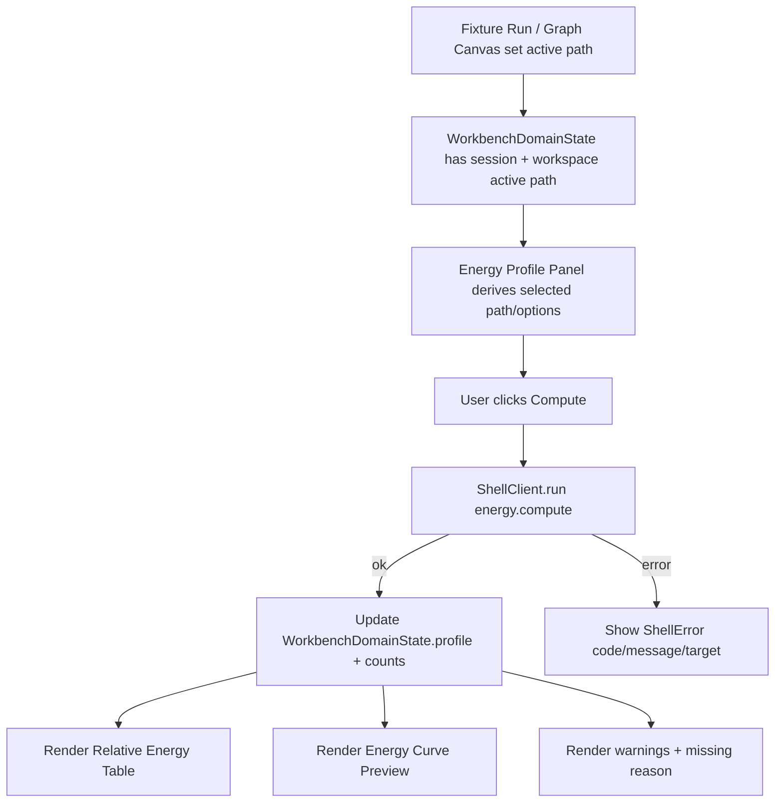

# web-energy-profile-panel design

## 0. 术语约定

| 术语 | 定义 | 防冲突结论 |
|---|---|---|
| Energy Profile Panel | Web 工作台中计算和展示 active path 能量剖面的右侧面板 | 不等同于 core `EnergyProfileEngine` |
| Energy Compute Command | Web UI 通过 ShellClient 提交的 `energy.compute` 命令 | 不在前端重算能量 |
| Energy Profile Point | ShellResponse profile projection 中的单个 path node 能量点 | 对应 core `EnergyPoint` 的 Web summary |
| Relative Energy Table | Energy Profile Panel 中按 path order 展示 label、node id、relative energy、unit 和 missing reason 的表格 | 不等同于导出用 Excel table |
| Energy Curve Preview | 由 profile points 投影出的基础 SVG 折线/点图 | 不生成 PNG/CDXML，不作为报告 artifact |
| Energy Compute Options | output unit、include corrections、energy key 和 baseline node id 的 UI 输入 | 直接映射 roadmap `EnergyComputeArgs` |

术语 grep 结果：core 已有 `EnergyProfileEngine`、`EnergyProfile`、`EnergyPoint`、`EnergyOptions`、`energy.compute`；Web 侧当前只有 `EnergyProfileSummary` 和静态 profile inspector。该 feature 复用 `Energy Profile Panel` 作为 UI 面板名，不新增 core 领域概念。

## 1. 决策与约束

### 需求摘要

本 feature 目标是在 Web Workbench 中把静态 Energy profile 摘要升级为可操作的 Energy Profile Panel：

1. 扩展前端 EnergyProfile DTO，显式表达 profile point 的 relative energy、unit、missing reason 和 warning。
2. 扩展 fixture transport 支持 `energy.compute`，按 active path / path_id 返回 JSON-safe EnergyProfile projection。
3. 新增 Energy Profile Panel，提供 path、output unit、include corrections、energy key、baseline node 的命令参数输入。
4. 点击 compute 后调用 ShellClient `energy.compute`，成功后用返回 profile 更新 WorkbenchDomainState，不在 UI 内重算。
5. 展示相对能量表、missing reason、warnings 和基础 SVG 曲线；动态 id、unit、warning/error code 原样显示。
6. 新增 `zh-CN` / `en-US` 双语文案；保留化学/命令动态值不翻译。
7. 浏览器桌面/窄屏验证表格、曲线、选项控件和 warnings 不重叠且无水平溢出。

### 明确不做

- 不修改 Python `EnergyProfileEngine`、EnergyOptions 语义、能量单位换算规则或 Project Content codec。
- 不在前端重新计算相对能量、校正项或单位换算；前端只展示 ShellResponse profile projection。
- 不调用 `export.profile`，不生成 PNG/CDXML/XLSX，也不写 artifact index。
- 不调用 `project.save_content`，不持久化新 profile；profile 保存留给既有 shell/project content 边界。
- 不实现高级图表库、ChemDraw 曲线导出、坐标拖拽、标注编辑或多条曲线叠加。
- 不把缺失能量点补成 0；missing point 必须显示 missing reason 且曲线跳过该点。
- 不翻译 energy key、node id、path id、unit、warning/error code 或底层 error message。
- 不新增 HTTP API、cloud SDK、账号系统或同步机制。

### 复杂度档位

- Frontend orchestration：L3。需要从 workspace active path 派生命令参数、调用 energy.compute、更新 profile projection 和错误状态。
- Fixture transport：L2。新增 fixture `energy.compute`，验证 success / missing path / unit / warning projection。
- UX：L3。右侧面板需要在窄屏下展示选项、表格、曲线和 warnings，避免文本溢出。
- Core integration：L1。本 feature 不改 Python core，只对齐已有 shell command contract。

### 关键决策

1. **命令权威仍在 ShellClient**：Energy Profile Panel 只提交 `energy.compute`，成功后使用 response profile 更新 WorkbenchDomainState。
2. **默认使用 workspace active path**：若用户没有选择 path，compute args 传入 `workspace.active_path_id`；没有 active path 时禁用 compute。
3. **先用基础 SVG 曲线**：第一版只画可读的折线/点图，缺失点跳过并在表格中显示 missing reason；高级图表和导出留给后续。
4. **选项直接映射 EnergyComputeArgs**：output unit 只允许 `kcal_mol` / `kj_mol`；include corrections 是 checkbox；energy key 默认 `electronic`；baseline node 可空。
5. **warnings 可见且不中断**：ShellResponse warnings 和 profile point missing reason 都显示；只有 `ok=false` 才进入 error 状态。

## 2. 名词与编排

### 2.1 名词层：值对象 / 实体 / 接口契约

**现状**：

- roadmap 第 4.7 已定义 `EnergyComputeArgs`：`session_id`、可选 `path_id`、`output_unit`、`include_corrections`、`energy_key`、`baseline_node_id`。
- `web/src/shell/types.ts` 已有 `EnergyProfileSummary`，但 `points` 仍是 `JsonValue[]`，不利于 UI 表格和曲线做类型约束。
- `PlatformShellService._run_energy_compute` 返回 `{ profile: _profile_summary(...) }`，summary point 包含 `node_id`、`label`、`relative_energy` 和 `missing_reason`。
- `WorkbenchShell` 右侧 inspector 只显示 profile id 和 point count，不调用 `energy.compute`。

**变化**：

补强 Web energy projection 类型，仍保持 JSON-safe：

```ts
type EnergyValueSummary = {
  value: number
  unit: string
  reference?: string | null
}

type EnergyProfilePointSummary = {
  node_id: string
  label: string
  relative_energy?: EnergyValueSummary | number | null
  unit?: string | null
  missing_reason?: string | null
  warnings?: ShellWarning[]
}

type EnergyProfileSummary = {
  id: string
  graph_id: string
  path_id: string
  point_count: number
  output_unit: string
  baseline_node_id?: string | null
  points: EnergyProfilePointSummary[]
  warnings?: ShellWarning[]
}

type EnergyComputeData = {
  command: "energy.compute"
  session_id: string
  profile: EnergyProfileSummary
}
```

新增 UI-only state：

```ts
type EnergyPanelOptions = {
  pathId?: string
  outputUnit: "kcal_mol" | "kj_mol"
  includeCorrections: boolean
  energyKey: string
  baselineNodeId?: string
}
```

边界：

- `EnergyProfileSummary` 是 shell projection，不是 core dataclass。
- `EnergyPanelOptions` 不写入 Project Content；只有用户点击 compute 时映射成 Shell command args。
- `relative_energy` 兼容当前 fixture 简写 number 和 core summary `{ value, unit }` 两种投影，UI 只做展示规范化。

### 2.2 编排层：主流程与控制流



**现状**：

- Fixture snapshot 已包含一个 profile summary，但 UI 只展示 id / point count。
- Graph Canvas 可设置 `workspace.active_path_id`，但没有与 energy compute 面板联动。
- Fixture transport 没有 `energy.compute` 分支。

**变化**：

- `WorkbenchShell` 新增 `runEnergyCompute` handler，读取 `sessionId`、Energy Panel options 和 workspace active path，调用 `energy.compute`。
- Energy compute 成功后只把 response profile 写入 `WorkbenchDomainState.profile`、`active.profileId` 和 `counts.profiles`，不修改 workspace graph。
- `EnergyProfilePanel` 展示 options、compute 按钮、profile summary、相对能量表、missing reason、warnings 和 SVG curve。
- `fixtureTransport` 支持 `energy.compute`，可按 `path_id` 或当前 fixture `active_path_id` 生成 profile；非法 path 返回 `graph_invalid`。

**跨层纪律**：

- Command authority：能量 profile 只来自 ShellResponse，不从 graph node/object energy keys 在前端拼算。
- Error visibility：`energy.compute` 失败写入 `WorkbenchDomainState.error`，显示 error code/message/target。
- Missing semantics：point 缺失时展示 `missing_reason`，曲线跳过该点，不填 0。
- Unit discipline：UI 显示 response unit；output unit 控件只负责提交参数，不假设换算成功。
- Responsive：表格在窄屏允许横向内部滚动或列压缩，但页面不能产生整体水平溢出。

### 2.3 挂载点清单

- `web/src/shell/types.ts` / `fixtureTransport.ts`：新增 typed energy profile point、`EnergyComputeData` 和 fixture `energy.compute`。
- `web/src/app/EnergyProfilePanel.tsx`：新增能量面板 UI、选项控件、表格、curve 和 warning/missing 展示。
- `web/src/app/WorkbenchShell.tsx`：新增 energy compute handler，并用 Energy Profile Panel 替换静态 profile inspector。
- `web/src/app/i18n/messages.ts`：新增 Energy Profile Panel 双语文案。
- `web/src/app/workbench.css`：新增 energy panel 表格、选项、曲线和 responsive 样式。
- `.codestable/architecture/web-workbench.md` / `requirements/web-workbench-shell.md`：acceptance 阶段记录能量面板当前能力和边界。

本 feature 不挂入 Python Energy Engine、Project Content codec、Report Export、Browser Project Repository、HTTP/cloud/账号系统。

### 2.4 推进策略

1. **Energy Projection And Fixture Command**：扩展 Web shell DTO 和 fixture transport，支持 `energy.compute` success/error/warning paths。
   - 退出信号：ShellClient tests 能调用 `energy.compute`，返回 JSON-safe profile points；缺失 path 返回结构化错误。
2. **Energy Panel UI Skeleton**：新增 Energy Profile Panel，显示 options、empty state、profile summary、relative energy table 和 basic curve。
   - 退出信号：Workbench tests 能看到 profile table、curve 和 existing fixture profile points。
3. **Command Integration**：WorkbenchShell 编排 `energy.compute`，成功后更新 profile/counts，失败时显示 shell error。
   - 退出信号：测试能点击 Compute，profile id/path/unit/points 更新；无 active path 时 compute disabled。
4. **I18n And Responsive Styling**：新增双语文案和响应式样式，长 node/path/warning text 不撑破布局。
   - 退出信号：中文测试覆盖主文案；桌面/窄屏浏览器无水平溢出。
5. **Verification And Scope Guard**：跑 Web test/build、Python 单测、真实浏览器桌面/窄屏验证和范围 grep。
   - 退出信号：`npm run test`、`npm run build`、`python3 -m unittest discover` 通过；scope grep 未触碰 core energy/export/project save/cloud。

## 3. 验收契约

### 关键场景清单

1. 首屏无 session / active path 时 Energy Profile Panel 显示可见空态，Compute disabled。
2. Fixture Run 后 Energy Profile Panel 展示 profile id、path id、output unit、baseline node 和两行 profile points。
3. 表格第一列显示结构 label，随后显示 node id、relative energy、unit 和 missing reason。
4. 基础曲线展示已有 relative energy 点；missing point 不画成 0。
5. 点击 Compute 调用 `energy.compute`，成功后更新 profile id/path/unit/point count 和 WorkbenchDomainState active profile id。
6. output unit 切为 `kj_mol` 后 compute args 使用 `kj_mol`，response unit 显示为 `kj_mol`。
7. include corrections checkbox 和 energy key 输入按原样进入 command args；UI 不解释校正项公式。
8. baseline node 可选择 path 内节点或留空；留空不传 `baseline_node_id`。
9. 缺失 path / session 的 `energy.compute` error 显示 error code/message/target。
10. ShellResponse warnings 和 point missing reason 可见，不吞掉。
11. 中文 locale 下 Energy Profile Panel 静态文案变为简体中文；node id、path id、unit、energy key、warning/error code 保持原样。
12. 不直接 mutate workspace graph、objects、imports 或 Browser Project Repository。
13. 不调用 `export.profile` 或 `project.save_content`。
14. 不修改 Python EnergyProfileEngine、EnergyOptions、Project Content codec 或 Report Export。
15. `npm run test` 通过。
16. `npm run build` 通过。
17. `python3 -m unittest discover` 通过。
18. 真实浏览器桌面 viewport 验证选项、表格、曲线和 warnings 无重叠。
19. 真实浏览器窄屏 viewport 验证长 node/path/missing text 无水平溢出。

### 反向检查

- 不新增高级图表库、ChemDraw 曲线导出、报告 artifact、云存储或账号系统。
- 不把 profile 计算结果写入 project repository 或触发保存。
- 不翻译 node id、path id、profile id、unit、energy key、warning/error code。
- 不把 missing relative energy 当作 0 参与曲线。

## 4. 与项目级架构文档的关系

- 本 design 落盘后把 roadmap item `web-energy-profile-panel` 更新为 `in-progress`。
- 实现完成并验收后，`.codestable/architecture/web-workbench.md` 应记录 Energy Profile Panel、`energy.compute` fixture command、profile table/curve 和 UI-only options 边界。
- `.codestable/architecture/ARCHITECTURE.md` 应补充 Web Workbench 已包含命令驱动的 Energy Profile Panel，但能量算法仍在 core Energy Engine。
- `.codestable/requirements/web-workbench-shell.md` 应补充用户可从 active path 计算相对能量并查看表格/曲线/warnings。
- roadmap acceptance 阶段把 `web-energy-profile-panel` 标为 `done`，下一项为 `web-report-export-panel`。
