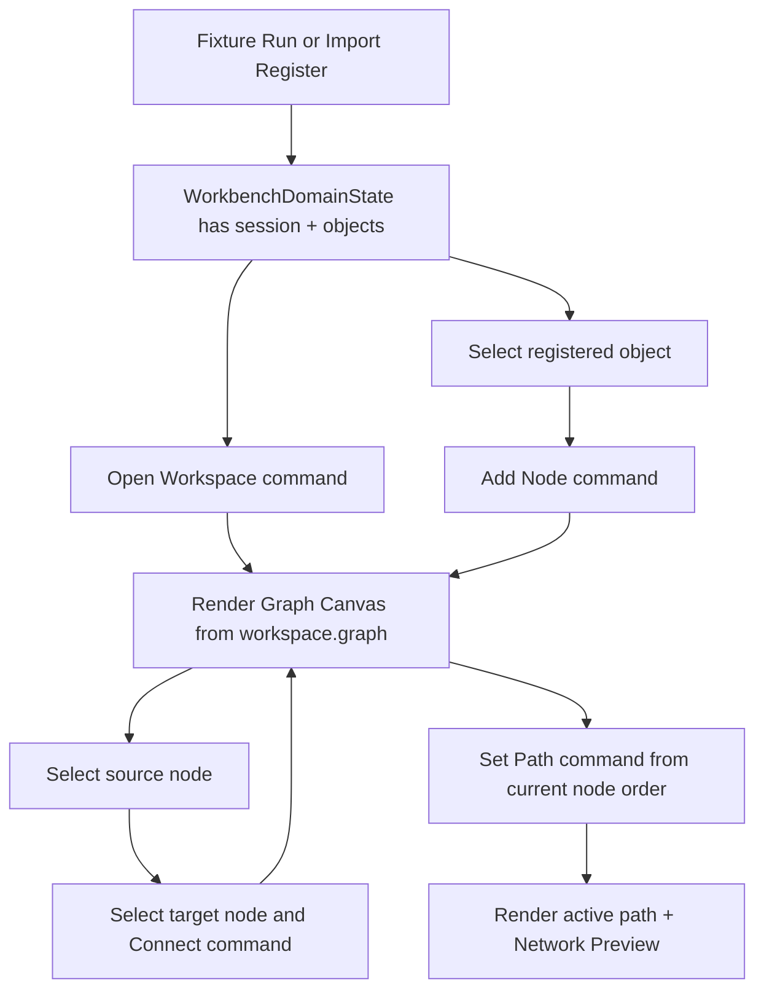

# web-graph-canvas-mvp design

## 0. 术语约定

| 术语 | 定义 | 防冲突结论 |
|---|---|---|
| Graph Canvas | Web 工作台中显示和编辑 ReactionGraph projection 的中间画布区域 | 不等同于 core `ReactionGraphService` |
| Canvas Node | UI 中从 workspace graph nodes 投影出的节点卡片 | 只展示 ShellResponse graph node，不本地生成 ChemicalObject |
| Active Graph Node | UI 当前选中的 node id，用于 connect / set path | UI-only state，不写 ReactionGraph |
| Pending Connection | 用户在 UI 中选中的第一端节点，下一次点击另一个节点后提交 `workspace.connect` | UI-only state，不写 Project Content |
| Active Canvas Path | Web 画布触发 `workspace.set_path` 后由 workspace projection 返回的 active path | path 数据仍由 workspace graph paths 承载 |
| Network Preview Panel | 画布侧边摘要，展示 preview node/edge/path count、active path 和 disconnected diagnostics | 不等同于能量曲线或报告预览 |

术语 grep 结果：core 已有 `ReactionGraph`、`GraphPatch`、`Graph Editor Workspace`、`Object Palette`、`Canvas Viewport`、`Workspace Selection`、`Network Preview`；Web 侧当前只有静态 `GraphWorkspaceFrame` 和 `WorkspaceSummary` DTO。该 feature 复用 `Graph Canvas` 作为 Web UI 面板名，避免引入新 core 概念。

## 1. 决策与约束

### 需求摘要

本 feature 目标是在 Web Workbench 中把静态图谱占位升级为 Graph Canvas MVP：

1. 扩展 fixture transport 支持 `workspace.open`、`workspace.add_node`、`workspace.connect`、`workspace.set_path`，返回已有 `WorkspaceSummary` / `WorkbenchDomainState` projection。
2. 新增 Graph Canvas UI，展示 workspace graph nodes、edges、paths、active path、preview counts 和 disconnected diagnostics。
3. 支持从已登记对象添加 species node；可通过对象列表选择对象后点击添加，作为第一版可访问替代，不强制真实拖拽。
4. 支持选择两个节点后连接 edge；支持把当前节点顺序设置为 active path。
5. 画布 selection、pending connection、position preview 等前端状态只存在于 UI，不直接 mutate graph JSON。
6. 新增 i18n 双语文案；动态 node id、object id、path id、warning code 不翻译。
7. 浏览器桌面/窄屏验证画布节点、edge、toolbar、preview 不重叠且无水平溢出。

### 明确不做

- 不修改 Python core `ReactionGraphService`、`GraphEditorWorkspaceService`、GraphPatch 语义或 Project Content codec。
- 不实现真实 HTML5 drag/drop 或自由拖动节点位置；第一版用 click-driven add/connect/set path。
- 不实现自动布局算法、缩放/平移持久化、键盘快捷键、多选框选或撤销/重做。
- 不调用 `energy.compute`，不展示能量曲线，不联动 Energy Profile Panel。
- 不保存 Project Content，不调用 `project.save_content`。
- 不把 pending/failed import preview item 变成 graph node；只能从已登记对象 / workspace palette 添加节点。
- 不把 Object Registry Panel selection 当作 Workspace Selection 保存。

### 复杂度档位

- Frontend orchestration：L3。需要多个 shell commands 顺序编排，并维护 UI-only selection / pending connection。
- Fixture transport：L2。扩展 Web fixture runtime 的 workspace command projection，但不改 Python core。
- UX：L3。中间画布需容纳节点、边、toolbar、preview 和窄屏布局。
- Core integration：L1。本 feature 不改 Python core，只对齐已有 shell command contract。

### 关键决策

1. **命令驱动，不本地 patch graph**：Graph Canvas 只通过 ShellClient 调用 `workspace.open/add_node/connect/set_path`，响应成功后用返回的 workspace projection 更新 WorkbenchDomainState。
2. **先 click-driven 添加/连接**：真实拖拽和自由布局是后续交互增强；第一版优先可测试、可访问、agent 友好。
3. **Fixture transport 模拟 workspace state**：Web 当前只有 `in-process-test` transport；为了验证 UI 编排，fixture transport 内维护最小 workspace state。真实 bridge/http transport 后续再接 Python shell。
4. **Selection 是 UI-only**：active node / pending connection 不进入 ShellResponse 或 Project Content。
5. **Graph Canvas 使用已登记对象**：object list 来自 `WorkbenchDomainState.objects`；pending/failed imports 不作为可添加对象。

## 2. 名词与编排

### 2.1 名词层：值对象 / 实体 / 接口契约

**现状**：

- `web/src/shell/types.ts` 已有 `WorkspaceSummary`，其中 `graph` 和 `preview` 目前是松散 `JsonObject`，fixture snapshot 返回 graph nodes/edges/paths。
- `WorkbenchShell` 的 `GraphWorkspaceFrame` 是静态 `Object A -> Object B` 占位，不调用 workspace commands。
- `fixtureTransport` 支持 `fixture.run`、`workbench.snapshot`、`import.preview`、`import.register_all`，不支持 workspace command。
- roadmap 第 4.6 已定义 `workspace.open/add_node/connect/set_path` command args。

**变化**：

补前端 graph projection 类型，仍保持 JSON-safe：

```ts
type GraphNodeSummary = {
  id: string
  kind: string
  label: string
  chemical_object_ids?: string[]
  position?: [number, number] | null
  metadata?: JsonObject
}

type GraphEdgeSummary = {
  id: string
  from_node?: string
  to_node?: string
  source?: string
  target?: string
  label?: string | null
  metadata?: JsonObject
}

type GraphPathSummary = {
  id: string
  label?: string | null
  node_ids: string[]
}

type WorkspaceCommandData = {
  command: "workspace.open" | "workspace.add_node" | "workspace.connect" | "workspace.set_path"
  session_id: string
  workspace: WorkspaceSummary
}
```

新增 UI state：

```ts
type GraphCanvasUiState = {
  selectedNodeId?: string
  pendingConnectionFromId?: string
  selectedObjectId?: string
}
```

边界：

- `GraphNodeSummary` / `GraphEdgeSummary` / `GraphPathSummary` 是 Web projection，不是 core dataclass。
- `WorkspaceCommandData.workspace` 是 shell response 中的权威 graph projection。
- `GraphCanvasUiState` 不进入 Project Content。

### 2.2 编排层：主流程与控制流



**现状**：

- Fixture snapshot 已可展示一个只读 workspace graph，但 UI 只是静态路径预览。
- Import register 后 objects count 变更，GraphWorkspaceFrame 不读取已登记对象列表。
- ShellClient 没有 Web fixture workspace command 覆盖。

**变化**：

- `WorkbenchShell` 新增 workspace command handlers：open workspace、add object node、connect selected nodes、set active path。
- `GraphCanvas` 接收 `WorkbenchDomainState`、active object id 和 command handlers，渲染 toolbar、object add control、canvas nodes/edges/path、selection 状态和 preview panel。
- `workspace.open` 在有 session 时可打开或刷新 workspace；`workspace.add_node` 用 active object id 生成 species node，position 由前端传入稳定坐标。
- `workspace.connect` 使用 `pendingConnectionFromId` 和当前点击节点提交连接；成功后清空 pending connection。
- `workspace.set_path` 使用当前 graph node 顺序提交 path，成功后展示 active path。

**跨层纪律**：

- Command authority：graph 结构变化只来自 ShellClient response，不在 React state 中直接 patch `state.workspace.graph`。
- Projection boundary：Graph Canvas 只读取 `WorkbenchDomainState.workspace` 和 `objects`；不从 DOM 或 Import Inbox pending item 反推领域状态。
- Error visibility：workspace command failure 写入 `WorkbenchDomainState.error`，显示 error code/message/target。
- Idempotence：fixture `workspace.open` 可重复调用，返回当前 workspace；重复 connect 同一 node pair 不新增重复 edge。
- Responsive：节点 id/object id/path id 必须 `overflow-wrap`，窄屏下 toolbar、canvas、preview 纵向堆叠。

### 2.3 挂载点清单

- `web/src/shell/types.ts` / `fixtureTransport.ts`：新增 graph/workspace command projection types 和 fixture workspace command state。
- `web/src/app/GraphCanvas.tsx` / optional state helper：新增画布 UI、node/edge/path/preview 渲染和 click-driven selection。
- `web/src/app/WorkbenchShell.tsx`：新增 workspace command handlers，并用 Graph Canvas 替换静态 GraphWorkspaceFrame。
- `web/src/app/i18n/messages.ts`：新增 Graph Canvas 双语文案。
- `web/src/app/workbench.css`：新增 graph toolbar、canvas、node、edge、preview、responsive 样式。
- `.codestable/architecture/web-workbench.md` / `requirements/web-workbench-shell.md`：acceptance 阶段记录 Graph Canvas MVP 当前能力和边界。

本 feature 不挂入 Python core、Project Content codec、Energy Engine、Report Export、Browser Project Repository、HTTP/cloud/账号系统。

### 2.4 推进策略

1. **Workspace Projection And Fixture Commands**：扩展 Web shell DTO 和 fixture transport，支持 workspace command success/error/idempotent paths。
   - 退出信号：ShellClient tests 能调用 open/add/connect/set_path，返回 JSON-safe workspace graph。
2. **Graph Canvas UI Skeleton**：新增 Graph Canvas component，显示 toolbar、empty/session state、nodes/edges/paths 和 preview panel。
   - 退出信号：Workbench tests 能看到 graph canvas、workspace preview counts 和 fixture nodes。
3. **Command Integration**：WorkbenchShell 编排 open/add/connect/set_path，成功后更新 workspace/graph counts，失败时显示 shell error。
   - 退出信号：测试能通过按钮添加对象节点、连接两个节点、设置 active path。
4. **I18n And Responsive Styling**：新增双语文案和响应式样式，长 node/object/path id 不撑破布局。
   - 退出信号：中文测试覆盖主文案；桌面/窄屏浏览器无水平溢出。
5. **Verification And Scope Guard**：跑 Web test/build、Python 单测、真实浏览器桌面/窄屏验证和范围 grep。
   - 退出信号：`npm run test`、`npm run build`、`python3 -m unittest discover` 通过；scope grep 未触碰 core graph/energy/export/cloud。

## 3. 验收契约

### 关键场景清单

1. 首屏无 session 时 Graph Canvas 显示可见空态，workspace commands disabled。
2. Fixture Run 后 Graph Canvas 展示 workspace graph id、Object A / Object B 节点、edge 和 preview counts。
3. 点击 Open Workspace 可重复刷新 workspace，不丢失已有 nodes/edges。
4. 有已登记对象时可选择对象并添加 species node；新 node 出现在画布，object id 原样可见。
5. 选择两个不同 node 后可提交 connect；edge 出现在画布，重复 connect 不新增重复 edge。
6. 点击 Set Active Path 后 active path id 和 path node order 可见。
7. workspace command error 显示 error code/message/target，不吞掉失败。
8. 中文 locale 下 Graph Canvas 静态文案变为简体中文；node id、object id、path id、warning code 保持原样。
9. 不从 pending/failed import item 生成 graph node；只使用已登记 objects/workspace palette。
10. 不直接 mutate WorkbenchDomainState.workspace.graph；graph 变化只来自 ShellClient response。
11. 不调用 energy.compute、export.profile 或 project.save_content。
12. 不修改 Python ReactionGraphService、GraphEditorWorkspaceService、GraphPatch、Project Content codec 或 Energy Engine。
13. `npm run test` 通过。
14. `npm run build` 通过。
15. `python3 -m unittest discover` 通过。
16. 真实浏览器桌面 viewport 验证节点、edge、toolbar、preview 无重叠。
17. 真实浏览器窄屏 viewport 验证长 node/object/path id 无水平溢出。

### 反向检查

- 不新增真实 drag/drop、自由拖动、自动布局、缩放/平移持久化。
- 不把 Object Registry Panel active object selection 写入 Workspace Selection。
- 不翻译 node id、object id、path id、edge id、parser id 或 warning/error code。
- 不新增 HTTP API、cloud SDK、账号系统或持久同步。

## 4. 与项目级架构文档的关系

- 本 design 落盘后把 roadmap item `web-graph-canvas-mvp` 更新为 `in-progress`。
- 实现完成并验收后，`.codestable/architecture/web-workbench.md` 应记录 Graph Canvas MVP、workspace command projection、UI-only selection/pending connection 和 click-driven 边界。
- `.codestable/architecture/ARCHITECTURE.md` 应补充 Web Workbench 已包含 Graph Canvas MVP，但 core ReactionGraph / Workspace 语义仍在 core 边界。
- `.codestable/requirements/web-workbench-shell.md` 应补充用户可从已登记对象添加节点、连接节点、设置 active path 和查看 network preview。
- roadmap acceptance 阶段把 `web-graph-canvas-mvp` 标为 `done`，下一项 `web-energy-profile-panel` 保持 planned。
