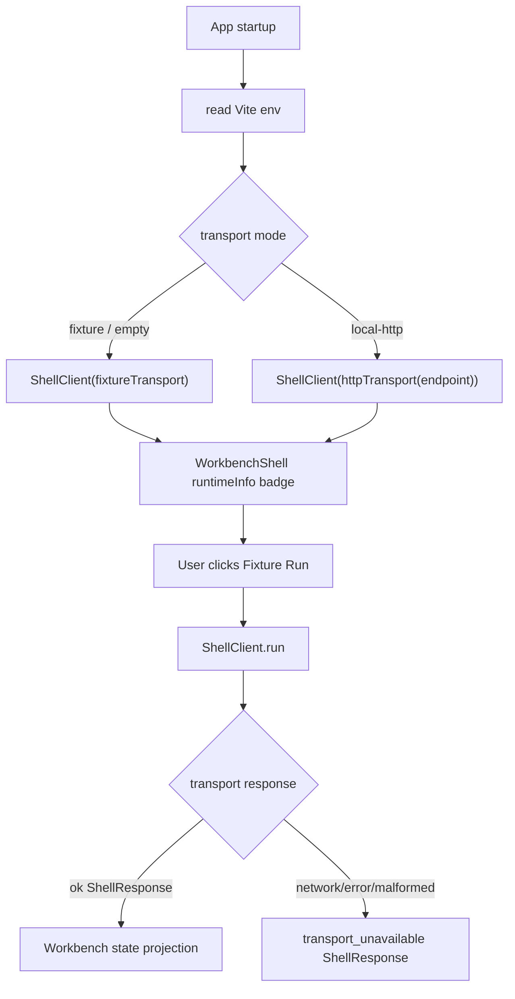

# web-http-shell-transport design

## 0. 术语约定

| 术语 | 定义 | 防冲突结论 |
|---|---|---|
| Http Shell Transport | 前端 `ShellTransport` 实现，使用 `fetch` 调用 local bridge `POST /api/shell` | 新增前端 transport，不改 Python bridge |
| Runtime Mode | Web app 当前 shell transport 模式，第一版为 `fixture` 或 `local-http` | UI 只显示模式，不承诺真实项目已接入 |
| Runtime Indicator | 顶栏显示当前 runtime mode 和 endpoint 的只读 badge | 不替代 local-only storage badge |
| Transport Unavailable | HTTP fetch/network/invalid JSON 失败时返回的 normalized ShellResponse error | 与 Platform Shell 领域错误分离 |

术语 grep 结果：当前 `web/src/shell/types.ts` 的 `ShellTransportKind` 只有 `in-process-test`；`App.tsx` 硬编码 `fixtureTransport`；`WorkbenchShell` 顶栏只显示 `Local-only` 和 command status；没有 `httpTransport`、runtime env 工厂或 runtime indicator。

## 1. 决策与约束

### 需求摘要

本 feature 把 Web ShellClient 的 transport 从固定 fixture 推进到可按 Vite env 选择：默认继续 fixture，设置 `VITE_RXNFLOW_SHELL_TRANSPORT=local-http` 时通过 `fetch` 调用 `VITE_RXNFLOW_SHELL_ENDPOINT`。UI 顶栏显示 runtime mode，避免用户把 fixture 数据误认为真实 Python bridge 结果。

### 明确不做

- 不扩展 Python local bridge；上一条 feature 已完成。
- 不实现浏览器 File bytes 到 parser preview；留给 `web-import-file-payload-bridge`。
- 不实现 project open/save bridge、bundle IO 或 export persistence。
- 不新增云存储、账号、权限、远程部署或 Vercel route。
- 不改变现有 workbench panel 业务逻辑，不重算能量，不生成导出文件。
- 不把 local-http 设为默认，避免 bridge server 未启动时页面首屏失败。

### 复杂度档位

- Robustness：L2。要处理 fetch 失败、HTTP 非 2xx、invalid JSON 和 malformed ShellResponse。
- Structure：L2。新增 `httpTransport.ts`、`runtime.ts` 和小型 UI indicator，复用 `ShellClient`。
- Testability：L2。Vitest mock fetch 覆盖成功/错误；WorkbenchShell 测试覆盖 runtime indicator；浏览器验证默认 fixture 模式不回退。
- Frontend QA：涉及可见顶栏 badge，需运行 dev server 并做桌面/窄屏 smoke。

## 2. 名词与编排

### 2.1 名词层：值对象 / 接口契约

**现状**：

- `ShellTransportKind = "in-process-test"`。
- `fixtureTransport.kind = "in-process-test"`。
- `App` 创建 `new ShellClient(fixtureTransport)`，没有 runtime mode 分支。

**变化**：

新增前端类型：

```ts
type ShellTransportKind = "in-process-test" | "http-api"

type WebShellRuntimeMode = "fixture" | "local-http"

type RuntimeConfig = {
  mode: WebShellRuntimeMode
  endpoint?: string
}

type RuntimeInfo = {
  mode: WebShellRuntimeMode
  transportKind: ShellTransportKind
  endpoint?: string
}
```

新增 transport 工厂：

```ts
function createHttpShellTransport(options: {
  endpoint: string
  timeoutMs?: number
  fetchImpl?: typeof fetch
}): ShellTransport

function createConfiguredShellRuntime(env: ImportMetaEnv): {
  shellClient: ShellClient
  runtimeInfo: RuntimeInfo
}
```

错误契约：

```ts
{
  ok: false,
  error: {
    code: "transport_unavailable",
    message: string,
    target: "http-api",
    details: { endpoint: string, status?: number, reason?: string }
  },
  warnings: [],
  artifacts: []
}
```

### 2.2 编排层：主流程与控制流



**跨层纪律**：

- HTTP transport 只转发 Shell payload，不解释 chemistry/domain data。
- fetch/network/HTTP/JSON 失败必须规范化为 ShellResponse，不抛到 React render。
- Runtime indicator 是可见事实，不改变 command behavior。
- 默认 fixture 模式必须继续通过现有 E2E。

### 2.3 挂载点清单

- `web/src/shell/httpTransport.ts`：新增 `http-api` transport。
- `web/src/shell/runtime.ts`：新增 Vite env runtime factory。
- `web/src/app/App.tsx` / `WorkbenchShell.tsx`：接入 runtimeInfo 和顶栏 indicator。
- `web/src/app/i18n/messages.ts` / `workbench.css`：新增双语 runtime 文案和样式。
- `web/src/shell/ShellClient.test.ts` / `WorkbenchShell.test.tsx`：新增 transport 和 indicator 测试。

### 2.4 推进策略

1. **Transport type and implementation**：扩展 `ShellTransportKind`，新增 `createHttpShellTransport`。
   - 退出信号：Vitest 可 mock fetch 验证 success / network failure / HTTP error / invalid JSON。
2. **Runtime factory**：新增 `createConfiguredShellRuntime(import.meta.env)`，默认 fixture，local-http 读取 endpoint。
   - 退出信号：单测确认默认 fixture 和 local-http config。
3. **UI indicator**：`WorkbenchShell` 顶栏显示 runtime mode 和 endpoint。
   - 退出信号：Testing Library 能看到 `Runtime Fixture` / `Runtime Local HTTP`。
4. **Verification**：跑 Web test/build、Python tests，并用浏览器验证默认 fixture 页面和 local-http bridge flow。
   - 退出信号：桌面/窄屏无 console error、无水平溢出；local-http 模式可通过 bridge 执行 `fixture.run`。
5. **Acceptance 回写**：更新 architecture、requirement、roadmap 和验收报告。
   - 退出信号：checklist 全 passed，roadmap item done。

## 3. 验收契约

### 关键场景清单

1. 默认无 env 时，Web app 使用 fixture transport，页面仍可运行 Fixture flow。
2. `VITE_RXNFLOW_SHELL_TRANSPORT=local-http` 且 endpoint 有值时，ShellClient 使用 `http-api` transport。
3. HTTP transport 成功时把 Shell payload POST 到 endpoint，并返回 normalized ShellResponse。
4. HTTP transport fetch 失败时返回 `transport_unavailable`，`target=http-api`。
5. HTTP transport HTTP 非 2xx 且 response 是 ShellResponse 时保留 bridge error code。
6. HTTP transport invalid JSON / malformed response 返回 `transport_unavailable`。
7. 顶栏显示 runtime indicator，英文和中文都有文案。
8. fixture 默认模式下现有 WorkbenchShell / E2E 主链路不回退。
9. local-http 模式下，启动 `python3 -m rxnflow.local_bridge` 后页面点击 Fixture Run 可显示真实 Python fixture project。
10. `npm run test`、`npm run build`、`python3 -m unittest discover` 通过。

### 反向检查

- 不修改 parser、registry、graph、energy、export 领域行为。
- 不扩展 `import.preview` bytes payload。
- 不把 local-http 设为默认。
- 不新增云存储、账号或服务端框架依赖。

## 4. 与项目级架构文档的关系

- 验收后 `web-workbench.md` 应记录前端已支持 `fixture` / `local-http` runtime mode，但真实 file/project/export bridge 仍未落地。
- `ARCHITECTURE.md` / `core-platform.md` 可补一句 Web HTTP transport 已能调用本地 bridge。
- `web-workbench-shell.md` 应补用户可见 runtime indicator。

