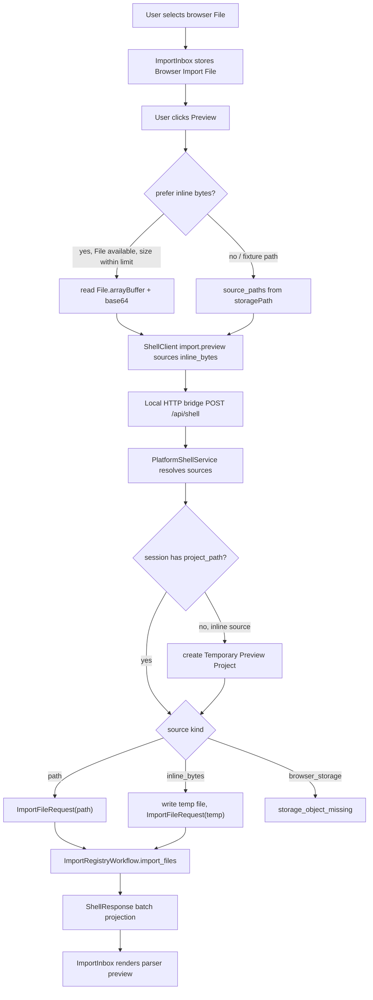

# web-import-file-payload-bridge design

## 0. 术语约定

| 术语 | 定义 | 防冲突结论 |
|---|---|---|
| Import Preview Source | `import.preview` 的 JSON-safe 文件来源描述，第一版支持 `path`、`inline_bytes` 和预留 `browser_storage` | roadmap 已定义；当前 Python 只实现 `path` 与 `inline_bytes` |
| Inline Bytes Source | 浏览器把小文件内容编码为 base64 后传给 shell 的 source | 只用于 preview，不作为长期 raw storage |
| Inline Import Limit | `inline_bytes` 可接受的最大解码后字节数 | 新增 shell 层限制，避免大文件直接塞进 HTTP body |
| Temporary Preview Project | 当 session 没有 core `project_path` 但收到 inline preview 时，Platform Shell 创建的进程内临时项目 | 只用于本次 local-http preview，不等同于 browser-local project 或 Project Content |
| Browser Import File | Web Import Inbox 维护的浏览器文件条目，保留 metadata 和可选 `File` 引用 | 不进入 ShellResponse，不写 Project Content |
| Payload Bridge Error | source 缺字段、base64 无效、超限或 browser storage 未实现时的结构化 ShellResponse error | 与 parser 解析失败分离 |

术语 grep 结果：roadmap 已有 `ImportPreviewSource` / `inline_bytes` / `browser_storage` 契约；`rxnflow.platform._run_import_preview` 当前只读 `source_path/source_paths/source_files`；`web/src/app/importInboxState.ts` 当前只保留文件 metadata 和 `storagePath`；`ImportInbox` 只通过 `importPreviewArgs` 传 `source_paths`。

## 1. 决策与约束

### 需求摘要

本 feature 让真实浏览器文件可以进入本地 Python parser preview：Web Import Inbox 选择文件后保留 `File` 引用，预览时读取小文件 bytes、base64 编码成 `source: { kind: "inline_bytes" }` 或 `sources: [...]`，经 `ShellClient` / `http-api` transport 发送给 local bridge。Python Platform Shell 解码 inline bytes 到临时文件，复用现有 `ImportRegistryWorkflow.import_files` 完成 raw file 复制、parser preview 和 batch projection。若当前 session 没有 core `project_path`，Platform Shell 会为 inline preview 创建进程内临时项目，让 local-http 页面可以完成真实 parser preview；这不写入 Browser Project Repository，也不代表项目内容已持久化。

### 明确不做

- 不实现 chunking、OPFS payload store、Worker pool、大文件 streaming 或进度条。
- 不实现 `browser_storage` adapter；收到该 source kind 时返回 `storage_object_missing target=storage_path`。
- 不把浏览器本地 Project Sidebar stub 伪装成 core project session；无 core `project_path` 的 inline preview 只使用 Temporary Preview Project。
- 不改变 parser、registry、Project Store、Import Workflow 的领域算法。
- 不在前端解析 Gaussian/ORCA/MAPLE/XYZ/extxyz，也不在前端登记 ChemicalObject。
- 不新增云存储、账号、权限或生产 HTTP 上传 API。

### 复杂度档位

- Robustness：L2。需要校验 source kind、字段类型、base64、payload size、临时文件清理和 batch errors。
- Structure：L2。Python 只在 Platform Shell 层增加 source resolution；Web 只在 Import Inbox 状态/args 生成处增加 file bytes。
- Testability：L2。Python unittest 覆盖 inline bytes success/error；Vitest 覆盖 args 生成和 UI preview payload；浏览器 smoke 覆盖 local-http 真实 `.xyz` 文件。
- Frontend QA：涉及 file input、preview state、错误展示和 responsive layout，需要浏览器验证。

## 2. 名词与编排

### 2.1 名词层：值对象 / 接口契约

**现状**：

- Python `import.preview` args 只支持 `source_path`、`source_paths` 或 `source_files`。
- Web `WebImportFile` 只有 `id/name/size/mimeType/lastModified/storagePath`，不能读取文件 bytes。
- Web `importPreviewArgs` 总是返回 `source_paths`，fixture transport 用这些路径生成 mock preview。

**变化**：

扩展 `import.preview` args：

```ts
type ImportPreviewSource =
  | { kind: "path"; source_path: string }
  | {
      kind: "inline_bytes"
      filename: string
      bytes_base64: string
      mime_type?: string | null
      expected_format?: string | null
    }
  | {
      kind: "browser_storage"
      project_ref: string
      storage_path: string
      expected_format?: string | null
    }

type ImportPreviewArgs = {
  session_id?: string
  project_path?: string
  source?: ImportPreviewSource
  sources?: ImportPreviewSource[]
  source_path?: string
  source_paths?: string[]
  expected_format?: string
  strict?: boolean
}
```

Python 错误契约：

```json
{
  "ok": false,
  "error": {
    "code": "payload_too_large",
    "target": "bytes_base64"
  }
}
```

Web `WebImportFile` 变化：

```ts
type WebImportFile = {
  id: string
  name: string
  size: number
  mimeType?: string
  lastModified?: number
  storagePath?: string
  file?: File
}

async function importPreviewArgsFromFiles(
  state: ImportInboxState,
  sessionId?: string,
  options?: { preferInlineBytes?: boolean; inlineByteLimit?: number }
): Promise<JsonObject>
```

### 2.2 编排层：主流程与控制流



**跨层纪律**：

- Web 只编码文件 bytes，不解析化学格式，不生成 parser metadata。
- Python source resolution 只生成现有 `ImportFileRequest`，不复制 Import Workflow 的 raw resource / parser 行为。
- inline temp file 必须在 `import.preview` 返回前清理；项目 raw file 持久副本仍由 Project Store 写入项目目录。
- Temporary Preview Project 只在进程内保活，服务 local-http inline preview；它不替代 Browser Project Repository、Project Content 保存或正式 project bridge。
- 多文件 preview 使用 `sources`，兼容旧 `source_paths`。
- `expected_format` 可作为全局 args，也可被 inline/browser source 覆盖；第一版 Web 仍传全局 expected_format。

### 2.3 挂载点清单

- `rxnflow/platform.py`：扩展 `import.preview` source resolution、inline bytes 限制、临时文件生命周期和错误投影。
- `tests/test_platform_shell_baseline.py` / `tests/test_local_http_shell_bridge.py`：覆盖 shell 与 HTTP bridge inline bytes preview。
- `web/src/app/importInboxState.ts`：保留 `File` 引用，新增 async args builder 和 inline limit。
- `web/src/app/WorkbenchShell.tsx` / `ImportInbox.tsx`：preview flow 改用 async args builder，并显示超限/inline 状态。
- `web/src/app/WorkbenchShell.test.tsx` / `web/src/shell/fixtureTransport.ts`：保证 fixture 与 inline args 兼容。
- `docs/dev/web-runtime-boundary.md`、architecture、requirement、roadmap：归并新边界。

### 2.4 推进策略

1. **Source contract and backend resolution**：在 Platform Shell 层解析 `source/source(s)`，支持 `path` 与小文件 `inline_bytes`。
   - 退出信号：Python 单测确认 inline bytes `.xyz` preview 成功，invalid source / invalid base64 / payload too large 返回指定 error。
2. **HTTP bridge contract coverage**：通过 local bridge `POST /api/shell` 调用 inline bytes preview，确认 JSON-safe 与 session 保留。
   - 退出信号：bridge 单测使用 `project.create` session + inline bytes `import.preview` 成功。
3. **Web import payload builder**：`WebImportFile` 保留 `File`，新增 async inline bytes args builder；fixture 模式继续可用 path fallback。
   - 退出信号：Vitest 确认 selected `File` 生成 `sources.inline_bytes`，超限在前端返回 `payload_too_large`。
4. **Workbench preview flow**：`WorkbenchShell.previewImport` 改用 async args builder，Import Inbox 展示 inline/path source 状态。
   - 退出信号：Testing Library 覆盖 file input -> preview command payload -> batch/error UI。
5. **Acceptance and docs**：更新 architecture、requirement、roadmap 和验收报告。
   - 退出信号：checklist 全 passed，roadmap item done。

## 3. 验收契约

### 关键场景清单

1. Python `import.preview` 收到 `source.kind=inline_bytes` 的小 `.xyz` 文件时，返回 `needs_confirmation` item、`parser_id=xyz-ase`、`object_count=1`。
2. Python `import.preview` 收到 `sources` 多文件 inline bytes 时，返回同一 batch 的多 item。
3. Python `import.preview` 收到 fixture session + inline bytes 时，会创建 Temporary Preview Project 并返回真实 parser preview。
4. inline bytes 超过限制时返回 `payload_too_large target=bytes_base64`，不调用 parser。
5. inline base64 无效或 source kind 缺字段时返回 `invalid_input target=source` 或 `target=bytes_base64`。
6. `browser_storage` source 返回 `storage_object_missing target=storage_path`，不假设 Python 能读 IndexedDB。
7. local HTTP bridge 可以透传 inline bytes `import.preview`，并保持 `project.create` session。
8. Web file input 选择真实 `File` 后，preview args 在 inline mode 下包含 `sources[0].kind=inline_bytes`、filename、mime_type 和 base64。
9. Web 选择超出前端 inline limit 的文件时，不发 shell command，Import Inbox 显示 `payload_too_large`。
10. fixture 默认模式下现有 Import Inbox preview/register 流程不回退。
11. local-http dev server + local bridge 下，浏览器选择 tiny `.xyz` 后点击 Preview 能看到真实 Python parser preview。
12. `python3 -m unittest discover`、`cd web && npm run test`、`cd web && npm run build` 通过。

### 反向检查

- 不修改 parser、registry、Project Store、Import Workflow 的领域行为。
- 不实现 `browser_storage` adapter、chunking、OPFS 或 Worker。
- 不把 browser-local Project Sidebar stub 当作 core project path；Temporary Preview Project 不写 Browser Project Repository。
- 不在前端解析化学格式或登记 ChemicalObject。
- 不新增云存储、账号或生产上传服务。

## 4. 与项目级架构文档的关系

- 验收后 `ARCHITECTURE.md` / `core-platform.md` 应记录 `import.preview` 支持 `path` 与 `inline_bytes` source，`browser_storage` 仍未实现。
- `web-workbench.md` 应记录 Import Inbox 在 local-http 模式可把小文件 bytes 送入 Python parser preview；无 core `project_path` 时使用 Temporary Preview Project。
- `web-workbench-shell.md` 应把“真实 browser File bytes 仍未接入”的边界改为“小文件 inline preview 已接入，大文件/Project Content bridge 未接入”。
- `docs/dev/web-runtime-boundary.md` 应补充 inline bytes payload 限制、临时文件清理和不替代长期 raw storage 的规则。
