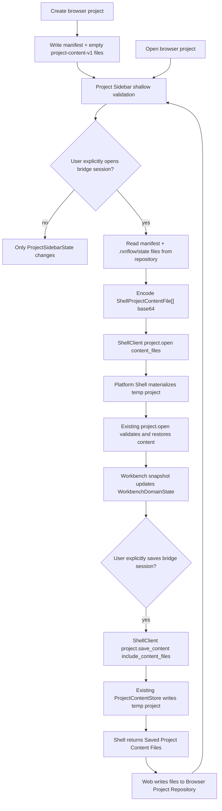

# web-project-content-bridge design

## 0. 术语约定

| 术语 | 定义 | 防冲突结论 |
|---|---|---|
| Web Project Content Bridge | Web Project Sidebar、Browser Project Repository 与 Platform Shell `project.open/save_content` 之间的显式协作层 | roadmap 已定义；不等同于 bundle import/export 或 browser_storage import adapter |
| Browser Project Content Files | Browser Project Repository 中 `.rxnflow/manifest.json` 与 `.rxnflow/state/*.json` bytes objects | 使用现有 Project Content schema，不再写 stub schema |
| Shell Project Content Payload | Web 把 Browser Project Content Files 编成 JSON-safe `{path, bytes_base64}` 后传给 Platform Shell 的 payload | 只用于 local bridge open，不让 Python 直接读 IndexedDB |
| Saved Project Content Files | `project.save_content` 返回给 Web 的真实 Project Content section bytes | Web 按 path 写回 Browser Project Repository |
| Browser Content Validation | Web 侧对 content index 是否可读、section 是否存在和 checksum 是否匹配的浅校验 | 不替代 Python ProjectContentValidator 的跨 section 深校验 |
| Bridge Session | `project.open` 或 `project.create` 返回的 PlatformSession | 进程内有效；和 Browser Project Ref 分离 |

术语 grep 结果：architecture / roadmap 已有 Browser Project Repository、Project Content、Project Sidebar、Platform Session 和 Web Project Content Stub。当前 `web/src/app/projectSidebarActions.ts` 只写 `.rxnflow/state/project-content.json` stub；`rxnflow.platform.project.open/save_content` 只接受本地 `project_path` 并写本地 filesystem；Browser Project Repository 不能被 Python bridge 直接访问。

## 1. 决策与约束

### 需求摘要

本 feature 让 Web 左侧项目入口保存和打开真实 Project Content sections。创建 browser project 时，Web 写入 `.rxnflow/manifest.json` 与空的 `project-content-v1` sections；打开 browser project 只选择 Browser Project Ref 和浅校验，不自动创建 core session。用户显式触发 bridge open 时，Web 读取 `.rxnflow/manifest.json` 与 `.rxnflow/state/` objects，把 bytes 以内联 payload 发送给 local HTTP bridge；Platform Shell 在临时目录 materialize 这些 files，再复用现有 `project.open(load_content=true/false)` 恢复 Bridge Session。用户显式保存 bridge session 时，`project.save_content` 写回 core 临时目录，并把真实 section bytes 返回；Web 再把这些 bytes 写回 Browser Project Repository。

### 明确不做

- 不实现云存储、账号、跨设备同步、多人协作或冲突合并。
- 不实现 `.rxnflow.zip` bundle import/export、OPFS payload store、大文件 chunking、Service Worker 或 Worker pool。
- 不把 Browser Project Ref 当成本地 filesystem path；Python bridge 不直接读 IndexedDB。
- 不把打开 browser project 自动等同于 `project.open`；只有显式 bridge open 才创建 core session。
- 不在前端解析、重算或重写 ChemicalObject、ReactionGraph、EnergyProfile 或 ExportArtifact 领域模型。
- 不实现 browser_storage import adapter，也不改变 Import Inbox raw file 长期存储策略。
- 不新增生产 HTTP API、安全认证或公网 remote bridge 能力。

### 复杂度档位

- Robustness：L2。需要处理缺 manifest、缺 section、checksum mismatch、base64 payload、临时目录生命周期、session 缺失和 repository 写入失败。
- Structure：L2。新增 Web content file helpers 与 Platform Shell content payload 入口；不重写 ProjectContentStore codec。
- Testability：L2。Python contract tests 覆盖 inline open/save files；Vitest 覆盖 Browser Repository 写入、打开、保存和 UI command payload；Playwright/Browser smoke 覆盖可见 flow。
- Frontend QA：涉及 Project Sidebar 文案、按钮状态、错误展示和桌面/窄屏布局，需要渲染验证。

## 2. 名词与编排

### 2.1 名词层：值对象 / 接口契约

**现状**：

- Browser Project Repository 以 project-relative POSIX path 保存 bytes object。
- Project Sidebar `createProject/saveProjectStub/openProject` 只写/read `.rxnflow/state/project-content.json` stub。
- Platform Shell `project.open` 需要本地 `project_path`；`project.save_content` 只把 sections 写回本地项目目录。

**变化**：

Web 侧新增真实 content 文件契约：

```ts
type BrowserProjectContentFile = {
  path: string
  bytes: Uint8Array
  checksum?: string
  metadata: JsonObject
}

type WebProjectContentOpenRequest = {
  projectRef: string
  loadContent: boolean
}

type WebProjectContentSaveRequest = {
  projectRef: string
  sessionId: string
  overwrite: true
}
```

Shell payload 第一版扩展：

```ts
type ShellProjectContentFile = {
  path: string
  bytes_base64: string
  checksum?: string | null
  metadata?: JsonObject
}

type ProjectOpenArgs = {
  project_path?: string
  load_content?: boolean
  content_files?: ShellProjectContentFile[]
}

type ProjectSaveContentArgs = {
  session_id: string
  include_content_files?: boolean
}
```

`project.open(content_files=...)` 成功后仍返回标准 restored session summary；`project.save_content(include_content_files=true)` 成功后在 `data.content_files` 返回 `.rxnflow/manifest.json` 与 `.rxnflow/state/*.json` bytes。

### 2.2 编排层：主流程与控制流



**跨层纪律**：

- Browser repository state、ProjectSidebarState、WorkbenchDomainState 和 PlatformSession 必须保持分离。
- Browser open 不创建 core session；bridge open/save 是独立显式动作。
- Web 只搬运 bytes 与 checksum，不解释 Project Content section 领域语义。
- Python 只 materialize received files 到临时 project directory 后复用 ProjectStore / ProjectContentStore；不新增 IndexedDB adapter。
- `project.save_content(include_content_files=false)` 继续保持原有本地行为。
- Manifest-only open 可用 `load_content=false`，但仍必须有 manifest bytes。

### 2.3 挂载点清单

- `rxnflow/platform.py`：扩展 `project.open(content_files)` materialize 入口和 `project.save_content(include_content_files)` bytes projection。
- `tests/test_platform_shell_baseline.py`：覆盖 inline content files open/save、missing files、checksum mismatch 和原有 filesystem path 行为不回退。
- `web/src/app/projectContentBridge.ts`：新增 Project Content file builders、repository read/write、base64 encode/decode 和 validation helpers。
- `web/src/app/projectSidebarActions.ts` / `ProjectSidebar.tsx`：替换 stub save/open 为真实 content files，并新增 bridge open/save action。
- `web/src/app/WorkbenchShell.tsx`：把 sidebar bridge action 编排到 ShellClient，并在成功后刷新 Workbench snapshot / repository state。
- `web/src/app/i18n/messages.ts`、component tests、architecture/requirement/docs：同步文案和边界。

### 2.4 推进策略

1. **Platform content payload contract**：扩展 `project.open` / `project.save_content`，支持 content files materialize 与 bytes projection。
   - 退出信号：Python 单测确认 inline content files 可 open、save 后返回真实 section bytes，path filesystem 流程不回退。
2. **Web content file helpers**：新增 Web Project Content 文件生成、repository read/write、shallow validation 和 base64 helpers。
   - 退出信号：Vitest 确认 create browser project 写入 manifest + 6 section + index，checksum 与 missing section 状态可识别。
3. **Sidebar actions and UI**：Project Sidebar 从 Save Stub 改成保存 Project Content，并暴露 Open Bridge / Save Bridge Session。
   - 退出信号：Testing Library 覆盖 create/open、missing content、bridge open payload、bridge save 写回 repository。
4. **Workbench bridge orchestration**：WorkbenchShell 编排 `project.open(content_files)`、snapshot refresh 和 `project.save_content(include_content_files)`。
   - 退出信号：fixture/local-http transport tests 覆盖 session id、workbench counts 和 Browser Repository persisted state。
5. **QA and docs**：更新 architecture、requirement、roadmap/checklist，并跑单元、构建和渲染 smoke。
   - 退出信号：Python unittest、Web Vitest、Web build、浏览器桌面/窄屏 smoke 通过。

## 3. 验收契约

### 关键场景清单

1. `project.open` 收到 `.rxnflow/manifest.json` 与完整 `.rxnflow/state/` content files payload 时，恢复 session，并返回 `project.open` restored summary。
2. `project.open(load_content=false, content_files=...)` 只打开 manifest，不读取 Project Content sections。
3. `project.open(content_files=...)` 收到缺 manifest、无效 base64、不安全 path 或 checksum mismatch 时返回结构化 error，不恢复 session。
4. `project.save_content(include_content_files=true)` 返回 `.rxnflow/manifest.json`、`.rxnflow/state/project-content.json` 和 6 个 section files 的 base64 bytes 与 checksum。
5. 原有 `project.open(project_path)` / `project.save_content(session_id)` filesystem path 行为不回退。
6. Web 创建 browser project 时写入真实 `project-v1` manifest 与 `project-content-v1` empty sections，不再写 `web-project-content-stub-v1`。
7. Web 打开 browser project 只更新 sidebar active project 和 validation，不自动调用 shell `project.open`。
8. Web 显式 Open Bridge 时，ShellClient payload 包含 `project.open`、`content_files` 和 `load_content=true`，成功后 Workbench snapshot 显示 shell session/project。
9. Web 显式 Save Bridge Session 时，ShellClient payload 包含 `project.save_content`、`session_id` 和 `include_content_files=true`；返回 files 写回 Browser Project Repository。
10. repository 缺 section 时 sidebar 显示 missing/dirty，不把 stub 标成 valid。
11. fixture 默认模式下 Project Sidebar 原有 list/create/open 流程不回退；local-http 模式下按钮状态和错误展示可读。
12. `python3 -m unittest discover`、`cd web && npm run test`、`cd web && npm run build` 通过，桌面/窄屏渲染无空白、无 framework overlay、无相关 console error。

### 反向检查

- 不实现云存储、账号、同步、bundle IO、OPFS/chunking/Worker 或 browser_storage import adapter。
- 不把 Browser Project Ref 当成 Python filesystem path。
- 不让 browser project open 自动创建 PlatformSession。
- 不在前端解析或重写 Project Content 领域模型，只搬运 bytes。
- 不改变 parser、registry、graph、energy、export 领域算法。

## 4. 与项目级架构文档的关系

- 验收后 `ARCHITECTURE.md` / `core-platform.md` 应记录 Platform Shell 支持 content files open/save projection。
- `web-workbench.md` 应把 Project Sidebar 当前能力从 stub save 更新为真实 Project Content files 与 bridge open/save。
- `project-content-persistence.md` / `web-workbench-shell.md` 应更新 Web 边界：browser-local content files 已可持久化，云存储、bundle IO 和 browser_storage adapter 仍未实现。
- `docs/dev/web-runtime-boundary.md` 应补充 Project Content Bridge 的显式 open/save 规则和 session/repository 分离约束。
