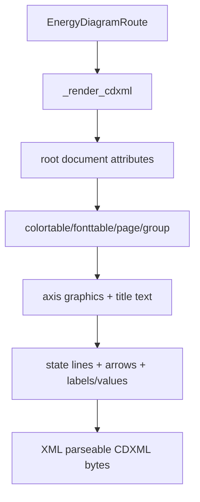

# export-cdxml-chemdraw-compat design

## 0. 术语约定

| 术语 | 定义 | 防冲突结论 |
|---|---|---|
| CDXML ChemDraw Compatibility | RxnFlow 生成的 CDXML 应具备 ChemDraw 可识别的 document/page/font/color/graphic/text/arrow 结构 | 只做结构兼容，不声明 ChemDraw roundtrip 完整高保真 |
| CDXML Object ID Discipline | 单文档内每个 generated object id 唯一且稳定递增 | 当前已有递增 id，本 feature 加测试和 Z/BoundingBox |
| CDXML Text Object | `<t>` + `<s>` 的文本节点，包含 position、BoundingBox、font/size/color/face | 当前已有基础节点，本 feature 补 center/lineheight/Z |
| CDX Boundary | `.cdx` binary 不属于当前能力 | 继续返回 unsupported，不新增 format |

术语 grep 结论：当前 `_render_cdxml()` 已生成 root/page/colortable/fonttable/group/graphic/arrow/t/s，但缺少 Z、文本 justification、page/header attributes、object id uniqueness tests 和更细的 XML 结构回归。

## 1. 决策与约束

### 需求摘要

本 feature 目标是让 CDXML energy diagram 的 XML 结构更接近 ChemDraw 可编辑对象，并把兼容边界变成测试：

1. Root/page/group 具有稳定 BoundingBox、page headers 和基础 ChemDraw document attributes。
2. Graphic、arrow、text 对象都有 id、BoundingBox 和 Z。
3. Text 使用 `<t>` + `<s>`，带 `CaptionJustification`、`Justification`、`LineHeight`。
4. Object ids 单文档唯一，稳定递增。
5. CDXML 能被 XML parser 解析，包含 fonttable/colortable/page/group/state lines/connectors/text。
6. CDX 仍不开放；不引入 ChemDraw GUI、PyQt 或外部 binary writer。

明确不做：

- 不生成 `.cdx` binary，不引入 ChemDraw/Revvity/ChemScript/Open Babel/RDKit 转换。
- 不生成 molecule-level CDXML、reaction scheme 或 bond/atom chemistry semantics。
- 不复制 `Energy_Diagram_Plotter_CDXML` 代码、随机 id 或 PyQt UI。
- 不修改 PNG/XLSX/Web/Project Content。

### 复杂度档位

小型 writer compatibility feature。偏离点：

- 只能做结构回归，不能在当前环境自动打开 ChemDraw 验证。
- 外部参考项目用 graphic + arrow + text + font/color/page 结构，本项目用标准 XML builder 重写，避免许可证和全局状态风险。

### 关键决策

1. **继续 XML builder**：保持 `xml.etree.ElementTree`，不拼接大段 CDXML 字符串。
2. **加对象纪律而不是重写元素模型**：补 id/Z/BoundingBox/Justification tests，不改 energy semantics。
3. **state line 仍用 graphic Line**：不切换到 bond/node fragment；本 roadmap 不做分子结构。
4. **connector 仍用 arrow**：保留 ChemDraw 可编辑连接对象。

## 2. 名词与编排

### 2.1 名词层：值对象 / 实体 / 接口契约

**现状**：

- `_render_cdxml()` root 只有 `CreationProgram`、`Name`、`BoundingBox`。
- page 只有 `id`、`BoundingBox`。
- graphic line 有 id、GraphicType、LineType、BoundingBox、color，state line 有 LineWidth。
- arrow 有 id、ArrowheadType、Tail3D、Head3D、color。
- text helper 只写 id、p、BoundingBox 和 nested `<s>`。

**变化**：

- root 增加 stable document attributes：`LabelFont`、`LabelSize`、`CaptionFont`、`CaptionSize`、`LineWidth`、`BoldWidth`、`color`、`bgcolor`。
- page 增加 `HeaderPosition`、`FooterPosition`。
- group 增加 `BoundingBox` 和 `Z`。
- graphic/arrow/text 都写 `Z`；arrow 增加 `BoundingBox`、`FillType`、`LineWidth`。
- text helper 增加 `CaptionJustification="Center"`、`Justification="Center"`、`LineHeight="auto"`。
- tests 解析 XML，检查 object id 唯一、Z 存在、state line / arrow / text shape。

### 2.2 编排层：主流程与控制流

**现状**：

CDXML writer 已能输出可解析 XML，但测试只检查 presence，缺少 object id / Z / text shape / root attribute guard。

**变化**：

- CDXML writer 使用 deterministic object id 和 Z。
- 文本/线/箭头的 ChemDraw-ish shape 被测试固定。
- `cdx` 继续在 validation 处返回 unsupported。

**跨层纪律**：

- 错误语义：CDXML writer 失败仍由 `_render_format()` 返回 `export_failed target=cdxml`。
- 幂等性：相同 route/title/options 输出稳定 XML。
- 扩展点：后续 CDX 或 molecule-level CDXML 必须另起 feature。
- 范围守护：不动 PNG/XLSX/Web/Project Content。

### 2.3 挂载点清单

- `_render_cdxml()` root/page/group/object attributes。
- `_cdxml_text()` text object attributes。
- CDXML structure tests：object id uniqueness、Z/BoundingBox、text shape、CDX unsupported。

### 2.4 推进策略

1. **Document/page attributes**：补 root/page/group document shape。
   - 退出信号：XML root/page/group attributes tests 通过。
2. **Object shape discipline**：补 graphic/arrow/text 的 Z/BoundingBox/LineWidth/Justification。
   - 退出信号：所有 generated graphic/arrow/text 有 id/Z 和必要 geometry。
3. **Compatibility regression tests**：补 unique ids、state line count、arrow shape、text shape、CDX unsupported。
   - 退出信号：focused report export tests 通过。
4. **Scope validation**：跑全量 Python tests 和 YAML 校验。
   - 退出信号：测试通过，未引入 CDX/GUI/外部转换依赖。

## 3. 验收契约

### 关键场景清单

1. CDXML root 有 `CreationProgram="RxnFlow"`、`LabelFont`、`CaptionFont`、`LineWidth`、`color`、`bgcolor`。
2. page 有 `BoundingBox`、`HeaderPosition`、`FooterPosition`。
3. group 有 `Integral="yes"`、`BoundingBox`、`Z`。
4. 所有带 id 的 generated elements id 唯一。
5. state line graphic 有 `GraphicType="Line"`、`LineWidth`、`BoundingBox`、`Z`。
6. arrow 有 `Tail3D`、`Head3D`、`BoundingBox`、`FillType`、`LineWidth`、`Z`。
7. text `<t>` 有 `p`、`BoundingBox`、`CaptionJustification`、`Justification`、`LineHeight`、`Z`，子 `<s>` 有 font/size/color/face。
8. missing point 不生成 state line。
9. 请求 `cdx` 仍返回 `invalid_input target=formats`。

### 明确不做的反向核对项

- 不新增 CDX 或其他 ExportFormat。
- 不引入 ChemDraw GUI、PyQt、Open Babel、RDKit 或 binary converter。
- 不生成 molecule-level CDXML 或 reaction scheme。
- 不修改 PNG/XLSX/Web/Project Content。

## 4. 与项目级架构文档的关系

- architecture 归并：验收时更新 CDXML writer 现状，记录 document/page/group/object attributes 和 CDX 边界。
- requirement 回写：无新增用户故事，只是 CDXML artifact 结构增强。
- roadmap 回写：验收通过后把 `export-cdxml-chemdraw-compat` 标为 done。
