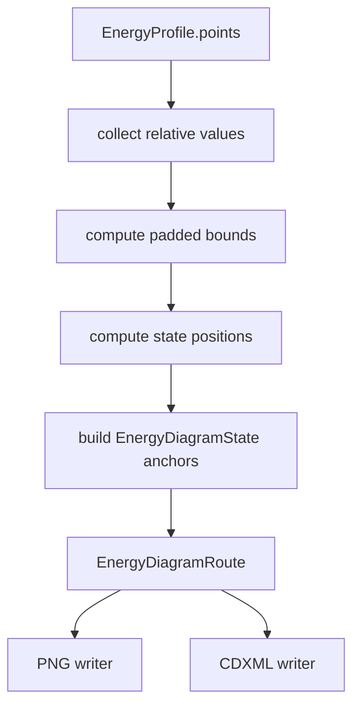

# export-energy-diagram-route-layout design

## 0. 术语约定

| 术语 | 定义 | 防冲突结论 |
|---|---|---|
| Energy Diagram Route Layout | 从 `EnergyProfile` 派生给 PNG/CDXML 共用的坐标与绘制布局 | 扩展现有 `EnergyDiagramRoute`，不新增 renderer 层 |
| Diagram Bounds | route 的 energy min/max 和 padding 后 y 轴范围 | 新增 route 字段，用于两个 writer 共享 |
| State Anchor | 单个 state 在 diagram coordinate 中的 x/y、line start/end、label/value anchor | 新增 state 字段，避免 PNG/CDXML 各自计算 |
| Missing State | 没有 relative energy 的 profile point | 继续保留 missing reason 和 warning，不画假 state line |

术语 grep 结论：当前已有 `EnergyDiagramRoute`、`EnergyDiagramState`、`_energy_bounds()`、`_state_positions()`、`_map_energy_to_y()`；没有 route-level bounds 或 per-state anchors。

## 1. 决策与约束

### 需求摘要

本 feature 目标是让 PNG 和 CDXML 从同一份 route layout 输出，而不是各自重复计算坐标。完成后：

1. `build_energy_diagram_route()` 返回每个 state 的 x/y/line/label/value anchor。
2. route 记录 energy bounds，处理相同能量、负值、缺失点和空有效值。
3. missing point 仍不生成 state line，只保留 label/missing anchor 和 warning。
4. PNG/CDXML writer 使用 route anchors，避免数值/位置语义偏差。

明确不做：

- 不重写 PNG/CDXML 美术风格，不做自动文字避让算法。
- 不新增 ChemDraw CDX、molecule-level CDXML、graph canvas screenshot。
- 不重新计算 EnergyProfile，不改 EnergyProfileEngine。
- 不修改 XLSX writer、Web Report Export Panel 或 ExportFormat。

### 复杂度档位

小型核心布局 feature。偏离点：

- 坐标是导出中间结构，不是 UI canvas 坐标，也不进入 Project Content。
- route layout 要可单测，不依赖 Pillow 或 XML writer 才能验证。

### 关键决策

1. **layout 写入 route dataclass**：给 `EnergyDiagramState` 增加 `x`、`y`、`line_start_x`、`line_end_x`、`label_x/y`、`value_x/y`，给 `EnergyDiagramRoute` 增加 `min_energy` / `max_energy`。
2. **固定虚拟坐标系**：route layout 默认用 CDXML 当前坐标系宽度计算，PNG writer 可等比例使用这些 anchors。
3. **missing state 没有 y/line**：missing point 的 `y`、line start/end 和 value anchor 为 `None`，label/missing anchor 可用。
4. **不做复杂避让**：长 label 的避让留后续；本 feature 只保证坐标统一和测试可见。

## 2. 名词与编排

### 2.1 名词层：值对象 / 实体 / 接口契约

**现状**：

- `EnergyDiagramState` 只有 node id、label、relative value、unit、missing reason。
- `EnergyDiagramRoute` 只有 profile id、path id、states、color、y axis label、warnings。
- PNG/CDXML writer 各自调用 `_state_positions()` 和 `_map_energy_to_y()`。

**变化**：

- `EnergyDiagramState` 增加可选 layout fields：`x`、`y`、`line_start_x`、`line_end_x`、`label_x`、`label_y`、`value_x`、`value_y`。
- `EnergyDiagramRoute` 增加 `min_energy`、`max_energy`。
- `build_energy_diagram_route()` 一次性计算 anchors；PNG/CDXML writer 优先使用 anchors，缺失时回退现有计算不需要保留。

**接口示例**

```python
route = build_energy_diagram_route(profile)
assert route.min_energy < route.max_energy
assert route.states[0].x is not None
assert route.states[1].missing_reason == "missing_energy"
assert route.states[1].y is None
```

### 2.2 编排层：主流程与控制流



**现状**：

Route builder 只做 semantic projection；writer 才算坐标。这会让两个 writer 的有效点、missing 断点和坐标范围出现重复逻辑。

**变化**：

- Route builder 统一计算 bounds 和 anchors。
- PNG/CDXML writer 用 state anchors 画 state line、connector、label 和 value。
- missing point 的断点逻辑仍由 writer 根据 `relative_value is None` 判断，但不再自行推导坐标。

**跨层纪律**：

- 错误语义：没有有效 relative values 时 bounds 仍返回 `-1.0, 1.0`，导出成功并保留 warnings。
- 幂等性：同一 profile/options 生成稳定 anchors。
- 扩展点：后续 label avoidance 可在 route builder 增加 anchor 调整，不需要改两个 writer。
- 范围守护：不动 XLSX、Web、parser 或 Project Content。

### 2.3 挂载点清单

- EnergyDiagramState / EnergyDiagramRoute dataclass layout fields。
- `build_energy_diagram_route()` layout calculation。
- PNG/CDXML writer 使用 route anchors。
- Report export tests 覆盖 anchors、same-energy bounds、missing point。

### 2.4 推进策略

1. **Route dataclass layout fields**：扩展 state/route dataclass 并保持现有 tests 通过。
   - 退出信号：旧构造方式仍可用，route 有 min/max 默认值。
2. **Route anchor builder**：在 `build_energy_diagram_route()` 中计算 bounds 和 anchors。
   - 退出信号：有效点有 x/y/line/value anchors；missing point y/line/value 为 None。
3. **Writer anchor consumption**：PNG/CDXML writer 使用 route anchors。
   - 退出信号：PNG/CDXML existing tests 仍通过，missing state line 仍不生成。
4. **Regression tests**：补 same-energy bounds、all-missing bounds、anchor monotonicity 和 scope guard。
   - 退出信号：focused tests、全量 Python tests、YAML 校验通过。

## 3. 验收契约

### 关键场景清单

1. 旧 `EnergyDiagramState("node-a", "A", 0.0, "kcal_mol")` 构造仍可用。
2. `build_energy_diagram_route()` 对有效 points 生成递增 x anchors。
3. 有效 state 有 y、line_start_x、line_end_x、value anchor。
4. missing state 的 y 和 state line anchors 为 `None`，warning 仍包含 `missing_energy_point`。
5. 所有有效点 relative energy 相同仍生成 `min_energy < max_energy`。
6. 全部 points missing 时 route bounds 为默认范围，PNG/CDXML 仍可成功。
7. PNG/CDXML writer tests 仍通过，CDXML missing point 不生成假 state line。

### 明确不做的反向核对项

- 不新增 export format。
- 不修改 XLSX writer、Web Report Export Panel、Project Content schema。
- 不实现 label collision avoidance、ChemDraw molecule-level CDXML 或 CDX。
- 不重新计算 EnergyProfile。

## 4. 与项目级架构文档的关系

- architecture 归并：验收时更新 `core-platform.md` / `ARCHITECTURE.md`，说明 Energy Diagram Route 已包含 bounds 和 state anchors。
- requirement 回写：无新增用户故事，只是导出图布局一致性增强。
- roadmap 回写：验收通过后把 `export-energy-diagram-route-layout` 标为 done。
