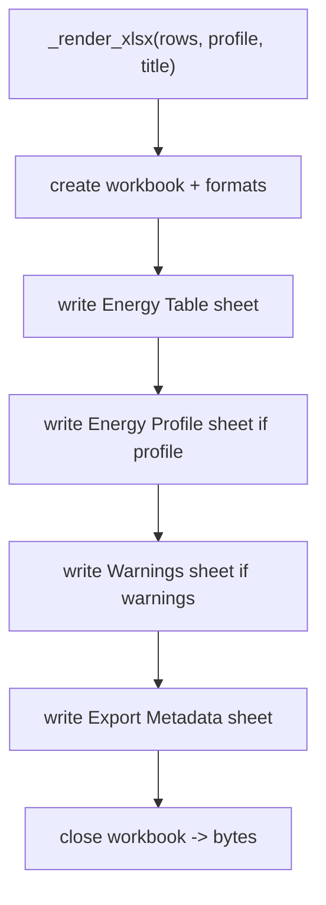

# export-xlsx-workbook-template design

## 0. 术语约定

| 术语 | 定义 | 防冲突结论 |
|---|---|---|
| XLSX Workbook Template | `ReportExportService` 为能量表生成的 Excel workbook 布局协议 | 现有 `_render_xlsx()` 已能写三张 sheet，本 feature 增强布局和元数据 |
| Energy Table Sheet | 主结构能量表 sheet，消费 `ENERGY_TABLE_COLUMNS` 与 `EnergyTableRow` | 继续作为第一 sheet |
| Group Header Row | `Energy Table` 上方按 `EnergyTableColumn.group` 合并的列组行 | 新增布局；不改变 column key |
| Export Metadata Sheet | 记录 schema version、column count、title/profile id 等审计信息的 sheet | 新增 sheet；不是 Project Content metadata |
| Workbook Structure QA | 不依赖 Excel UI 的 workbook zip/xml 结构检查 | 新增测试；当前环境无 `soffice`/`pdftoppm`，visual render 作为可选 |

术语 grep 结论：当前只有 `_render_xlsx()`、`Energy Table`、`Energy Profile`、`Warnings`。没有 group header、metadata sheet 或 workbook structure QA helper。

## 1. 决策与约束

### 需求摘要

本 feature 目标是让 XLSX artifact 更接近可交付能量表模板，而不是仅能被 Excel 打开。完成后：

1. `Energy Table` sheet 有可读的 title、group header row、column label row、冻结窗格和 autofilter。
2. 列宽按结构名、能量数值、basis function、profile/warning 等类型设置，减少默认窄列。
3. workbook 增加 `Export Metadata` sheet，记录 energy table schema version、column count、title、profile id/path id、row count。
4. `Energy Profile` / `Warnings` sheet 保持现有数据语义，但补冻结和列宽。
5. tests 能从 workbook zip/xml 检查 sheet 存在、merged cells、autofilter、freeze panes、metadata 和关键文本。

明确不做：

- 不新增 CSV ExportFormat，也不生成独立 `.csv` 文件。
- 不读取或套用用户私有 workbook 模板。
- 不新增 Excel chart、图片嵌入、宏、公式重算或 pivot table。
- 不修改 Energy Table Contract 的 column key / row builder。
- 不修改 PNG/CDXML writer、Web Report Export Panel 或 Project Content schema。
- 不要求本机安装 LibreOffice；缺少 render 工具时用结构化 XML 测试替代 visual render。

### 复杂度档位

小型 writer enhancement。偏离点：

- Spreadsheet layout 需要结构化测试，而不是只检查 zip signature。
- 增加 metadata sheet 是导出 artifact 内部审计，不改变 ShellArtifact 或 ExportArtifactRecord schema。
- visual render 工具当前不可用，验收必须明确不能做真实 spreadsheet screenshot。

### 关键决策

1. **不改字段契约**：XLSX writer 只消费 `ENERGY_TABLE_COLUMNS` 和 rows，不新增表格字段。
2. **两层表头**：有 title 时第 0 行 title，第 1 行 group header，第 2 行 column label；无 title 时 group header 在第 0 行，column label 在第 1 行。
3. **合并连续 group**：相邻同 group 且长度大于 1 的列合并；无 group 的列写单格。
4. **metadata sheet 独立**：审计信息不塞进 `Energy Table` 左上角，避免污染数据行。
5. **结构测试优先**：用 workbook XML 验证 merged cells、sheet names、freeze panes、autofilter 和 shared strings；如果环境后续有 render 工具，再补可选 visual check。

## 2. 名词与编排

### 2.1 名词层：值对象 / 实体 / 接口契约

**现状**：

- `_render_xlsx(rows, profile, title)` 直接写单行 column labels，冻结在 data header 下，固定前列宽 24，其余 18。
- `Energy Profile` sheet 有单行 header 和冻结窗格。
- `Warnings` sheet 只在有 warnings 时创建。
- tests 只检查 workbook XML 中 sheet 名和若干 shared strings。

**变化**：

- 新增内部 helper `_write_energy_table_sheet(workbook, rows, title)`，返回 header/data row metadata。
- 新增内部 helper `_write_group_header_row(sheet, row, columns, formats)`，按 group/source 写合并组。
- 新增内部 helper `_write_export_metadata_sheet(workbook, profile, title, rows)`。
- `_render_xlsx()` 改为调用 helpers，减少当前大函数职责。
- `Energy Table` sheet 增加 autofilter 范围、冻结窗格和按列类型设置宽度。

**接口示例：workbook 结构**

```text
Energy Table
row 0: title (optional)
row 1: group header, e.g. Gas / Solution / Profile
row 2: Structure / Egas (Hartree) / ...
row 3+: data rows

Export Metadata
key | value
energy_table_schema_version | energy-table-v1
energy_table_column_count | 20
```

### 2.2 编排层：主流程与控制流



**现状**：

`_render_xlsx()` 同时承担 format 创建、主表、profile sheet 和 warnings sheet。布局细节集中在一个函数里，后续继续加 workbook 样式会使它变成大函数。

**变化**：

- 把 sheet 写入拆成小 helper，但不改变 public `ReportExportService.export()`。
- 主表使用 group row + label row，并对 header/data row index 统一计算。
- metadata sheet 只写审计 key/value，便于 tests 和 Web/agent 解读 artifact。

**跨层纪律**：

- 错误语义：仍由 `_render_format()` 捕获 XlsxWriter ImportError/Exception 并返回 `export_failed`。
- 幂等性：同一 rows/profile/title 生成同样 workbook sheet names、metadata strings 和 table layout。
- 扩展点：CSV 后续不依赖 XLSX sheet layout，只复用 Energy Table Contract。
- 范围守护：不新增 file picker、Web UI、Project Content 或 export format。

### 2.3 挂载点清单

- XLSX writer helpers：`_write_energy_table_sheet`、`_write_group_header_row`、`_write_export_metadata_sheet`。
- Workbook layout behavior：group header row、autofilter、freeze panes、column widths、metadata sheet。
- Report export tests：workbook XML structure regression 和 scope guard。

### 2.4 推进策略

1. **Workbook helper split**：拆 `_render_xlsx()` 的 sheet 写入 helpers，行为保持现有测试通过。
   - 退出信号：focused report export tests 仍通过。
2. **Energy Table layout**：增加 group header、冻结、autofilter 和列宽策略。
   - 退出信号：workbook XML 中存在 merged cells、autofilter 和 freeze pane。
3. **Export Metadata sheet**：新增 `Export Metadata` sheet，写 schema version、column count、title、profile/path、row count。
   - 退出信号：shared strings 中包含 metadata keys 和 `energy-table-v1`。
4. **Workbook QA tests**：补 zip/xml 结构测试和 scope guard，明确当前无 render 工具。
   - 退出信号：focused tests、全量 Python tests、YAML 校验通过。

## 3. 验收契约

### 关键场景清单

1. XLSX export 仍返回 `.xlsx` zip bytes，writer id 不变或明确更新。
2. Workbook 包含 `Energy Table`、`Energy Profile`、`Warnings` 和 `Export Metadata` sheets。
3. `Energy Table` 有 title、group header row 和 column label row。
4. `Energy Table` XML 包含 merged cells，覆盖连续 group header。
5. `Energy Table` XML 包含 autofilter 和 freeze pane。
6. `Export Metadata` sheet 包含 `energy_table_schema_version=energy-table-v1`、column count、row count、profile id/path id。
7. Existing data strings 如 `template-row`、`A`、`B`、`Check TS entropy` 仍存在。
8. Warning sheet 只在 warnings 存在时创建；无 warnings 不强制空 sheet。
9. 缺少 XlsxWriter 仍返回 `export_failed target=dependency`。

### 明确不做的反向核对项

- 不新增 CSV/CDX/PDF/PPTX/SVG ExportFormat。
- 不读取用户 workbook 模板。
- 不新增 Excel chart、宏、图片、公式重算或 pivot table。
- 不修改 PNG/CDXML writer、Web Report Export Panel、Project Content schema。

## 4. 与项目级架构文档的关系

- architecture 归并：验收时更新 `core-platform.md` / `ARCHITECTURE.md` 的 XLSX workbook 现状，补 group header、autofilter、metadata sheet。
- requirement 回写：无新增用户故事，只是导出 artifact 质量增强；不更新 requirement。
- roadmap 回写：验收通过后把 `export-xlsx-workbook-template` 标为 done。
