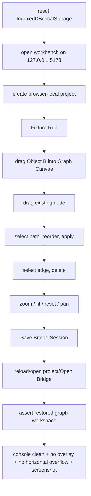

# graph-editor-e2e-qa design

## 0. 术语约定

| 术语 | 定义 | 防冲突结论 |
|---|---|---|
| Graph Editor E2E Matrix | Playwright 真实 Chromium 中覆盖 Graph Canvas 已落地编辑能力的用例集合 | 不等同于 component tests，也不替代单元测试 |
| Desktop Graph Editor Journey | `1280x720` 下覆盖 drag/drop、node move、edge/path edit、viewport、save/open restore 的主流程 | 不扩大到所有工作台面板组合 |
| Narrow Graph Editor Journey | `390x840` 下覆盖图谱工具条、画布、预览、能量/导出关键区域可用和无水平溢出 | 不要求完整拖拽矩阵重复一遍 |
| Graph Editor E2E Helper | `web/e2e/workbench-helpers.ts` 中稳定封装图谱交互的 helper | 只服务测试，不进入 runtime bundle |
| Browser Plugin Smoke | 用 in-app Browser 做页面身份 / 非空白 / console 基础检查 | 复杂手势以 Playwright 为准 |

术语 grep 结果：现有 `web/e2e/workbench-journey.spec.ts` 已有 desktop/narrow workbench journey，但图谱部分仍偏主流程 smoke；`workbench-helpers.ts` 已有 open/reset/project/fixture/import/energy/export helpers；`web/playwright.config.ts` 已固定 `http://127.0.0.1:5173` 并复用 server；local-http smoke 已独立在 `web/e2e/local-http-bridge.spec.ts`。

## 1. 决策与约束

### 需求摘要

本 feature 目标是把已落地的 Web Graph Editor 交互补成真实浏览器回归：

1. Desktop E2E 覆盖 Object Registry drag/drop 到 Graph Canvas、已有 node pointer drag、edge selection/delete、path order draft/apply、Pan/Zoom/Fit/Reset 和 Save/Open Bridge restore。
2. Narrow E2E 覆盖 `390x840` 下图谱画布、toolbar、path list、preview、energy/report 关键区域仍可见且无水平溢出。
3. 每条 E2E 收集 console warning/error、检查无 framework overlay、无水平溢出，并附截图。
4. E2E helper 封装真实鼠标 / DragEvent / viewport / bridge 操作，让后续图谱功能复用同一套测试动作。
5. 默认 fixture E2E 承担复杂图谱交互矩阵；local-http smoke 继续只验证真实 bridge 主链路，不复制所有手势。

### 明确不做

- 不新增产品 UI、shell command、Project Content schema、localStorage graph state 或云同步能力。
- 不把 component tests 改成 E2E，也不删除已有 unit/component 覆盖。
- 不在 local-http E2E 中复制完整 drag/drop/node move/viewport 矩阵；local-http 只保留真实 Python bridge smoke。
- 不引入第三方 diagramming/canvas library，不改 GraphCanvas runtime 交互语义。
- 不把 Playwright screenshots/traces/report 写入 Project Content 或 Browser Project Repository。

### 复杂度档位

- E2E coverage：L3。真实浏览器手势、IndexedDB、Vite server 和响应式布局都参与，flakiness 风险高。
- Runtime change：L1。理想状态只改测试与文档；若发现可访问性 selector 不稳定，只做最小 testability 补强。
- Persistence coverage：L3。需要通过 UI 操作验证 Save/Open Bridge restore，而不是直接调用 fixture transport。

### 关键决策

1. **默认 E2E 仍用 fixture runtime**：复杂手势由 `npm run test:e2e` 覆盖，避免 local-http bridge 和 Python 导出依赖造成额外不稳定。
2. **helper 优先**：拖入、拖动、视口、保存恢复封装到 `workbench-helpers.ts`，spec 只表达用户流程。
3. **可观察断言优先**：断言 UI 上的 node id、edge count、path order、zoom output、selected path class / text、checksum / validation，而不是窥探 React state。
4. **Browser 插件做 smoke，Playwright 做手势**：in-app Browser 已知可能对本地 Vite click 触发 CDP timeout，复杂手势不依赖它。
5. **不扩大产品边界**：E2E 只验证现有能力，不借机实现键盘删除、多选、path delete、wheel/pinch 或 bundle IO。

## 2. 名词与编排

### 2.1 名词层：值对象 / 实体 / 接口契约

**现状**：

- `web/e2e/workbench-journey.spec.ts` 已有 desktop/narrow Workbench Journey，覆盖 project、fixture、import、graph add/connect/set path、energy、export。
- `workbench-helpers.ts` 已有 `openWorkbench`、`resetWorkbenchStorage`、`createAndSaveBrowserProject`、`runFixture`、`buildImportedWaterPath`、`expectNoHorizontalOverflow`、`attachViewportScreenshot` 等 helper。
- GraphCanvas 已有可访问元素：Graph Canvas region、Graph canvas surface、node buttons、edge hitbox button、path select button、Pan/Zoom/Fit/Reset/Delete Selected buttons、zoom output。
- Graph Editor Workspace Persistence 已证明 component-level Save/Open Bridge content files restore，但默认 E2E 尚未覆盖完整真实浏览器 restore。

**变化**：

新增/扩展测试 helper 概念：

```ts
type GraphEditorE2EState = {
  graphCanvas: Locator
  objectRegistry: Locator
}

async function dragRegisteredObjectToGraphCanvas(page, objectName, target)
async function dragGraphNode(page, nodeName, delta)
async function exerciseGraphViewportControls(page)
async function saveAndRestoreGraphWorkspace(page, projectName)
```

测试可观察输出：

- node drop 后出现 `node-web-3` / object id / formula。
- node drag 后同一 node 的 bounding box 发生有限变化。
- edge delete 后 Network Preview edge count 为 `0`，Object A/Object B nodes 仍可见。
- path reorder 后 path text 变为 `node-b -> node-a`。
- viewport controls 改变 zoom output / transform，并可 reset。
- Save/Open Bridge restore 后 zoom output、selected path、path order 或 node position 可见恢复。

### 2.2 编排层：主流程与控制流



**现状**：

- Existing desktop E2E 通过 click-driven `buildImportedWaterPath` 覆盖 Add Node / Connect / Set Path，但不覆盖 HTML5 drag/drop、node drag、edge delete、path reorder、viewport controls 或 save/open restored selection。
- Existing narrow E2E 覆盖关键区域可见、Add Node / Connect / Set Path、Energy / Export，但图谱操作矩阵较浅。
- Browser plugin smoke 在前几个 feature 中反复遇到本地 Vite 点击 CDP timeout，不能作为复杂手势唯一证据。

**变化**：

- 在默认 fixture E2E 中新增 Graph Editor desktop matrix test，串联 project create、fixture、drag/drop、node move、edge/path edit、viewport 和 bridge restore。
- 扩展或新增 narrow graph editor test，至少验证工具条、画布、path list、preview、energy/report 可用，无水平溢出，并附截图。
- `workbench-helpers.ts` 新增 Graph Editor 专用 helper，隐藏真实鼠标 / DragEvent / locator 细节。
- 保持 local-http E2E 不变或仅增加轻量断言，避免复制复杂矩阵。

**跨层纪律**：

- Error semantics：E2E 遇到 console warning/error、framework overlay 或水平溢出即失败。
- Idempotence：每条 E2E beforeEach 清理 IndexedDB/localStorage，project name 带时间戳，避免跨测试污染。
- Ordering：先完成 fixture workspace，再做 graph 操作；Save Bridge 前必须有 active browser project。
- Observability：每条新增/扩展 journey 附 screenshot；失败时保留 Playwright trace。
- Scope guard：E2E helper 不 import runtime private state，不访问 React internals，不写 Project Content 测试夹具文件。

### 2.3 挂载点清单

- Playwright helper：`web/e2e/workbench-helpers.ts` 增加图谱交互 helper。
- Default fixture E2E：`web/e2e/workbench-journey.spec.ts` 增加 desktop graph editor matrix 和 narrow graph editor coverage。
- Playwright config / output：继续使用既有 `npm run test:e2e`、`test-results/`、`playwright-report/`，不改产物边界。
- Architecture / roadmap / acceptance 文档：记录 Graph Editor QA Harness 覆盖范围和限制。

本 feature 不新增 runtime shell command、React route、Project Content section、repository schema、local-http 完整手势矩阵、云存储 SDK 或浏览器持久化逻辑。

### 2.4 推进策略

1. **Design And Roadmap Gate**：落盘 design/checklist，回写 roadmap item 为 in-progress。
   - 退出信号：design status approved；checklist YAML 和 roadmap items YAML 校验通过。
2. **Graph E2E Helpers**：在 `workbench-helpers.ts` 增加 drag/drop、node drag、viewport、save/restore 和 overlay helper。
   - 退出信号：helper 只依赖 Playwright public API，spec 可读性提升，无 runtime import。
3. **Desktop Graph Editor Matrix**：新增或扩展 desktop E2E，覆盖 drag/drop、node move、edge/path edit、viewport、Save/Open Bridge restore。
   - 退出信号：`npm run test:e2e -- --grep "graph editor"` 或等效 focused run 通过。
4. **Narrow Graph Editor Coverage**：补 `390x840` 下 graph toolbar/canvas/preview/energy/export 可用、无水平溢出和截图。
   - 退出信号：focused narrow E2E 通过。
5. **Verification And Scope Guard**：运行 Web tests/build、默认 E2E，按需 Browser smoke，更新 architecture/roadmap/acceptance。
   - 退出信号：测试通过；scope grep 未新增 runtime persistence / cloud / schema；验收报告落档。

## 3. 验收契约

### 关键场景清单

1. `npm run test:e2e` 默认 fixture 模式包含 Graph Editor desktop matrix，覆盖 drag/drop、node drag、edge delete、path reorder、viewport controls、Save/Open Bridge restore。
2. Desktop matrix 中 Object Registry registered object 能拖入 Graph Canvas，drop 后显示新 node，且 console clean。
3. Desktop matrix 中已有 graph node 鼠标拖动后 bounding box 或 style 有可观察变化，并继续显示来自 ShellResponse 的 node id。
4. Desktop matrix 中 edge selection + Delete Selected 后 edge count 变为 0，node 仍保留，network preview 不由前端自行推断。
5. Desktop matrix 中 path order draft 上移/Apply 后 path order 文本变化，active/selected path 可见。
6. Desktop matrix 中 Zoom/Fit/Reset/Pan 有可观察 viewport 变化，Reset 后 zoom 回到 `100%`。
7. Desktop matrix 中 Save Bridge Session 后 reload/open project/Open Bridge 能恢复 graph workspace 可见状态，至少包含 node position、viewport、selected path 或 active path 的可观察断言。
8. Narrow `390x840` graph editor journey 能完成核心 graph interaction smoke，Graph Canvas、toolbar、preview、Energy Profile Panel 和 Report Export Panel 可见，无水平溢出。
9. 每条新增/扩展 E2E 捕获 console warning/error、检查无 framework overlay、无水平溢出并附 screenshot。
10. local-http E2E 不复制完整 graph editor matrix，仍只验证真实 bridge smoke。
11. 不新增产品 runtime command、Project Content schema、localStorage graph state、自动保存、云同步或账号系统。
12. `npm run test` 通过。
13. `npm run build` 通过。
14. `npm run test:e2e` 通过。
15. Browser dev preview 页面身份 / 非空白 / console smoke 有记录；复杂手势可由 Playwright 作为主证据。

### 反向检查

- 不把 Playwright helper 逻辑 import 到 runtime app。
- 不在 E2E 中直接改 IndexedDB Project Content bytes 来伪造保存/恢复；必须走 UI 的 Save/Open Bridge。
- 不让 E2E 依赖不稳定的像素精确坐标；只断言有限移动、可见文本、aria state、console 和 layout health。

## 4. 与项目级架构文档的关系

- acceptance 阶段应在 `.codestable/architecture/web-workbench.md` 更新 E2E QA Harness 当前覆盖矩阵。
- acceptance 阶段应在 `.codestable/architecture/ARCHITECTURE.md` 同步 Web E2E QA Harness 描述，说明 graph editor matrix 已覆盖保存/恢复。
- requirement `web-workbench-shell` 应补充当前真实浏览器回归已经覆盖图谱编辑桌面/窄屏矩阵。
- roadmap acceptance 阶段把 `graph-editor-e2e-qa` 标为 `done`。
