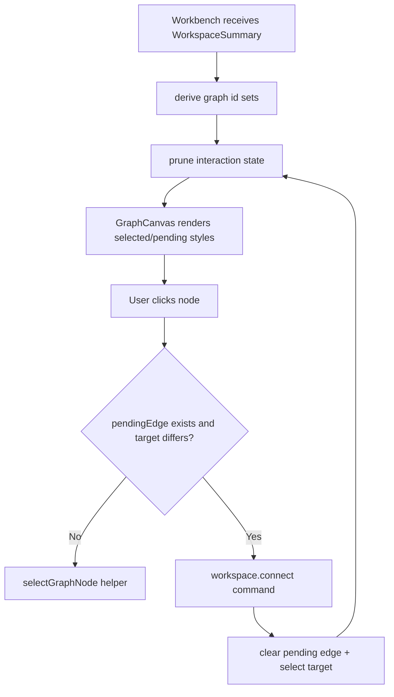

# graph-editor-interaction-state design

## 0. 术语约定

| 术语 | 定义 | 防冲突结论 |
|---|---|---|
| Graph Editor Interaction State | Web Graph Canvas 内部的 UI-only 状态，承载 mode、selection、hover、dragging 和 pending edge | 不等同于 core `WorkspaceSelection` 或 Project Content 中的 workspace snapshot |
| Graph Editor Mode | 当前画布手势语义，第一版只需要 `select` / `connect` / `pan` | 不改变现有 toolbar command 名称 |
| Graph Editor Selection | 当前选中的 node/edge/path id 集合 | 只引用当前 `WorkbenchDomainState.workspace.graph` 中存在的 id |
| Pending Edge | connect 模式下已选 source node，下一次点击 target node 后提交 `workspace.connect` | 替代现有 `pendingConnectionFromId`，不进入 ShellResponse |

术语 grep 结果：当前 Web 侧已有 `selectedGraphNodeId` / `pendingConnectionFromId` 两个零散 state；core architecture 已有 `CanvasViewport`、`WorkspaceSelection`、`NetworkPreview`。本 feature 只抽 Web UI state helper，避免提前承诺 core workspace 持久化字段。

## 1. 决策与约束

### 需求摘要

本 feature 目标是把 Graph Canvas MVP 中分散在 `WorkbenchShell` 的 selection / pending connection 状态收敛成一个可测试的 interaction state 模型：

1. 新增 Web 前端 `GraphEditorInteractionState` 类型，包含 `mode`、`selection`、`hover`、`dragging`、`pendingEdge`。
2. 新增初始化、选择节点、进入 connect、清理失效引用等纯函数 helper。
3. `WorkbenchShell` 用单个 interaction state 替代 `selectedGraphNodeId` 和 `pendingConnectionFromId`。
4. `GraphCanvas` 从 interaction state 渲染 selected / pending node，现有 Open Workspace、Add Node、Connect、Set Path flow 保持不变。
5. domain state 更新后清理不存在的 selection / pending edge，避免 UI 引用 stale node。

### 明确不做

- 不实现真实 object drag/drop、节点拖动、框选、多选 UI、键盘删除、pan/zoom 或 viewport 持久化。
- 不新增或修改 `workspace.move_node`、`workspace.remove`、`workspace.connect` 等 shell command。
- 不修改 Python core `ReactionGraphService`、`GraphEditorWorkspaceService`、Project Content codec 或 Browser Project Repository。
- 不把 transient hover/dragging/pending edge 写入 ShellResponse、Project Content、Browser localStorage 或 ReactionGraph。
- 不改变 Graph Canvas 当前 click-driven 添加节点、连接节点和设置 active path 的用户路径。

### 复杂度档位

- Frontend state orchestration：L2。只抽 UI-only state helper 和 React 编排，不改 shell/runtime。
- Testability：tested。helper 需要单元测试，现有 WorkbenchShell graph flow component tests 继续覆盖用户路径。
- Evolvability：active。状态类型要为 drag/drop、node dragging、viewport feature 预留字段，但本 feature 不实现这些交互。

### 关键决策

1. **状态 helper 独立于组件**：interaction state 纯函数放在 Web app 模块中，便于后续拖拽/viewport feature 复用和单测覆盖。
2. **selection 使用数组协议**：即使当前 UI 只支持单 node，类型仍使用 `nodeIds` / `edgeIds` / `pathIds`，对齐 roadmap 契约并避免后续多选改类型。
3. **connect 仍由 WorkbenchShell 编排命令**：helper 只表达 `pendingEdge.fromNodeId`；真正调用 `workspace.connect` 仍在 `WorkbenchShell`，保持 ShellClient command authority。
4. **清理失效引用集中处理**：workspace projection 改变后调用 helper prune，selection 和 pending edge 只保留当前 graph 中存在的 id。

## 2. 名词与编排

### 2.1 名词层：值对象 / 实体 / 接口契约

**现状**：

- `web/src/app/WorkbenchShell.tsx` 维护 `selectedGraphNodeId` 和 `pendingConnectionFromId` 两个独立 `useState`。
- `GraphCanvas` props 直接接收 `selectedNodeId` / `pendingConnectionFromId`，并用二者渲染 selected / pending 样式。
- `WorkbenchShell` 的 workspace effect 会按当前 nodes 清理两个 state；connect flow 通过 `pendingConnectionFromId + selectGraphNode(nodeId)` 触发 `workspace.connect`。

**变化**：

新增 UI-only state 类型和 helper，字段对齐 roadmap 第 4.1 节：

```ts
type GraphEditorMode = "select" | "connect" | "pan"

type GraphEditorSelection = {
  nodeIds: string[]
  edgeIds: string[]
  pathIds: string[]
}

type CanvasPoint = {
  x: number
  y: number
}

type GraphEditorInteractionState = {
  mode: GraphEditorMode
  selection: GraphEditorSelection
  hover?: { kind: "node" | "edge" | "path"; id: string } | null
  dragging?:
    | { kind: "node"; nodeIds: string[]; origin: CanvasPoint; current: CanvasPoint }
    | { kind: "canvas"; origin: CanvasPoint; current: CanvasPoint }
    | { kind: "object-drop"; objectId: string; current: CanvasPoint }
    | null
  pendingEdge?: { fromNodeId: string } | null
}
```

接口示例：

```ts
const next = selectGraphNode(initialGraphEditorInteractionState, "node-a")
// next.selection.nodeIds === ["node-a"]
// next.mode === "select"

const connecting = startGraphEditorConnection(next)
// connecting.mode === "connect"
// connecting.pendingEdge?.fromNodeId === "node-a"

const pruned = pruneGraphEditorInteractionState(connecting, {
  nodeIds: ["node-b"],
  edgeIds: [],
  pathIds: [],
})
// pruned.selection.nodeIds === []
// pruned.pendingEdge === null
```

边界：

- helper 输入输出必须 JSON-safe plain object，但不需要通过 ShellClient。
- helper 不读取 DOM，不调用 `shellClient.run`，不 import repository/runtime。
- `GraphCanvas` 只消费 state，不直接写 domain graph。

### 2.2 编排层：主流程与控制流



**现状**：

- `selectedGraphNodeId` 初始跟随 workspace 第一个 node；workspace 更新时如果当前 selection 不存在则改成第一个 node。
- `pendingConnectionFromId` 只在点击 Connect 后设置，下一次点击另一个 node 时触发 shell command。
- selection/pending state 不可单测，只能通过 WorkbenchShell component test 间接覆盖。

**变化**：

- `WorkbenchShell` 初始化 `graphEditorInteraction`，workspace effect 调用 prune helper 清理失效 selection / pending edge，并在无 selection 时保留现有“自动选第一个 node”的 MVP 行为。
- 点击 node 时，如果 `pendingEdge.fromNodeId` 存在且 target 不同，仍提交 `workspace.connect`；成功或失败响应返回后清空 pending edge 并选择 target node。
- 点击 Connect 时通过 helper 从当前 selected node 进入 connect 模式；无 selected node 时不改变 state。
- `GraphCanvas` props 改为 `interactionState`，selected/pending 从 `selection.nodeIds[0]` 和 `pendingEdge.fromNodeId` 派生。

**跨层纪律**：

- Command authority：graph 结构变化仍只来自 ShellClient response。
- UI-only boundary：interaction state 不进入 `WorkbenchDomainState`、ShellResponse、Project Content 或 Browser Project Repository。
- Idempotence：prune helper 可重复调用，输入 id 集合相同时输出稳定。
- Error visibility：workspace command 失败仍走现有 `applyWorkspaceResponse` error path，不能被 interaction helper 吞掉。

### 2.3 挂载点清单

- 本 feature 不引入新应用路由、shell command、repository schema、Project Content section、runtime env 或第三方注册项。
- 用户可见挂载点仍是现有 Graph Canvas toolbar 和 node click flow；只把其状态来源从两个独立 state 改为统一 interaction state。

### 2.4 推进策略

1. **Interaction State Helper**：新增类型、initial state、select/start/clear/prune 纯函数。
   - 退出信号：helper tests 覆盖 selection、pending edge、prune stale references。
2. **Workbench State Integration**：`WorkbenchShell` 用单一 interaction state 替代两个 graph state。
   - 退出信号：现有 graph flow component tests 仍通过，connect 行为不回退。
3. **GraphCanvas Prop Boundary**：`GraphCanvas` 消费 interaction state，selected/pending 派生集中化。
   - 退出信号：节点 selected / pending 样式仍可由 component tests 观察，TypeScript build 通过。
4. **Verification And Scope Guard**：跑 Web tests/build 和页面健康检查。
   - 退出信号：`npm run test`、`npm run build` 通过；浏览器页面非空白、console clean；scope grep 未新增 shell/core/persistence 改动。

## 3. 验收契约

### 关键场景清单

1. Fixture Run 后 Graph Canvas 仍显示 `node-a` / `node-b`、`path-a-b` 和 no disconnected nodes。
2. 点击 Connect 前，已选 node 可作为 pending edge source；点击另一个 node 后仍提交 `workspace.connect`。
3. 重复 connect 同一 node pair 仍保持幂等，不新增重复 edge。
4. Add Node 后新 node 出现在画布；selection/pending state 不会引用已不存在 node。
5. workspace projection 变化后，stale selected node、pending edge、hover、dragging node ids 会被清理。
6. helper 单测覆盖 `selectGraphNode`、`startGraphEditorConnection`、`clearGraphEditorPendingEdge`、`pruneGraphEditorInteractionState`。
7. 不新增 `workspace.move_node`、`workspace.remove` 或任何 Python shell command。
8. 不把 interaction state 写入 ShellResponse、Project Content、Browser Project Repository 或 localStorage。
9. `npm run test` 通过。
10. `npm run build` 通过。
11. 浏览器 dev preview 页面非空白、无 framework overlay、console error/warn clean。

### 反向检查

- 不实现真实 drag/drop、节点拖动、框选、多选 UI、键盘删除、pan/zoom 或 viewport 持久化。
- 不修改 Python core graph、workspace、energy、export、project content codec。
- 不改变已落地 i18n 文案含义；动态 node/object/path id 继续原样显示。

## 4. 与项目级架构文档的关系

- acceptance 阶段应在 `.codestable/architecture/web-workbench.md` 记录 Graph Canvas interaction state 已从零散 `selectedGraphNodeId` / `pendingConnectionFromId` 收敛为 UI-only `GraphEditorInteractionState`。
- `.codestable/architecture/ARCHITECTURE.md` 不需要新增入口；这是 Web Workbench 内部交互状态边界，不改变系统级模块关系。
- roadmap acceptance 阶段把 `graph-editor-interaction-state` 标为 `done`，后续 `graph-editor-object-drop` / `graph-editor-node-layout` 可复用该 interaction state。
