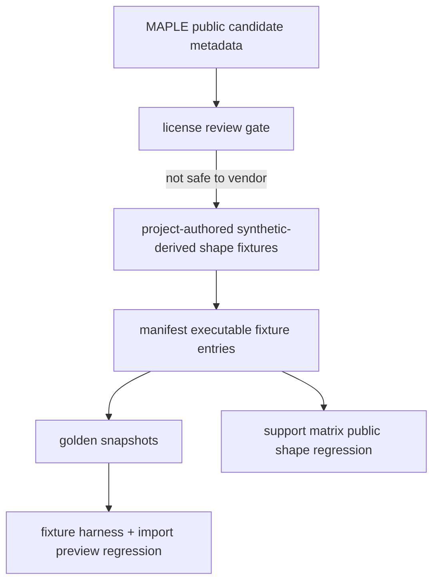

# maple-out-real-fixtures design

## 0. 术语约定

| 术语 | 定义 | 防冲突结论 |
|---|---|---|
| MAPLE Public Candidate | `sources.yaml` / `support-matrix.yaml` 已登记的 MAPLE sp/opt candidate file id | 仍不是 vendored fixture |
| Synthetic-derived Shape Fixture | 项目内手写 fixture，模仿 public candidate 暴露出的文件形状和字段组合，但不复制原始行、结构、banner 或数值 | `source.kind=synthetic`，不是第三方文件 |
| MAPLE Final XYZ Fixture | 单帧 MAPLE-style `.xyz`，comment 行含 `Image 0 Energy = ...`，用于验证 final `.xyz` 可被 MAPLE parser 识别 | 只生成 frame-level ChemicalObjectDraft |
| MAPLE Public Shape Regression | support matrix 中连接 public candidate source ids 与 synthetic-derived executable fixtures 的回归 entry | 不声明 public 原文件已 vendor 或完整真实版本支持 |

## 1. 决策与约束

### 需求摘要

本 feature 目标是在不越过 MAPLE public example 许可证边界的前提下，把 roadmap 的 MAPLE `.out` / final `.xyz` 最小回归往前推进：

1. 评估 `maple-output-public-candidates` 中 sp `.out`、opt `.out` 和 opt final `.xyz` 的可提交策略。
2. 因 MAPLE LICENSE 与输出 banner 同时出现 BSD、CC BY academic、commercial prohibited、all-rights-reserved 文案，不直接 vendor public example 原文件。
3. 新增项目内 synthetic-derived MAPLE `.out` 和 final `.xyz` executable fixtures，锁定 public candidate 暴露出的基本形状：MAPLE banner marker、task/model、坐标块、Hartree energy、单帧 final `.xyz` energy comment。
4. 新增 golden snapshots、support matrix entry 和 harness/import-preview 回归覆盖，明确 public originals 仍是 candidate/reference，不是已入库真实 fixture。

明确不做：

- 不复制 `/tmp/rxnflow-maple/example/...` 原始文件进 `tests/fixtures/parsers/files/`。
- 不把 MAPLE public examples 标为 `vendored-third-party` 或 `redistributable=true`。
- 不修改 MAPLE parser runtime、ImportRegistryWorkflow、Platform Shell 或 Web UI。
- 不声明 MAPLE public candidate 原文件已经解析通过。
- 不支持 MAPLE scan/path/MD/frequency 或 ReactionPath / TS / thermochemistry 语义。
- 不解决 MAPLE public examples 的商业再分发授权问题。

### 复杂度档位

测试侧 fixture corpus feature。偏离点：

- roadmap 原始措辞是“真实/公开 fixture”，但许可证证据不支持直接 vendor；因此采用 roadmap notes 允许的 synthetic-derived fallback。
- 需要同时更新 manifest、输入文件、snapshots、support matrix、harness tests、import preview scope guard 和 docs/architecture/roadmap。

### 关键决策

1. **许可证优先**：license 不稳时不 vendor 原始 public examples；可提交 fixture 只用项目内 synthetic-derived content。
2. **source trace 不等于 vendor**：support matrix 可以通过 `source_ids` / `candidate_file_ids` 记录 public candidate 背景，但 fixture source 仍是 `synthetic`。
3. **最小形状覆盖**：本步只覆盖 sp `.out` 与 opt final `.xyz` 解析形状，不增加 task semantics。
4. **preview 回归同步**：新增 executable fixture 后必须进入 `ImportRegistryWorkflow` preview regression，保证 parser snapshot 字段在 import preview 中保真。

## 2. 名词与编排

### 2.1 名词层：值对象 / 实体 / 接口契约

**现状**：

- `manifest.yaml` 中已有 synthetic MAPLE sp/opt `.out` 和 synthetic MAPLE path `.xyz` fixture。
- `sources.yaml` 中 MAPLE public sp `.out`、opt `.out`、opt final `.xyz` 是 `fixture_policy: candidate`。
- `support-matrix.yaml` 中 `maple-output-public-candidates` 是 `status: candidate`，`fixture_ids` 为空。
- `ParserFixtureSource.kind` 已支持 `synthetic`；`vendored-third-party` 才要求 upstream path/hash/size 和 redistributable。

**变化**：

- 新增两个 executable fixtures：
  - `maple-sp-public-shape-synthetic-derived`：项目内 MAPLE-like sp `.out`。
  - `maple-opt-final-xyz-public-shape-synthetic-derived`：项目内单帧 MAPLE final `.xyz`。
- 新增对应 `parser-golden-v1` snapshots，固定 label、method、geometry sample、electronic energy 和 warning codes。
- 新增 support matrix entry `maple-public-shape-regression`，`status: partial`，`source_ids=[maple-dev-example]`，`candidate_file_ids` 链接 public sp `.out` 与 opt final `.xyz`，`fixture_ids` 链接 synthetic-derived executable fixtures。
- `maple-output-public-candidates` 保持 `status: candidate` 和空 `fixture_ids`，继续表示 public originals 尚未 vendor。

### 2.2 编排层：主流程与控制流

**跨层纪律**：

- 错误语义：public originals 仍不进入 `fixture_ids`；support matrix known_limits 明确 synthetic-derived fallback。
- 幂等性：测试只读仓库内 fixture，不访问 `/tmp/rxnflow-maple` 或网络。
- 扩展点：未来拿到授权或确认可再分发时，可另起 feature 把 candidate file 升级为 `vendored-third-party`。
- 可观测点：YAML 校验、fixture harness、import preview parser regression、全量 unittest。

### 2.3 挂载点清单

- `tests/fixtures/parsers/files/maple/` 的新增 synthetic-derived MAPLE input files。
- `tests/fixtures/parsers/manifest.yaml` 和 `snapshots/*.json` 的 executable fixture entries。
- `tests/fixtures/parsers/support-matrix.yaml` 的 `maple-public-shape-regression` entry。
- `tests/test_parser_fixture_harness.py` / `tests/test_import_preview_parser_regression.py` 的 fixture count、scope guard 和 MAPLE public-shape assertions。
- `docs/dev/parser-fixture-corpus.md`、architecture 和 roadmap 的 source policy / current coverage 描述。

### 2.4 推进策略

1. **Design and roadmap gate**：落 design/checklist，把 roadmap item 标为 in-progress，并记录 MAPLE public license fallback 决策。
   - 退出信号：feature doc、checklist 和 roadmap YAML 通过。
2. **Synthetic-derived executable fixtures**：新增 MAPLE public-shape `.out` / final `.xyz` fixture、manifest entries 和 snapshots。
   - 退出信号：fixture harness 能加载并解析新增 fixtures。
3. **Support matrix and regression tests**：新增 `maple-public-shape-regression` entry，更新 harness/import-preview tests 和 no-vendor guard。
   - 退出信号：focused parser fixture harness 与 import preview regression 通过。
4. **Docs and acceptance**：回写 docs/architecture/roadmap，补验收报告并跑全量验证。
   - 退出信号：checks 全 passed，roadmap item done，YAML/focused/full tests 通过。

## 3. 验收契约

### 关键场景清单

1. `manifest.yaml` 包含两个新增 MAPLE synthetic-derived executable fixtures。
2. 新增 fixtures 的 `source.kind` 是 `synthetic`，不是 `vendored-third-party`。
3. 新增 MAPLE `.out` fixture 能解析出一个 object，label 为 `MAPLE sp`，method 包含 `sp uma`，energy unit 为 `hartree`。
4. 新增 MAPLE final `.xyz` fixture 能解析出一个 frame-level object，label 为 `Image 0`，energy unit 为 `hartree`。
5. `support-matrix.yaml` 有 `maple-public-shape-regression` entry，`status: partial`，`fixture_ids` 指向新增 fixtures。
6. `maple-output-public-candidates` 仍保持 `status: candidate`，不把 public originals 放进 executable fixture ids。
7. import preview parser regression 覆盖新增 executable fixtures，并保持 preview-only 不登记对象。
8. `tests/fixtures/parsers/files/maple/` 不包含 MAPLE 原始 public example banner 的 copyright/license/all-rights-reserved 文案。
9. docs/architecture 明确这是 synthetic-derived shape coverage，不是 public examples 已 vendor 或真实版本完整支持。

### 明确不做的反向核对项

- 不复制 MAPLE public example 原文件。
- 不把 MAPLE source inventory policy 改成 allowed/vendored。
- 不新增 vendored-third-party manifest source。
- 不修改 parser runtime、ImportRegistryWorkflow、Platform Shell 或 Web UI。
- 不声明 scan/path/MD/frequency 支持。
- 不生成 ReactionPath、TS candidate、thermochemistry 或 correction 数据。

## 4. 与项目级架构文档的关系

- architecture 归并：更新 Parser Fixture Corpus 当前覆盖，说明 MAPLE public-shape synthetic-derived fixtures 已进入 executable corpus，但 public originals 仍未 vendor。
- guide 回写：补 synthetic-derived fallback 规则，强调 license 不稳时不能提交 public output 原文件。
- roadmap 回写：验收通过后把 `maple-out-real-fixtures` 标为 done，并在主文档备注“采用 synthetic-derived fallback”。
