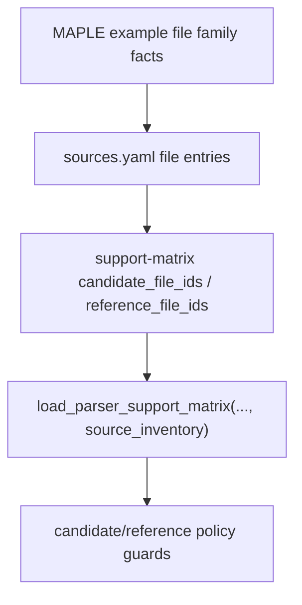

# maple-public-example-inventory design

## 0. 术语约定

| 术语 | 定义 | 防冲突结论 |
|---|---|---|
| MAPLE Public Example Inventory | MAPLE `example/` 文件族在 `sources.yaml` / `support-matrix.yaml` 中的任务级分类 | 不等于 parser 支持，也不 vendor 文件 |
| Candidate File Link | `support-matrix.yaml` 中指向 `fixture_policy: candidate` 的 `candidate_file_ids` | 新增字段，用于后续可评估 fixture |
| Reference File Link | `support-matrix.yaml` 中指向 `fixture_policy: reference-only` 的 `reference_file_ids` | 已有字段，继续表示只做语义参考 |
| MAPLE Path Family | IRC/NEB/String/AutoNEB 等输出族，包含多帧 `.xyz`、path topology JSON 和 TS candidate 文件 | 第一阶段不生成 ReactionPath |
| MAPLE Non-object Artifact | MD thermo/summary、frequency summary、scan final trajectory 等不直接映射 ChemicalObjectDraft 的文件 | 保持 reference-only |

## 1. 决策与约束

### 需求摘要

本 feature 目标是把 MAPLE `example/` 从少量来源 file entry 扩展成 support matrix 可读的任务级边界：

1. `sources.yaml` 增补 MAPLE scan、TS/NEB、TS/String、MD trajectory/summary、frequency output/TS xyz 等代表文件。
2. support matrix 增加 `candidate_file_ids`，并在传入 source inventory 时校验它们必须指向 `fixture_policy=candidate`。
3. support matrix 新增 MAPLE public example entries，区分 sp/opt candidate、scan reference、path family reference、MD reference、frequency reference。
4. docs/architecture 明确这些只是 source-backed inventory，不新增 executable fixture 或 parser 支持。

明确不做：

- 不 vendor MAPLE example 文件。
- 不新增 parser fixture manifest 条目或 golden snapshots。
- 不修改 MAPLE parser runtime、ImportRegistryWorkflow、Platform Shell 或 Web UI。
- 不把 scan/IRC/NEB/String/MD/frequency 伪装成当前支持的 ChemicalObjectDraft 语义。
- 不解决 MAPLE license 的再分发判断。

### 复杂度档位

测试侧 support matrix inventory feature。偏离点：

- 需要新增 `candidate_file_ids` 字段，和已有 `reference_file_ids` 对称校验。
- MAPLE 文件族很多，首轮只登记代表性文件和 task family，不追求全量逐文件清单。

### 关键决策

1. **candidate/reference 分流**：sp/opt 小 `.out` / final `.xyz` 标 candidate；path/MD/frequency/scan 先 reference-only。
2. **support matrix 不宣称 runtime 支持**：source-backed entries 使用 `status: candidate` 或 `reference-only`，`fixture_ids` 为空。
3. **大文件保守**：scan `.out` / final `.xyz` 和 MD trajectory 体积较大，保持 reference-only。
4. **不绕过 license review**：所有 MAPLE upstream 文件仍继承 `review-required`。

## 2. 名词与编排

### 2.1 名词层：值对象 / 实体 / 接口契约

**现状**：

- `sources.yaml` 的 MAPLE source 已有 sp/opt candidate、IRC path、AutoNEB JSON、MD thermo、freq summary。
- `support-matrix.yaml` 已有 MAPLE synthetic entries 和三条 MAPLE reference-only entries。
- `ParserSupportMatrixEntry` 已有 `source_ids`、`fixture_ids`、`reference_file_ids`，但没有 `candidate_file_ids`。

**变化**：

- `ParserSupportMatrixEntry` 增加 `candidate_file_ids: tuple[str, ...]`。
- `SUPPORT_MATRIX_ENTRY_STATUSES` 增加 `candidate`。
- loader 校验 `candidate_file_ids` 指向 source inventory 中 `fixture_policy: candidate` 的 file id。
- `sources.yaml` 增补代表性 MAPLE file entries。
- `support-matrix.yaml` 新增或调整 MAPLE entries：
  - `maple-output-public-candidates`
  - `maple-scan-reference`
  - `maple-path-family-reference`
  - `maple-md-artifacts-reference`
  - `maple-frequency-reference`

### 2.2 编排层：主流程与控制流

**跨层纪律**：

- 错误语义：candidate link 形状错误继续抛 `AssertionError`。
- 幂等性：只读 YAML，不访问 `/tmp` clone 或网络。
- 扩展点：后续 `maple-out-real-fixtures` 只从 candidate entries 选择文件。
- 可观测点：focused unittest、YAML 校验、全量 unittest。

### 2.3 挂载点清单

- `tests/fixtures/parsers/sources.yaml` 的 MAPLE file entries。
- `tests/fixtures/parsers/support-matrix.yaml` 的 MAPLE public entries。
- `tests/parser_fixture_harness.py` 的 candidate file link schema guard。
- `tests/test_parser_fixture_harness.py` 的 MAPLE public inventory tests。
- `docs/dev/parser-fixture-corpus.md` 和 architecture/roadmap 归并。

### 2.4 推进策略

1. **Design and roadmap gate**：建立 feature design/checklist，把 roadmap item 标为 in-progress，并补 roadmap candidate_file_ids 契约。
   - 退出信号：feature checklist 与 roadmap YAML 通过。
2. **MAPLE source entries**：补 MAPLE scan/TS/MD/freq 代表文件到 `sources.yaml`。
   - 退出信号：MAPLE source 覆盖 sp/opt/scan/ts/irc/md/freq 代表 file ids。
3. **Support matrix candidate/reference links**：新增 `candidate_file_ids` loader guard 和 MAPLE support matrix entries。
   - 退出信号：candidate/reference policy cross-check 通过，错误引用会失败。
4. **Docs and acceptance**：回写 docs/architecture/roadmap，补验收报告并运行验证。
   - 退出信号：checks 全 passed，roadmap item done，YAML/focused/full tests 通过。

## 3. 验收契约

### 关键场景清单

1. `sources.yaml` 的 MAPLE source 至少包含 sp、opt、scan、ts、irc、md、freq 代表 file ids。
2. MAPLE sp/opt candidate files 进入 `candidate_file_ids`，不进入 `reference_file_ids`。
3. MAPLE scan/path/MD/frequency files 进入 `reference_file_ids`，不进入 executable `fixture_ids`。
4. support matrix 有 `maple-output-public-candidates` entry，status 为 `candidate`。
5. support matrix 有 MAPLE scan/path/MD/frequency reference entries，status 为 `reference-only`。
6. loader 拒绝未知 `candidate_file_ids`。
7. loader 拒绝 reference-only file 出现在 `candidate_file_ids`。
8. loader 拒绝 candidate file 出现在 `reference_file_ids`。
9. `reference_only_entries()` 仍只返回 reference-only entries，不返回 candidate entries。
10. docs/architecture 明确 MAPLE public inventory 不 vendor 文件、不新增 runtime parser 支持。

### 明确不做的反向核对项

- 不新增 MAPLE executable fixture。
- 不复制 MAPLE example 文件进 `tests/fixtures/parsers/files/`。
- 不修改 parser runtime、ImportRegistryWorkflow、Platform Shell 或 Web UI。
- 不声明 MAPLE scan/path/MD/frequency 已支持。
- 不解决 MAPLE license 再分发判断。

## 4. 与项目级架构文档的关系

- architecture 归并：补 MAPLE public candidate/reference source-backed inventory 现状。
- guide 回写：补 `candidate_file_ids` 和 MAPLE source inventory 维护规则。
- roadmap 回写：验收通过后把 `maple-public-example-inventory` 标为 done。
