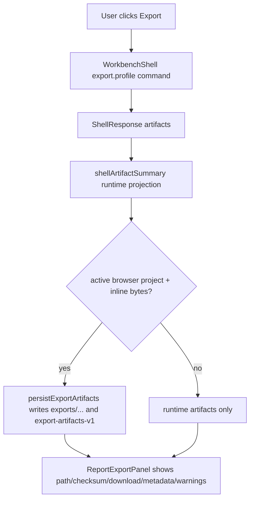

# web-report-export-verification design

## 0. 术语约定

| 术语 | 定义 | 防冲突结论 |
|---|---|---|
| Web Report Export Verification | Web Report Export Panel 的单测、E2E 和浏览器验证闭环 | 只验证 Web 对 Shell artifact 的投影和持久化，不生成导出 bytes |
| Inline Download Contract | `ShellArtifact.bytes_base64` 转为 data URL 和 `download={basename}.{format}` | 当前已有 download link，本 feature 补 MIME / format 覆盖和 E2E 证据 |
| Browser Export Persistence Contract | active browser project 下把 inline artifact 写到 `exports/...`，并更新 `export-artifacts-v1` | 当前已有 persistence helper，本 feature 固定 checksum、metadata 和 unsupported/no-bytes 边界 |
| Local HTTP Export Smoke | 通过真实 Python local bridge 执行 `export.profile` 的 Web E2E | 当前已有 local-http E2E，本 feature 补 CDXML/XLSX metadata 断言和可视证据 |

术语 grep 结论：现有 `ReportExportPanel`、`exportArtifactPersistence`、`WorkbenchShell`、`workbench-journey.spec.ts` 和 `local-http-bridge.spec.ts` 已覆盖核心路径；缺口集中在 metadata 细粒度、format/MIME guard、unsupported artifact persistence guard 和验收证据归档。

## 1. 决策与约束

### 需求摘要

本 feature 目标是把 Web Report Export Panel 的导出流程从“已有测试覆盖”收口为 roadmap 级验收：

1. Fixture 模式下 PNG/CDXML/XLSX artifact 均显示、可下载、带 metadata/warnings。
2. Active browser project 存在时，inline artifact 写入 `exports/{basename}.{format}`，并更新 `export-artifacts-v1` 和 checksum。
3. include bytes 关闭时只展示 runtime artifacts，不出现 download link，也不写 browser-local exports。
4. browser persistence 失败时保留 runtime artifacts 和 download link，并显示 warning。
5. local-http 模式下真实 Python bridge 返回 writer metadata，Web 仍完成 persisted checksum / download 展示。
6. 窄屏布局下 Report Export Panel 可见、按钮可操作、无水平溢出。

明确不做：

- 不在 Web 前端生成 PNG/CDXML/XLSX bytes。
- 不新增 CSV/CDX/PDF/PPTX/SVG 或报告预览。
- 不修改 Python ReportExportService 的导出语义。
- 不引入云存储、账号、File System Access API、OPFS 或自动保存。
- 不把 Playwright report、trace 或 screenshot 纳入版本控制。

### 复杂度档位

验证型小 feature。偏离点：

- 涉及真实浏览器和 local-http bridge，需要跑 `web` Vitest、fixture E2E、local-http E2E，并用 Browser plugin 对当前页面做手工 smoke。
- 若发现视觉/交互缺陷，优先修目标 panel 的小问题；不借机改整体 Web 风格。

### 关键决策

1. **以 ShellArtifact projection 为边界**：Web 只消费 shell 返回的 artifact id/format/bytes_base64/metadata/warnings。
2. **测试优先补缺口**：现有实现基本完整，先补 format/MIME、metadata、unsupported persistence 的测试，再跑 E2E。
3. **local-http 只做 smoke**：验证真实 writer id、persisted path、checksum 和 download link，不复制 fixture 全矩阵。
4. **浏览器验证只看 Web surface**：确认页面非空、无 overlay、console clean、桌面/窄屏 export flow 可操作。

## 2. 名词与编排

### 2.1 名词层：值对象 / 实体 / 接口契约

**现状**：

- `ShellArtifact` 已包含 `id`、`format`、`path`、`bytes_base64`、`metadata`。
- `WorkbenchArtifactSummary` 已包含 `persisted`、`checksum`、`has_inline_bytes`。
- `ReportExportPanel` 展示 format、id、path、inline bytes、persisted、checksum、metadata 和 download link。
- `exportArtifactPersistence` 支持 PNG/CDXML/XLSX inline bytes 写入 Browser Project Repository。

**变化**：

- Fixture artifact metadata 增加 report export 质量路线需要的 CDXML/XLSX metadata fixture：CDXML writer id、XLSX energy table schema version/column count、warnings guard。
- Unit tests 固定 `ReportExportPanel` 的 PNG/CDXML/XLSX download link、CDXML MIME、XLSX metadata、include-bytes-off 和 persistence failure 行为。
- Persistence tests 补 unsupported artifact format 不写 `exports/...` / 不写 record。
- E2E helpers 补 metadata 断言：fixture 和 local-http 都检查 writer id、persisted path、checksum、download count；local-http 检查真实 writer ids。

### 2.2 编排层：主流程与控制流

**现状**：

Flow 已存在，测试覆盖分散在 `WorkbenchShell.test.tsx`、`exportArtifactPersistence.test.ts`、`workbench-journey.spec.ts` 和 `local-http-bridge.spec.ts`。

**变化**：

- 把 roadmap 关心的 output evidence 固定为测试断言和浏览器验证记录。
- Browser project persistence 的 skip/error cases 留在 helper 单测和 WorkbenchShell 单测，不推到 E2E 里重复跑。
- E2E 继续使用 fixture/local-http 两条路径，分别验证 mock projection 和真实 Python writer projection。

**跨层纪律**：

- 错误语义：browser persistence failure 只生成 warning，不吞掉 runtime artifacts。
- 幂等性：重复导出同 basename/path 覆盖同一 `exports/...` object 和 record，不创建重复 record。
- 扩展点：新增 CSV/CDX 必须先改 core Shell / artifact persistence / Web enum，不在本 feature 打开。
- 可观测点：DOM text、download link、checksum、writer_id、warning code、Playwright screenshot 和 console issues。

### 2.3 挂载点清单

- `web/src/shell/fixtureTransport.ts` fixture export metadata / warnings projection。
- `web/src/app/ReportExportPanel.tsx` artifact display / download MIME surface（必要时小修）。
- `web/src/app/exportArtifactPersistence.ts` persistence guard tests。
- `web/src/app/WorkbenchShell.test.tsx` report export panel behavior tests。
- `web/e2e/workbench-journey.spec.ts`、`web/e2e/local-http-bridge.spec.ts` 和 helpers 的 E2E export assertions。

### 2.4 推进策略

1. **Fixture metadata and unit guards**：补 fixture artifact metadata、download/MIME、metadata、unsupported persistence 单测。
   - 退出信号：`npm run test -- ReportExportPanel/WorkbenchShell/exportArtifactPersistence` 相关测试通过。
2. **E2E export assertions**：补 fixture/local-http E2E 的 report export metadata、checksum、download 和 warning 断言。
   - 退出信号：`npm run test:e2e` 和 `npm run test:e2e:local-http` 通过。
3. **Rendered browser QA**：用 Browser plugin 打开当前 dev server，验证桌面和窄屏 export surface 非空、无 overlay、console clean、可点击导出。
   - 退出信号：浏览器 DOM/截图/交互证据通过。
4. **Scope validation**：跑 Web build/test 和 YAML 校验，确认未新增格式/存储能力。
   - 退出信号：`npm run build`、`npm run test`、YAML 通过；grep 确认无 CSV/CDX/Web bytes writer/cloud storage。

## 3. 验收契约

### 关键场景清单

1. Fixture `export.profile` 后 Report Export Panel 显示 PNG/CDXML/XLSX 三个 artifact、3 个 download link、writer metadata 和 `chemdraw_cdxml_only` warning。
2. CDXML download link 使用 `chemical/x-cdxml` data URL，XLSX download link 使用 spreadsheet MIME。
3. Active browser project + inline bytes 时，三种 artifact 写入 `exports/rxnflow-profile.{format}`，显示 `persisted=yes` 和 sha256 checksum，并更新 `export-artifacts-v1`。
4. include bytes 关闭时，没有 download link，不写 browser-local exports，`export-artifacts-v1` 保持空。
5. persistence failure 时 runtime artifacts 和 download link 仍可见，并显示 `artifact_persistence_failed` warning。
6. unsupported artifact format 不写入 Browser Project Repository，不写 export artifact record，并返回 unsupported warning/error projection。
7. local-http E2E 显示真实 writer ids：`pillow-energy-plot-v1`、`rxnflow-cdxml-energy-v1`、`xlsxwriter-energy-workbook-v1`，并显示 persisted path/checksum/download。
8. 窄屏 E2E 中 Report Export Panel 可见、Export 可点击、3 个 download link 可见，无水平溢出。
9. Browser 验证桌面/窄屏页面非空，无 Vite overlay，无相关 console error/warn，export interaction 后 artifact cards 可见。

### 明确不做的反向核对项

- 不新增 CSV/CDX 等 Web export format。
- 不在 Web 前端生成 PNG/CDXML/XLSX bytes。
- 不调用云存储、账号、OPFS、File System Access API 或自动保存。
- 不修改 Python core export writer。
- 不把测试截图/report/trace 加入版本控制。

## 4. 与项目级架构文档的关系

- architecture 归并：验收时更新 Web Workbench / ARCHITECTURE 的 Report Export Panel QA 现状，记录 fixture/local-http E2E 和 browser-local artifact persistence 验证。
- requirement 回写：`web-workbench-shell` 已存在，若验收发现用户可见边界变化则更新；否则说明未变。
- roadmap 回写：验收通过后把 `web-report-export-verification` 标为 done。
