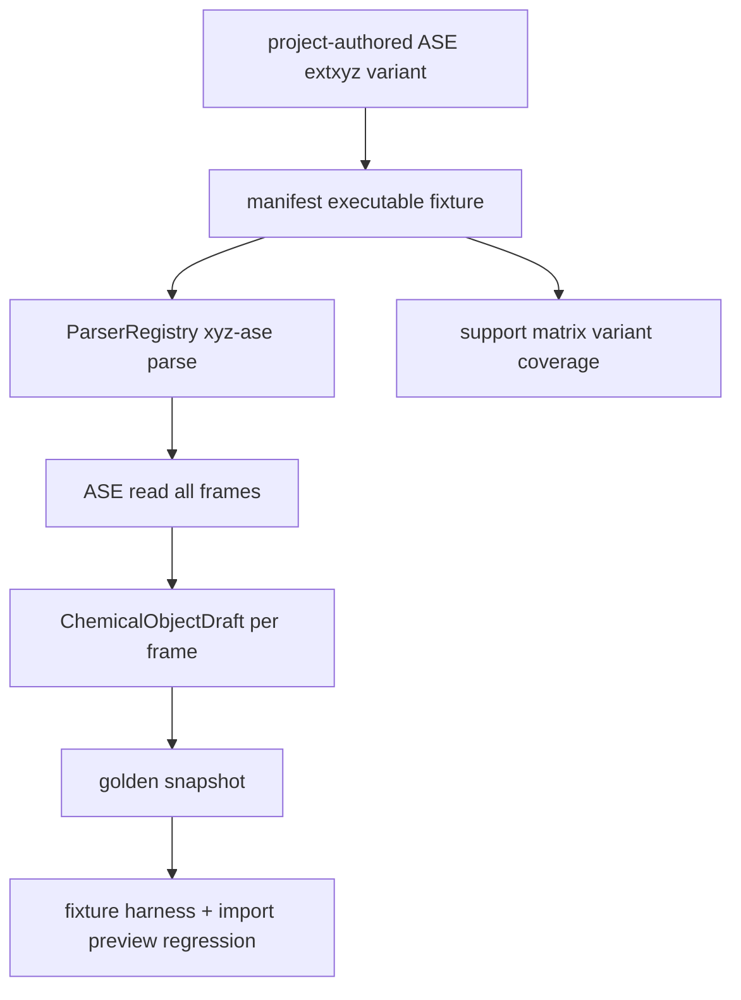

# ase-extxyz-real-variant-fixtures design

## 0. 术语约定

| 术语 | 定义 | 防冲突结论 |
|---|---|---|
| ASE extxyz Variant Fixture | 项目内手写、符合 ASE extxyz 语义的小型 fixture，用于覆盖真实语法变体 | `source.kind=synthetic`，不表示外部数据集已 vendor |
| Multi-frame Extxyz Fixture | 一个 `.xyz` 文件内包含多个 extxyz frame，验证 `index=":"` 全帧解析 | 只生成多个 `ChemicalObjectDraft`，不生成路径或反应拓扑 |
| Calculator Energy Fallback | ASE 读入 extxyz 后 energy 可能落在 `atoms.calc.results["energy"]`，parser 在 `atoms.info["energy"]` 缺失时读取该位置 | 当前 adapter 已有 fallback，本 feature 固定回归证据 |
| Extxyz Unit Assumption | RxnFlow 把 extxyz energy 按 ASE eV 语义转为 Hartree，并记录 `unit_assumed` warning | 不新增显式 unit 字段解析 |

## 1. 决策与约束

### 需求摘要

本 feature 目标是推进 roadmap 中 ASE extxyz 语法变体覆盖：

1. 复用现有 `ase-extxyz-project-authored` source inventory，不引入第三方 extxyz 数据集。
2. 新增项目内多帧 extxyz fixture，覆盖 frame label、metadata、charge、`spin` / `spin_multiplicity`、calculator energy fallback、missing energy 和 warning 聚合。
3. 更新 manifest、source inventory、support matrix、golden snapshot、parser fixture harness 和 import preview scope guard。
4. 明确 extxyz energy 当前按 eV 转 Hartree，missing energy 只产生 warning 和空 energy map。

明确不做：

- 不 vendor 外部 extxyz 数据集或 ASE 文档样例原文。
- 不新增 runtime parser API、Project Store、ImportRegistryWorkflow、Platform Shell、ReactionGraph、EnergyProfile、Report Export 或 Web UI 改动。
- 不生成 ReactionPath、direction/topology、TS candidate 或 energy profile。
- 不解析 stress、forces、magmoms、lattice/PBC 深语义、calculator name、method、thermochemistry 或显式 energy unit。
- 不改变 extxyz energy 的单位假设；继续按 eV 转 Hartree 并记录 `unit_assumed`。

### 复杂度档位

测试侧 fixture corpus feature。偏离点：

- roadmap 原文写“真实 extxyz 变体”，但为避免许可证/体积/隐私风险，本 feature 用项目自写小型 fixture 模拟 ASE 实际读写形状。
- 当前已有单帧 energy 和 missing energy fixture；本 feature 增加组合型多帧覆盖，不替换旧 fixture。
- 如现有 `rxnflow.parsers.xyz` 能解析新增 fixture，不改 runtime parser。

### 关键决策

1. **project-authored source**：source inventory 继续使用 `ase-extxyz-project-authored`，新增文件按 `fixture_policy=vendored` 登记。
2. **calculator fallback 固定**：snapshot 必须证明至少一个 frame 在 `atoms.info` 不含 energy 时仍由 `atoms.calc.results` 得到 electronic energy。
3. **warning 不去重**：多帧中每个有 energy 的 frame 产生 `unit_assumed`，missing frame 产生 `missing_section`；snapshot 固定排序后的 warning code 列表。
4. **no runtime fork**：除非测试暴露缺口，否则不修改 `rxnflow.parsers.xyz`。

## 2. 名词与编排

### 2.1 名词层：值对象 / 实体 / 接口契约

**现状**：

- `rxnflow.parsers.xyz._parse_extxyz` 使用 ASE `read(..., index=":")` 读取所有 frames。
- `_extxyz_energy` 优先读 `atoms.info["energy"]`，缺失时读 `atoms.calc.results["energy"]`，将 eV 转 Hartree 并追加 `unit_assumed`。
- `manifest.yaml` 已有 `extxyz-h2-energy-charge-spin` 和 `extxyz-h2-missing-energy` 两个单帧 fixtures。
- `support-matrix.yaml` 只有单帧 synthetic coverage。

**变化**：

- 新增 `extxyz-multiframe-metadata-calculator-energy` fixture，包含三个 frame：
  - frame 0：`label=co-calc-energy`、`charge=0`、`spin_multiplicity=1`、calculator energy `-14.25 eV`。
  - frame 1：`label=h2-spin-metadata`、`charge=0`、`spin=1`、energy `-1.1 eV`。
  - frame 2：`label=he-missing-energy`，无 energy metadata。
- 新增对应 `parser-golden-v1` snapshot，固定 object_count=3、labels、charge/spin、geometry sample、Hartree energy、empty energy map 和 warning codes。
- 更新 source inventory 和 support matrix，把 extxyz entry 从单帧 synthetic 扩展到 multi-frame / calculator-energy variant coverage。

接口示例：

```python
RawFile(name="extxyz-multiframe-metadata-calculator-energy.xyz")
ParserRegistry.default().parse(...)
# => ParseResult(
#      objects=(
#        ChemicalObjectDraft(label="co-calc-energy", energies={"electronic": EnergyValue(-14.25 * EV_TO_HARTREE, "hartree", ...)}),
#        ChemicalObjectDraft(label="h2-spin-metadata", spin_multiplicity=1, ...),
#        ChemicalObjectDraft(label="he-missing-energy", energies={}),
#      ),
#      warnings=("missing_section", "unit_assumed", "unit_assumed"),
#    )
```

### 2.2 编排层：主流程与控制流



**跨层纪律**：

- 错误语义：missing energy 保持 `missing_section` warning，不补 0，不把 parse 变失败。
- 单位语义：extxyz energy 继续按 eV 转 Hartree，每个有 energy 的 frame 产生 `unit_assumed`。
- 幂等性：测试只读仓库内 fixture，不访问 ASE 官网、外部 repo 或用户本机数据。
- 扩展点：未来如需 forces/stress/lattice/magmoms/method，另起 feature 扩展 `ChemicalObjectDraft` 或 parser contract。
- 可观测点：snapshot、support matrix fixture ids、source inventory size/hash、focused/full tests。

### 2.3 挂载点清单

- `tests/fixtures/parsers/files/extxyz/` 的新增 project-authored extxyz variant input。
- `tests/fixtures/parsers/manifest.yaml`、`sources.yaml` 和 `snapshots/*.json` 的 fixture/source/snapshot entries。
- `tests/fixtures/parsers/support-matrix.yaml` 的 `ase-extxyz-synthetic` entry。
- `tests/test_parser_fixture_harness.py` / `tests/test_import_preview_parser_regression.py` 的 fixture count、source count、snapshot assertions 和 scope guard。
- `docs/dev/parser-fixture-corpus.md`、architecture 和 roadmap 的 extxyz coverage 描述。

### 2.4 推进策略

1. **Design and roadmap gate**：落 design/checklist，把 roadmap item 标为 in-progress。
   - 退出信号：feature doc、checklist 和 roadmap YAML 通过。
2. **Variant fixture and snapshot**：新增多帧 extxyz fixture、manifest/source entries 和 golden snapshot。
   - 退出信号：fixture harness 可解析 3 个 frames，并固定 calculator energy fallback、metadata 和 warnings。
3. **Support matrix and regression tests**：更新 support matrix、parser harness assertions、import preview scope guard。
   - 退出信号：focused parser fixture harness 与 import preview regression 通过。
4. **Docs, architecture and acceptance**：回写 docs/architecture/roadmap，补验收报告并跑全量验证。
   - 退出信号：checks 全 passed，roadmap item done，YAML/focused/full tests 通过。

## 3. 验收契约

### 关键场景清单

1. `manifest.yaml` 包含 `extxyz-multiframe-metadata-calculator-energy` executable fixture。
2. 新增 fixture 的 `source.kind` 是 `synthetic`，source inventory file policy 是 `vendored`。
3. 新增 fixture 解析成功，`object_count=3`。
4. frame 0 固定 calculator energy fallback：label、charge、spin_multiplicity、C/O geometry 和 `-14.25 eV` 转 Hartree。
5. frame 1 固定 metadata 变体：`spin` 映射到 `spin_multiplicity=1`，H/H geometry 和 `-1.1 eV` 转 Hartree。
6. frame 2 固定 missing energy：空 `energies`，产生 `missing_section`。
7. 新增 fixture warning codes 包含两个 `unit_assumed` 和一个 `missing_section`。
8. support matrix 的 ASE extxyz entry 包含新 fixture，tasks/known_limits 覆盖 multi-frame、metadata、calculator energy、missing energy 和 unit assumption。
9. import preview parser regression scope guard 包含新增 fixture，并保持 preview-only 不登记 ChemicalObject。
10. docs/architecture 明确这是 project-authored extxyz variant coverage，不声明外部 extxyz 数据集已 vendor 或真实版本完整支持。

### 明确不做的反向核对项

- 不复制外部 extxyz 数据集或 ASE 文档样例原文。
- 不修改 ImportRegistryWorkflow、Platform Shell、ReactionGraph、EnergyProfile、Report Export 或 Web UI。
- 不生成 ReactionPath、direction/topology、TS candidate 或 energy profile。
- 不解析 forces、stress、magmoms、lattice/PBC 深语义、calculator name、method、thermochemistry 或显式 energy unit。
- 不改变 extxyz energy 按 eV 转 Hartree并记录 `unit_assumed` 的行为。

## 4. 与项目级架构文档的关系

- architecture 归并：更新 Parser Fixture Corpus 当前覆盖，说明 ASE extxyz 已覆盖单帧和多帧 project-authored variants，含 calculator energy fallback 和 missing energy warning。
- guide 回写：补 ASE extxyz project-authored variant 维护规则。
- roadmap 回写：验收通过后把 `ase-extxyz-real-variant-fixtures` 标为 done，并在主文档备注“project-authored variant coverage”。
