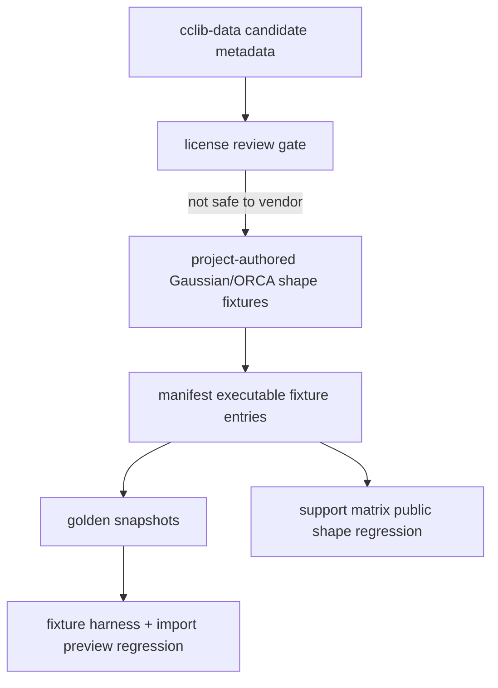

# cclib-public-gaussian-orca-fixtures design

## 0. 术语约定

| 术语 | 定义 | 防冲突结论 |
|---|---|---|
| cclib-data Candidate | `sources.yaml` 中登记的 cclib-data Gaussian/ORCA 候选文件 id | 仍不是 vendored fixture |
| cclib Public Shape Regression | support matrix 中把 cclib-data candidate ids 与项目内 executable fixtures 连接起来的 partial entry | 不声明 public 原文件已 vendor |
| Gaussian Synthetic-derived Shape Fixture | 项目内手写 Gaussian-like log，覆盖 cclib adapter 所需 marker、charge/spin、geometry、method、SCF energy 形状 | `source.kind=synthetic` |
| ORCA Synthetic-derived Shape Fixture | 项目内手写 ORCA-like output，覆盖 cclib adapter 所需 marker、charge/spin、geometry、method、SCF energy 形状 | `source.kind=synthetic` |

## 1. 决策与约束

### 需求摘要

本 feature 目标是推进 roadmap 中 Gaussian/ORCA 公开样例兼容性证据，但不越过 cclib-data license 边界：

1. 复核 cclib-data source inventory：Gaussian16 water / CO-PBE、ORCA 5.0 / ORCA 6.0 是 candidate，但 source license 当前是 `not-declared-in-sparse-checkout`、`review-required`。
2. 网络复核记录 commit 上 `LICENSE` raw 404，GitHub license API 404；README 只说明这是 cclib regression logfiles，不足以直接 vendor 原始文件。
3. 新增项目内 Gaussian/ORCA synthetic-derived shape fixtures，覆盖 cclib adapter 投影字段：method、charge、spin multiplicity、geometry、electronic energy。
4. 更新 support matrix，把 cclib-data candidate ids 和 synthetic-derived fixtures 关联，明确 public originals 未 vendor，adapter 投影由项目内 fixtures 验证。

明确不做：

- 不复制 cclib-data 原始 Gaussian/ORCA log/output 文件进 `tests/fixtures/parsers/files/`。
- 不把 cclib-data source policy 改成 allowed/vendored。
- 不新增 vendored-third-party manifest source。
- 不复制或改写 cclib parser 逻辑；继续通过 cclib backend/adapter 投影。
- 不支持 thermochemistry、frequency、NBO、SCF convergence 细节、basis function 统计或完整 job metadata。
- 不修改 ImportRegistryWorkflow、Platform Shell、ReactionGraph、EnergyProfile、Report Export 或 Web UI。

### 复杂度档位

测试侧 fixture corpus feature。偏离点：

- roadmap 原始措辞是“公开样例”，但 cclib-data license 证据不足；本 feature 采用 synthetic-derived fallback。
- 当前已有 synthetic Gaussian/ORCA baseline；本 feature 要新增 public-candidate-linked shape regression，而不是替换旧 baseline。
- 需要避免把 cclib-data candidate source link 写成已 vendor 或已解析真实文件。

### 关键决策

1. **license gate 优先**：cclib-data 原始文件保持 candidate/reference-only，不进入 executable fixtures。
2. **adapter projection 固定**：新增 fixtures 只验证 RxnFlow cclib adapter 的稳定投影，不评估 cclib 自身 parser 覆盖率。
3. **method/charge/spin/energy 必须显式**：snapshot 必须锁定 method、charge、spin_multiplicity、geometry sample、hartree energy 和 empty thermochemistry。
4. **no runtime fork**：如现有 cclib adapter 可解析新增 fixtures，不改 runtime parser。

## 2. 名词与编排

### 2.1 名词层：值对象 / 实体 / 接口契约

**现状**：

- `rxnflow.parsers.cclib_adapter` 输出单个 `ChemicalObjectDraft`，字段来自 cclib data：`charge`、`mult`、`metadata` method、last geometry、last `scfenergies` converted from eV to hartree。
- `manifest.yaml` 已有 `gaussian-sp-water-synthetic-minimal` 和 `orca-sp-water-synthetic-minimal` baseline fixtures。
- `sources.yaml` 里 cclib-data candidate ids 尚未进入 executable corpus。
- `support-matrix.yaml` 的 Gaussian/ORCA entries 目前只声明 synthetic coverage。

**变化**：

- 新增 `gaussian-sp-public-shape-synthetic-derived` fixture，固定 Gaussian cclib adapter 的 public-candidate-like projection。
- 新增 `orca-sp-public-shape-synthetic-derived` fixture，固定 ORCA cclib adapter 的 public-candidate-like projection。
- 新增对应 `parser-golden-v1` snapshots。
- 更新 Gaussian/ORCA support matrix entries：`source_ids=[cclib-data-gaussian-orca]`，`candidate_file_ids` 链接对应 cclib-data candidate，`fixture_ids` 同时包含 baseline synthetic 和 public-shape synthetic-derived fixtures，known_limits 明确 public originals 未 vendor。

接口示例：

```python
RawFile(name="gaussian-sp-public-shape-synthetic-derived.log")
ParserRegistry.default().parse(...)
# => ChemicalObjectDraft(
#      method="PBE",
#      charge=0,
#      spin_multiplicity=1,
#      geometry=(Atom3D(...), ...),
#      energies={"electronic": EnergyValue(..., "hartree", "cclib scfenergies converted from eV")},
#    )
```

### 2.2 编排层：主流程与控制流



**跨层纪律**：

- 错误语义：public originals 保持 candidate，不进入 `fixture_ids`；support matrix known_limits 说明 fallback。
- 幂等性：测试只读仓库内 fixtures，不访问网络或外部 clone。
- 扩展点：未来若确认 cclib-data license 允许再分发，可另起 feature 将单个 candidate 升级为 `vendored-third-party`。
- 可观测点：snapshot 字段、support matrix source/candidate links、no-vendor grep guard、focused/full tests。

### 2.3 挂载点清单

- `tests/fixtures/parsers/files/gaussian/` 与 `tests/fixtures/parsers/files/orca/` 的新增 synthetic-derived input files。
- `tests/fixtures/parsers/manifest.yaml` 与 `snapshots/*.json` 的 executable fixture entries。
- `tests/fixtures/parsers/support-matrix.yaml` 的 Gaussian/ORCA cclib entries。
- `tests/test_parser_fixture_harness.py` / `tests/test_import_preview_parser_regression.py` 的 fixture count、scope guard、snapshot assertions 和 no-vendor guards。
- `docs/dev/parser-fixture-corpus.md`、architecture 和 roadmap 的 cclib-data source policy 描述。

### 2.4 推进策略

1. **Design and roadmap gate**：落 design/checklist，把 roadmap item 标为 in-progress，记录 cclib-data license fallback 决策。
   - 退出信号：feature doc、checklist 和 roadmap YAML 通过。
2. **Synthetic-derived cclib fixtures**：新增 Gaussian/ORCA public-shape fixtures、manifest entries 和 snapshots。
   - 退出信号：fixture harness 能加载并解析新增 fixtures，method/charge/spin/energy 字段稳定。
3. **Support matrix and regression tests**：更新 support matrix source/candidate links、harness assertions、import preview scope guard 和 no-vendor guard。
   - 退出信号：focused parser fixture harness 与 import preview regression 通过。
4. **Docs, architecture and acceptance**：回写 docs/architecture/roadmap，补验收报告并跑全量验证。
   - 退出信号：checks 全 passed，roadmap item done，YAML/focused/full tests 通过。

## 3. 验收契约

### 关键场景清单

1. `manifest.yaml` 包含两个新增 Gaussian/ORCA synthetic-derived executable fixtures。
2. 新增 fixtures 的 `source.kind` 是 `synthetic`，不是 `vendored-third-party`。
3. Gaussian public-shape fixture 能解析出 method、charge、spin、geometry、hartree electronic energy。
4. ORCA public-shape fixture 能解析出 method、charge、spin、geometry、hartree electronic energy。
5. Gaussian/ORCA support matrix entries 链接 `cclib-data-gaussian-orca` source id 和对应 candidate file ids。
6. cclib-data source inventory 仍为 `redistributable_default: review-required`，candidate files 不进入 manifest source。
7. import preview parser regression 覆盖新增 executable fixtures，并保持 preview-only 不登记 ChemicalObject。
8. `tests/fixtures/parsers/files/gaussian` 和 `files/orca` 不包含 cclib-data 原始文件路径、repo marker、license/proprietary/private path 等 vendor 风险文本。
9. docs/architecture 明确这是 synthetic-derived shape coverage，不是 cclib-data 原文件已 vendor 或真实版本完整支持。

### 明确不做的反向核对项

- 不复制 cclib-data public example 原文件。
- 不把 cclib-data source inventory policy 改成 allowed/vendored。
- 不新增 vendored-third-party manifest source。
- 不修改 cclib adapter runtime、ImportRegistryWorkflow、Platform Shell、ReactionGraph、EnergyProfile、Report Export 或 Web UI。
- 不声明 thermochemistry、frequency、NBO、SCF convergence、basis statistics 或完整 job metadata 支持。

## 4. 与项目级架构文档的关系

- architecture 归并：更新 Parser Fixture Corpus 当前覆盖，说明 Gaussian/ORCA public-shape synthetic-derived fixtures 已进入 executable corpus，但 cclib-data originals 仍未 vendor。
- guide 回写：补 cclib-data license gate 和 synthetic-derived fallback 规则。
- roadmap 回写：验收通过后把 `cclib-public-gaussian-orca-fixtures` 标为 done，并在主文档备注“采用 synthetic-derived fallback”。
