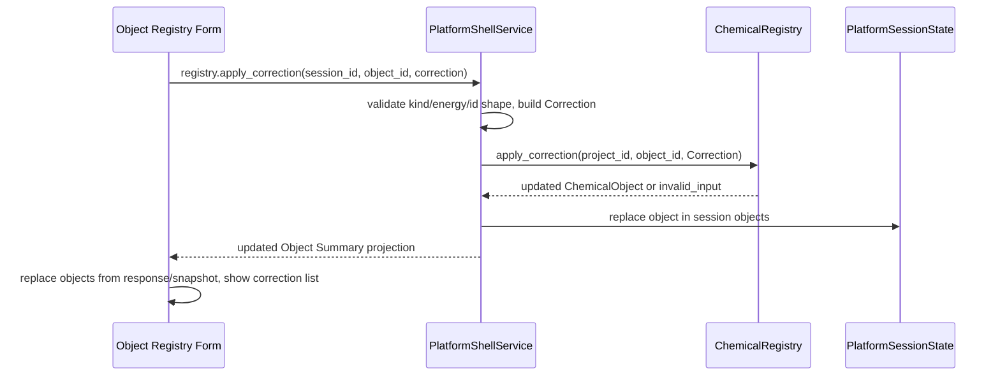

# Correction Command And UI

## 0. 术语约定

- **Registry Apply Correction Command**：Platform Shell 命令 `registry.apply_correction`，把结构化 correction payload 追加到项目内已登记 ChemicalObject。
- **Correction Entry Form**：Web Object Registry Panel 中面向 active object 的校正项输入表单，只提交 Shell command，不直接修改前端对象状态。
- **Correction Summary Projection**：Object Summary 中面向 Web 扫描的 correction 明细投影，至少包含 id、kind、energy、created_at、note。
- **Append-only Correction**：校正项只追加到 `ChemicalObject.corrections`，不重写 `ChemicalObject.energies`、`thermochemistry` 或 parser provenance。

## 1. 决策与约束

### 需求摘要

本 feature 要把已有 `ChemicalRegistry.apply_correction` 能力暴露到端侧：agent 可以通过 Shell command 给对象追加 `resonance`、`solvation`、`manual` 三类 correction；Web 用户可以在 Object Registry 里选择对象、填写 kind/value/unit/reference/note 并提交，成功后面板用 Shell 返回或 snapshot 刷新显示 correction count 和明细。成功标准是：合法 correction append-only 落入 session objects，重复同 id 同 payload 幂等，重复 id 不同 payload 返回结构化错误，Web 不在本地伪造对象状态，后续 energy.compute include corrections 能消费新增 correction。

### 明确不做

- 不新增 correction policy selector；Energy Profile Panel 仍只暴露 include corrections boolean。
- 不自动生成或推荐谐振/溶剂化校正数值；正负号完全由用户输入的 energy value 表示。
- 不修改 parser 输出、ChemicalObject 原始 energies/thermochemistry、registry fingerprint 或 provenance。
- 不实现 correction 编辑、删除、排序、批量导入或 undo/redo。
- 不自动保存 Project Content；持久化仍由现有 Project Sidebar Save Bridge Session / project.save_content 触发。
- 不把 Web 表单状态写入 Project Content、localStorage、Workspace Snapshot 或 ReactionGraph。

### 复杂度档位

走默认发布库档位：L3 + modules + reasonable + team + stable + tested + validated。偏离点：Web 表单做最小可用输入，不引入表单库或复杂 validation framework；后端 Shell command 是长期契约，必须 JSON-safe、可由 agent 直接调用、错误 target 稳定。

### 关键决策

1. **ChemicalRegistry 仍是唯一写入核心**：Shell command 只解析 payload、构造 `Correction`，然后调用 `ChemicalRegistry.apply_correction`。
2. **Shell 成功后同步 session objects**：返回 updated object summary，并把 `_PlatformSessionState.objects` 中对应对象替换为 registry 返回对象，保证后续 `workbench.snapshot` 和 `energy.compute` 看见新增 correction。
3. **Object Summary 展示 correction 明细**：已有 `correction_count` 继续保留；新增 `corrections` summary 供 Web 列表展示和测试断言。
4. **correction id 可选但最终必有**：payload 未带 id 时，Shell 根据 object_id、kind、energy、reference、note 生成稳定 id；payload 带 id 时保留原值并交给 registry 做幂等/冲突判断。
5. **Web 只信 ShellResponse**：Correction Entry Form submit 成功后通过 `registry.apply_correction` response 或随后的 snapshot 更新 `WorkbenchDomainState.objects`，不本地 append correction。

### 前置依赖

`reaction-node-stoichiometry-contract` 已完成，`EnergyOptions.correction_policy` 也已在 `energy-expression-engine` 中落地。当前功能只依赖 ChemicalRegistry 已有 append-only correction 能力，以及 Platform Shell / Web Workbench 既有 command 编排。

## 2. 名词与编排

### 2.1 名词层：值对象 / 实体 / 接口契约

**现状**

- `Correction` 已包含 `id`、`kind`、`energy`、`created_at` 和 `note`。
- `ChemicalRegistry.apply_correction(project_id, object_id, correction)` 已支持 append-only、同 id 同 payload 幂等、同 id 不同 payload 冲突。
- Platform Shell 尚无 `registry.apply_correction` command；Object Summary 只有 `correction_count`，Web Object Registry 只有 disabled correction entry。

**变化**

- ShellCommandName 新增 `registry.apply_correction`。
- Shell args 遵守 roadmap `RegistryApplyCorrectionArgs`：`session_id`、`object_id`、`correction.kind`、`correction.energy.value/unit/reference`、可选 `correction.id`、可选 `correction.note`。
- Object Summary Projection 新增 `corrections: CorrectionSummary[]`，其中 energy 使用现有 `{value, unit, reference}` shape。
- Web `ObjectRegistryPanel` 新增受控 `CorrectionEntryForm` props：active object、pending 状态、提交回调、错误展示；空对象时仍 disabled。

**接口示例**

```json
{
  "command": "registry.apply_correction",
  "args": {
    "session_id": "session-1",
    "object_id": "object-a",
    "correction": {
      "kind": "solvation",
      "energy": { "value": -2.4, "unit": "kcal_mol", "reference": "SMD CH2Cl2" },
      "note": "1M solvation correction"
    }
  }
}
```

成功 response：

```json
{
  "ok": true,
  "data": {
    "command": "registry.apply_correction",
    "session_id": "session-1",
    "object": {
      "id": "object-a",
      "correction_count": 1,
      "corrections": [
        {
          "id": "corr-object-a-solvation-...",
          "kind": "solvation",
          "energy": { "value": -2.4, "unit": "kcal_mol", "reference": "SMD CH2Cl2" },
          "created_at": "1970-01-01T00:00:00Z",
          "note": "1M solvation correction"
        }
      ]
    }
  }
}
```

### 2.2 编排层：主流程与控制流



**现状**

Platform Shell command handlers 统一先 `_resolve_state`，再调用核心服务并更新 `_PlatformSessionState`。Object Registry Panel 只读 `WorkbenchDomainState.objects`，active object selection 由 `WorkbenchShell` 维护，现有 correction entry 是 disabled button。Fixture transport 维护一份前端测试用 workbench state，可模拟 fixture/session/workspace/energy/export commands。

**变化**

- Shell dispatch 增加 `registry.apply_correction` 分支。
- 后端 payload validation 独立在 platform helper 内完成：kind 不在三类内、energy 非 object、unit/value 非法、object 缺失都返回 `invalid_input` 和稳定 target。
- 命令成功后 `_PlatformSessionState.objects` 替换 updated object；`reaction_graphs`、`workspaces`、`profile`、`artifacts` 不变。
- Web Workbench 增加 `applyCorrection` handler，失败时写入 command status error，成功时只用 response object 更新 domain objects。
- FixtureTransport 增加同名 command，用于前端测试和 fixture runtime 交互演示；local-http 模式自然走真实 Python Shell。

**跨层纪律**

- 错误语义：shape 错误都在 Shell 边界返回 `invalid_input target=correction.*` 或 `object_id`；registry 冲突透传为 `invalid_input target=correction.id`。
- 幂等性：同 id 同 payload 不重复追加；Web 重复 submit 若 payload 完全一致应保持 count 不变。
- 解耦约束：Web 不导入 Python codec，不复制能量计算逻辑；后端 command 不调用 parser、graph patch、export 或 project save。
- 持久化边界：session 内对象更新立即可用于 compute；长期保存仍由现有 Project Content save 机制完成。
- i18n：新增静态表单文案进入 `zh-CN` / `en-US` catalog；Shell error code/message/target 原样显示。

### 2.3 挂载点清单

- Platform Shell command registry：新增 `registry.apply_correction` dispatch、payload parser、response projection。
- Object Summary Projection：新增 `corrections` 明细。
- Web Shell DTO / FixtureTransport：新增 command name、CorrectionSummary 类型和 fixture command 模拟。
- Web Object Registry Panel / WorkbenchShell：启用 correction entry form 并把 submit 编排到 ShellClient。

### 2.4 推进策略

1. 设计与 roadmap 接线：落 design/checklist，并把 roadmap item 标为 in-progress。
   - 退出信号：feature spec 完整，items.yaml 通过校验。
2. Shell command 骨架：实现 `registry.apply_correction` payload validation、Correction 构造、session object 替换和 object summary response。
   - 退出信号：平台单测覆盖合法 append、幂等、冲突、非法 kind/unit/value/object。
3. Web DTO 与 fixture transport：前端类型和 fixture runtime 支持 correction summary / apply command。
   - 退出信号：ShellClient focused tests 覆盖 fixture apply correction 和错误路径。
4. Web Object Registry 表单：实现 correction entry form、提交 handler、i18n、状态更新和错误显示。
   - 退出信号：WorkbenchShell component tests 覆盖添加校正项、重复 id 幂等、失败错误展示和中英文文案。
5. 验证与验收：跑 Python/Web 测试、build、浏览器桌面/窄屏表单 QA，回写 architecture/roadmap 并写 acceptance。
   - 退出信号：所有 checks passed，acceptance report 完成。

## 3. 验收契约

### 关键场景清单

1. Shell `registry.apply_correction` 输入合法 manual/solvation/resonance correction → 返回 updated object summary，session snapshot 的 `correction_count` 和 `corrections` 同步增加。
2. payload 未带 id → Shell 生成稳定 correction id；同 payload 重复提交不重复追加。
3. payload 带同 id 但不同 energy/note/kind → 返回 `invalid_input target=correction.id`，session object 不被部分更新。
4. invalid kind、invalid energy unit、非有限 value、missing object_id/object missing → 返回结构化 `invalid_input`，target 与 roadmap 契约一致。
5. 追加 correction 后再次 `energy.compute(include_corrections=true)` → 能量结果包含新增 correction。
6. Web Object Registry 选择对象后填写表单并提交 → correction count/list 刷新，表单保留可继续追加下一条。
7. Web submit 失败 → Object Registry 不本地伪造 correction，错误 code/message/target 可见。
8. 空对象状态下 correction form 不可提交。

### 明确不做的反向核对项

- 不新增 correction policy selector 或 energy profile policy UI。
- 不实现 correction 编辑、删除、排序、批量导入或 undo/redo。
- 不自动保存 Project Content，不调用 project.save_content。
- 不修改 parser、graph、workspace、export 或 report export 逻辑。
- 不改写 ChemicalObject 原始 energies/thermochemistry/provenance。

## 4. 与项目级架构文档的关系

Acceptance 阶段需要更新 `.codestable/architecture/ARCHITECTURE.md`、`.codestable/architecture/core-platform.md` 和 `.codestable/architecture/web-workbench.md`：

- 名词归并：Registry Apply Correction Command、Correction Summary Projection、Correction Entry Form。
- 动词骨架归并：Shell command 调用 ChemicalRegistry、更新 session objects、Web 只信 ShellResponse。
- 跨层纪律归并：append-only、不自动保存、不本地伪造、不改 parser/graph/export。

不需要新增 requirement；能力属于既有 `web-workbench-shell` 需求下的对象登记与命令式工作台扩展。
