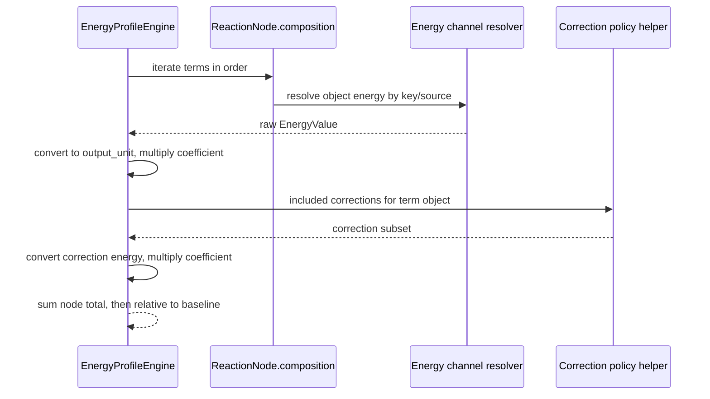

# Energy Expression Engine

## 0. 术语约定

- **Energy Expression Engine**：`EnergyProfileEngine` 内部的节点能量表达式计算口径，输入 graph/object/options，输出节点 total energy 或 missing diagnostics。
- **composition coefficient**：`ReactionNodeCompositionTerm.coefficient`，节点能量计算时乘到对应 object energy 和 included corrections 上。旧节点由 `chemical_object_ids` 自动投影为 coefficient 1。
- **CorrectionPolicy**：EnergyOptions 中的结构化校正项选择策略，支持 `none`、`all`、`kinds` 和 `ids`。本 feature 只落核心计算类型和 engine 读取，不新增 registry command 或 Web 表单。
- **EnergyComponent / CorrectionComponent / EnergyExpression**：roadmap 中定义的 provenance 明细类型。本 feature 不把这些字段写入 `EnergyPoint`，只把数值规则和 missing diagnostics 准备好；完整 profile projection 留给 `energy-profile-provenance-details`。

## 1. 决策与约束

### 需求摘要

本 feature 要让 Energy Engine 真实消费 ReactionNode composition terms：节点总能量从 `sum(object energy)` 改为 `sum(term.coefficient * selected energy)`，并让 correction inclusion 从 boolean 兼容扩展到可解释的 `CorrectionPolicy`。成功标准是：旧单对象/多对象节点保持 coefficient 1 行为；`A + 2B` 节点按 coefficient 计算；重复 object term 按 term 顺序逐项求和；correction policy 可选择 none/all/kinds/ids；missing/ambiguity/source 错误仍结构化返回。

### 明确不做

- 不把 `EnergyExpression` / component 明细写入 `EnergyPoint` 或 Project Content；这留给 `energy-profile-provenance-details`。
- 不新增 `registry.apply_correction` Shell command 或 Web correction form。
- 不新增 Web 节点组成编辑或 energy/correction selector UI。
- 不自动配平反应、不验证元素守恒、电荷守恒或 reaction direction。
- 不修改 parser 输出、ChemicalObject 原始 energy/thermochemistry/correction 存储结构。
- 不升级 `energy-profiles-v1` schema version。

### 复杂度档位

走默认发布库档位：L3 + modules + reasonable + team + stable + tested + validated。偏离点：本轮 provenance 只做内部 diagnostics，不扩展 profile point schema，避免和后续 `energy-profile-provenance-details` 重叠；兼容性要求 backward-compatible，因为旧 graph、旧 profile options 和旧 include_corrections boolean 必须继续可用。

### 关键决策

1. **composition 是 Energy Engine 的权威节点组成**：`ReactionNode.__post_init__` 已把旧 `chemical_object_ids` 投影为 coefficient 1 composition，因此 engine 只遍历 `node.composition`。
2. **term 不合并**：重复 object id 保留 term 顺序逐项计算，数值上自然相加，后续 provenance 才能解释每一项来源。
3. **先转换再乘 coefficient**：每个 selected energy 和 correction energy 先转换到 output_unit，再乘 coefficient，避免不同 unit 混算。
4. **CorrectionPolicy 与 include_corrections 兼容**：`include_corrections=false` 等价 `mode=none`；`true` 且 policy 缺失等价 `mode=all`。
5. **本轮不保存 expression**：数值行为先稳定；profile provenance 投影和持久化字段后续独立 feature 做，避免一次改动过大。

### 前置依赖

`reaction-node-stoichiometry-contract` 和 `energy-channel-catalog` 已完成，composition 与 energy_source resolver 可直接复用。

## 2. 名词与编排

### 2.1 名词层：值对象 / 实体 / 接口契约

**现状**

- `EnergyProfileEngine._node_total_energy` 遍历 `node.chemical_object_ids`，每个 object 隐含 coefficient 1。
- corrections 只有 `include_corrections` boolean，true 时包含 object 上所有 Correction。
- `EnergyOptions` 还没有 `correction_policy` 字段。
- `EnergyPoint` 没有 expression/provenance 字段。

**变化**

- 新增 `CorrectionPolicyMode`、`CorrectionKind`、`CorrectionPolicy` 模型类型。
- `EnergyOptions` 新增 `correction_policy: CorrectionPolicy | None = None`，旧调用保持可用。
- `_node_total_energy` 遍历 `node.composition`，按 coefficient 计算 object energy 和 included correction energy。
- correction inclusion 通过 helper 统一解析：`include_corrections=false` → none；`true + None` → all；`kinds`/`ids` 分别按 kind/id 过滤。
- missing energy details 保留 `object_id`、`energy_key`、`energy_source`、`node_id`；correction unit 错误仍指向 correction id。

**接口示例**

```python
ReactionNode(
    "node-combo",
    "species",
    "A + 2B",
    composition=(
        ReactionNodeCompositionTerm("object-a", 1.0),
        ReactionNodeCompositionTerm("object-b", 2.0),
    ),
)
# output_unit=kcal_mol 时 total = E(A) + 2 * E(B)
```

```python
EnergyOptions(
    output_unit="kcal_mol",
    include_corrections=True,
    energy_key="electronic",
    correction_policy=CorrectionPolicy(mode="kinds", kinds=("solvation",)),
)
# 只把 kind=solvation 的 correction energy 乘以对应 term coefficient 后计入
```

### 2.2 编排层：主流程与控制流



**现状**

Energy Engine 已有 path/baseline/missing point 编排，能区分 baseline missing error 与非 baseline missing point。Energy Channel resolver 已处理 energies/thermochemistry/source ambiguity。Graph layer 已保证 species/transition_state composition 非空、coefficient 非零有限、object id 已登记。

**变化**

- `_node_total_energy` 的 object loop 改成 composition term loop。
- correction filter helper 在每个 term object 下执行，true/all 保持旧行为。
- compute_profile 的 baseline、warning、relative energy 编排不变。
- `compute_fixture_profile` 仍保持 fixture 最小链路，旧 fixture id 和旧单对象行为不变；通用 engine 是正式表达式实现入口。

**跨层纪律**

- 错误语义：composition 缺失走现有 `missing_energy`；source ambiguity 仍是 `ambiguous_energy_channel`；policy shape 错误返回 `invalid_input target=energy_options.correction_policy`。
- 兼容性：旧 `chemical_object_ids` graph 构造后已有 coefficient 1 composition；旧 `EnergyOptions` 无 policy 时不改变行为。
- 顺序约束：composition terms 按输入顺序计算，不合并重复 object id。
- 解耦约束：不调用 parser、registry、workspace、Project Content 或 export；只消费传入 dataclass。
- 可观测点：单测通过 absolute/relative energy、warnings 和错误 details 验证。

### 2.3 挂载点清单

- `EnergyOptions` 模型契约：新增可选 `correction_policy`。
- Energy Engine 节点能量计算：从 `chemical_object_ids` 切换到 `composition` term loop。
- Energy Profile codec：保存/加载可选 `correction_policy` 并兼容旧 JSON。
- Platform Shell / Web DTO：允许 `energy.compute` payload 带 `correction_policy`，profile options projection 可回显 policy。

### 2.4 推进策略

1. 名词骨架：新增 CorrectionPolicy 类型和 EnergyOptions 字段。
   - 退出信号：旧 EnergyOptions constructor 仍通过，新 policy 可表达 none/all/kinds/ids。
2. 计算核心：让 `_node_total_energy` 遍历 composition term 并乘 coefficient。
   - 退出信号：A + 2B、负/小数 coefficient、重复 object term 单测通过。
3. Correction policy：实现 include_corrections 兼容映射和 kinds/ids 过滤。
   - 退出信号：none/all/kinds/ids 单测通过，旧 include_corrections true 行为保持。
4. 持久化 / Shell / Web DTO：codec 与 Shell/Web types 支持可选 correction_policy。
   - 退出信号：profile options round-trip 和 Shell/Web focused tests 通过。
5. 回归测试与验收：跑 focused tests、全量 Python、Web test/build、YAML 校验并回写架构/roadmap。
   - 退出信号：所有验证通过，acceptance report 完成。

## 3. 验收契约

### 关键场景清单

1. 旧 `ReactionNode(chemical_object_ids=["A","B"])` → composition coefficient 1，relative energy 与旧行为一致。
2. `ReactionNode(composition=[A*1, B*2])` → node total 使用 `E(A) + 2E(B)`。
3. composition 含负数或小数 coefficient → 按数值乘到 selected energy。
4. 同一 object id 重复出现 → 每个 term 逐项参与求和，不提前合并。
5. `include_corrections=true` 且 no policy → 所有 corrections 按 term coefficient 计入，保持旧行为。
6. `correction_policy.mode=kinds` → 只计入指定 kind corrections。
7. `correction_policy.mode=ids` → 只计入指定 id corrections。
8. explicit thermochemistry source 与 composition coefficient 可组合计算。
9. baseline 缺失仍返回 error，非 baseline 缺失仍生成 missing point/warning。

### 明确不做的反向核对项

- 不新增 `EnergyPoint.expression` 或 Project Content profile expression 字段。
- 不新增 registry correction command 或 Web correction form。
- 不新增 Web selector UI。
- 不调用 parser/import/workspace/export/project store。
- 不升级 `energy-profiles-v1` schema version。

## 4. 与项目级架构文档的关系

Acceptance 阶段需要更新 `.codestable/architecture/ARCHITECTURE.md` 和 `.codestable/architecture/core-platform.md`：

- 名词归并：CorrectionPolicy 与 EnergyOptions.correction_policy。
- 动词骨架归并：Energy Engine 按 composition coefficient 和 selected channel 计算 node total。
- 跨层纪律归并：旧 chemical_object_ids 通过 composition coefficient 1 兼容；correction policy 与 include_corrections 的映射；本 feature 不落 profile expression 持久化。

不需要更新 requirement；用户可见 Web 控件和表达式明细留给后续 feature。
