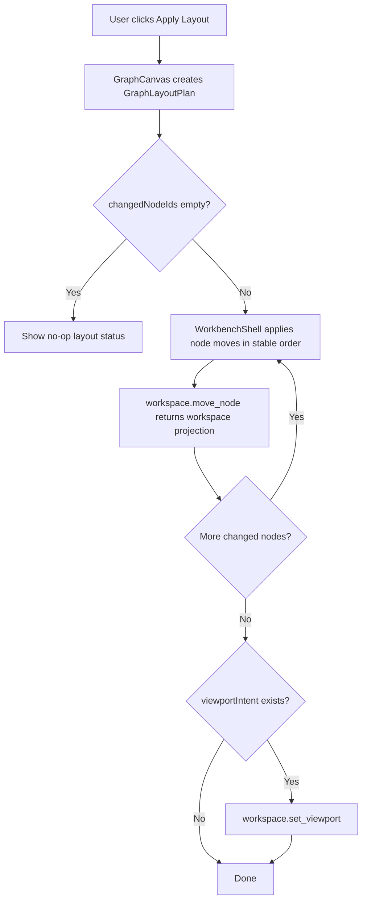

# graph-editor-auto-layout design

## 0. 术语约定

| 术语 | 定义 | 防冲突结论 |
|---|---|---|
| Graph Layout Plan | Web helper 从当前 `GraphSummary` 派生出的布局计划，包含 node positions、changed nodes、可选 viewport intent 和 warnings | 不等同于 GraphPatch、ReactionGraph schema 或 Project Content |
| Layout Strategy | 生成 layout plan 的策略，首轮为 `layered-left-to-right`，必要时 fallback `grid-compact` | 不等同于化学反应路径搜索或能量排序 |
| Apply Layout | 用户点击按钮后把 layout plan 中 changed node positions 逐个提交给 `workspace.move_node` 的编排动作 | 不直接 mutate `WorkbenchDomainState.workspace.graph.nodes` |
| Layout Fit Intent | apply layout 后可选生成的 viewport intent，用于让新布局进入视野 | 复用 `workspace.set_viewport`，不自动保存项目 |

术语 grep 结果：`GraphNodeLayoutPosition`、`graphNodeLayoutBounds`、`workspace.move_node`、`workspace.set_viewport`、`Fit To View` 已存在；当前没有 `GraphLayoutPlan` 或 `auto layout` 实现。历史 feature 明确把 auto layout 留作后续能力。

## 1. 决策与约束

### 需求摘要

本 feature 目标是提供第一版 Web Graph Canvas 自动布局：

1. 用户可在 Graph Canvas 工具区点击 Apply Layout。
2. Web helper 只读取当前 `WorkspaceSummary.graph.nodes/edges/paths`，生成确定性 `GraphLayoutPlan`。
3. Apply Layout 按稳定 node id 顺序逐个调用既有 `workspace.move_node(node_id, position)`。
4. 每个可见 position 更新都以 ShellResponse workspace projection 为准。
5. 若 layout plan 产生 viewport intent，应用完节点位置后可调用 `workspace.set_viewport` 让布局进入当前画布视野。
6. 无节点、单节点、分叉、多 disconnected component 和 cycle 都有稳定 fallback，不报错崩溃。

### 明确不做

- 不新增 Python core layout engine、GraphPatch op、Shell command 或 Project Content schema。
- 不实现自动反应路径搜索、过渡态识别、化学合理性判定、元素/电荷守恒或自动配平。
- 不做 edge rerouting、bezier/orthogonal routing、label collision avoidance 或 node collision avoidance 的复杂算法。
- 不新增 undo/redo/history、localStorage persistence、autosave、cloud sync 或 Browser Project Repository write。
- 不引入第三方 diagramming/canvas/layout 库。
- 不改变 node composition、edge/path 数据、active path、selection、energy profile 或 report export。

### 复杂度档位

- Frontend computation：L2。纯 Web helper，输入 graph summary，输出稳定 layout plan。
- Frontend orchestration：L3。Apply Layout 需要顺序提交多个 `workspace.move_node`，并处理中途失败。
- Shell contract：L1。复用已落地 `workspace.move_node` / `workspace.set_viewport`，不新增命令。
- Persistence：L1。节点位置仍保存为现有 `ReactionNode.position`；长期落盘仍由显式 Save Bridge Session 触发。
- Testability：tested。helper tests、component tests、Web unit/build、Playwright 可覆盖。

### 关键决策

1. **layout helper 放 Web app 层**：首轮 layout 是画布可读性增强，不让 Python core 依赖 UI 坐标假设。
2. **稳定而简单优先**：`layered-left-to-right` 先按 edge direction 做层级，disconnected / cycle fallback 到 id 排序 grid。
3. **ShellResponse authority**：GraphCanvas 只显示 layout applying 状态；最终 node positions 来自每次 move command 的 workspace projection。
4. **顺序提交，不做批量 command**：避免新增 shell contract；中途失败时保留已成功 projection，并显示结构化错误。
5. **Fit 是 viewport intent，不是保存**：layout 后可请求 fit viewport，但不会自动 Save Bridge Session 或写浏览器仓储。

## 2. 名词与编排

### 2.1 名词层：值对象 / 实体 / 接口契约

**现状**：

- `web/src/app/graphNodeLayout.ts` 已有 `GraphNodeLayoutPosition`、`graphNodeLayoutBounds={600,360,20}`、snap/clamp 和 node position fallback。
- `web/src/app/graphViewport.ts` 已有 `fitGraphViewportToNodes`、`resetGraphViewport` 和 viewport clamp/transform helper。
- `GraphCanvas` 已能调用 `onMoveNode({nodeId, position})` 与 `onSetViewport(viewport)`。
- `WorkbenchShell.moveGraphNode` 调用 `workspace.move_node`；`setGraphViewport` 调用 `workspace.set_viewport`。
- 当前没有 layout plan 类型、Apply Layout 按钮或多 node move 编排。

**变化**：

新增 Web helper contract：

```ts
type GraphLayoutStrategy = "layered-left-to-right" | "grid-compact"

type GraphLayoutWarning = {
  code: string
  message: string
  target?: string | null
}

type GraphLayoutPlan = {
  graphId: string
  strategy: GraphLayoutStrategy
  nodePositions: Record<string, [number, number]>
  changedNodeIds: string[]
  viewportIntent?: GraphViewport | null
  warnings: GraphLayoutWarning[]
}
```

核心 helper：

```ts
createGraphLayoutPlan({
  graph,
  viewport,
  fitAfterLayout,
}): GraphLayoutPlan
```

布局语义：

- `layered-left-to-right`：从 edge source/target 派生层级；source 更靠左，target 更靠右；同层按 label/id 稳定排序。
- `grid-compact`：当没有可用 edge 或检测到循环/无法稳定分层时，按 label/id 生成紧凑 grid。
- 所有 position 必须经过 `snapGraphNodeLayoutPosition` 和 `clampGraphNodeLayoutPosition`。
- `changedNodeIds` 只包含目标 position 与当前 `graphNodePosition(node)` 不同的 node。

边界：

- 空 graph 返回 empty plan、`changedNodeIds=[]` 和 `warnings=[]`。
- 单节点可居中或放在稳定 anchor；不报错。
- cycle graph fallback `grid-compact` 并给 warning `layout_cycle_fallback`。
- disconnected components 不报错；按 component 和 id 稳定排布。

### 2.2 编排层：主流程与控制流



**现状**：

- GraphCanvas command bar 已有 Open/Add/Connect/Set Path/Delete 和 viewport controls。
- WorkbenchShell 已有单 node `moveGraphNode` 和 single viewport setter。
- Pending command/error 状态是 WorkbenchShell 统一管理；GraphCanvas 不持久化 command 状态。

**变化**：

- 新增 `graphAutoLayout.ts`，集中 layout plan 生成逻辑和 tests。
- GraphCanvas 新增 Apply Layout 按钮，disabled 条件为没有 session 或没有 graph nodes。
- GraphCanvas 点击按钮时创建 plan，并把 plan 交给 `onApplyAutoLayout(plan)`。
- WorkbenchShell 新增 `applyGraphAutoLayout(plan)`：按 `changedNodeIds` 稳定顺序逐个发送 `workspace.move_node`；每次成功都复用现有 workspace response update。
- 如果任一 move 返回 error，停止后续 moves，显示 shell error；不回滚已成功 moves。
- 全部 move 成功后，若 plan 带 `viewportIntent`，调用 `workspace.set_viewport`。
- Layout warnings 可在 GraphCanvas 中显示为非阻断提示；不进入 ShellResponse 或 Project Content。

**跨层纪律**：

- Command authority：node positions 和 viewport 都必须等待 ShellResponse projection。
- Error semantics：中途失败显示已有 ShellError；layout helper warning 不伪装成 ShellError。
- Idempotence：连续点击 Apply Layout，第二次若 positions 已一致应为 no-op 或只执行 fit，不重复 move。
- Persistence boundary：Apply Layout 不自动保存；用户仍需显式 Save Bridge Session。
- Isolation：layout 不触碰 object registry、import inbox、energy profile、report export、project bundle 或 browser repository。

### 2.3 挂载点清单

- Graph layout helper：新增纯 Web layout plan 计算入口。
- GraphCanvas command bar：新增 Apply Layout 按钮、disabled 状态和 warning/no-op 展示。
- WorkbenchShell graph command orchestration：新增 apply plan 的顺序 move / optional viewport 编排。
- Tests：新增 helper/component/E2E 覆盖自动布局主路径和边界。
- i18n/styles：新增中英文文案和稳定按钮尺寸。

本 feature 不新增 Platform Shell command、Python dataclass、Project Content codec、Browser Project Repository API、localStorage key、第三方 layout library 或 report export format。

### 2.4 推进策略

1. **Layout Plan Helper**：新增 `graphAutoLayout` helper 和单元测试，覆盖 layered、grid fallback、empty/single/disconnected/cycle、snap/clamp、changed node 计算。
   - 退出信号：helper tests 证明同一 graph 输入得到稳定 plan；所有 position 在虚拟画布内且按 grid snap。
2. **Canvas Apply Entry**：GraphCanvas 接入 Apply Layout 按钮、disabled/no-op/warning 显示和 `onApplyAutoLayout(plan)` prop。
   - 退出信号：component test 可点击 Apply Layout，生成 plan；无 session/无 nodes 时按钮不可用或 no-op 状态清晰。
3. **Sequential Move Orchestration**：WorkbenchShell 实现顺序提交 layout plan 的 `workspace.move_node`，成功后可选 `workspace.set_viewport`。
   - 退出信号：component test 看到多个 move command 按稳定顺序发出；ShellResponse 更新后节点位置来自 projection；第二次 Apply 不重复 move。
4. **Verification And Scope Guard**：跑 Web tests/build、必要 Python 单测和浏览器主链路。
   - 退出信号：测试通过；Playwright 或 Browser 验证页面非空白、console clean、Apply Layout 有可观察位置变化；scope grep 未新增 core command/schema、localStorage、third-party layout library 或 autosave。

## 3. 验收契约

### 关键场景清单

1. `createGraphLayoutPlan` 对同一 graph 多次调用返回稳定 `nodePositions` 和 `changedNodeIds`。
2. 无 node graph 返回 empty plan，不抛异常，不发送 `workspace.move_node`。
3. 单节点 graph 生成有限、snap/clamp 后的位置。
4. 有 directed edges 的 graph 使用 `layered-left-to-right` 让 source 层在 target 层左侧。
5. cycle 或无法稳定分层时 fallback `grid-compact`，返回 warning，不阻断 Apply Layout。
6. 所有 layout position 都在 `graphNodeLayoutBounds` 内，并按 grid snap。
7. GraphCanvas Apply Layout disabled / no-op 状态不会误发 move command。
8. Apply Layout 对 changed nodes 按稳定顺序发送 `workspace.move_node`，成功后可见 node position 来自 ShellResponse projection。
9. Apply Layout 第二次点击在节点已处于目标位置时不重复发送 move command。
10. 若 layout plan 带 viewport intent，节点移动成功后才发送 `workspace.set_viewport`。
11. 任一 `workspace.move_node` 失败时停止后续 moves，显示结构化错误，不本地回滚或伪造成功。
12. 不新增 Python core command、GraphPatch op、Project Content schema、Browser Project Repository write、localStorage persistence、autosave 或第三方 layout library。
13. 不改变 node composition、edge/path 数据、active path、selection、energy profile、report export 或 project bundle 行为。
14. `cd web && npm run test -- --run` 通过。
15. `cd web && npm run build` 通过。
16. 需要时 `python3 -m unittest discover` 通过或说明未触碰 Python runtime。
17. 真实浏览器验证页面非空白、无 framework overlay、console error/warn clean；Apply Layout 有可观察位置变化，桌面/窄屏无明显重叠或水平溢出。

### 反向检查

- 不把 layout plan、layout warnings、applying state 或 no-op status 写入 ShellResponse、Project Content、Browser Project Repository 或 localStorage。
- 不让 GraphCanvas 直接 patch `WorkbenchDomainState.workspace.graph.nodes`。
- 不把 auto layout 描述为化学路径搜索、能量排序或自动机理推断。

## 4. 与项目级架构文档的关系

- acceptance 阶段应在 `.codestable/architecture/web-workbench.md` 记录 Graph Canvas 已支持 Web-side auto layout plan 和 Apply Layout 入口，仍通过 `workspace.move_node` / `workspace.set_viewport` projection 生效。
- requirement `web-workbench-shell` 应补充用户可一键整理图谱布局，但仍不自动保存、不做化学合理性判断。
- roadmap acceptance 阶段把 `graph-editor-auto-layout` 标为 `done`，后续 `graph-editor-wheel-minimap` 和 `graph-editor-lightweight-history` 可复用 layout plan / viewport intent。
