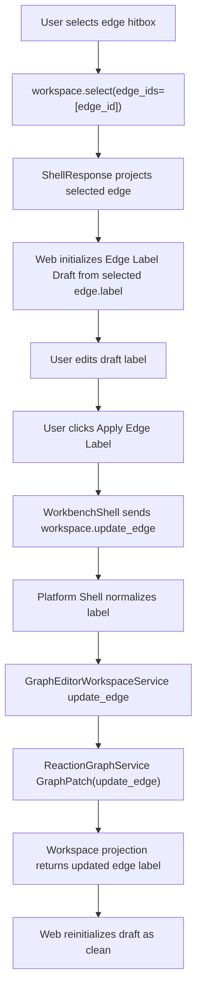

# graph-editor-edge-label-edit design

## 0. 术语约定

| 术语 | 定义 | 防冲突结论 |
|---|---|---|
| Workspace Edge Update Contract | 新增 `workspace.update_edge` shell command，用于更新 graph edge 的 label | 不复用 `workspace.connect`，不新增 `workspace.reconnect_edge` |
| Edge Label Edit | 更新已有 `ReactionEdge.label`，用于标注反应步骤、条件、催化剂或分叉说明 | 不等同于编辑 edge endpoints |
| Edge Label Draft | Web 选中 edge 后在 Graph Canvas 侧区维护的 UI-only label 草稿 | 不进入 ShellResponse、Project Content、Browser Project Repository 或 localStorage |
| Label Normalization | Web / Shell 提交时把空字符串或全空白 label 归一化为 `null` | 避免保存没有语义的空白 label |
| Endpoint Integrity | `workspace.update_edge` 不允许改变 `from_node` / `to_node` | 端点重连留给后续 feature |

术语 grep 结果：`ReactionEdge.label` 已存在；`ReactionGraphService` 已支持 `GraphPatch("update_edge")`，但允许 patch `from_node` / `to_node` / `label` / `metadata`。当前 `GraphEditorWorkspaceService`、Platform Shell、fixture transport 和 Web Shell DTO 还没有 `workspace.update_edge`。Graph Canvas 已有 edge selection、edge hitbox 和 Delete Selected，但未显示或编辑 label。

## 1. 决策与约束

### 需求摘要

本 feature 目标是补齐 selected edge 的 label 编辑闭环：

1. 用户在 Graph Canvas 选中 edge 后，可在 Network Preview 侧区看到 Edge Label Draft。
2. 用户修改 label 时只改 Web UI draft，不立即修改 `WorkbenchDomainState.workspace.graph.edges`。
3. 点击 Apply 后发送 `workspace.update_edge(session_id, edge_id, label)`。
4. 空字符串或全空白 label 归一化为 `null`，表示清空 label。
5. 成功后 Web 只用 ShellResponse workspace projection 刷新 edge label。
6. 命令不改变 `from_node` / `to_node`，不新增或删除 edge/path/node。
7. unknown edge id 返回 `graph_invalid target=edge_id`；缺失 edge id 返回 `invalid_input target=edge_id`；非法 label 返回 `invalid_input target=edge_label`。

### 明确不做

- 不实现 edge endpoint 重连、edge direction 反转、edge type、reaction condition 结构化表单或 metadata 复杂编辑。
- 不改变 `workspace.connect`、`workspace.remove`、`workspace.set_path` 或 node/path delete 语义。
- 不新增 GraphPatch op、Project Content schema、Browser Project Repository write、localStorage persistence、autosave 或第三方图谱库。
- 不让 GraphCanvas 本地 patch edge label；可见 label 必须来自 ShellResponse workspace projection。
- 不更新或删除 EnergyProfile，不重新计算能量，不改变 Report Export。
- 不新增自由绘线手势；它在 `graph-editor-free-edge-drawing` 中复用稳定后的 edge label/update 契约。

### 复杂度档位

- Core contract：L2。`GraphPatch("update_edge")` 已存在，workspace 只需暴露 label-only update method 并限制端点。
- Platform Shell：L2。新增一个薄 command handler，做 label 归一化和 error target 映射。
- Web orchestration：L2。新增 Edge Label Draft 表单，继续等待 ShellResponse projection。
- Persistence：L1。不改 schema；label 已属于 `reaction-graphs-v1` 的 `ReactionEdge` 字段，显式 Save Bridge Session 后自然保存。
- Testability：tested。core workspace、platform shell、fixture transport、component test 和浏览器验证可覆盖。

### 关键决策

1. **新增 `workspace.update_edge`**：edge label 是 update 语义，不适合塞进 `workspace.connect` 或 `workspace.remove`。
2. **workspace 层限制端点**：core `GraphPatch("update_edge")` 能改 endpoints，但本 feature 的 workspace command 只传 label / 可选 metadata，避免 UI 绕开 roadmap 边界。
3. **label 清空用 `null`**：空白字符串没有业务含义，统一在 shell/fixture/Web 归一化。
4. **Edge Label Draft 是 UI-only**：用户输入期间不修改 domain state，也不写持久化。
5. **label 可见性轻量处理**：首轮只在 edge hit target / selected edge detail 中显示 label；不做复杂 label collision avoidance 或 edge routing。

## 2. 名词与编排

### 2.1 名词层：值对象 / 实体 / 接口契约

**现状**：

- `ReactionEdge` 已有 `label: str | None` 和 `metadata`。
- `ReactionGraphService._update_edge` 已支持 `GraphPatch("update_edge", id=edge_id, patch={...})`。
- `GraphEditorWorkspaceService` 当前只有 add/move/remove/select/connect/set_path 等 workspace methods，没有 label-only edge update method。
- Platform Shell `ShellCommandName` 和 `WorkspaceCommandData.command` 当前不包含 `workspace.update_edge`。
- fixture transport 能 render edge label 字段，但没有 update edge command。
- Graph Canvas edge hitbox aria label 只表达 `Edge {source} to {target}`，未展示 label；selected edge 没有 draft UI。

**变化**：

核心 workspace contract：

```python
def update_edge(
    project_id: ID,
    workspace_id: ID,
    edge_id: ID,
    label: str | None,
    metadata: dict[str, Any] | None = None,
) -> Result[WorkspaceSnapshot]
```

Shell command args：

```ts
type WorkspaceUpdateEdgeArgs = {
  session_id: string
  edge_id: string
  label?: string | null
  metadata?: Record<string, JsonValue>
}
```

Web draft shape：

```ts
type EdgeLabelDraft = {
  edgeId: string | null
  label: string
  dirty: boolean
}
```

删除语义之外的稳定规则：

- `label` 缺失且 `metadata` 也缺失时返回 `invalid_input target=edge_label`。
- `label=null` 或空白字符串表示清空 label。
- `metadata` 第一版只允许 JSON object 透传，不在 UI 中编辑；未传 metadata 时保留现有 metadata。
- unknown edge id 返回 `graph_invalid target=edge_id`。
- 更新后 selection 保持 selected edge，除非 ShellResponse projection 中 edge 不存在。

### 2.2 编排层：主流程与控制流



**现状**：

- Edge hitbox click 已调用 `workspace.select(edge_ids=[edgeId])`。
- Delete Selected 已能删除 selected edge。
- `GraphEdgeSummary.label` 类型存在，但 GraphCanvas 没有表单消费它。
- WorkbenchShell 对 node composition 已有 UI draft + Apply + ShellResponse projection 的编排样板。

**变化**：

- 新增 Edge Label Draft 初始化 / reconcile 逻辑：选中 edge 时从 ShellResponse edge label 初始化；workspace projection 更新后若 edge 仍存在则同步 clean draft，若不存在则清空 draft。
- GraphCanvas 在 Network Preview 侧区显示 selected edge detail：edge id、from/to、当前 label 输入、Apply、Reset、清空 label。
- WorkbenchShell 新增 `updateGraphEdgeLabel` 编排函数，提交 `workspace.update_edge` 并用 `applyWorkspaceResponse` 处理结果。
- Platform Shell 新增 `_run_workspace_update_edge` handler，解析 edge_id、label、metadata，归一化 label。
- Fixture transport 新增 `fixtureWorkspaceUpdateEdgeResponse`，保持 fixture runtime 与 Web tests 一致。

**跨层纪律**：

- Command authority：GraphCanvas 不直接 mutate edge label。
- Error semantics：missing edge id 为 `invalid_input target=edge_id`；unknown edge 为 `graph_invalid target=edge_id`；非法 label 为 `invalid_input target=edge_label`。
- Endpoint integrity：Shell command 不接受 from/to 修改，workspace method 不传 endpoint patch。
- Persistence boundary：label 更新不自动保存；显式 Save Bridge Session 后通过既有 Project Content 保存。
- Isolation：edge label edit 不调用 EnergyProfileEngine、ReportExportService、Browser Project Repository、Project Content writer 或 import/object registry。

### 2.3 挂载点清单

- Core workspace edge update contract：`GraphEditorWorkspaceService.update_edge` 用既有 `GraphPatch("update_edge")` 暴露 label-only update。
- Platform Shell command adapter：新增 `workspace.update_edge` args 解析、label normalization 和 error target mapping。
- Fixture transport：fixture `workspace.update_edge` 支持 label update / clear / missing edge。
- GraphCanvas / WorkbenchShell edge label draft orchestration：selected edge 显示 draft，Apply 后只消费 ShellResponse projection。
- Tests：core workspace、platform shell、ShellClient fixture、WorkbenchShell component 和浏览器验证覆盖 edge label edit。

本 feature 不新增 Project Content codec、Browser Project Repository API、localStorage key、third-party UI library、free edge drawing gesture、report/export format 或 energy command。

### 2.4 推进策略

1. **Core Workspace Edge Update Contract**：新增 workspace `update_edge` method，限制只更新 label / 可选 metadata，并补 core workspace tests。
   - 退出信号：label set/clear 成功；unknown edge 返回 `graph_invalid`；from/to 不变化。
2. **Platform Shell And Fixture Contract**：新增 `workspace.update_edge` shell handler、fixture transport command、Shell DTO 类型和 tests。
   - 退出信号：真实 shell 与 fixture 都能 update / clear edge label，错误 target 一致，JSON-safe projection 保持。
3. **Web Edge Label Draft Entry**：GraphCanvas / WorkbenchShell 增加 selected edge draft UI、Apply/Reset/clear 编排和 component tests。
   - 退出信号：选中 edge 后 draft 初始化；编辑不立即改可见 graph；Apply 发送 `workspace.update_edge`，ShellResponse 后 label 可见且 draft clean。
4. **Verification And Scope Guard**：跑 Python 单测、Web tests/build 和浏览器主链路。
   - 退出信号：测试通过；浏览器桌面/窄屏可编辑 edge label、清空 label，无 overlay/console error/水平溢出；scope grep 未新增 endpoint reconnect、schema、autosave、energy/report 变更。

## 3. 验收契约

### 关键场景清单

1. `GraphEditorWorkspaceService.update_edge(edge_id, label="TS search")` 更新 edge label，保持 `from_node` / `to_node` 不变。
2. `update_edge(edge_id, label=None)` 清空 edge label。
3. unknown edge id 返回 `graph_invalid target=edge_id`，state 不变化。
4. Platform Shell `workspace.update_edge` 接受 string label 并返回 `command=workspace.update_edge` 的 workspace projection。
5. Platform Shell 对空字符串 / whitespace label 返回 label 为 `null` 的 projection。
6. Platform Shell 缺失 edge id 返回 `invalid_input target=edge_id`。
7. Platform Shell 非 string / null label 返回 `invalid_input target=edge_label`。
8. fixture transport `workspace.update_edge` 支持 set / clear / missing edge，与真实 shell error target 对齐。
9. Web GraphCanvas 选中 edge 后显示 Edge Label Draft，并从 selected edge label 初始化。
10. Web 修改 draft label 前，edge 可见 label 仍来自旧 ShellResponse projection。
11. Web Apply 后发送 `workspace.update_edge(edge_id, label)`，成功后 edge hitbox / selected edge detail 显示新 label。
12. Web 清空 label 后发送 `label=null` 或空白归一化，成功后 UI 显示无 label。
13. 切换 selected edge 或 edge 被删除后，draft 不保留 stale edge id。
14. 不新增 GraphPatch op、Project Content schema、Browser Project Repository write、localStorage persistence、autosave 或第三方库。
15. 不改变 `workspace.connect`、`workspace.remove`、`workspace.set_path`、node/path delete、EnergyProfile 或 Report Export 行为。
16. `python3 -m unittest discover` 通过。
17. `cd web && npm run test -- --run` 通过。
18. `cd web && npm run build` 通过。
19. 浏览器验证页面非空白、无 framework overlay、console clean；edge label edit 在桌面/窄屏无明显重叠或水平溢出。

### 反向检查

- 不把 edge label edit 做成前端本地 patch `workspace.graph.edges`。
- 不把 edge label edit 扩展成 edge endpoint reconnect、free edge drawing、结构化反应条件编辑或能量 profile 重算。
- 不把 label draft 写入 localStorage、Browser Project Repository 或 Project Content，除非用户显式 Save Bridge Session 保存已投影的 graph state。

## 4. 与项目级架构文档的关系

- acceptance 阶段应更新 `.codestable/architecture/core-platform.md`：记录 `workspace.update_edge` shell command、`GraphEditorWorkspaceService.update_edge` label-only contract、endpoint integrity 和 label normalization。
- acceptance 阶段应更新 `.codestable/architecture/web-workbench.md`：记录 selected edge label draft、Apply/Reset/clear 编排、Web 只等待 ShellResponse projection。
- requirement `web-workbench-shell` 应补充用户可编辑 selected edge label，但仍不自动保存、不做端点重连、不做结构化反应条件编辑。
- roadmap acceptance 阶段把 `graph-editor-edge-label-edit` 标为 `done`；后续 `graph-editor-free-edge-drawing` 可复用稳定后的 edge label/update 语义。
