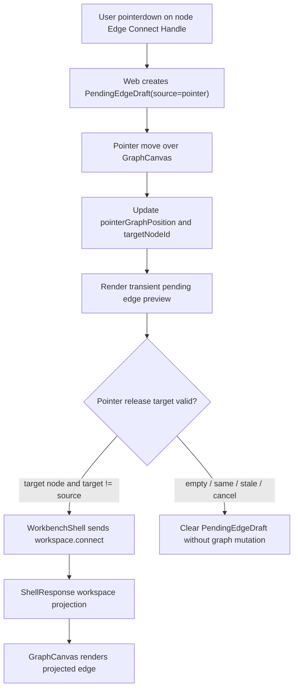

# graph-editor-free-edge-drawing design

## 0. 术语约定

| 术语 | 定义 | 防冲突结论 |
|---|---|---|
| Direct Edge Gesture | 用户从 graph node 的连线手柄拖到另一个 graph node 后创建 edge 的 pointer 手势 | 不等同于 endpoint reconnect，不拖动已有 edge |
| Pending Edge Draft | Web UI-only 的连线草稿，记录 source node、当前 pointer graph position、可选 target node | 不进入 ShellResponse、Project Content、Browser Project Repository 或 localStorage |
| Edge Connect Handle | node card 上的 pointer-only 连线起点 affordance | 不替代 node button 的选择语义，也不是独立 shell command |
| Click-driven Connect Fallback | 已有“选中 source node → 点击 Connect → 点击 target node”的无鼠标/可测路径 | 本 feature 必须保留 |
| Connect Projection Authority | 新 edge 是否出现只以 `workspace.connect` 的 ShellResponse workspace projection 为准 | GraphCanvas 不本地 append edge |

术语 grep 结果：`graphEditorInteractionState.ts` 已有 `pendingEdge?: { fromNodeId }`、`startGraphEditorConnection`、`completeGraphEditorConnection` 和 click-driven connect；GraphCanvas 已有 node pointer drag move、canvas pan、object drop 和 edge hitbox。当前没有 pointer drag edge preview、edge connect handle、target hit testing 或 direct gesture E2E。

## 1. 决策与约束

### 需求摘要

本 feature 目标是补齐 Graph Canvas 的直接拖线连边：

1. 用户可从某个 graph node 发起 pointer drag 连线手势。
2. 拖动中画布显示 transient pending edge preview，从 source node 指向当前 pointer 或合法 target node。
3. pointer release 到另一个合法 graph node 时，Web 调用既有 `workspace.connect(session_id, from_node_id, to_node_id)`。
4. 成功后新 edge 只从 ShellResponse workspace projection 出现；重复 connect 继续沿用 fixture/core 幂等语义。
5. release 到空白区域、同一 source node、缺失 target 或已失效 source 时，不发送 shell command，只清理 pending draft 或显示可恢复 no-op/error 状态。
6. 既有 click-driven Connect fallback 保留，键盘/无鼠标路径不被拖线手势替代。
7. 该功能不改变 edge label 编辑；创建后的 label 仍由 `graph-editor-edge-label-edit` 的 Edge Label Draft 处理。

### 明确不做

- 不新增 core / Platform Shell command，不改 `workspace.connect` payload 契约。
- 不实现 edge endpoint reconnect、edge direction flip、drag existing edge、edge deletion gesture 或 structured reaction condition form。
- 不在拖线时弹出 label 输入；不把 label prompt 混入 direct edge gesture。
- 不新增 GraphPatch op、Project Content schema、Browser Project Repository write、localStorage persistence、autosave 或第三方 diagramming library。
- 不改变 node drag move、object drop、canvas pan、edge selection/delete、path order draft、Edge Label Draft、EnergyProfile 或 Report Export 行为。
- 不实现多选框选、keyboard nudge、wheel/minimap 或 undo/redo；这些属于后续 roadmap item。

### 复杂度档位

- Web interaction state：L2。已有 `pendingEdge` 骨架，需要扩成 pointer position / target id 并保留 click fallback。
- GraphCanvas pointer orchestration：L3。需要和 node drag move、canvas pan、viewport transform、object drop 共存，避免手势抢占。
- Shell/core：L1。不改 contract，只复用既有 `workspace.connect`。
- Persistence：L1。pending draft 不持久化；新 edge 进入现有 ReactionGraph 后随显式 Save Bridge Session 保存。
- Testability：tested。helper tests、component tests 和浏览器验证可覆盖。

### 关键决策

1. **复用 `workspace.connect`**：direct gesture 只是新的 Web 输入方式，不引入 `workspace.draw_edge` 或新的 core patch。
2. **node move 与 edge draw 分离**：node body pointer drag 继续移动节点；Direct Edge Gesture 从 node 上的 Edge Connect Handle 发起，避免破坏已有布局手势。
3. **click fallback 保留**：Connect button + target node click 继续可用，作为 keyboard/accessibility/test fallback。
4. **preview 是 UI-only**：pending line、hover target、invalid target status 不写入任何 shell/domain/persistence 状态。
5. **release 才提交**：pointer move 不调用 shell；只有 release 到合法 target node 才发送 `workspace.connect`。
6. **label 后置编辑**：创建 edge 不带 label UI，用户需要标注时选中 edge 用 Edge Label Draft。

## 2. 名词与编排

### 2.1 名词层：值对象 / 实体 / 接口契约

**现状**：

- `GraphEditorInteractionState.pendingEdge` 只有 `{ fromNodeId }`，可支持 click-driven connect mode，但无法表达 pointer preview。
- `GraphEditorDraggingState` 已有 node/canvas/object-drop 三类 transient drag，不包含 edge draft。
- GraphCanvas node card 是 button，body pointer drag 触发 `workspace.move_node`；edge layer 只渲染已存在 edge 和 HTML hitbox。
- `workspace.connect` 已存在并接受 `session_id`、`from_node_id`、`to_node_id`、可选 label/metadata；当前 Web click flow 不传 label。

**变化**：

扩展 Web pending edge draft：

```ts
type PendingEdgeDraft = {
  fromNodeId: string
  pointerGraphPosition?: { x: number; y: number } | null
  targetNodeId?: string | null
  source: "click" | "pointer"
}
```

新增 direct gesture intent：

```ts
type DirectEdgeGestureResult =
  | { kind: "connect"; fromNodeId: string; toNodeId: string }
  | { kind: "cancel"; reason: "empty-target" | "same-node" | "stale-source" | "pointer-cancel" }
```

稳定规则：

- `source="click"` 用于既有 Connect button flow；可没有 pointer position。
- `source="pointer"` 用于 Edge Connect Handle drag；必须在 pointer move 时更新 pointerGraphPosition。
- `targetNodeId` 只表示当前 hover / hit-tested candidate；release 时仍要用最新 graph nodes 校验。
- `fromNodeId === toNodeId` 不发送 command。
- 新 edge label 不从 pending draft 传入，第一版 command args 只含 from/to/session。

### 2.2 编排层：主流程与控制流



**现状**：

- Click-driven flow 已在 `selectGraphNode` 中实现：pending source 存在且点击不同 node 时发送 `workspace.connect`。
- `pointFromPointerEvent`、`screenPointToGraphPoint` 和 `graphViewport` 已能把 screen pointer 映射到固定 `600 x 360` graph space。
- E2E helper 已有 node pointer drag 和 canvas pan 的 pointer event dispatch 样板。

**变化**：

- GraphCanvas 在每个 node card 上渲染 Edge Connect Handle。handle pointerdown 不触发 node move，不改变 selected node，直接创建 pointer pending edge。
- GraphCanvas 维护 pointer session ref，pointermove 更新 pending edge pointer position，并基于当前 pointer 所在 node 或 helper hit-test 设置 targetNodeId。
- GraphEdgeLayer 增加 pending preview line 渲染：source node center 到 target node center，或 source node center 到 pointerGraphPosition。
- pointerup 调用 WorkbenchShell 的 connect orchestration；成功/失败都清理 pointer pending draft，失败显示 ShellError 到既有 workbench error surface。
- WorkbenchShell 抽出 `connectGraphNodes(fromNodeId, toNodeId)`，供 click fallback 和 direct gesture 共享，避免两条路径的 error/projection 语义分叉。

**跨层纪律**：

- Command authority：GraphCanvas 不 append edge，不本地修改 `WorkbenchDomainState.workspace.graph.edges`。
- Gesture isolation：node body drag 仍用于 `workspace.move_node`；canvas pan 仍只在 pan mode/empty surface 生效；object drop 不被 edge gesture 捕获。
- Error semantics：invalid source/target 进入 UI no-op；shell 返回的 `graph_invalid` / `invalid_input` 原样展示。
- Persistence boundary：pending edge 不保存；ShellResponse 里的新 edge 可随显式 Save Bridge Session 保存。
- Accessibility：click-driven Connect fallback 保留；Edge Connect Handle 是 pointer affordance，不是唯一建边入口。

### 2.3 挂载点清单

- Web interaction state：扩展 `GraphEditorInteractionState.pendingEdge` 和纯 helper，用于 pointer position / target / source 管理。
- GraphCanvas direct gesture UI：node Edge Connect Handle、pointer session、pending preview line、release target 判定。
- WorkbenchShell connect orchestration：抽出共享 `connectGraphNodes`，让 click fallback 与 direct gesture 复用同一 `workspace.connect` response 处理。
- Tests / browser QA：interaction helper、WorkbenchShell component test、Playwright helper 或浏览器验证覆盖 direct gesture、cancel/self target、node drag regression 和 click fallback。

本 feature 不挂入 Python core、Platform Shell、Project Content Store、Browser Project Repository、EnergyProfilePanel、ReportExportPanel 或 third-party graph library。

### 2.4 推进策略

1. **Pending Edge Gesture State**：扩展 pending edge draft shape 和 helper tests，覆盖 pointer start/update/target/cancel/prune，同时保持 click pending flow。
   - 退出信号：helper tests 证明 click pending 和 pointer pending 都能 start/complete/clear，stale source 会 prune。
2. **GraphCanvas Direct Gesture UI**：新增 Edge Connect Handle、pending preview line、target hit testing，并确保 node body drag / pan / object drop 不回退。
   - 退出信号：component test 能从 `node-a` handle 拖到 `node-b`，Apply 前无本地 edge append，release 后发送 `workspace.connect`。
3. **Shared Connect Orchestration**：WorkbenchShell 抽共享 connect function，click fallback 和 pointer release 都走同一 shell response projection。
   - 退出信号：click-driven connect 既有测试仍通过；direct drag 和 click connect payload/error 语义一致。
4. **Verification And Scope Guard**：跑 Web tests/build、必要 Python tests、浏览器桌面/窄屏验证。
   - 退出信号：direct edge drag 可用，release 空白/同 node 不发 command；无 console error/overlay/水平溢出；scope grep 未新增 core command/schema/autosave/energy/export 变更。

## 3. 验收契约

### 关键场景清单

1. Interaction helper 可创建 `source="pointer"` 的 pending edge draft，记录 source node 和 pointer graph position。
2. Pointer move 更新 pending edge preview position，不修改 domain graph。
3. Pointer move / release 可识别合法 target node，并把 `targetNodeId` 记录在 pending draft。
4. Pointer release 到另一个 node 时发送 `workspace.connect(from_node_id, to_node_id)`。
5. `workspace.connect` 成功后新 edge 只由 ShellResponse workspace projection 出现在 GraphCanvas。
6. Pointer release 到空白区域不发送 `workspace.connect`，pending draft 被清空。
7. Pointer release 到同一 source node 不发送 `workspace.connect`，pending draft 被清空或显示 no-op。
8. Source node 在 gesture 期间从 projection 消失时，不发送 command，pending draft 被 prune。
9. Node body drag 仍发送 `workspace.move_node`，不误触发 edge drawing。
10. Pan mode empty canvas drag 仍发送 `workspace.set_viewport`，不误触发 edge drawing。
11. Object Registry drag/drop 仍发送 `workspace.add_node(position)`，不误触发 edge drawing。
12. 既有 click-driven Connect fallback 仍可用：选中 source → Connect → 点击 target 创建 edge。
13. Direct gesture 不创建 edge label；创建后如需 label，仍选中 edge 使用 Edge Label Draft。
14. 不新增 Python core / Platform Shell command、GraphPatch op、Project Content schema、Browser Project Repository write、localStorage persistence、autosave、EnergyProfile 或 Report Export 变更。
15. `cd web && npm run test -- --run` 通过。
16. `cd web && npm run build` 通过。
17. 浏览器验证 `http://127.0.0.1:5173/` 页面非空白、无 framework overlay、console clean；direct edge gesture 在桌面/窄屏无明显重叠或水平溢出。

### 反向检查

- 不把 direct edge drawing 实现成前端本地 append edge。
- 不把 direct edge drawing 扩展成 endpoint reconnect、edge label prompt、reaction condition editor、multi-select、undo/redo 或 minimap。
- 不删除 Connect button / click fallback。
- 不把 Pending Edge Draft 写入 ShellResponse、Project Content、Browser Project Repository 或 localStorage。

## 4. 与项目级架构文档的关系

- acceptance 阶段应更新 `.codestable/architecture/web-workbench.md`：记录 Direct Edge Gesture、Edge Connect Handle、Pending Edge Draft pointer fields、preview line、release-to-connect 编排和 click fallback 保留。
- acceptance 阶段应按实际情况更新 `.codestable/requirements/web-workbench-shell.md`：用户可从 node 拖线到另一个 node 创建 edge；仍不做 endpoint reconnect、edge label prompt、autosave 或结构化 reaction condition。
- core / platform 架构通常不需要更新，因为本 feature 复用既有 `workspace.connect`，不新增 shell/core contract；若实现中发现必须改 contract，需先回 roadmap/design。
- roadmap acceptance 阶段把 `graph-editor-free-edge-drawing` 标为 `done`；后续 `graph-editor-multiselect-keyboard` 和 `graph-editor-wheel-minimap` 继续复用既有 selection / viewport 边界。
