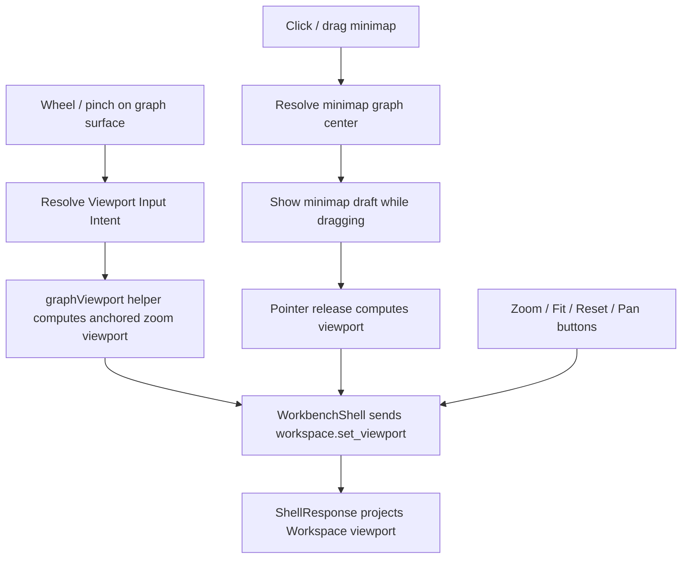

# graph-editor-wheel-minimap design

## 0. 术语约定

| 术语 | 定义 | 防冲突结论 |
|---|---|---|
| Viewport Input Intent | wheel、pinch、minimap drag/click 归一化后的视口输入意图 | 不是 shell command；最终仍投影为 `workspace.set_viewport` |
| Wheel Zoom | 鼠标滚轮或触控板滚动在 graph surface 内触发的缩放 | 不替代现有 Zoom In/Out buttons |
| Pinch Zoom | 触控板 pinch / ctrl+wheel 一类缩放输入 | 首轮以 wheel event 的 ctrl/meta scale path 接入，不做低层 PointerEvent 多指识别 |
| Graph Minimap | 画布内的小型 overview，显示 graph node bounds 与 current viewport window | UI-only，不保存到 Project Content / Browser Project Repository / localStorage |
| Minimap Navigation | 点击或拖动 minimap viewport window 后设置 graph viewport center | 不新增 graph layout state，不移动 nodes |
| Viewport Authority | 可见 viewport 以 `WorkspaceSummary.viewport` 为准 | Web 只生成 intent，成功后从 ShellResponse projection 刷新 |

术语 grep 结果：`graphViewport.ts` 已有 `normalizeGraphViewport`、`zoomGraphViewport`、`panGraphViewport`、`fitGraphViewportToNodes`、screen/graph 坐标换算和 zoom clamp；`GraphCanvas` 已有 Pan / Zoom In / Zoom Out / Fit / Reset buttons 与 `workspace.set_viewport` 编排；当前没有 `wheel`、`pinch` 或 `minimap` 产品实现。

## 1. 决策与约束

### 需求摘要

本 feature 目标是把 Graph Canvas 的 viewport navigation 从按钮/pan 扩展到更自然的鼠标/触控板输入：

1. 用户在 graph surface 内 wheel scroll 时，按 pointer anchor 缩放当前 viewport，并发送 `workspace.set_viewport`。
2. ctrl/meta wheel 或浏览器暴露的 pinch-like wheel 输入走同一缩放 helper，只改变缩放比例，不绕过 zoom clamp。
3. 用户在 minimap 上点击 graph 区域时，将主画布 viewport center 移到对应 graph point。
4. 用户拖动 minimap viewport window 时，持续显示 minimap transient draft；release 后发送一次 `workspace.set_viewport`。
5. Minimap 显示 current graph node bounds、node dots、active viewport window 和 zoom percent，窄屏也能看到并可用。
6. 现有 Pan、Zoom In/Out、Fit、Reset、object drop、node drag、rubber-band、direct edge gesture 和 keyboard nudge 保持行为不变。
7. 所有可见 viewport 更新仍来自 ShellResponse `WorkspaceSummary.viewport` projection。

### 明确不做

- 不新增 Python core / Platform Shell command、Project Content schema、Browser Project Repository write、localStorage persistence、autosave 或 history stack。
- 不把 minimap node bounds、minimap drag draft、surface DOM size、wheel delta 或 pointer anchor 写入 ShellResponse / Project Content / Browser Project Repository。
- 不引入第三方 diagramming/minimap library。
- 不实现 inertial scroll、kinetic pan、multi-touch PointerEvent 手势识别、minimap node selection、minimap edge drawing、viewport undo/redo 或 persistent minimap preferences。
- 不改变 `workspace.set_viewport` contract、zoom clamp、fixed `600 x 360` virtual graph coordinate system 或 `ReactionNode.position`。
- 不让 wheel zoom 破坏页面可达性：graph surface 外不拦截滚动；没有 workspace/session 时不处理。

### 复杂度档位

- Viewport helper：L2。现有 zoom/pan/fit helper 可复用，但需要 anchor-preserving wheel zoom 和 minimap geometry mapping。
- GraphCanvas orchestration：L3。wheel/minimap 要和 canvas pan、rubber-band、node drag、direct edge gesture、object drop 和 keyboard shortcuts 共存。
- WorkbenchShell orchestration：L1。不改 shell command，继续使用现有 `onSetViewport` → `workspace.set_viewport`。
- CSS responsive：L2。minimap 必须在工作台密集布局中不制造水平溢出。
- Tests / browser QA：tested。helper/component tests 与真实浏览器 desktop/narrow 验证覆盖。

### 关键决策

1. **复用 Workspace viewport authority**：wheel / pinch / minimap 只生成 viewport intent，成功后仍从 ShellResponse projection 更新可见 transform。
2. **新增 Web-only viewport intent helper**：把 wheel delta、anchor point、minimap click/drag 统一放在 `graphViewport.ts`，避免把几何散落在组件里。
3. **Wheel 只在 graph surface 内拦截**：事件目标必须属于 graph surface / graph content；页面其他区域保持正常滚动。
4. **Minimap 不持久化**：node bounds、viewport window 和 drag draft 都由当前 graph + viewport + surface size 派生。
5. **Minimap drag release 才提交 command**：拖动中只显示 UI draft，避免高频 `workspace.set_viewport` command。
6. **保留按钮 fallback**：Pan / Zoom / Fit / Reset 保持可用，wheel/minimap 只是增量输入方式。

## 2. 名词与编排

### 2.1 名词层：值对象 / 实体 / 接口契约

**现状**：

- `GraphViewport = { x, y, zoom }` 已在 `graphViewport.ts` 定义，zoom 被 `0.35..2.5` clamp。
- `screenPointToGraphPoint` / `graphPointToScreenPoint` 已负责 surface 与 `600 x 360` graph coordinate 转换。
- `GraphCanvas` 按 `graphViewportCssTransform(viewport)` 渲染 `.graph-viewport-layer`。
- `GraphCanvas` 现有 viewport buttons 直接调用 `onSetViewport(zoomGraphViewport / fitGraphViewportToNodes / resetGraphViewport)`。
- `WorkbenchShell` 已把 `onSetViewport` 映射到 `workspace.set_viewport`，不需要新 shell command。

**变化**：

新增 / 扩展 Web viewport helper types：

```ts
type ViewportInputIntent =
  | { kind: "wheel-zoom"; anchor: CanvasPoint; deltaY: number; ctrlOrMeta?: boolean }
  | { kind: "minimap-center"; center: CanvasPoint }
  | { kind: "minimap-drag"; center: CanvasPoint }

type GraphMinimapGeometry = {
  scale: number
  offset: CanvasPoint
  graphBounds: { left: number; top: number; right: number; bottom: number }
  viewportWindow: { left: number; top: number; width: number; height: number }
  nodes: Array<{ id: string; x: number; y: number }>
}

type GraphMinimapDraft = {
  origin: CanvasPoint
  current: CanvasPoint
  center: CanvasPoint
}
```

稳定规则：

- Wheel zoom anchor 是 pointer 所在 surface point 映射到 graph coordinate 的点；缩放后该 graph point 应尽量留在原 screen anchor 附近。
- Wheel factor 按 deltaY 正负生成，最终 zoom 仍走 `clampGraphViewportZoom`。
- Minimap graph bounds 来自 current graph node positions；没有 nodes 时不显示可交互 minimap。
- Minimap viewport window 从 current `GraphViewport` 派生，不改变 workspace state。
- Minimap click/drag 得到的是新 viewport center，最终 viewport 仍保留 current zoom。
- Minimap draft 只在 Web UI 层存在，release 后清空。

### 2.2 编排层：主流程与控制流



**现状**：

- `GraphCanvas` 已有 pan pointer session、rubber-band session、node drag session 和 direct edge session。
- Graph surface 当前不监听 wheel；minimap UI 不存在。
- E2E helper `exerciseGraphViewportControls` 已覆盖 buttons 和 pan。

**变化**：

- `graphViewport.ts` 新增 anchor-preserving wheel zoom helper、minimap geometry helper 和 minimap center-to-viewport helper。
- `GraphCanvas` surface 新增 scoped `onWheel` handler；只有 workspace 可用、nodes 存在且目标在 graph surface 内时处理。
- `GraphCanvas` 新增 `GraphMinimap` 子视图，显示 node dots、viewport window、drag draft 和 zoom percent。
- Minimap pointer down / move / up 维护 Web-only draft；click 或 drag release 调用 `onSetViewport` 一次。
- `WorkbenchShell` 继续使用既有 `setGraphViewport` 编排，无新 command。
- E2E helper 扩展 desktop graph editor matrix，覆盖 wheel zoom 和 minimap navigation；narrow flow 验证 minimap 不造成水平溢出。

**跨层纪律**：

- Command authority：viewport 可见结果只来自 ShellResponse workspace projection；GraphCanvas 不直接 patch `WorkbenchDomainState.workspace.viewport`。
- Gesture isolation：wheel/minimap 不抢 node drag、edge handle drag、rubber-band、object drop 或 canvas pan pointer sessions。
- Event scope：graph surface 外不处理 wheel；no session / no workspace / no nodes 时不处理。
- Ordering：minimap drag release 只发送一次 `workspace.set_viewport`；wheel 每次有效输入最多发送一次。
- Persistence boundary：minimap geometry、drag draft、surface size 和 wheel delta 都是 UI-only。
- Accessibility：现有 viewport buttons 保留；minimap 具备 aria-label 与可点击/可拖动 target，窄屏仍能看到。

### 2.3 挂载点清单

- Viewport helper：wheel anchor zoom、minimap geometry、minimap center-to-viewport 的纯函数。
- GraphCanvas viewport UI：surface `onWheel`、`GraphMinimap`、minimap pointer draft、minimap styling。
- WorkbenchShell viewport orchestration：继续复用 `onSetViewport`，如有必要只做命名/回调透传整理。
- Tests / browser QA：helper tests、WorkbenchShell component tests、desktop/narrow Playwright coverage。

本 feature 不挂入 Python core、Platform Shell、Project Content Store、Browser Project Repository、EnergyProfilePanel、ReportExportPanel、localStorage、history stack 或 third-party graph library。

### 2.4 推进策略

1. **Viewport Intent Helpers**：扩展 `graphViewport.ts`，支持 anchor-preserving wheel zoom、minimap geometry 和 minimap center mapping。
   - 退出信号：helper tests 证明 zoom clamp、anchor 保持、minimap node/window geometry 和 center mapping 稳定。
2. **Wheel / Pinch Surface Input**：GraphCanvas 接入 scoped wheel handler，并保持按钮/pan/drop/drag/rubber-band/direct edge 不回退。
   - 退出信号：component tests 证明 wheel 发送 `workspace.set_viewport`，graph surface 外/无 workspace 不发送，现有 viewport buttons 仍可用。
3. **Graph Minimap UI**：新增 minimap overview、viewport window、click/drag navigation 和响应式样式。
   - 退出信号：component tests 证明 minimap click/drag release 只发送一次 `workspace.set_viewport`，drag draft 不写 shell，窄屏不水平溢出。
4. **Verification And Scope Guard**：跑 Web tests/build、必要 Python tests、浏览器桌面/窄屏验证。
   - 退出信号：wheel zoom、minimap navigation、buttons、pan、node drag、rubber-band、direct edge、object drop 可用；scope grep 未新增 core/schema/autosave/history/export 变更。

## 3. 验收契约

### 关键场景清单

1. Viewport helper 对 wheel delta 生成 zoom intent，zoom 始终在 `0.35..2.5` 内。
2. Wheel zoom 以 pointer anchor 为中心，缩放后 anchor 对应 graph point 尽量保持在同一 screen point。
3. Minimap geometry 可从 nodes、current viewport 和 minimap size 派生 node dots、graph bounds 和 viewport window。
4. Minimap center mapping 保留 current zoom，只改变 viewport x/y。
5. Graph surface 内 wheel 发送一次 `workspace.set_viewport`；payload 只包含 viewport。
6. Graph surface 外 wheel 不发送 shell command。
7. no session / no workspace / no nodes 时 wheel 不发送 shell command。
8. ctrl/meta wheel 或 pinch-like wheel path 不绕过 zoom clamp。
9. 现有 Zoom In/Out、Fit、Reset buttons 仍发送 `workspace.set_viewport`。
10. Pan mode pointer drag 仍发送 `workspace.set_viewport`，不被 wheel/minimap 改坏。
11. Node drag、rubber-band selection、direct edge gesture 和 object drop 坐标换算不回退。
12. Minimap 显示 node dots、viewport window 和 zoom percent。
13. 点击 minimap graph 区域发送一次 `workspace.set_viewport`，viewport center 对应点击 graph point。
14. 拖动 minimap viewport window 时显示 transient draft，drag 过程中不发送 shell command，release 后发送一次。
15. Minimap 在窄屏布局中不造成页面级水平溢出，控件文字不重叠。
16. 不新增 Python core / Platform Shell command、Project Content schema、Browser Project Repository write、localStorage persistence、autosave、history stack、EnergyProfile 或 Report Export 变更。
17. `cd web && npm run test -- --run` 通过。
18. `cd web && npm run build` 通过。
19. 浏览器验证开发服务页面非空白、无 framework overlay、console clean；desktop/narrow 验证 wheel/minimap/viewport controls 无明显重叠或水平溢出。

### 反向检查

- 不把 viewport intent 做成前端本地 domain state patch。
- 不新增 `workspace.zoom`、`workspace.minimap` 或 batch viewport command。
- 不把 minimap drag draft / geometry / wheel delta 写入 ShellResponse、Project Content、Browser Project Repository 或 localStorage。
- 不让 graph surface 外 wheel 阻止页面滚动。
- 不引入第三方 minimap / diagramming dependency。

## 4. 与项目级架构文档的关系

- acceptance 阶段应更新 `.codestable/architecture/web-workbench.md`：记录 Wheel Zoom、Pinch-like Wheel Input、Graph Minimap、Minimap Navigation、viewport authority 和 UI-only minimap draft。
- acceptance 阶段应更新 `.codestable/requirements/web-workbench-shell.md`：用户可用 wheel/pinch 和 minimap 导航图谱；仍不做 history、autosave、persistent preferences 或完整多指手势识别。
- core / platform 架构通常不需要更新，因为本 feature 复用既有 `workspace.set_viewport`；如果实现中发现必须改 contract，需先回 roadmap/design。
- roadmap acceptance 阶段把 `graph-editor-wheel-minimap` 标为 `done`；后续 `graph-editor-lightweight-history` 可复用本 feature 的 viewport intent 边界。
