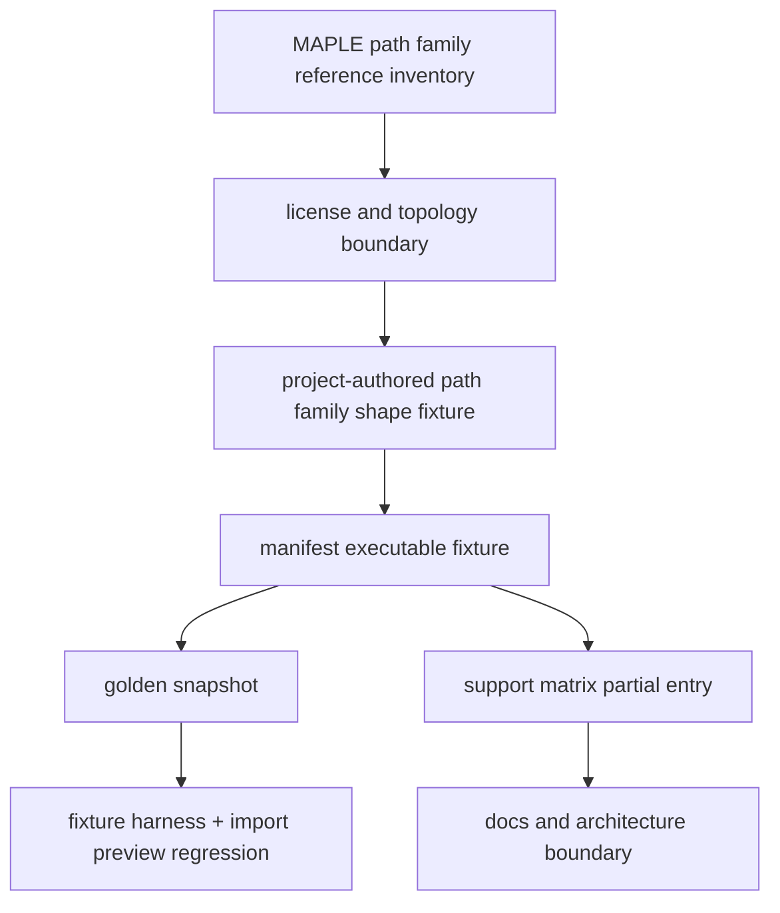

# maple-path-output-semantics design

## 0. 术语约定

| 术语 | 定义 | 防冲突结论 |
|---|---|---|
| MAPLE Path XYZ | MAPLE IRC、NEB、String、AutoNEB 等路径族产生的多帧 `.xyz`，frame comment 暴露 image/frame/iteration 与 energy | 区分于 RxnFlow `ReactionPath` |
| MAPLE Path Family Shape Fixture | 项目内 synthetic-derived fixture，用手写结构和数值覆盖 MAPLE public path examples 的 comment 形状 | `source.kind=synthetic`，不复制 MAPLE 原始 examples |
| Frame-level ChemicalObjectDraft | parser 对每个 XYZ frame 输出一个 `ChemicalObjectDraft`，label 来自 comment，energy 映射到 `energies["electronic"]` | 当前 parser 输出边界 |
| Path Topology Boundary | IRC direction、NEB/String image 拓扑、AutoNEB tree JSON、TS candidate 与 path grouping 均不进入本 feature | 未来需另起 graph/import feature |

## 1. 决策与约束

### 需求摘要

本 feature 目标是把 MAPLE path `.xyz` 支持边界从单一 synthetic IRC 样例扩展成可审计的 path family 语义说明：

1. 参考 source inventory 已登记的 MAPLE IRC full path、NEB MEP、String MEP 和 AutoNEB path/tree reference 文件。
2. 不 vendor ClickFF/MAPLE public examples；继续采用项目内 synthetic-derived shape fixture。
3. 用 executable fixtures 固定 MAPLE path `.xyz` comment 形状、frame label、Hartree energy 和多帧 object_count。
4. 在 support matrix/docs/architecture 中明确：当前 parser 只输出逐帧 `ChemicalObjectDraft`，不生成 `ReactionPath`、TS candidate、方向或拓扑。

明确不做：

- 不复制 `/tmp/rxnflow-maple/example/...` 原始 path `.xyz`、`.out`、tree JSON 或 TS candidate 文件。
- 不修改 `ReactionGraph`、`ReactionPath`、ImportRegistryWorkflow、ChemicalRegistry、EnergyProfile 或 Web UI。
- 不把 MAPLE path `.xyz` 转成 RxnFlow graph path、node order、branch tree、TS object 或 energy profile。
- 不解析 AutoNEB tree JSON、NEB/String `.out` 里的迭代日志或 IRC forward/backward direction。
- 不把 source inventory 的 path reference-only 条目改成 vendored/candidate。
- 不新增 runtime parser branch 来猜测任务类型；本步只锁定已有 MAPLE XYZ comment 解析能力。

### 复杂度档位

测试侧 fixture corpus + 支持矩阵 feature。偏离点：

- 用户关心 MAPLE path family，但当前领域模型还没有 path-level parser output；本 feature 必须把“能读 frame”与“能建反应路径”分开。
- MAPLE public examples 许可证/banner 边界仍是 review-required；因此 executable coverage 只能用 synthetic-derived shape fixture。
- 验收重点是防止后续文档或测试把 frame-level parser support 误写成 ReactionPath 支持。

### 关键决策

1. **逐帧对象优先**：MAPLE path `.xyz` 继续通过 `parse_xyz_frames` 输出多个 `ChemicalObjectDraft`。
2. **拓扑显式缺席**：support matrix 必须把 `direction`、`path_topology`、`transition_state` 标为 `unsupported` 或 `reference-only`。
3. **path family 分层覆盖**：IRC/NEB/String/AutoNEB 的 executable coverage 使用 synthetic-derived `.xyz`；AutoNEB tree JSON 保持 reference-only。
4. **无 runtime 扩张**：现有 MAPLE XYZ comment 识别足够时不改 parser runtime，避免为测试 fixture 写 task-specific 分支。

## 2. 名词与编排

### 2.1 名词层：值对象 / 实体 / 接口契约

**现状**：

- `rxnflow.parsers.maple.MapleOutputPlugin` 通过 MAPLE-style `.xyz` comment 识别 `Image N Energy =`、`Frame N Energy =`、`Iter N Image M Energy =`、`Iteration N Energy =`。
- `rxnflow.parsers.xyz.parse_xyz_frames` 把每个 frame 投影为 `ChemicalObjectDraft`，label 来自 comment 前缀，energy 单位默认 hartree。
- `manifest.yaml` 只有 `maple-irc-path-synthetic-minimal` 一个 path fixture，`support-matrix.yaml` 已写明 path topology/TS 不支持。
- `sources.yaml` 中 IRC/NEB/String/AutoNEB path files 是 `reference-only`。

**变化**：

- 新增 `maple-path-family-synthetic-derived` executable fixture，覆盖 IRC/NEB/String/AutoNEB 风格的 `Image N Energy = ...` 多帧 shape。
- 复用既有 `maple-irc-path-synthetic-minimal`，让 support matrix 的 MAPLE path partial entry 同时覆盖原有 IRC comment variants 和新增 public path family shape。
- 新增 snapshot 记录 object_count、frame labels、Hartree electronic energies、空 thermochemistry、空 warning codes。
- `maple-path-family-reference` 保持 `reference-only`，继续连接 source inventory 的真实 MAPLE path/tree reference ids。

接口示例：

```python
RawFile(name="maple-path-family-synthetic-derived.xyz")
ParserRegistry.default().parse(...)
# => ParseResult.objects: (
#      ChemicalObjectDraft(label="Image 0", energies={"electronic": EnergyValue(..., "hartree")}),
#      ChemicalObjectDraft(label="Image 1", energies={"electronic": EnergyValue(..., "hartree")}),
#      ...
#    )
# 不返回 ReactionPath / ReactionGraph / TS candidate。
```

### 2.2 编排层：主流程与控制流



**跨层纪律**：

- 错误语义：缺失 path topology 不是 parse failure；它是 support matrix 中的 explicit unsupported field。
- 幂等性：测试只读取仓库内 synthetic fixtures，不访问 `/tmp/rxnflow-maple` 或网络。
- 扩展点：未来若要把 path frames 转成 ReactionGraph/ReactionPath，必须另起 feature 设计 path grouping、node identity、direction、branch tree 和 TS object 规则。
- 可观测点：snapshot object_count/labels/energy units、support matrix known_limits、no-vendor grep guard、import preview preview-only regression。

### 2.3 挂载点清单

- `tests/fixtures/parsers/files/maple/` 的新增 MAPLE path family synthetic-derived `.xyz`。
- `tests/fixtures/parsers/manifest.yaml` 和 `snapshots/*.json` 的 executable fixture entry。
- `tests/fixtures/parsers/support-matrix.yaml` 中 MAPLE path partial/reference entries。
- `tests/test_parser_fixture_harness.py` / `tests/test_import_preview_parser_regression.py` 的 fixture count、scope guard、path family assertions 和 no-ReactionPath guard。
- `docs/dev/parser-fixture-corpus.md`、architecture 和 roadmap 的 MAPLE path boundary 描述。

### 2.4 推进策略

1. **Design and roadmap gate**：落 design/checklist，把 roadmap item 标为 in-progress，明确 no-ReactionPath 边界。
   - 退出信号：feature doc、checklist 和 roadmap YAML 通过。
2. **Path family executable fixture**：新增 synthetic-derived path family `.xyz`、manifest entry 和 snapshot。
   - 退出信号：fixture harness 能加载并解析新增 fixture，object_count/labels/energy units 稳定。
3. **Support matrix and regression guards**：更新 support matrix、harness tests、import preview scope guard 和 no-vendor/no-ReactionPath assertions。
   - 退出信号：focused parser fixture harness 与 import preview regression 通过。
4. **Docs, architecture and acceptance**：回写 docs/architecture/roadmap，补验收报告并跑全量验证。
   - 退出信号：checks 全 passed，roadmap item done，YAML/focused/full tests 通过。

## 3. 验收契约

### 关键场景清单

1. `manifest.yaml` 包含 `maple-path-family-synthetic-derived` executable fixture。
2. 新 fixture 的 `source.kind` 是 `synthetic`，不是 `vendored-third-party`。
3. 新 fixture snapshot 至少覆盖 4 个 MAPLE path frames，labels 为 `Image N`，energy unit 为 `hartree`。
4. 原有 `maple-irc-path-synthetic-minimal` 继续覆盖 `Image`、`Iter N Image M`、`Iteration N` label variants。
5. `support-matrix.yaml` 的 MAPLE path partial entry 覆盖两个 executable path fixtures，并把 path topology、direction、transition state 标为不支持。
6. `maple-path-family-reference` 保持 `reference-only`，继续指向 IRC/NEB/String/AutoNEB source reference ids。
7. import preview parser regression 覆盖新增 executable fixture，并保持 preview-only 不登记 ChemicalObject。
8. 测试或 docs 中没有把 MAPLE path fixtures 描述为 `ReactionPath`、`ReactionGraph`、TS candidate 或 energy profile 支持。
9. `tests/fixtures/parsers/files/maple/` 不包含 MAPLE 原始 public example banner 的 copyright/license/all-rights-reserved 文案。
10. docs/architecture 明确 MAPLE path `.xyz` 当前是 frame-level object coverage，path topology 仍未解析。

### 明确不做的反向核对项

- 不复制 MAPLE public path examples 原文件。
- 不把 MAPLE source inventory path reference-only policy 改成 candidate/vendored。
- 不新增 vendored-third-party manifest source。
- 不修改 parser runtime、ImportRegistryWorkflow、ChemicalRegistry、ReactionGraph、EnergyProfile 或 Web UI。
- 不生成 ReactionPath、ReactionGraph、TS candidate、direction/topology、thermochemistry 或 correction 数据。
- 不解析 AutoNEB tree JSON、NEB/String output logs、IRC forward/backward direction。

## 4. 与项目级架构文档的关系

- architecture 归并：更新 Parser Fixture Corpus 当前覆盖，说明 MAPLE path family synthetic-derived fixture 已进入 executable corpus，但仍只生成 frame-level `ChemicalObjectDraft`。
- guide 回写：补 MAPLE path family 的 source policy 与 no-ReactionPath boundary，强调 public path files/tree JSON 仍 reference-only。
- roadmap 回写：验收通过后把 `maple-path-output-semantics` 标为 done，并在主文档备注 path topology 另起 graph/import feature。
