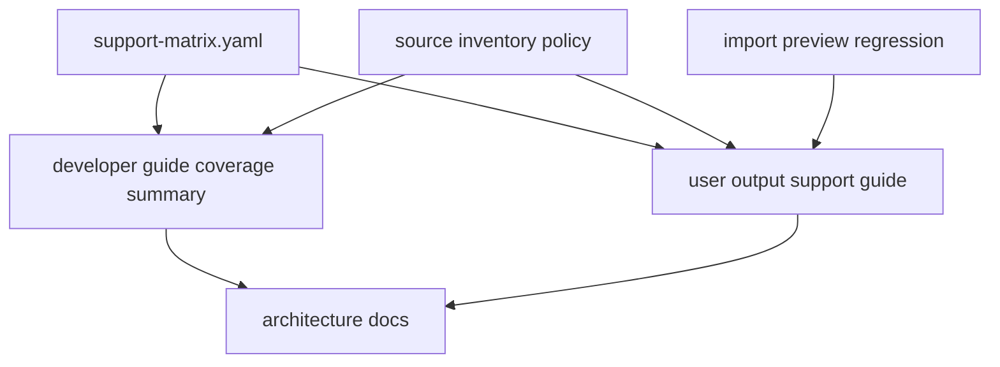

# parser-real-output-guides design

## 0. 术语约定

| 术语 | 定义 | 防冲突结论 |
|---|---|---|
| Parser Output Support Guide | 面向用户/agent 的输出支持边界文档，说明哪些格式可预览、哪些只是候选或参考 | 新增在 `docs/user/`，不替代开发者 corpus guide |
| Fixture-backed Support | 由 manifest fixture、snapshot、support matrix 和 import preview regression 一起证明的支持边界 | 不等同于真实软件版本完整认证 |
| Candidate Source | `sources.yaml` 中已登记、未来可评估的外部文件 | 不是已 vendor、不是已解析 |
| Reference-only Artifact | 只用于说明已知输出族或任务形状的外部 artifact | 不进入 executable corpus |
| Contribution Checklist | 用户或开发者贡献真实输出样例前必须确认的脱敏、授权、体积和任务语义清单 | 不自动接受任何真实文件 |

## 1. 决策与约束

### 需求摘要

本 feature 目标是收束 parser real-output compatibility roadmap 的文档闭环：

1. 更新 `docs/dev/parser-fixture-corpus.md`，补清当前 support matrix 状态、fixture-backed 边界和贡献样例流程。
2. 新增用户向 `docs/user/parser-output-support.md`，用非测试内部语言说明 Gaussian、ORCA、MAPLE、XYZ、ASE extxyz 当前能预览哪些字段、哪些仍不支持。
3. 明确 supported / partial / candidate / reference-only 的区别，避免把 synthetic 或 synthetic-derived corpus 说成真实版本完整支持。
4. 给用户和 agent 一份贡献真实计算输出样例的 checklist：授权、脱敏、文件体积、软件版本、任务类型、期望字段和不应提交的信息。

明确不做：

- 不新增 parser runtime、fixture、snapshot 或 support matrix 条目。
- 不修改 ImportRegistryWorkflow、Platform Shell、Web UI、Project Store、ReactionGraph、EnergyProfile 或 Report Export。
- 不声明 Gaussian/ORCA/MAPLE/ASE extxyz 已完整支持真实版本。
- 不提供法律意见；许可证不清时仍标为 review-required。
- 不写营销式功能介绍，文档只说明可操作边界。

### 复杂度档位

文档型 feature。偏离点：

- 文档必须准确反映当前 corpus：MAPLE/cclib-data public originals 未 vendor，ASE extxyz 是 project-authored variants。
- 用户文档要可读，但不能隐藏 diagnostic、missing energy、unit assumption 和 reference-only 限制。
- 验证主要靠 grep/审阅和现有 test suite，预计不改 runtime。

### 关键决策

1. **用户/开发者分层**：用户指南解释“能否导入/预览”；开发者指南解释“如何维护 corpus”。
2. **状态词固定**：supported/partial/candidate/reference-only/unsupported 的含义必须与 support matrix 一致。
3. **贡献前先脱敏和授权**：真实输出进入仓库前必须确认可再分发、无隐私/机密路径/项目编号。
4. **不扩支持承诺**：文档只总结已落地 fixture-backed 行为，不把 future work 写成当前能力。

## 2. 名词与编排

### 2.1 名词层：值对象 / 实体 / 接口契约

**现状**：

- `docs/dev/parser-fixture-corpus.md` 已说明 manifest/source/support matrix、source policy、snapshot、import preview regression 和 parser gap triage。
- 当前没有用户向 parser 输出支持文档。
- `support-matrix.yaml` 已覆盖 MAPLE candidates/reference-only、Gaussian/ORCA cclib synthetic-derived、XYZ/extxyz project-authored variants 和 expected-error。

**变化**：

- 新增 `docs/user/parser-output-support.md`，说明：
  - 当前支持状态词；
  - Gaussian/ORCA/MAPLE/XYZ/ASE extxyz 的 fixture-backed 支持字段；
  - warnings/errors 的用户含义；
  - 贡献真实样例前的 checklist；
  - 明确不支持/不承诺事项。
- 更新 `docs/dev/parser-fixture-corpus.md`，补“当前 corpus 覆盖摘要”和用户指南链接。
- 更新 architecture，登记新增用户指南和已完成 roadmap 文档闭环。

接口示例：

```text
用户问题：我的 ORCA 输出能不能进 RxnFlow？
文档回答：当前 ORCA cclib adapter 只有 project-authored synthetic-derived shape fixtures 覆盖 method、charge/spin、geometry 和 electronic energy；真实 ORCA 版本、任务类型、SCF convergence 和完整 job metadata 未声明完整支持。导入前应先做 preview 并检查 warning/error。
```

### 2.2 编排层：主流程与控制流



**跨层纪律**：

- 错误语义：文档需解释 `missing_section`、`unit_assumed` 和 `parse_failed` 的用户影响。
- 幂等性：只写 Markdown/CodeStable 文档，不生成测试 fixtures。
- 可观测点：文档路径、grep 状态词、full tests 保持通过。

### 2.3 挂载点清单

- `docs/user/parser-output-support.md` 新增用户指南。
- `docs/dev/parser-fixture-corpus.md` 当前覆盖摘要和相关文档链接。
- `.codestable/architecture/ARCHITECTURE.md`、`core-platform.md` 的文档边界描述。
- roadmap items/main doc 和 feature acceptance。

### 2.4 推进策略

1. **Design and roadmap gate**：落 design/checklist，把 roadmap item 标为 in-progress。
   - 退出信号：feature doc、checklist 和 roadmap YAML 通过。
2. **Guides update**：新增用户指南并补开发者指南。
   - 退出信号：用户能从文档判断当前支持边界和贡献样例流程。
3. **Architecture and acceptance**：回写架构、roadmap 和验收报告。
   - 退出信号：checks 全 passed，roadmap item done。
4. **Verification**：运行 YAML、文档 grep/focused tests 和全量 unittest。
   - 退出信号：YAML/focused/full tests 通过。

## 3. 验收契约

### 关键场景清单

1. 新增 `docs/user/parser-output-support.md`，面向用户说明当前 parser 输出支持边界。
2. 用户指南解释 supported、partial、candidate、reference-only、unsupported 的区别。
3. 用户指南逐项说明 Gaussian、ORCA、MAPLE、XYZ、ASE extxyz 当前 fixture-backed 支持字段和已知限制。
4. 用户指南解释 `missing_section`、`unit_assumed`、`parse_failed` 的影响。
5. 用户指南包含真实输出样例贡献 checklist，覆盖授权、脱敏、体积、软件版本、任务类型和期望字段。
6. 开发者指南链接用户指南，并补当前 corpus 覆盖摘要。
7. docs/architecture 记录新增用户指南和 parser support guide 边界。
8. roadmap item 标为 done。

### 明确不做的反向核对项

- 不新增 parser runtime、fixture、snapshot 或 support matrix 条目。
- 不修改 ImportRegistryWorkflow、Platform Shell、Web UI、Project Store、ReactionGraph、EnergyProfile 或 Report Export。
- 不声明真实 Gaussian/ORCA/MAPLE/ASE extxyz 版本完整支持。
- 不提供法律意见；许可证不清仍使用 review-required。

## 4. 与项目级架构文档的关系

- architecture 归并：新增 Parser Output Support Guide 文档入口，说明它是用户向支持边界说明，不是 runtime API。
- roadmap 回写：验收通过后把 `parser-real-output-guides` 标为 done，关闭 `rxnflow-parser-real-output-compatibility` roadmap 的子 feature 清单。
