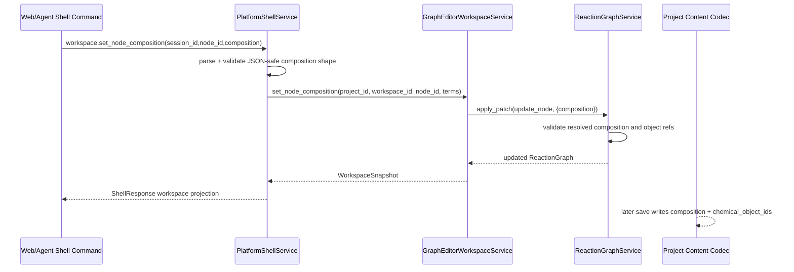

# Reaction Node Stoichiometry Contract

## 0. 术语约定

- **ReactionNodeCompositionTerm**：ReactionNode 内的单个组成项，字段为 `object_id`、`coefficient`、可选 `role`、可选 `label` 和 `metadata`。grep 现状没有同名类型；roadmap 已把它定义为节点组成的权威名词。
- **composition**：ReactionNode 的新权威组成字段，值为 `ReactionNodeCompositionTerm[]`。它表达节点由哪些 ChemicalObject 组成以及各自系数，不复制 ChemicalObject 内容。
- **chemical_object_ids**：旧兼容投影字段，仍保留在 ReactionNode、Project Content 和 Shell/Web DTO 中。新数据写入时它由 composition 的 object_id 投影得到；旧数据读取时会补成 coefficient 1 的 composition。
- **coefficient**：用户/agent 显式输入的计量系数。第一版只验证非零有限数，不自动配平、不推断反应方向。
- **workspace.set_node_composition**：新的 Shell command 和 workspace 编排入口，用于替换已有节点的 composition。grep 现状没有同名命令。

## 1. 决策与约束

### 需求摘要

本 feature 要让用户和 agent 能在一个 reaction node 上表达 `A + 2B` 这类带系数的组成，并且通过 Project Content 保存/恢复。成功标准是：新增节点可以带 composition；旧 `chemical_object_ids` 节点读取后得到 coefficient 1 composition；Shell 可以调用 `workspace.set_node_composition` 更新节点；结构化错误覆盖空 composition、非法 coefficient 和缺失 object id。

### 明确不做

- 不修改 Energy Engine 的数值语义；按 coefficient 计算能量留给 `energy-expression-engine`。
- 不做能量通道选择、thermochemistry channel catalog 或 correction policy。
- 不做 Web 节点组成编辑表单；本轮只更新 Shell DTO 类型和 fixture/local command contract 所需投影。
- 不自动配平反应、不校验元素守恒、电荷守恒或反应方向。
- 不新增 Project Content schema version；`reaction-graphs-v1` 用可选 `composition` 字段兼容。

### 复杂度档位

走对外发布库/服务默认档位：L3 + modules + reasonable + team + stable + tested + validated。偏离点：性能只要求 reasonable，因为 composition term 数量预计很小，不设性能预算；兼容性要求 backward-compatible，因为已有 `reaction-graphs-v1` 和旧 Web DTO 必须继续可读。

### 关键决策

1. **composition 是权威字段，chemical_object_ids 是兼容投影**：后续能量表达式需要 coefficient/role/label，旧 id 列表不够表达；但 Web 和旧项目仍依赖 `chemical_object_ids`，所以第一阶段双写双读。
2. **旧节点自动补 coefficient 1**：旧项目不需要 migration 才能继续打开；读取/构造时统一视为每个 object id 的 coefficient 为 1。
3. **允许负数和小数 coefficient，禁止 0/NaN/Infinity**：负数和小数可以表达后续差值或半反应等人工场景；0 没有化学/计算意义且容易隐藏错误。
4. **同一 object id 可重复出现**：核心层不擅自合并项，保留用户/agent 输入顺序；后续显示层可自行合并但不能改变计算语义。
5. **set_node_composition 走 Workspace/Shell，不绕过 ReactionGraphService**：保持现有 GraphPatch authority 和 ShellResponse projection 纪律。

### 前置依赖

无。当前 roadmap item 没有 depends_on，相关核心模块已经存在。

## 2. 名词与编排

### 2.1 名词层：值对象 / 实体 / 接口契约

**现状**

- `rxnflow.models.ReactionNode` 只有 `chemical_object_ids`、`position` 和 `metadata`；species / transition_state 依赖 `chemical_object_ids` 非空。
- `rxnflow.workspace.NodePlacement` 只接收 `chemical_object_ids` 创建节点。
- `rxnflow.graph_workspace_codec` 的 `reaction-graphs-v1` node 只保存 `chemical_object_ids`，旧数据无 composition。
- `rxnflow.platform` 的 workspace graph projection 只输出 `chemical_object_ids`。
- `web/src/shell/types.ts` 的 `GraphNodeSummary` 只知道 `chemical_object_ids`。

**变化**

- 新增 `ReactionNodeCompositionTerm` dataclass，并在 `ReactionNode` / `NodePlacement` 中增加 `composition` 字段。
- 新增 `ReactionNode.resolved_composition` 或等价 helper，把缺失 composition 的旧节点投影为 coefficient 1。
- Graph validation 改为验证 resolved composition；对 species / transition_state 要求 composition 非空。
- GraphPatch `update_node` 允许 patch `composition`，并保持 `chemical_object_ids` 与 composition 投影一致。
- Project Content node JSON 写入 `composition`，同时继续写 `chemical_object_ids`；读取旧 JSON 自动补 composition。
- Platform Shell 新增 `workspace.set_node_composition`，Graph/Workspace projection 输出 `composition` 和 `chemical_object_ids`。
- Web Shell type 增加 `ReactionNodeCompositionTermSummary` 和 command union 字段。

**接口示例**

```python
# 来源：rxnflow.models ReactionNode / ReactionNodeCompositionTerm
ReactionNode(
    id="node-combo",
    kind="species",
    label="A + 2B",
    composition=(
        ReactionNodeCompositionTerm("object-a", 1.0),
        ReactionNodeCompositionTerm("object-b", 2.0, role="reagent"),
    ),
)
# 可观察：node.chemical_object_ids == ("object-a", "object-b")
```

```python
# 来源：rxnflow.workspace GraphEditorWorkspaceService.set_node_composition
workspace.set_node_composition(
    "project-a",
    "workspace-main",
    "node-combo",
    (
        ReactionNodeCompositionTerm("object-a", 1.0),
        ReactionNodeCompositionTerm("object-b", 2.0),
    ),
)
# 输出：WorkspaceSnapshot.graph.nodes 中 node-combo 带 composition，preview 同步更新
```

```json
// 来源：rxnflow.platform ShellCommand workspace.set_node_composition
{
  "command": "workspace.set_node_composition",
  "args": {
    "session_id": "session-a",
    "node_id": "node-combo",
    "composition": [
      {"object_id": "object-a", "coefficient": 1},
      {"object_id": "object-b", "coefficient": 2, "role": "reagent"}
    ]
  }
}
```

主要错误路径：

- composition 不是 list、为空或 coefficient 非有限非零 → `invalid_input target=composition`。
- composition 引用未登记 object → `graph_invalid target=object_id`。
- node 不存在 → `graph_invalid target=node_id`。

### 2.2 编排层：主流程与控制流



**现状**

Workspace 的节点变更路径都是 `workspace.add_node`、`workspace.move_node`、`workspace.remove`、`workspace.connect` 和 `workspace.set_path`。GraphPatch 是唯一写 graph 的协议，失败批次不会写回 graph。Project Content save/load 通过 graph codec 保存节点字段。

**变化**

- `workspace.add_node` 接收旧 `chemical_object_ids` 时自动生成 coefficient 1 composition；如果 payload 直接传 composition，则按 composition 创建节点。
- `workspace.set_node_composition` 解析 JSON terms 后走 GraphPatch `update_node`。
- ReactionGraphService 在 add/update/restore 时统一校验 composition，失败不写回 graph。
- Project Content save/load 只在 node 层增加可选字段，不改变 workspace section。
- Shell/Web projection 双字段输出，Web 可继续读取 `chemical_object_ids`。

**跨层纪律**

- 错误语义：payload shape 错误返回 `invalid_input`；引用问题返回 `graph_invalid`；shell target 保持 `composition`、`object_id`、`node_id`。
- 幂等性：同一 node 设置同一 composition 多次得到相同 graph；GraphPatch 仍是替换式 update。
- 顺序约束：composition term 顺序按用户输入保留；`chemical_object_ids` 投影按首次出现顺序去重。
- 兼容性：旧 graph JSON 缺少 composition 时不会报错；新 graph JSON 继续带旧字段。
- 可观测点：ShellResponse workspace graph nodes、Project Content `reaction-graphs.json`、unit tests 都能观察 composition。

### 2.3 挂载点清单

- `PlatformShellService.run` 命令路由：新增 `workspace.set_node_composition`。
- Shell command name/type union：Python Shell 命令分发和 Web `ShellCommandName` / `WorkspaceCommandData` 增加该命令。
- Project Content `reaction-graphs-v1` node JSON：新增可选 `composition` 字段，并保持 `chemical_object_ids`。

### 2.4 推进策略

1. 名词骨架：新增 composition term 类型和 ReactionNode/NodePlacement 兼容投影。
   - 退出信号：旧 constructor 调用仍能通过，新 constructor 可得到 composition 和 chemical_object_ids 投影。
2. Graph validation：让 add/update/restore 使用 resolved composition 校验对象引用和 coefficient。
   - 退出信号：正常、多对象、非法 coefficient、缺失 object 的 graph tests 可区分错误。
3. Workspace/Shell 编排：新增 set_node_composition 并让 add_node 接受 composition payload。
   - 退出信号：Shell command 返回更新后的 workspace projection，失败不改 state。
4. Project Content / DTO：codec 保存/加载 composition，旧 JSON 自动补 coefficient 1，Web Shell types 能表达新字段。
   - 退出信号：reaction graph section round-trip 和旧 section load tests 通过。
5. 回归测试：补齐 Python focused tests 和 YAML 校验。
   - 退出信号：相关单测和 CodeStable YAML 校验通过。

## 3. 验收契约

### 关键场景清单

1. 创建 `ReactionNode(composition=[A, 2B])` → 节点保存两个 composition term，`chemical_object_ids` 投影为 `["A", "B"]`。
2. 使用旧 `ReactionNode(chemical_object_ids=["A"])` → resolved composition 为单 term coefficient 1，旧测试和能量计算不回退。
3. `workspace.set_node_composition` 更新已有 node 为 `A + 2B` → ShellResponse workspace graph node 同时包含 `composition` 和兼容 `chemical_object_ids`。
4. composition coefficient 为 0、NaN、Infinity 或非数字 → 返回 `invalid_input target=composition`，graph state 不写回。
5. composition 引用缺失 object id → 返回 `graph_invalid target=object_id` 或具体缺失 object target，graph state 不写回。
6. Project Content 保存新 graph → `reaction-graphs.json` node 同时包含 `composition` 和 `chemical_object_ids`；加载后 dataclass 等价。
7. Project Content 读取旧 graph JSON（只有 `chemical_object_ids`）→ 加载成功并自动得到 coefficient 1 composition。

### 明确不做的反向核对项

- 不新增或修改 Energy Engine coefficient 计算逻辑；`rxnflow.energy` 不应出现对 `coefficient` 的计算分支。
- 不新增 thermochemistry channel selector、CorrectionPolicy 或 registry correction command。
- 不新增 Web 节点组成编辑表单组件。
- 不新增 reaction graph schema version v2 或 destructive migration。
- 不新增自动配平、元素守恒或电荷守恒校验逻辑。

## 4. 与项目级架构文档的关系

Acceptance 阶段需要更新 `.codestable/architecture/ARCHITECTURE.md` 和 `.codestable/architecture/core-platform.md`：

- 名词归并：ReactionNodeCompositionTerm、composition 是 ReactionNode 权威组成字段，chemical_object_ids 是兼容投影。
- 动词骨架归并：`workspace.set_node_composition` 通过 Platform Shell → Workspace → GraphPatch 更新节点组成。
- 跨层纪律归并：旧 graph JSON 缺 composition 时按 coefficient 1 兼容读取；新 JSON 双写 composition 和 chemical_object_ids；本 feature 不改变 Energy Engine coefficient 计算。

不需要更新 requirement 边界；`web-workbench-shell` 仍描述 Web 工作台能力，真实 Web 表单留给后续 roadmap item。
