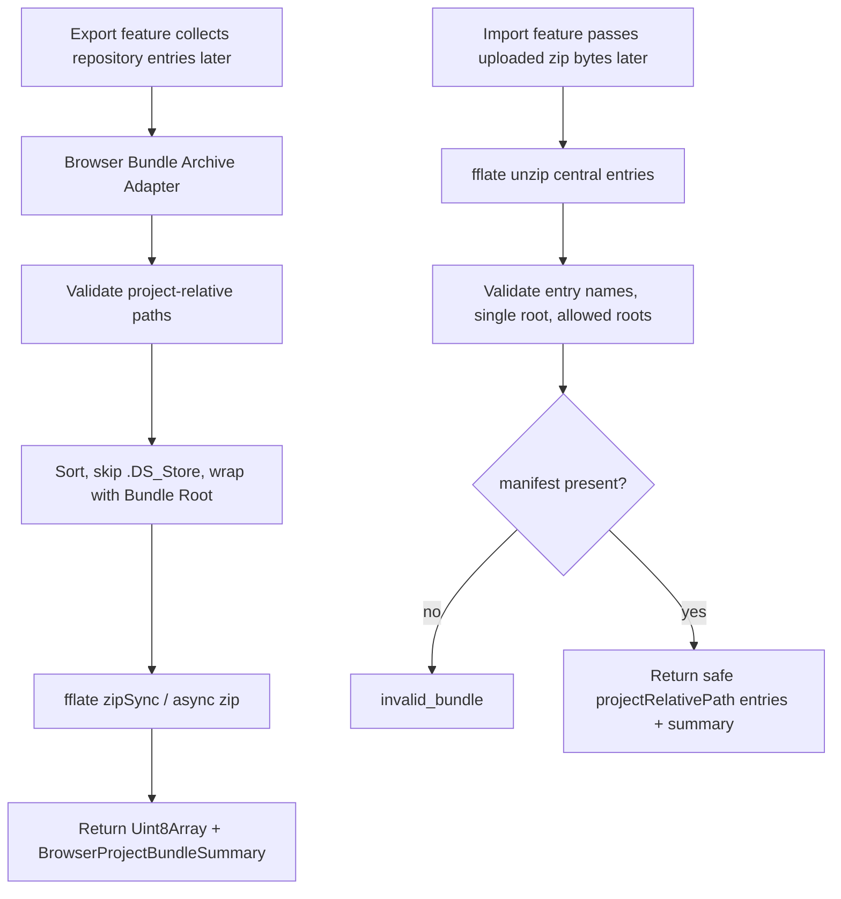

# Web Project Bundle Archive Adapter

## 0. 术语约定

- **Browser Bundle Archive Adapter**：Web 侧纯 TypeScript archive helper，接收 project-relative bytes entries，输出 / 读取 `.rxnflow.zip` bytes，不依赖 React UI、ShellClient 或 Browser Project Repository。
- **Browser Project Bundle Entry**：一个 bundle 文件条目，包含 `projectRelativePath`、`bytes`、`byteSize` 和 `checksum`；它不包含 zip root 前缀。
- **Bundle Root**：zip 内唯一 top-level directory，例如 `demo.rxnflow/`；所有实际文件都必须位于该 root 下。
- **Bundle Entry Safety**：对 zip entry name 和 project-relative path 的安全校验，复刻 Python `ProjectBundleService` 的 single-root、POSIX relative、allowed roots 和 `inputs/raw` 限制。
- **Browser Project Bundle Summary**：Web import/export UI 后续可展示的 archive 摘要，包含 bundleName、rootName、projectId/projectName、fileCount、byteSize、checksum 和 validation 状态。
- **Zip Dependency Boundary**：Web archive adapter 唯一允许直接调用 zip 库的位置；其他 UI/repository 模块只消费 adapter 的 typed API。

术语检索结果：`Project Bundle`、`Browser Project Bundle Shape` 已在 roadmap、architecture 和 core `ProjectBundleService` 中存在；Web 侧目前只有 disabled Project Sidebar bundle entry，没有 zip IO。`.codestable/compound` 没有 Web zip 依赖决策记录。

## 1. 决策与约束

### 需求摘要

Web Workbench 已有 Browser Project Repository、Project Content files、raw input persistence 和 export artifact persistence，但 Project Sidebar 的 Import Bundle / Export Bundle 仍不可用。下一步需要先补一个不带 UI 的 archive adapter：它能在浏览器端创建 `.rxnflow.zip` bytes，也能从用户上传的 zip bytes 中检查 single-root、manifest、allowed roots 和 entry safety，并返回安全的 project-relative entries 与 summary。这样后续 export UI、import UI 和 repository writer 可以复用同一套 zip / path 语义。

### 明确不做

- 不启用 Project Sidebar Import Bundle / Export Bundle 按钮，不实现 file picker、download link、object URL 或导入成功 toast。
- 不把 bundle entries 写入 Browser Project Repository，也不创建新的 browser-local project。
- 不调用 Python `ProjectBundleService`、Platform Shell `project.export_bundle` / `project.import_bundle` 或 local-http bridge。
- 不深度校验 Project Content schema、ReactionGraph、ChemicalObject、EnergyProfile 或 ExportArtifact index；本 feature 只做 archive/path/manifest shallow semantics。
- 不实现 bundle 覆盖、合并、冲突解决、增量 patch 或自动 Save Bridge Session。
- 不实现 OPFS/chunking、Worker pool、Service Worker、云存储、账号或跨设备同步。
- 不改变核心 `.rxnflow.zip` allowed roots、manifest requirement、Project Content schema 或 Python CLI bundle 语义。

### 复杂度档位

Web archive orchestration = L3：新增独立 helper 和 tests，后续 UI/repository writer 会消费它，但本 feature 不接 UI。

Security/path semantics = L4：zip entry 输入不可信，必须覆盖 traversal、absolute path、backslash、多 root、root file、`__MACOSX`、duplicate entry、`inputs/*` 非 raw 等错误路径。

Dependency surface = L2：新增一个小型 zip 依赖，必须把依赖隔离在 adapter 内，避免后续 UI 直接散落调用。

Core integration = L1：不改 Python core；只复刻 core bundle contract。

### 关键决策

1. **使用 `fflate` 作为 Web zip 依赖**：`npm view fflate` 显示当前包为 MIT、带 TypeScript declarations，描述为浏览器/Node 可用的轻量压缩/解压库。相比 JSZip，它更适合 helper-only 阶段；JSZip 的链式文件 API 更友好但依赖面更重。
2. **adapter 输出 `Uint8Array`，不输出 `Blob`**：archive helper 保持平台无关，后续 Sidebar Export UI 再把 bytes 包装为 `Blob` / object URL。
3. **adapter 输入 entry list，不直接读 repository**：导出 helper 接收调用方整理好的 `BrowserProjectBundleEntry[]` 和 `rootName`；后续 export feature 再负责从 Browser Project Repository 收集 `.rxnflow/`、`inputs/raw/` 和 `exports/`。
4. **import/read 先校验 central directory 语义再暴露 entries**：`inspect` / `read` 遇到任何非法 entry 直接返回 structured error；后续 import writer 不会看到半安全、半非法的 entries。
5. **summary 是 shallow archive summary**：从 manifest JSON 尝试提取 `id` / `name` / `schema_version`，但不验证完整 manifest schema 或 Project Content index。
6. **稳定 zip 输出优先**：导出按 project-relative path 排序，跳过 `.DS_Store` 和 `__MACOSX`，并使用与 Python core 一致的固定时间口径；如果 `fflate` API 对权限位/mtime 有表达限制，实现阶段需要在 adapter tests 中固定可观测输出。
7. **symlink 语义按可观测能力处理**：如果 `fflate` 暴露 zip external attributes，就拒绝 Unix symlink entry；如果不暴露，Web import 仍不会解压到真实文件系统或创建 symlink，但 design/checklist 要保留 symlink guard 调研与测试结论。

### 前置依赖

roadmap `rxnflow-web-project-portability` 已规定 Browser Project Bundle Shape；core `ProjectBundleService` 已落地 `.rxnflow.zip` import/export、allowed roots 和安全路径校验；Web 已有 Browser Project Repository 和 raw/export bytes anchors。

## 2. 名词与编排

### 2.1 名词层：值对象 / 实体 / 接口契约

**现状**

- Python core `ProjectBundleService` 以本地 Project Directory 为输入/输出，`ProjectBundleSummary` 字段是 `bundle_path/project_path/project_id/root_name/file_count/byte_size/checksum/validation_summary`。
- Roadmap 4.2 已定义 Web `BrowserProjectBundleEntry` 和 `BrowserProjectBundleSummary`，并要求 bundle 恰好一个 top-level root、必须有 `<root>/.rxnflow/manifest.json`、只允许 `.rxnflow/**`、`inputs/raw/**`、`exports/**`。
- Web `BrowserProjectRepository` 已提供 `listObjects/readObject/writeObject` 和 project-relative POSIX path 校验，但没有 archive helper 或 zip dependency。
- Project Sidebar 目前只显示 disabled bundle actions；component test 明确 guard “without enabling zip IO”。

**变化**

新增 Web archive adapter 类型：

```ts
type BrowserProjectBundleEntry = {
  name: string
  projectRelativePath: string
  bytes: Uint8Array
  byteSize: number
  checksum: `sha256:${string}`
}

type BrowserProjectBundleSummary = {
  bundleName: string
  rootName: string
  projectId?: string | null
  projectName?: string | null
  fileCount: number
  byteSize: number
  checksum: `sha256:${string}`
  validation: {
    state: "not_checked" | "valid" | "warning" | "error"
    issueCount: number
  }
}

type BrowserProjectBundleArchive =
  | { ok: true; summary: BrowserProjectBundleSummary; bytes: Uint8Array }
  | { ok: false; error: BrowserProjectBundleError }

type BrowserProjectBundleReadResult =
  | { ok: true; summary: BrowserProjectBundleSummary; entries: BrowserProjectBundleEntry[] }
  | { ok: false; error: BrowserProjectBundleError }

type BrowserProjectBundleError = {
  code: "invalid_bundle" | "invalid_input" | "zip_failed"
  message: string
  target?: string | null
  details?: unknown
}
```

拟暴露 helper：

```ts
createBrowserProjectBundleArchive(input: {
  bundleName?: string
  rootName: string
  entries: BrowserProjectBundleEntry[]
}): Promise<BrowserProjectBundleArchive>

inspectBrowserProjectBundleArchive(input: {
  bundleName: string
  bytes: Uint8Array
}): Promise<BrowserProjectBundleReadResult>

readBrowserProjectBundleArchive(input: {
  bundleName: string
  bytes: Uint8Array
}): Promise<BrowserProjectBundleReadResult>
```

边界：

- `projectRelativePath` 必须是 POSIX relative normalized file path；禁止空 path、绝对路径、反斜杠、`.`、`..`、root file、`__MACOSX` 和 allowed roots 外路径。
- `inputs/` 下只允许 `inputs/raw/...`。
- writer 会跳过 `.DS_Store` 和任何包含 `__MACOSX` path segment 的 input entry；reader 遇到这类 zip entry 直接失败。
- `name` 是 zip entry name 或 file basename 的 display field；权限、目录 entry、compression metadata 不进入长期 domain type。
- `checksum` 使用 SHA-256，沿用 Web repository checksum 口径。

### 2.2 编排层：主流程与控制流



**现状**

- Web 侧没有 zip read/write path，bundle UI 也没有可调用 helper。
- Python core 的 bundle export 会先验证 project content，再收集 `.rxnflow/`、`inputs/raw/`、`exports/`，排序后写入固定 timestamp 的 zip。
- Python core import 会检查 zip central directory，再解压到临时目录，拒绝 unsafe entry、多 root、missing manifest 和 existing destination。

**变化**

- 新增一个不依赖 UI 的 archive adapter，后续 export/import feature 只通过它读写 zip。
- writer flow：调用方提供 entries → adapter 校验 rootName 和每个 `projectRelativePath` → 跳过 export-only metadata entry → 按 path 排序 → 写入 `<rootName>/<projectRelativePath>` → checksum 最终 zip bytes → 返回 summary。
- reader flow：adapter 解压 zip metadata/entries → 校验每个 zip entry name → 确认恰好一个 root → 确认 `<root>/.rxnflow/manifest.json` file 存在 → 读取 file bytes → 计算 entry checksum 和 bundle checksum → 尝试从 manifest 提取 project id/name → 返回 entries + summary。
- `inspect` 和 `read` 第一版可共享实现；如果后续需要只读 summary 不加载全部 bytes，再拆出 lazy/read-metadata path。

**跨层纪律**

- Archive authority：adapter 是 Web zip/path safety 的唯一入口；UI 和 repository writer 不直接调用 `fflate`。
- No partial import：reader 任何非法 entry 都返回 error，不返回部分 entries。
- Core parity：错误边界必须覆盖 Python `ProjectBundleService` 已有 unsafe bundle tests；字段命名可 Web 化，但语义不能变。
- Determinism：writer 排序和固定 timestamp 必须让相同 entries 生成相同 bytes/checksum，除非 zip 库限制被测试记录为不可避免。
- Manifest shallow parse：manifest 只用于 summary，不通过失败 parse 伪装成 content validation；真正内容校验留给后续 import/open bridge。
- Uninstallability：删除 adapter 和依赖后，当前 Web UI 仍回到 disabled bundle actions，不影响 Import Inbox、Graph Canvas、Energy/Profile、Report Export。

### 2.3 挂载点清单

- Web package dependency：新增 `fflate` 作为 `web/` dependency，限制在 archive adapter import。
- Browser Bundle Archive Adapter module：新增纯 TypeScript helper，负责 zip read/write、entry safety、summary 和 structured error。
- Archive adapter tests：覆盖 writer/reader 成功、稳定输出、unsafe entry、allowed roots 和 summary extraction。
- Roadmap/feature artifacts：标记该 item 进入 implementation，后续 export/import UI feature 依赖本 adapter。

不挂入 React Project Sidebar、WorkbenchShell、Browser Project Repository write path、ShellClient、Python core、local-http bridge 或 docs/user。

### 2.4 推进策略

1. **Zip dependency boundary**：安装 `fflate`，建立 archive adapter module 和最小 typed result/error shape。
   - 退出信号：Web build/test 可解析依赖；grep 只有 adapter/tests import `fflate`。
2. **Path safety parity**：实现 bundle root、entry name、project-relative path、allowed roots、duplicate entry 和 export skip rules。
   - 退出信号：tests 覆盖 absolute/backslash/dotdot/dot/empty/root file/multi-root/`__MACOSX`/outside roots/`inputs` 非 raw/duplicate。
3. **Archive writer**：从 safe entries 生成 `.rxnflow.zip` bytes、固定排序/mtime、checksum 和 summary。
   - 退出信号：manifest + raw + export entries 生成单 root archive；同输入重复输出 checksum 稳定；`.DS_Store` 和 `__MACOSX` 被跳过。
4. **Archive reader**：从 zip bytes 读取 safe project-relative entries，校验 manifest present，并提取 shallow summary。
   - 退出信号：roundtrip tests 返回 `.rxnflow/manifest.json`、`inputs/raw/...`、`exports/...` entries，entry checksum/fileCount/byteSize 正确。
5. **Scope guards and verification**：证明没有启用 UI/repository writer/shell bridge，并跑 Web test/build。
   - 退出信号：`npm run test -- --run`、`npm run build` 通过；scope grep 确认无 file picker/download/object URL/sidebar action 接入。

## 3. 验收契约

### 关键场景清单

1. 输入 manifest、Project Content state、`inputs/raw/water.xyz` 和 `exports/profile.png` entries，writer 生成 `.rxnflow.zip` bytes，zip 内所有文件位于同一个 Bundle Root 下。
2. 同一输入重复 writer，输出 checksum 保持稳定。
3. writer 跳过 `.DS_Store` 和包含 `__MACOSX` segment 的 export-only metadata entry。
4. writer 拒绝空 root、含 `/` 或 `\` 的 root、root 为 `.` / `..` / `__MACOSX`。
5. writer 拒绝 absolute path、backslash、empty segment、`.`、`..`、allowed roots 外文件、root file 和 `inputs/cache/...`。
6. reader 能读取 writer 生成的 archive，返回 project-relative entries、entry checksum、bundle checksum、fileCount 和 byteSize。
7. reader 从 `<root>/.rxnflow/manifest.json` 提取 project id/name 到 summary；manifest JSON 无法解析时仍返回 structured `invalid_bundle` 或明确的 warning/error 状态，不崩溃。
8. reader 拒绝 multi-root archive、missing manifest、duplicate entry、absolute path、backslash、`.`、`..`、root file、`__MACOSX`、allowed roots 外 entry 和 `inputs/` 非 raw entry。
9. 如果 zip metadata 可判断 symlink，reader 拒绝 symlink entry；如果不可判断，测试或实现注释明确 Web 不创建 filesystem symlink 的限制。
10. `fflate` 只在 archive adapter module/tests 中被 import，React UI 和 repository 模块不直接依赖 zip 库。
11. Project Sidebar bundle actions 保持 disabled/unavailable；本 feature 不触发 file picker、download、object URL 或 repository import/export write。
12. `npm run test -- --run` 和 `npm run build` 通过。

### 明确不做的反向核对项

- 不改 Python `ProjectBundleService`、Platform Shell bundle commands、CLI 或 core Project Content validation。
- 不新增 Project Sidebar import/export UI 行为，不启用按钮。
- 不创建 browser-local project，不写 Browser Project Repository。
- 不调用 local-http bridge 或 Shell command。
- 不实现 cloud/OPFS/chunking/Worker/Service Worker。
- 不把 manifest shallow parse 当作 Project Content deep validation。

## 4. 与项目级架构文档的关系

Acceptance 阶段需要更新：

- `.codestable/architecture/web-workbench.md`：记录 Web Browser Bundle Archive Adapter、`fflate` dependency boundary、Bundle Entry Safety 和 helper-only 范围。
- `.codestable/architecture/ARCHITECTURE.md`：补 Web 项目可携带性已有 archive adapter，但 Sidebar import/export 和 repository writer 仍待后续 feature。
- `.codestable/requirements/project-content-persistence.md`：补 Web `.rxnflow.zip` archive helper 已能读写安全 bundle bytes，但还不等同于用户可见 import/export。
- roadmap items/main doc：验收时标记 `web-project-bundle-archive-adapter` done，并保持 export/import 子项 planned。

不更新 user guide；用户还不能在 UI 里导入/导出 bundle。
