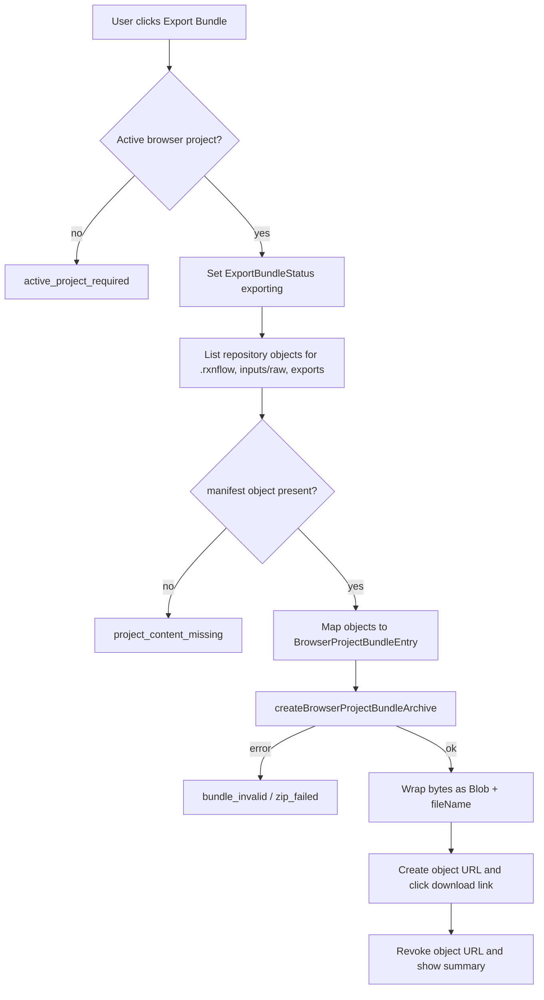

# Web Project Bundle Export

## 0. 术语约定

- **Browser Bundle Export Action**：Web 侧从 active Browser Project Repository project 收集 `.rxnflow/`、`inputs/raw/` 和 `exports/` bytes，调用 Browser Bundle Archive Adapter，返回 downloadable `Blob` 的编排动作。
- **Export Bundle Status**：Project Sidebar 中只服务导出的 UI-only 状态，表达 idle/exporting/success/error、summary、fileName 和 error，不写入 Project Content 或 repository。
- **Export Bundle Download**：浏览器端一次性下载动作，使用 `.rxnflow.zip` `Blob` 和 object URL；URL 必须在触发后 revoke。
- **Current Repository Bytes**：导出只读取 Browser Project Repository 已存在 bytes，不从 Shell session、runtime artifacts 或 React state 生成缺失文件。
- **Unsaved Bridge Hint**：如果当前 bridge session 已打开，导出区域提示用户需要先显式 Save Bridge Session 才能把 session 内改动写入 bundle；它不是自动保存。

术语检索结果：`Browser Bundle Archive Adapter`、`Browser Project Bundle Entry`、`Browser Project Bundle Summary` 已由上一条 feature 落地；`Project Sidebar` 现有 bundle action 仍 disabled。`.codestable/compound` 暂无相关沉淀文档。

## 1. 决策与约束

### 需求摘要

Web Workbench 已有 Browser Project Repository、raw input persistence、export artifact persistence 和 Web archive adapter。现在需要把 Project Sidebar 的 Export Bundle 从 unavailable 变成可操作：用户选择 active browser-local project 后，点击 Export Bundle，Web 从 repository 读取 `.rxnflow/`、`inputs/raw/` 和 `exports/` 下已有对象，生成 `.rxnflow.zip` 并触发下载，同时展示 bundle summary 或结构化错误。

### 明确不做

- 不实现 Import Bundle、file picker、new project writer、覆盖/合并/冲突解决或 roundtrip import。
- 不自动调用 `project.save_content`、Open Bridge、`project.export_bundle`、Python `ProjectBundleService`、local-http bridge 或任何 Shell command。
- 不生成缺失的 `.rxnflow/state/*.json`、raw input、PNG、CDXML、XLSX 或 export artifact bytes。
- 不把 runtime `ShellArtifact.bytes_base64`、当前 React `WorkbenchDomainState`、未保存 bridge session 或 inline download data URL 拼进 bundle。
- 不做 Project Content deep validation、schema migration 或跨 section 引用校验；这里只依赖 repository shallow bytes 和 archive adapter shallow manifest summary。
- 不实现云存储、账号、StorageManager.persist、OPFS/chunking、Worker pool、Service Worker 或后台同步。
- 不改变 `.rxnflow.zip` allowed roots、bundle root、manifest required、Project Content schema、i18n runtime 或 repository path contract。

### 复杂度档位

Web UI orchestration = L3：新增可见 Sidebar action、状态展示和下载副作用，需要 component tests 与真实浏览器验证。

Repository export collection = L3：从多个 prefix 收集 bytes，要求 `.rxnflow/manifest.json` 存在，跳过空 prefix，不写 repository。

Download side effect = L2：一次性 object URL + click；必须可 revoke，避免泄漏。

Core integration = L1：不改 Python core，不接 Shell command；只消费上一条 archive adapter。

### 关键决策

1. **新增导出 action helper，而不是把逻辑塞进 React 组件**：Browser Bundle Export Action 负责 active project guard、prefix collection、entry mapping、archive adapter call 和 structured result；ProjectSidebar 只渲染状态并触发回调。
2. **导出以 repository 当前 bytes 为唯一数据源**：如果 bridge session 里有未保存图谱/对象/profile，UI 只提示 Save Bridge Session；导出 action 不替用户保存。
3. **`project_content_missing` 对应缺 manifest 或 repository 内容不完整**：缺 `.rxnflow/manifest.json` 时导出失败；`.rxnflow/state/...` 是否齐全由 repository shallow validation 和后续 open/validation 流程处理，本 feature 不补文件。
4. **bundle root 默认来自 active project name**：rootName 使用 project name 的安全化形式，fileName 采用同一安全 base 加 `.rxnflow.zip`；如果安全化为空，回退到 project id/ref 的稳定片段。
5. **Import Bundle 保持 disabled**：本 feature 只启用 Export Bundle；Import Bundle 的 disabled 文案需要调整为“导入将在后续版本支持”，避免误导用户以为 export 也不可用。
6. **download 副作用留在 WorkbenchShell 或窄 helper**：action 返回 `Blob`/fileName/summary；UI 层负责创建 object URL、触发 `<a download>` click 并在 finally revoke。
7. **状态是 UI-only**：Export Bundle Status 不写入 ProjectSidebarState 的 repository-derived 核心字段，也不改变 project validation/persistence/bridge 状态。

### 前置依赖

roadmap `web-project-bundle-archive-adapter` 已 done；Web archive adapter 已提供 `createBrowserProjectBundleArchive`、allowed roots、manifest required、stable zip 和 summary。Browser Project Repository 已提供 `listObjects(projectRef, prefix)` 和 bytes objects。Project Sidebar 已有 bundle section、i18n 和 disabled buttons。

## 2. 名词与编排

### 2.1 名词层：值对象 / 实体 / 接口契约

**现状**

- `ProjectSidebarState` 只描述 project list、active project、persistence、validation、bridge、lastWrite 和 repository error；没有 bundle/export 状态。
- `ProjectSidebar.tsx` 渲染 Import Bundle / Export Bundle 两个 disabled button 和统一 unavailable 文案。
- `BrowserProjectRepository` 可按 prefix 列出 `BrowserStorageObject`，每个 object 带 path、bytes、checksum、metadata。
- `projectBundleArchive.ts` 接收 `BrowserProjectBundleEntry[]` 和 rootName，返回 `Uint8Array` archive bytes + `BrowserProjectBundleSummary`，但不读 repository、不产出 Blob。
- roadmap 4.3 已规定 `ExportBrowserBundleRequest/Result` 和错误码：`active_project_required`、`project_content_missing`、`bundle_invalid`、`storage_failed`、`zip_failed`。

**变化**

新增 Web export result 契约，保持 roadmap 错误语义：

```ts
type ExportBrowserBundleRequest = {
  projectRef: string
  rootName?: string
  includePrefixes: [".rxnflow", "inputs/raw", "exports"]
}

type ExportBrowserBundleResult =
  | {
      ok: true
      summary: BrowserProjectBundleSummary
      blob: Blob
      fileName: `${string}.rxnflow.zip`
    }
  | {
      ok: false
      error: {
        code:
          | "active_project_required"
          | "project_content_missing"
          | "bundle_invalid"
          | "storage_failed"
          | "zip_failed"
        message: string
        target?: string | null
      }
    }
```

新增 Project Sidebar 可见状态：

```ts
type ExportBundleStatus =
  | { state: "idle" }
  | { state: "exporting" }
  | { state: "success"; fileName: string; summary: BrowserProjectBundleSummary }
  | { state: "error"; error: ExportBrowserBundleResult["error"] }
```

边界：

- helper 只收集 `.rxnflow`、`inputs/raw`、`exports` 三个 prefix；其他 repository object 不进入 bundle。
- `BrowserStorageObject` 映射为 `BrowserProjectBundleEntry` 时保留 path/bytes/checksum/byteSize；checksum 缺失时复算。
- `Blob` MIME type 使用 `application/zip`。
- `fileName` 必须以 `.rxnflow.zip` 结尾，且不能包含 slash/backslash。
- error message 是 UI 可显示短句；error code/target 保留动态原文，不进入 catalog 翻译。

### 2.2 编排层：主流程与控制流



**现状**

- Project Sidebar bundle actions 没有 callback props，也不会触发 file picker/download。
- WorkbenchShell 已把 project creation/open/save/open bridge/save bridge 的副作用放在 callbacks 内，并用 `projectSidebarStateRef` 避免 stale state。
- Report Export Panel 的 inline artifact download 使用 data URL；项目包导出需要 object URL，因为 zip bytes 可能较大且来自 Blob。
- 当前 bundle adapter helper-only；Project Sidebar tests guard export button disabled。

**变化**

- ProjectSidebar 增加 `onExportBundle` callback 和 `exportBundleStatus` prop；Export Bundle button 在 active project 存在且不 busy 时 enabled，Import Bundle 仍 disabled。
- WorkbenchShell 增加 `exportBundleStatus` UI state 和 `exportBrowserProjectBundle` callback：读取 active project ref，调用 export action，成功后触发 download，失败后展示 structured error。
- 导出 action 的 repository 收集顺序固定为 `.rxnflow`、`inputs/raw`、`exports`，再由 archive adapter 做最终 path safety、排序、skip metadata 和 summary。
- 成功后 sidebar 展示 fileName、fileCount、byteSize、checksum、projectName/rootName；失败显示 error code/message/target。
- 如果 bridge state 为 `open`，sidebar 在 bundle section 显示 unsaved bridge hint：用户需要点击 Save Bridge Session 才能把当前 session changes 写入 repository 后再导出。该提示不判断精确 dirty state，也不阻止导出。

**跨层纪律**

- Repository read-only：export feature 对 Browser Project Repository 只调用 `listObjects` / 可能的 manifest existence check，不调用 `writeObject` / `deleteObject`。
- No shell side effect：导出不触发 `project.save_content`，不从 ShellResponse 读取 bytes，不调用 Python ProjectBundleService。
- Single authority：zip 生成仍只通过 Browser Bundle Archive Adapter；导出 action 不直接 import `fflate`。
- Object URL lifecycle：每次成功下载创建的 URL 必须在同一 callback 的 finally 或短延迟后 revoke；不把 URL 存进 React state。
- I18n completeness：新增 Sidebar 文案必须同时补 `en-US` 与 `zh-CN` catalog，key 完整性测试继续通过。
- Uninstallability：删除 export action/helper、Sidebar callback/status 和 tests 后，Project Sidebar 可以回到 disabled bundle entry，其他 Project Content、Import Inbox、Report Export 不受影响。

### 2.3 挂载点清单

- Browser Bundle Export Action module：新增 repository-prefix collection、entry mapping、Blob wrapping、fileName/rootName safety 和 structured errors。
- WorkbenchShell export orchestration：新增 export status state、download object URL lifecycle 和 ProjectSidebar callback wiring。
- ProjectSidebar bundle section：Export Bundle button enabled、Import Bundle 保持 disabled、summary/error/unsaved bridge hint UI。
- I18n catalog and CSS：新增中英文文案与紧凑状态样式，保证桌面/窄屏不挤压。
- Component/unit tests：覆盖 success download、缺 active project/manifest/storage/archive error、Import Bundle 仍 disabled、不会调用 shell save 和 repository write。

不挂入 Python core、Platform Shell bundle commands、local-http bridge、ProjectContentValidator、Browser Project Repository writer/import path、ReportExportPanel 运行态 artifact 生成或 user guide。

### 2.4 推进策略

1. **Export action contract**：新增 export action helper，定义 request/result/error/status 形状和 project name -> root/fileName safety。
   - 退出信号：unit tests 覆盖 active project guard、缺 manifest、prefix collection、checksum fallback 和 filename suffix。
2. **Archive adapter bridge**：把 repository objects 映射为 `BrowserProjectBundleEntry[]` 并调用 `createBrowserProjectBundleArchive`。
   - 退出信号：manifest + state + raw + export repository objects 生成 Blob summary；allowed roots 仍由 adapter 拒绝。
3. **Sidebar UI wiring**：ProjectSidebar 接收 export props，启用 Export Bundle，保留 Import Bundle disabled，并展示 exporting/success/error/hint。
   - 退出信号：component tests 能点击 Export Bundle 并看到 fileName/fileCount/checksum；无 active project 时 disabled 或返回 active_project_required。
4. **Download lifecycle**：WorkbenchShell 成功导出后创建 object URL、触发 download、revoke URL，不持久化 URL。
   - 退出信号：tests mock `URL.createObjectURL/revokeObjectURL` 和 anchor click，确认调用成对发生。
5. **Scope guards and verification**：补 i18n/CSS，更新 disabled bundle test，跑 Web test/build 和浏览器桌面/窄屏验证。
   - 退出信号：`npm run test -- --run`、`npm run build`、desktop + narrow browser smoke 通过；grep 确认不调用 Shell bundle/save 和 repository write。

## 3. 验收契约

### 关键场景清单

1. active browser project 含 `.rxnflow/manifest.json`、Project Content state、`inputs/raw/demo.xyz` 和 `exports/profile.png` 时，点击 Export Bundle 触发 `.rxnflow.zip` 下载，summary 显示 fileCount、byteSize、checksum、rootName/projectName。
2. 导出的 zip 只包含一个 bundle root，root 下只含 `.rxnflow/`、`inputs/raw/` 和 `exports/` repository bytes。
3. 没有 active browser project 时 Export Bundle 不可用，或 action 返回 `active_project_required`，不创建 object URL。
4. active project 缺 `.rxnflow/manifest.json` 时返回 `project_content_missing`，不下载。
5. repository `listObjects` 失败时返回 `storage_failed`，错误 code/message/target 在 sidebar 可见。
6. archive adapter 返回 unsafe path / missing manifest / invalid bundle 时映射为 `bundle_invalid` 或 `zip_failed`，不下载。
7. bridge session 已打开时，bundle section 显示先 Save Bridge Session 的提示；点击 Export Bundle 不自动调用 `project.save_content`。
8. Export Bundle 成功后 `URL.createObjectURL` 和 `URL.revokeObjectURL` 成对调用；object URL 不存入长期 state。
9. Import Bundle button 仍 disabled，不触发 file picker、repository writer 或 import flow。
10. 导出不调用 `ShellClient.run`、Python `project.export_bundle`、local-http bridge 或 Browser Project Repository `writeObject/deleteObject`。
11. 新增 i18n key 在 `en-US` / `zh-CN` 中完全一致；中英文状态文案均可渲染。
12. Sidebar bundle section 在桌面与窄屏浏览器里按钮、summary、error 文本不重叠。
13. `npm run test -- --run` 和 `npm run build` 通过。

### 明确不做的反向核对项

- 不实现 Import Bundle、file picker、新项目导入 writer、覆盖/合并或 roundtrip import。
- 不自动 Save Bridge Session，不调用 Shell command 或 Python bundle service。
- 不生成缺失 raw/export/project content bytes。
- 不做 Project Content deep validation 或 schema migration。
- 不实现 cloud/OPFS/chunking/Worker/Service Worker。
- 不改变 archive adapter allowed roots、安全路径或核心 `.rxnflow.zip` 语义。

## 4. 与项目级架构文档的关系

Acceptance 阶段需要更新：

- `.codestable/architecture/web-workbench.md`：记录 Project Sidebar Export Bundle 已启用、只读 Browser Project Repository、object URL lifecycle、Import Bundle 仍待后续 feature。
- `.codestable/architecture/ARCHITECTURE.md`：补 Web 侧用户可见 `.rxnflow.zip` 导出路径。
- `.codestable/requirements/project-content-persistence.md`：补 Web 用户能把 browser-local project 手动导出为 `.rxnflow.zip` 备份/迁移，但需先显式 Save Bridge Session。
- roadmap items/main doc：验收时标记 `web-project-bundle-export` done，保持 import/roundtrip/QA planned。

用户指南可在 portability QA/guides 收口时统一补；本 feature acceptance 只需在架构/需求中记录当前能力边界。
