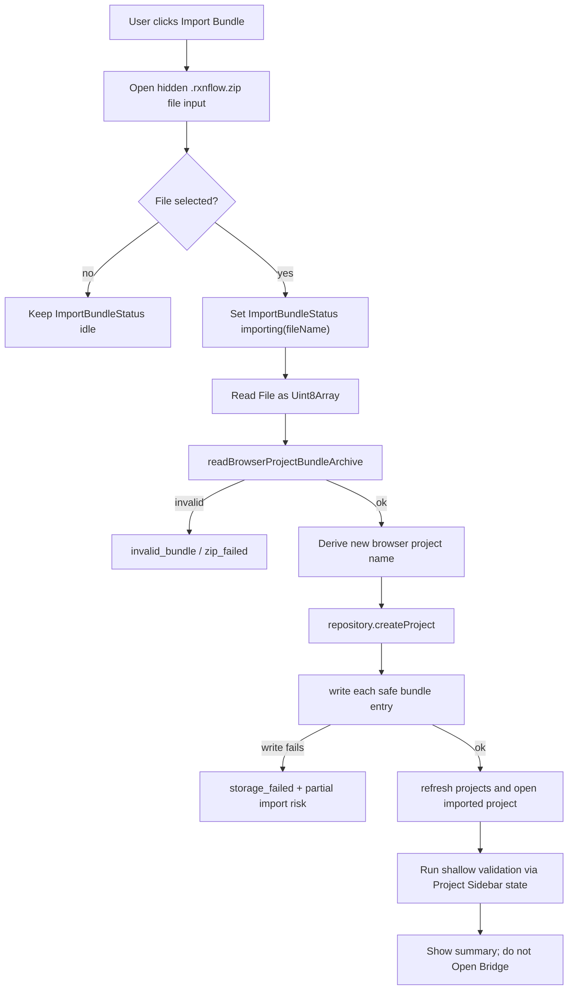

# Web Project Bundle Import

## 0. 术语约定

- **Browser Bundle Import Action**：Web 侧读取用户选择的 `.rxnflow.zip` `File`，调用 Browser Bundle Archive Adapter，创建新的 Browser Project Repository project，并把安全 entries 写入该 project 的编排动作。
- **Import Bundle Status**：Project Sidebar 中只服务导入的 UI-only 状态，表达 idle/importing/success/error、summary、project、receipts 和 error，不写入 Project Content 或 WorkbenchDomainState。
- **Bundle Import File Picker**：Project Sidebar 内隐藏 file input + 可见 Import Bundle button；只接受 `.rxnflow.zip`，选择文件后立即触发 import，之后清空 input value 以允许重复选择同一文件。
- **Create New Project Policy**：Web import 第一版总是创建新的 browser-local project，不覆盖、不合并、不写当前 active project。
- **Import Write Receipts**：Browser Project Repository `writeObject` 返回的每个 bundle entry 写入凭据，用于 UI summary 与验收，不代表深 Project Content validation。
- **Partial Import Risk**：现有 Browser Project Repository API 没有暴露跨 object 事务；完整 archive 校验后才创建 project / 写 entries，但写入中失败时可能留下已创建 project 或部分 objects，UI 必须显示风险。

术语检索结果：`Browser Bundle Archive Adapter`、`Browser Project Bundle Entry`、`Browser Project Bundle Summary`、`Browser Bundle Export Action` 已落地；核心层 `ProjectBundleService.import_bundle` 使用本地目录临时解包 + rename 原子化，但 Web repository 当前没有同等事务 API。`.codestable/compound` 暂无相关沉淀文档。

## 1. 决策与约束

### 需求摘要

Web Workbench 已能保存 browser-local Project Content files、持久化 raw inputs / export artifacts，并能从 Project Sidebar 导出 `.rxnflow.zip`。现在需要启用 Project Sidebar 的 Import Bundle：用户选择一个安全 `.rxnflow.zip` 后，Web 在浏览器端读取 zip，复用 archive adapter 的 single-root / manifest / allowed roots / path safety 校验，创建新的 browser-local project，写入 bundle entries，刷新 Project Sidebar 并把 active project 指向新项目，同时展示导入 summary 或结构化错误。

### 明确不做

- 不覆盖、合并、改名或写入当前 active browser project；不实现 conflict UI、diff、merge、roundtrip QA 或冲突解决。
- 不自动 Open Bridge、`project.open`、`project.save_content`、`project.import_bundle`、Python `ProjectBundleService`、local-http bridge 或任何 Shell command。
- 不做 Project Content deep validation、schema migration、跨 section 引用校验或自动修复；只用 archive adapter shallow summary + 现有 Project Sidebar shallow validation。
- 不重新解析 raw files，不登记 ChemicalObject，不计算 energy profile，不生成/刷新 report export artifacts。
- 不实现 cloud、账号、StorageManager.persist、OPFS/chunking、Worker pool、Service Worker、后台同步或跨设备实时同步。
- 不改变 `.rxnflow.zip` allowed roots、manifest required、Bundle Root、安全路径、Project Content schema、Browser Project Repository path contract 或 i18n runtime。
- 不新增 Browser Project Repository transaction API；写入中失败先暴露 partial import risk，后续如要 rollback/transaction 另起 feature。

### 复杂度档位

Web UI orchestration = L3：新增 file input、busy/success/error 状态、active project 切换和 i18n/CSS，需要 component tests 与真实浏览器验证。

Repository import writer = L4：从不可信 zip 到 repository writes，必须处理创建新项目、metadata、receipt、storage failure 和 partial import risk。

Archive safety reuse = L3：读取 zip 仍由 archive adapter 承担；import action 不能重复实现 zip/path safety，也不能看到非法 entries 后继续部分写入。

Core integration = L1：不改 Python core，不接 Shell command；只消费 Browser Bundle Archive Adapter 和 Browser Project Repository。

### 关键决策

1. **新增导入 action helper，而不是把写入逻辑塞进 React 组件**：Browser Bundle Import Action 负责 file bytes、archive read、project name derivation、new project creation、entry writes、receipts 和 structured result；ProjectSidebar 只渲染状态并触发 file picker。
2. **第一版固定 create_new_project**：导入总是创建新的 browser-local project；即使同名 project 已存在，也交给 repository 生成新的 projectRef，不覆盖、不合并、不自动 rename 已有项目。
3. **project name 优先来自 manifest name**：archive adapter summary 中 `projectName` 可用时作为新 project name；否则使用 bundle root 去掉 `.rxnflow` 后的安全显示名；再否则使用 uploaded file name 去掉 `.rxnflow.zip`。
4. **先完整读取并校验 archive，再创建 project**：`readBrowserProjectBundleArchive` 返回 `ok` 后才调用 `repository.createProject`；非法 zip 不创建 project、不写 object。
5. **写入 metadata 使用窄分类**：`.rxnflow/manifest.json` 标记 `project_manifest`，`.rxnflow/state/project-content.json` 标记 `project_content_index`，其他 `.rxnflow/state/*` 用文件名派生或 `project_content_file`，`inputs/raw/*` 标记 `raw_file`，`exports/*` 标记 `export_artifact`。
6. **Partial import risk 显式可见**：如果 createProject 成功后某个 `writeObject` 失败，返回 `storage_failed`，target 指向失败 path，并带 `partialProjectRef` / `writtenCount` 等 details；UI 显示该风险，不自动删除已写 objects。
7. **导入成功后刷新并激活新 project，但不 Open Bridge**：WorkbenchShell 调用现有 open/refresh state 路径或等效 helper，使 Project Sidebar active project 指向新项目，并运行 shallow validation；工作台 domain state 不因 import 改变。
8. **Export 与 Import 状态分离**：Project Sidebar 同时接收 `importBundleStatus` 和 `exportBundleStatus`；两者不互相覆盖 summary/error，但 busy 时互相禁用避免同一区域并发操作。

### 前置依赖

roadmap `web-project-bundle-archive-adapter` 和 `web-project-bundle-export` 已 done。Web archive adapter 已提供 `readBrowserProjectBundleArchive`、entry safety、summary 和 checksum。Browser Project Repository 已提供 `createProject` / `writeObject` / `listProjects`。Project Sidebar bundle section 已有 Import Bundle button、Export Bundle status、i18n 与 CSS 基础。

## 2. 名词与编排

### 2.1 名词层：值对象 / 实体 / 接口契约

**现状**

- `ProjectSidebar.tsx` 的 Import Bundle button 仍 disabled，只显示“后续启用”文案；没有 file input 或 import callback。
- `projectBundleArchive.ts` 能读取 `.rxnflow.zip` 为 safe `BrowserProjectBundleEntry[]` + `BrowserProjectBundleSummary`，但不创建 project、不写 repository。
- `BrowserProjectRepository` 单次 `createProject` 和 `writeObject` 各自独立；当前接口没有批量写入事务或 rollback。
- `projectSidebarActions.ts` 已有 `createProject/openProject/saveProjectContent` 和 shallow validation helpers，但没有从外部 entries 创建项目的 import action。
- roadmap 4.4 已规定 `ImportBrowserBundleRequest/Result` 和错误码：`invalid_bundle`、`unsupported_bundle`、`storage_failed`、`zip_failed`。

**变化**

新增 Web import result 契约：

```ts
type ImportBrowserBundleRequest = {
  file: File
  conflictPolicy: "create_new_project"
}

type ImportBrowserBundleResult =
  | {
      ok: true
      project: BrowserProjectRef
      summary: BrowserProjectBundleSummary
      receipts: BrowserWriteReceipt[]
    }
  | {
      ok: false
      error: {
        code:
          | "invalid_bundle"
          | "unsupported_bundle"
          | "storage_failed"
          | "zip_failed"
        message: string
        target?: string | null
        details?: {
          partialProjectRef?: string
          writtenCount?: number
          fileName?: string
        }
      }
    }
```

新增 Project Sidebar 可见状态：

```ts
type ImportBundleStatus =
  | { state: "idle" }
  | { state: "importing"; fileName: string }
  | {
      state: "success"
      project: BrowserProjectRef
      summary: BrowserProjectBundleSummary
      receiptCount: number
    }
  | { state: "error"; error: ImportBrowserBundleResult["error"] }
```

边界：

- request 第一版只接受 `File`；不接 drag/drop、URL、ArrayBuffer 或 multiple bundles。
- `File` name 不作为安全依据，只用于 UI message 和 fallback project name。
- entries 写入 repository 时使用 archive adapter 返回的 `projectRelativePath`，不保留 zip root 前缀。
- import action 不修改 bundle bytes、manifest id/name 或 Project Content section bytes。
- error message 是 UI 可显示短句；error code/target/details 保留动态原文，不进入 catalog 翻译。

### 2.2 编排层：主流程与控制流



**现状**

- Project Sidebar bundle section 已能展示 export success/error，但 import 只有 disabled button。
- WorkbenchShell 已集中处理 Project Sidebar callbacks，并用 `projectSidebarStateRef` 避免 stale state。
- Import Inbox 已有 file input 样式和 file selection pattern，可复用隐藏 input + label/button 交互经验。
- `openProject` 会刷新 projects、设置 activeProject、执行 shallow validation，并把 bridge 状态置回 idle。

**变化**

- ProjectSidebar 增加 `importBundleStatus`、`onImportBundleFileSelected` 或 `onImportBundle` callback；Import Bundle button 在非 busy 状态启用，点击触发隐藏 file input。
- WorkbenchShell 增加 import status state 和 `importBrowserProjectBundle` callback：读取 file，调用 import action，成功后打开 imported project（Project Sidebar active 指向新 project），失败后展示 structured error。
- 导入 action 的顺序固定为 read file bytes → archive adapter read → create project → write entries；adapter error 不创建 project。
- 成功后 sidebar 展示 imported project name、rootName、fileCount、byteSize、checksum 和 receiptCount。
- 导入成功不改变 `WorkbenchDomainState`、不创建 PlatformSession、不自动 Open Bridge；用户需要显式 Open Bridge 才恢复 core session。

**跨层纪律**

- Archive authority：zip 读取和安全 entry 校验只通过 Browser Bundle Archive Adapter；导入 action 不直接 import `fflate`。
- Repository create-only：导入写入新 projectRef，不写 active project，不调用 `deleteObject` / overwrite 旧 project。
- No shell side effect：导入不触发 `ShellClient.run`、`project.open`、`project.import_bundle` 或 local-http bridge。
- No partial unsafe import：archive adapter 返回 error 时不创建 project；只有 storage failure 可能发生在已创建 project 之后，并且必须显示 partial import risk。
- I18n completeness：新增 Sidebar 文案必须同时补 `en-US` 与 `zh-CN` catalog，key 完整性测试继续通过。
- Uninstallability：删除 import action/helper、Sidebar file input/status 和 tests 后，Project Sidebar 可回到 Import Bundle disabled 状态，Export Bundle、Import Inbox、Report Export 不受影响。

### 2.3 挂载点清单

- Browser Bundle Import Action module：新增 File bytes read、archive result mapping、project name derivation、repository create/write、metadata mapping、receipts 和 structured errors。
- WorkbenchShell import orchestration：新增 import status state、ProjectSidebar callback wiring、成功后打开 imported browser project、失败后展示 partial risk。
- ProjectSidebar bundle section：Import Bundle button/file input enabled、Import Bundle status summary/error、Export/Import busy 互斥。
- I18n catalog and CSS：新增中英文文案与 compact status/error 样式，保证桌面/窄屏不挤压。
- Component/unit tests：覆盖成功导入、非法 bundle、zip failure、storage failure/partial risk、Import 不调用 shell、不覆盖 active project、Export 仍可用。

不挂入 Python core、Platform Shell bundle commands、local-http bridge、ProjectContentValidator、Import Inbox parser preview/register、ReportExportPanel、云存储或 repository transaction API。

### 2.4 推进策略

1. **Import action contract**：新增 import action helper，定义 request/result/error/status、file bytes 读取和 project name fallback。
   - 退出信号：unit tests 覆盖 manifest name、rootName/fileName fallback、invalid/zip error mapping 和 conflictPolicy guard。
2. **Repository writer bridge**：把 archive entries 写入新 Browser Project Repository project，补 metadata mapping、receipt collection 和 storage failure partial risk。
   - 退出信号：safe bundle 导入后 repository 中存在 `.rxnflow/manifest.json`、state、raw、export objects；非法 bundle 不创建 project；写入失败返回 partialProjectRef/writtenCount。
3. **Sidebar UI wiring**：ProjectSidebar 接收 import props，启用 Import Bundle file picker，展示 importing/success/error/partial risk，并保持 Export Bundle 正常。
   - 退出信号：component tests 能选择 `.rxnflow.zip` 并看到 imported project、fileCount/checksum/receiptCount；错误 code/message/target 可见。
4. **WorkbenchShell active project refresh**：导入成功后刷新 Project Sidebar 并打开新 project，执行 shallow validation；不改 WorkbenchDomainState、不 Open Bridge。
   - 退出信号：测试确认 active project 是 imported project，Workbench snapshot 不被导入动作覆盖，`project.open` / `project.import_bundle` 未调用。
5. **Scope guards and verification**：补 i18n/CSS，跑 Web test/build 和浏览器桌面/窄屏验证。
   - 退出信号：`npm run test -- --run`、`npm run build`、desktop + narrow browser smoke 通过；grep 确认不调用 Shell bundle/open/save，不写 active project，不引入 cloud/OPFS/Worker。

## 3. 验收契约

### 关键场景清单

1. 用户选择一个包含 `.rxnflow/manifest.json`、Project Content state、`inputs/raw/demo.xyz` 和 `exports/profile.png` 的 `.rxnflow.zip`，Import Bundle 创建新的 browser-local project，写入所有 safe entries，Project Sidebar active project 指向新 project，并展示 rootName、fileCount、byteSize、checksum、receiptCount。
2. 导入后的 repository object paths 不包含 bundle root 前缀，只包含 `.rxnflow/`、`inputs/raw/` 和 `exports/` project-relative bytes。
3. project name 优先使用 manifest `name`；manifest 缺 name 时使用 bundle root；root 不适合显示时使用 file name fallback。
4. 用户取消 file picker 时保持 idle，不创建 project、不写 repository。
5. 非 zip、坏 zip、multi-root、missing manifest、unsafe path、`inputs/` 非 raw、duplicate 或 symlink bundle 返回 `invalid_bundle` 或 `zip_failed`，不创建 project。
6. repository `createProject` 失败时返回 `storage_failed`，不写 object，错误 code/message/target 可见。
7. repository `writeObject` 中途失败时返回 `storage_failed`，展示 partial import risk、partialProjectRef 和 writtenCount；不自动删除已写 objects。
8. Import Bundle 成功不调用 `ShellClient.run`、Python `project.import_bundle`、`project.open`、`project.save_content` 或 local-http bridge。
9. Import Bundle 不覆盖当前 active project；已有 active project 的 objects 保持不变，新 projectRef 不同。
10. 导入成功后不自动 Open Bridge；bridge state 为 idle，用户可显式点击 Open Bridge。
11. Export Bundle 仍可用；Import/Export busy 状态互相禁用，summary/error 不互相覆盖。
12. 新增 i18n key 在 `en-US` / `zh-CN` 中完全一致；中英文导入状态文案均可渲染。
13. Sidebar bundle section 在桌面与窄屏浏览器里 file picker button、summary、error/partial 文本不重叠。
14. `npm run test -- --run` 和 `npm run build` 通过。

### 明确不做的反向核对项

- 不覆盖、合并、改名已有 project，不写当前 active project，不做 roundtrip QA。
- 不自动 Open Bridge，不调用 Shell command 或 Python bundle service。
- 不重新解析 raw files、不登记对象、不计算能量、不生成报告 artifact。
- 不做 Project Content deep validation、schema migration 或自动修复。
- 不实现 cloud/OPFS/chunking/Worker/Service Worker/repository transaction API。
- 不改变 archive adapter allowed roots、安全路径或核心 `.rxnflow.zip` 语义。

## 4. 与项目级架构文档的关系

Acceptance 阶段需要更新：

- `.codestable/architecture/web-workbench.md`：记录 Project Sidebar Import Bundle 已启用、create-new-project policy、partial import risk、Import 成功不自动 Open Bridge。
- `.codestable/architecture/ARCHITECTURE.md`：补 Web 侧用户可见 `.rxnflow.zip` 导入路径和 Browser Bundle Import Action 术语。
- `.codestable/requirements/project-content-persistence.md`：补 Web 用户能从 `.rxnflow.zip` 恢复为新的 browser-local project，但不是云同步/覆盖/自动 bridge open。
- roadmap items/main doc：验收时标记 `web-project-bundle-import` done，保持 roundtrip/QA planned。

用户指南仍在 portability QA/guides 收口时统一补；本 feature acceptance 只需在架构/需求中记录当前能力边界。
