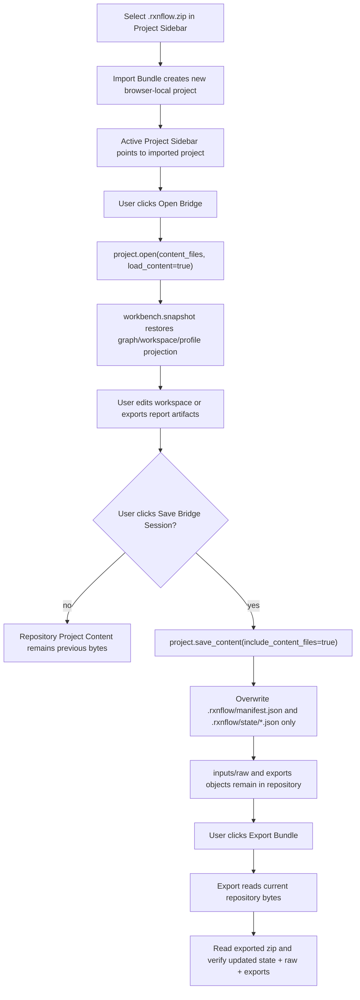

# Web Project Portability Roundtrip

## 0. 术语约定

- **Portability Roundtrip Scenario**：用户从 `.rxnflow.zip` 导入 browser-local project，显式 Open Bridge 恢复 core session，编辑/导出后显式 Save Bridge Session，再 Export Bundle 生成可迁移项目包的完整链路。
- **Imported Browser Project Session Restore**：Import Bundle 成功后，Project Sidebar active project 指向新 browser-local project；只有用户点击 Open Bridge 时，Web 才把 `.rxnflow/manifest.json` 与 `.rxnflow/state/*.json` 作为 `project.open(content_files, load_content=true)` payload 恢复到 core session。
- **Explicit Bridge Sync Boundary**：Web repository 与 core session 之间只通过 Open Bridge / Save Bridge Session 同步；bundle import/export、raw persistence、report artifact persistence 都不自动保存或打开 bridge session。
- **Repository/Core Session Parity Probe**：测试/QA 用证据，核对 Save Bridge Session 后 repository 中 Project Content state 与 core session 改动一致，同时 `inputs/raw/...` 和 `exports/...` 仍保留。
- **Bundle Re-export Evidence**：导出后的 `.rxnflow.zip` 经 Browser Bundle Archive Adapter 读回，证明 zip 内包含更新后的 `.rxnflow/state/*.json`、既有 raw input 与 export artifact bytes。
- **Roundtrip Browser QA**：真实浏览器层的 smoke，用 fixture 或 local-http runtime 走一遍导入、打开、编辑/导出、保存、导出包与布局检查。

术语检索结果：`Browser Bundle Import Action`、`Browser Bundle Export Action`、`Open Bridge`、`Save Bridge Session`、`Web Export Artifact Persistence` 已落地；本 feature 不新增 bundle 格式术语。

## 1. 决策与约束

### 需求摘要

Web 现在已经能持久化 raw inputs、导出 artifacts、导出 `.rxnflow.zip`，也能从安全 `.rxnflow.zip` 创建新的 browser-local project。下一步需要把这些局部能力连成可验证闭环：导入后的 project 能显式 Open Bridge 恢复 Project Content；在 core session 中做图谱/报告导出等改动后，只有显式 Save Bridge Session 才把 `.rxnflow/state/*.json` 写回 repository；随后 Export Bundle 读取 repository 当前 bytes，生成包含更新 state、raw inputs 和 exports 的 `.rxnflow.zip`。

### 明确不做

- 不新增 bundle 格式、allowed roots、manifest schema、Project Content schema 或 archive adapter 安全规则。
- 不实现 autosave、dirty tracking、自动 Save Bridge Session、自动 Open Bridge、后台同步或导出前强制保存。
- 不调用 Python `ProjectBundleService`、`project.import_bundle`、`project.export_bundle`，也不让 Web 前端直接读写本机 filesystem bundle。
- 不新增 cloud、账号、跨设备实时同步、OPFS/chunking、Worker、Service Worker 或持久化权限申请。
- 不实现 bundle 覆盖、合并、冲突解决、部分 rollback 或删除 partial import project。
- 不在浏览器端做 Project Content deep validation、schema migration、raw reparse、对象登记、能量重算或报告文件生成。
- 不在本 feature 写用户指南；指南和完整错误样例留给 `web-project-portability-qa-guides`。

### 复杂度档位

Bridge roundtrip orchestration = L4：同一场景跨 Browser Project Repository、Project Sidebar、ShellClient、Project Content bridge、bundle import/export、report artifact persistence 与 E2E harness。

UI change = L1/L2：优先复用已有 Save Bridge hint 和状态展示；只有测试暴露口径不清时才做小文案修正，不重做视觉。

Repository evidence = L3：需要在测试中直接读取 repository objects 和 zip entries，核对 state 更新、raw/export 保留和 bundle root 安全。

Local-http QA = L4：需要真实浏览器 + 本地 Python bridge 验证，不把 fixture 通过误判成真实 bridge 可用。

### 关键决策

1. **把本 feature 定位为一致性闭环与 QA 加固，不重写 import/export/open/save 实现**：已有 action helper 是权威入口，本 feature 主要补跨动作测试、少量 helper 和必要文案。
2. **显式同步边界不变**：Import Bundle 只恢复 repository bytes；Open Bridge 才创建/恢复 core session；Save Bridge Session 才把 core session content files 写回 repository；Export Bundle 永远只读取 repository 当前 bytes。
3. **保存不得破坏 raw/export objects**：Save Bridge Session 只覆盖 `.rxnflow/manifest.json` 与 `.rxnflow/state/*.json`；`inputs/raw/...` 和 `exports/...` 不应被删除或改写。
4. **导出证据必须读回 zip，而不是只看 UI summary**：roundtrip tests 需要用 Browser Bundle Archive Adapter 或等价 zip reader 检查 `.rxnflow/state/*.json`、`inputs/raw/...`、`exports/...` entries。
5. **E2E 先做窄 smoke，完整矩阵留给 QA/guides**：本 feature 至少覆盖 local-http desktop 主链路；桌面/窄屏全矩阵和用户指南在下一条收口。
6. **保守提示优先于 dirty tracking**：bridge open 时已有 Save Bridge hint 继续保留；不判断“是否真的有未保存改动”，避免引入不准的 dirty state。
7. **测试 fixture 可以生成 bundle，但不能绕开用户路径**：component/E2E 可以用 helper 生成 `.rxnflow.zip`，但导入必须经过 Project Sidebar file input，导出必须经过 Export Bundle button。

### 前置依赖

roadmap `web-raw-input-persistence`、`web-project-bundle-export`、`web-project-bundle-import` 均已 done。`WorkbenchShell` 已有 `openSidebarBridgeSession`、`saveSidebarBridgeSession`、`importSidebarBundleFile` 和 `exportSidebarBundle` 编排。`web/e2e/local-http-bridge.spec.ts` 已覆盖 local-http 基础主链路，但尚未串起 bundle import/export roundtrip。

## 2. 名词与编排

### 2.1 名词层：值对象 / 实体 / 接口契约

**现状**

- `importBrowserProjectBundle` 成功后只创建/激活新 browser-local project，不调用 shell，也不改 `WorkbenchDomainState`。
- `openSidebarBridgeSession` 从 active project 读取 Project Content files，调用 `project.open(content_files, load_content=true)`，再用 `workbench.snapshot` 更新 `WorkbenchDomainState`。
- `saveSidebarBridgeSession` 调用 `project.save_content(include_content_files=true)`，再通过 `saveProjectContent` 覆盖 repository 中 Project Content files。
- `persistExportArtifacts` 会把 runtime report artifacts 写入 `exports/...` 并更新 export artifact index；它不调用 Save Bridge Session。
- `exportBrowserProjectBundle` 只收集 repository 当前 `.rxnflow`、`inputs/raw`、`exports` bytes 并生成 Blob。
- 现有 component tests 分别覆盖 bridge save/open、graph restore、export、import，但没有单个测试核对 imported bundle → open bridge → edit/save → export bundle 的跨层一致性。

**变化**

新增测试/QA 证据契约，不作为生产 API 暴露：

```ts
type WebProjectPortabilityRoundtripStep =
  | "import_bundle"
  | "open_bridge"
  | "edit_workspace_or_export"
  | "save_bridge_session"
  | "export_bundle"
  | "read_exported_bundle"

type RoundtripRepositoryProbe = {
  projectRef: string
  hasRawInput: boolean
  hasExportArtifact: boolean
  workspaceStateChanged: boolean
  projectContentChecksum: `sha256:${string}`
}

type BundleReExportEvidence = {
  fileName: `${string}.rxnflow.zip`
  entryPaths: string[]
  hasUpdatedWorkspaceState: boolean
  hasRawInput: boolean
  hasExportArtifact: boolean
}
```

边界：

- 这些 shape 只服务 tests/E2E helper 或验收报告，不进入 runtime Shell DTO、Project Content schema 或 Browser Project Repository interface。
- 如果实现中不需要显式 type，也必须在测试断言中覆盖同等字段。
- 本 feature 不新增新的 UI state；若补文案，只进入 i18n catalog，不新增持久化字段。

### 2.2 编排层：主流程与控制流



**现状**

- Open Bridge / Save Bridge Session 已能恢复和保存 graph/workspace selection、viewport、active path。
- Report Export artifact persistence 已能把 inline PNG/CDXML/XLSX 写入 `exports/...`，并更新 Project Content export artifact index。
- Bundle Import/Export 分别有独立 UI 与 action tests。
- local-http E2E 已覆盖真实 bridge、inline import preview、workspace、energy、report export，但没有验证 `.rxnflow.zip` 迁移后再次打开。

**变化**

- 增加 roundtrip component tests：用 bundle fixture 导入 project，Open Bridge 恢复 workspace，执行一个可观察 workspace edit 或 report export，Save Bridge Session 后读取 repository，确认 Project Content state 更新且 raw/export objects 未丢，再 Export Bundle 并读回 zip。
- 增加 local-http roundtrip smoke：在真实 bridge runtime 下导入 bundle 或先导出再导入，Open Bridge 后执行现有主链路的一小段，Save Bridge Session，再 Export Bundle，检查 UI summary、console clean 和无水平溢出。
- 如果现有 helper 不方便读导出的 Blob，新增 test-only download capture 或把 `triggerBrowserBundleDownload` 的边界收窄到可 mock；生产行为仍是点击下载。
- 保留现有 Save Bridge hint；若需要改文案，表达“Export uses repository bytes, save bridge first for shell changes”，中英文同步。

**跨层纪律**

- Sync explicitness：所有从 repository 到 core 的恢复只通过 Open Bridge；所有从 core 到 repository 的保存只通过 Save Bridge Session。
- Non-destructive content save：Save Bridge Session 不删除、枚举或覆盖 `inputs/raw/...` 与 `exports/...` objects。
- Bundle export authority：导出的 `.rxnflow.zip` 只以 repository 当前 bytes 为准；测试不能从 `WorkbenchDomainState` 直接拼 zip 作为证据。
- Runtime separation：fixture component tests 验证编排细节，local-http E2E 验证真实 Python bridge；两者证据不互相替代。
- No hidden shell side effect：Import Bundle / Export Bundle 仍不得触发 `project.open`、`project.save_content`、`project.import_bundle`、`project.export_bundle`。
- Download capture hygiene：测试捕获 Blob 或下载文件后要清理临时文件；object URL lifecycle 仍由既有 export tests 守住。

### 2.3 挂载点清单

- WorkbenchShell component roundtrip tests：导入 bundle、Open Bridge、workspace/report 改动、Save Bridge Session、repository probe、Export Bundle zip readback。
- E2E roundtrip harness：扩展 local-http smoke 或新增独立 spec/helper，走真实浏览器用户路径并检查 download/import/export 结果。
- Test bundle/download helpers：生成安全 `.rxnflow.zip` fixture、捕获 Export Bundle Blob/download、读取 bundle entries；只服务 tests。
- Optional Sidebar hint/i18n：仅当现有 Save Bridge hint 不足以表达 repository/core boundary 时微调文案。
- CodeStable architecture/requirement/roadmap acceptance 回写。

不挂入 Python core、ProjectBundleService、local bridge server command set、Browser Project Repository transaction API、Project Content schema、cloud storage、user guide。

### 2.4 推进策略

1. **Roundtrip fixture evidence**：建立测试用 bundle fixture 和导出 Blob/readback helper，复用 Browser Bundle Archive Adapter。
   - 退出信号：测试 helper 能生成含 Project Content state、`inputs/raw/demo.xyz`、`exports/profile.png` 的 `.rxnflow.zip`，并能读回 exported bundle entry paths。
2. **Component roundtrip**：补 WorkbenchShell test 覆盖 import → Open Bridge → workspace edit/report export → Save Bridge Session → repository probe。
   - 退出信号：断言 `project.open` / `project.save_content` payload 正确，Save Bridge 后 workspace state checksum 变化，raw/export objects 仍存在。
3. **Bundle re-export readback**：在 component 层点击 Export Bundle，捕获 Blob 并用 archive adapter 读回。
   - 退出信号：读回 entries 同时包含更新后的 `.rxnflow/state/workspaces.json`、`.rxnflow/state/reaction-graphs.json`、`inputs/raw/demo.xyz` 和 `exports/profile.png` 或新导出 artifact。
4. **Local-http smoke**：扩展 local-http Playwright，走真实 bridge 的 roundtrip 窄链路。
   - 退出信号：`npm run test:e2e:local-http` 通过，console clean、无水平溢出，UI 可见 imported project、Open Bridge、Save Bridge、Bundle ready。
5. **Scope guards and verification**：跑 Web unit/build/E2E，grep 确认没有新增 autosave/cloud/Python bundle command。
   - 退出信号：`npm run test -- --run`、`npm run build`、`npm run test:e2e:local-http` 通过；必要时 fixture E2E smoke 也通过。

## 3. 验收契约

### 关键场景清单

1. 用户从含 `.rxnflow/manifest.json`、Project Content state、`inputs/raw/demo.xyz`、`exports/profile.png` 的 `.rxnflow.zip` 导入，Project Sidebar active project 指向新 project；导入后 `WorkbenchDomainState` 仍未被自动替换。
2. 点击 Open Bridge 后，`project.open` payload 包含导入 project 的 `.rxnflow/manifest.json` 和 `.rxnflow/state/*.json` content files，`load_content=true`；snapshot 恢复 graph/workspace/profile projection。
3. Open Bridge 后执行 workspace edit，例如 viewport、node position、selection/path order 或 report export；在点击 Save Bridge Session 前，Export Bundle 不自动调用 `project.save_content`。
4. 点击 Save Bridge Session 后，Web 调用 `project.save_content(include_content_files=true)`，repository 中 `.rxnflow/state/workspaces.json` / `reaction-graphs.json` 等 Project Content bytes 更新。
5. Save Bridge Session 不删除或覆盖 `inputs/raw/demo.xyz` 与既有 `exports/profile.png`；report export 产生的新 `exports/...` artifact 也能继续留在 repository。
6. Save 后点击 Export Bundle，导出的 zip 被读回后包含一个 bundle root，root 下有更新后的 `.rxnflow/state/*.json`、raw input entry 和 export artifact entry。
7. 重新导入刚导出的 bundle 为新 project 后，再 Open Bridge 能恢复保存后的 workspace/graph 可观察状态。
8. local-http E2E 在真实 Python bridge 下能完成导入 bundle、Open Bridge、工作台操作、Save Bridge Session、Export Bundle，并保持 console clean、无水平溢出。
9. bridge open hint 可见，提示用户导出前需要先 Save Bridge Session 才能包含 shell session 改动；不要求精确 dirty tracking。
10. Import Bundle / Export Bundle 仍不调用 `project.import_bundle`、`project.export_bundle` 或 Python `ProjectBundleService`。
11. 不新增 cloud、autosave、OPFS/chunking、Worker、Service Worker 或 repository transaction API。
12. `npm run test -- --run`、`npm run build` 和 `npm run test:e2e:local-http` 通过。

### 明确不做的反向核对项

- 不自动 Open Bridge、Save Bridge Session 或 Export Bundle 前保存。
- 不在 bundle import/export 中调用 Shell command 或 Python bundle service。
- 不改变 Project Content / Project Manifest / bundle archive schema。
- 不做 deep validation、schema migration、raw reparse、对象登记或能量重算。
- 不实现 bundle merge、overwrite、conflict resolution、cloud sync 或 live storage。
- 不把 Roundtrip evidence shape 暴露为生产 API。

## 4. 与项目级架构文档的关系

Acceptance 阶段需要更新：

- `.codestable/architecture/web-workbench.md`：记录 Web Project Portability Roundtrip 已验证 import/export 与 Open Bridge / Save Bridge Session 的同步边界，以及 local-http roundtrip QA 覆盖。
- `.codestable/architecture/ARCHITECTURE.md`：补充 Web bundle import/export 与 bridge session 的稳定同步纪律。
- `.codestable/requirements/project-content-persistence.md`：补充 Web 用户可通过 `.rxnflow.zip` 手动迁移 project，并在导入后显式 Open Bridge / Save Bridge Session 保持 core session 与 repository 同步。
- roadmap items/main doc：验收时标记 `web-project-portability-roundtrip` done，保持 `web-project-portability-qa-guides` planned。

用户指南仍在 `web-project-portability-qa-guides` 统一补；本 feature acceptance 只落架构、需求和 QA 证据。
